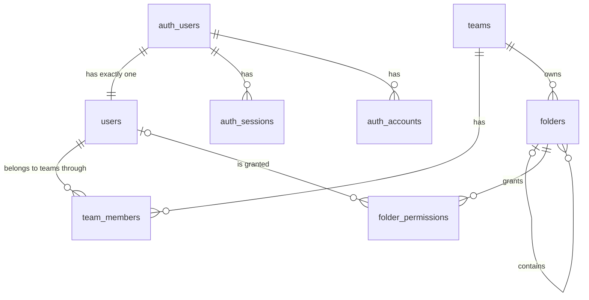

# Self-hosted cloud storage platform

A cloud storage platform that schools, clubs, and small companies run on their own server: upload, organize, search, and share files, and use them offline. School project of HTL Villach, class 5BHITM, subject ITP (project 1), built by a team of four.

The project goal, its target users, and its non-goals are in [gam-ai-knowledge/GOAL.md](gam-ai-knowledge/GOAL.md).

## Status

Early scaffold. What exists today:

- a pnpm and Turborepo workspace with the five units in `apps/` and the shared packages in `packages/`; the Next.js application is the `web` unit in `apps/web/` (App Router, React, Tailwind CSS, Biome), the other units are empty; the shared package `packages/db` holds the relational schema (Prisma 8), its migrations, and the seed data
- a `docker-compose.yml` that starts PostgreSQL 18, Redis, MongoDB, CouchDB, SeaweedFS, ClamAV, Mailpit, a Caddy reverse proxy, and the `web` unit; the other four units join when their code runs
- the project documentation in `gam-ai-knowledge/`

Everything else in the architecture below is planned. The current state of every feature is in [gam-ai-knowledge/ROADMAP.md](gam-ai-knowledge/ROADMAP.md) and [gam-ai-knowledge/ROADMAP-DETAILS.md](gam-ai-knowledge/ROADMAP-DETAILS.md).

## Quick start

Requirements: Docker with Docker Compose, Node.js 24 LTS, and pnpm.

```bash
# 1. configuration: copy the example and set your own values
cp .env.example .env

# 2. start the stack (data services, mail catcher, reverse proxy, web)
docker compose up -d

# 3. install, create the tables, add the local test data, start the web application
pnpm install && pnpm db:migrate && pnpm db:seed
pnpm --filter @stash/web dev
```

The stack serves the web application at <http://localhost:8080> (`PROXY_PORT`) and catches all e-mail in Mailpit at <http://localhost:8025>. The first start takes a few minutes. All settings come from `.env`; OAuth and captcha are off there, so the stack starts offline once the images are present. Step 3 runs the web application with hot reload at <http://localhost:3000>; `pnpm db:migrate` and `pnpm db:seed` build the database connection `DATABASE_URL` from the PostgreSQL values in `.env` with the host `localhost`.

Checks:

```bash
pnpm run lint                                  # Biome check of every package, through Turborepo
pnpm run typecheck                             # TypeScript check of every package
pnpm run build                                 # build of every package
pnpm test                                      # tests of every package, including the acceptance tests of the repository
pnpm dev                                       # the dev task of every package (watch mode), through Turborepo
node gam-ai-knowledge/tools/doc-check.mjs      # consistency check of the documentation
npx markdownlint-cli2 "gam-ai-knowledge/**/*.md" # markdown lint
node gam-engineering/tools/prompt-export.mjs install-hook # once per clone: activates the AI chat export hook
```

## Start without internet access

The school requires that the application starts locally without internet access. What that needs today:

1. Prepare once while online: `docker compose pull`, `docker compose build web`, and `pnpm install` (fills the local pnpm store).
2. Afterwards, offline: `docker compose up -d`, `pnpm install --offline`, then start the web application as in the quick start.
3. To check it, start the stack with `docker/compose.offline-check.yml` on top: both networks become internal, so no container reaches the internet, and every service must become healthy (SCF-T-8; the commands are in the file).
4. Settings that decide whether a feature may use the internet live in `.env` and are never hard-coded. Features that need the internet (login with GitHub, Google, or Microsoft, bot protection) must be switchable off there; they arrive with the identity feature (R3, [ROADMAP.md](gam-ai-knowledge/ROADMAP.md)).

Known gap: the starter layout loads its fonts through `next/font/google`, which fetches them at build time. A build without internet fails until the fonts are bundled locally.

## Architecture overview

The target architecture is five separately running units behind one reverse proxy, one per area of the team ([ADR-0001](gam-ai-knowledge/adr/0001-five-units-behind-one-origin.md)). The browser reaches `web`, `identity`, `storage`, and `cms` under one origin; `worker` is internal.


| Area | Unit | Planned content |
| --- | --- | --- |
| Identity & sharing | `identity` | registration, login, multi-factor authentication, teams, roles, permissions, share links, quotas, audit log |
| Storage engine & processing | `storage`, `worker` | storage API, resumable uploads, deduplication, thumbnails, virus scan, text recognition, search |
| Web client & design system | `web` | file browser, preview, themes, accessibility modes |
| Offline, content & observability | `cms` | installable offline web app, landing page, help center, changelog, metrics, logs, traces |

The planned technology is listed in the project proposal ([docs/projektantrag.md](docs/projektantrag.md)); binding choices and versions are recorded in [gam-ai-knowledge/STACK.md](gam-ai-knowledge/STACK.md) as they are made. The units share their data shapes through one contracts package.

## Data model

The relational schema as it stands, defined in `packages/db` (Prisma 8) and drawn with every column in [gam-ai-knowledge/concepts/scaffolding.md](gam-ai-knowledge/concepts/scaffolding.md) §8, "Relational data model" (story `SCF-US-4`). Table names are plural, as the SQL style guide of the school demands. The application's own `users` table is in a 1:1 relation to the user table of the authentication library: the database creates the `users` row with every auth user. Files, share links, quotas, and the audit log join with their features. The diagram drawn in Vertabelo follows as an export (open human step).



`auth_verifications` (e-mail confirmation and reset tokens of the authentication library) has no relation.

## Operation and deployment

What exists today and what is planned (`gam-ai-knowledge/ROADMAP.md`, R14 *Deployment*):

| Topic | Today | Planned |
| --- | --- | --- |
| Start | `docker compose up -d` starts PostgreSQL and MongoDB; the web application is started by hand | One command starts every unit, the reverse proxy, and the databases |
| Configuration | Variables in `.env` (copy of `.env.example`, never committed) | The same, for every unit |
| Data | Named Docker volumes `postgres-data`, `postgres-etc`, `mongo-data`, and `mongo-config` | Backup and restore notes with the deployment |
| Deployment | None | The GitLab CI pipeline deploys the whole stack to the team's own server when `main` is updated, TLS terminated by the reverse proxy |
| Monitoring | None | Metrics, logs, and traces in Prometheus, Loki, Tempo, and Grafana (R2) |

Releases are tagged `v<version>` on `main` and published as GitLab Releases; the rules are in [gam-ai-knowledge/WORKFLOW.md](gam-ai-knowledge/WORKFLOW.md), section *Releases*.

## Code quality scan

The repository is scanned locally into a SonarQube server that every project on the developer's computer shares; the server itself is not part of this repository (`gam-ai-knowledge/STACK.md`, section 3).

1. Start the shared server (`docker compose up -d` in its folder) and open <http://localhost:9000>.
2. Create a token (*My Account → Security*) and write it into `.env.sonar`, a copy of `.env.sonar.example`. The file is never committed.
3. Run `pnpm sonar`. It scans under the project key `stash` (`sonar-project.properties`) and fails when the quality gate fails.

## Documentation

| Where | What |
| --- | --- |
| [gam-ai-knowledge/GOAL.md](gam-ai-knowledge/GOAL.md) | Project goal, target users, success signals, non-goals |
| [gam-ai-knowledge/ROADMAP.md](gam-ai-knowledge/ROADMAP.md) | Features in dependency order, with owner and stage |
| [gam-ai-knowledge/concepts/](gam-ai-knowledge/concepts/) | One concept document per feature |
| [gam-ai-knowledge/work-items/](gam-ai-knowledge/work-items/) | User stories with their acceptance criteria |
| [gam-ai-knowledge/adr/](gam-ai-knowledge/adr/) | Decision records |
| [gam-ai-knowledge/WORKFLOW.md](gam-ai-knowledge/WORKFLOW.md) | Branches, commits, merge requests, Definition of Done, releases |
| [gam-ai-knowledge/team/TEAM.md](gam-ai-knowledge/team/TEAM.md) | Team members, roles, ownership |
| [docs/](docs/) | The school's binding requirements and the project proposal |

## Definition of Done

The Definition of Done is binding for every issue and merge request: [gam-ai-knowledge/WORKFLOW.md](gam-ai-knowledge/WORKFLOW.md), section *Definition of Done*. It is kept only there so that it cannot drift; a merge request is merged only when every item holds.

## Working on the project

Every change starts with an issue, happens on its own branch, and reaches `dev` through a merge request reviewed by another person; `main` only receives releases. The rules are in [gam-ai-knowledge/WORKFLOW.md](gam-ai-knowledge/WORKFLOW.md), the commands in [docs/git_workflow_commands.md](docs/git_workflow_commands.md). Sessions with Claude Code start with `/gam-engineering` ([CLAUDE.md](CLAUDE.md)).

## Licence notes

The repository is public, so all content must be licence-free. Licences of what the project uses today (the licence of a dependency is the one it declares; check again when a version changes):

| Component | Licence | Use |
| --- | --- | --- |
| Next.js, React, Tailwind CSS (`@tailwindcss/postcss`, `@tailwindcss/vite`) | MIT | web application; `@tailwindcss/vite` builds the styles of Storybook |
| Radix UI (`radix-ui`) | MIT | accessible primitives of the design system (`@stash/ui`) |
| Storybook (`storybook`, `@storybook/react-vite`), Vite | MIT | component documentation of the design system (`packages/ui`) |
| Zod, zod-to-openapi (`@asteasolutions/zod-to-openapi`) | MIT | shared contracts and the generated API description (`packages/contracts`) |
| dotenv | BSD-2-Clause | reads the `.env` file in `packages/db` |
| Prisma | Apache-2.0 | database access, schema, and migrations (`packages/db`) |
| node-postgres (`pg`) | MIT | seed command and database tests of `packages/db` |
| TypeScript | Apache-2.0 | language |
| Biome | MIT or Apache-2.0 | lint and format |
| pnpm, Turborepo | MIT | package manager and task runner |
| commitlint | MIT | checks commit messages |
| yaml | ISC | reads the CI configuration in tests and scripts |
| Playwright | Apache-2.0 | browser tests |
| `@axe-core/playwright` | MPL-2.0 | accessibility tests |
| PostgreSQL 18 (Docker image) | PostgreSQL Licence | relational database, runs as a container |
| MongoDB 8.0 (Docker image) | SSPL | metadata database, runs as a container; not part of the delivered source |
| Redis 8.8 (Docker image) | RSALv2, SSPLv1, or AGPLv3, at the user's choice | sessions and cache, runs as a container |
| CouchDB 3.5 (Docker image) | Apache-2.0 | offline sync database, runs as a container |
| SeaweedFS 4.51 (Docker image) | Apache-2.0 | object storage, runs as a container |
| ClamAV 1.5 (Docker image) | GPL-2.0 | virus scanner, runs as a container; not part of the delivered source |
| Mailpit 1.32 (Docker image) | MIT | catches all outgoing e-mail of the local stack |
| Caddy 2.11 (Docker image) | Apache-2.0 | reverse proxy of the local stack |
| Node.js 24 (Docker image) | MIT | runs the configuration step of the observability profile as a container |
| OpenTelemetry Collector 0.164 (Docker image) | Apache-2.0 | receives, cleans, and routes telemetry; runs as a container of the observability profile |
| Prometheus 3.15 (Docker image) | Apache-2.0 | metric store of the observability profile, runs as a container |
| Loki 3.7 (Docker image) | AGPL-3.0 | log store of the observability profile, runs as a container; not part of the delivered source |
| Tempo 2.10 (Docker image) | AGPL-3.0 | trace store of the observability profile, runs as a container; not part of the delivered source |
| Grafana 13.2 (Docker image) | AGPL-3.0 | dashboard tool of the observability profile, runs as a container; not part of the delivered source |
| BusyBox 1.38 (Docker image) | GPL-2.0 | one static binary copied into the Loki, Tempo, and collector images, so their health checks can run; not part of the delivered source |
| Geist and Geist Mono fonts | SIL Open Font Licence 1.1 | loaded by the starter layout |
| `next.svg` and `vercel.svg` in `apps/web/public/` | logos of Vercel (third party), shipped with the Next.js starter | **to be replaced** by own assets before the final submission; `file.svg`, `globe.svg`, and `window.svg` of the starter are unused and to be deleted |

Open points: MongoDB's SSPL is not an OSI-approved licence, so the team decides whether the proposal's choice stays (issue #110); third-party content added later is entered here when it is added.
