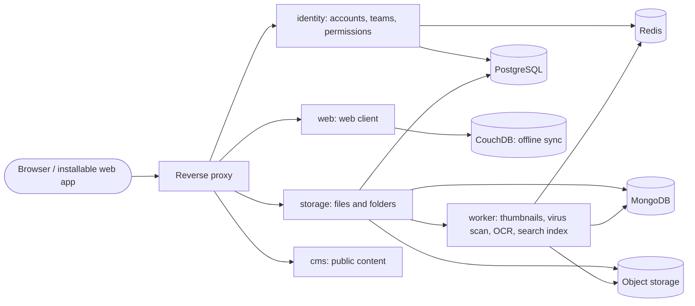

# Self-hosted cloud storage platform

A cloud storage platform that schools, clubs, and small companies run on their own server: upload, organize, search, and share files, and use them offline. School project of HTL Villach, class 5BHITM, subject ITP (project 1), built by a team of four.

The project goal, its target users, and its non-goals are in [documentation/GOAL.md](documentation/GOAL.md).

## Status

Early scaffold. What exists today:

- a Next.js application in `next/` (App Router, React, Tailwind CSS, Biome, Prisma)
- a `docker-compose.yml` that starts PostgreSQL 18 and MongoDB 8
- the project documentation in `documentation/`

Everything else in the architecture below is planned. The current state of every feature is in [documentation/ROADMAP.md](documentation/ROADMAP.md) and [documentation/ROADMAP-DETAILS.md](documentation/ROADMAP-DETAILS.md).

## Quick start

Requirements: Docker with Docker Compose, Node.js 24 LTS, and pnpm.

```bash
# 1. configuration: copy the example and set your own values
cp .env.example .env

# 2. start the databases (PostgreSQL 18, MongoDB 8)
docker compose up -d

# 3. start the web application
cd next
pnpm install
pnpm dev
```

The web application then runs at <http://localhost:3000>. It reads the database connection from `DATABASE_URL`; put that variable into `next/.env`, matching the PostgreSQL values of step 1.

Checks:

```bash
cd next && pnpm lint                            # Biome check of the application
node tools/doc-check.mjs documentation          # consistency check of the documentation
npx markdownlint-cli2 "documentation/**/*.md"   # markdown lint
```

### Start without internet access

The school requires that the application starts locally without internet access. What that needs today:

1. Prepare once while online: `docker compose pull` (PostgreSQL and MongoDB images) and `pnpm install` (fills the local pnpm store).
2. Afterwards, offline: `docker compose up -d`, `pnpm install --offline`, then start the web application as in the quick start.
3. Settings that decide whether a feature may use the internet live in `.env` and are never hard-coded. Features that need the internet (login with GitHub, Google, or Microsoft, bot protection) must be switchable off there; they arrive with the identity feature (R3, [ROADMAP.md](documentation/ROADMAP.md)).

Known gap: the starter layout loads its fonts through `next/font/google`, which fetches them at build time. A build without internet fails until the fonts are bundled locally.

## Architecture overview

The target architecture is five separately running units behind one reverse proxy, one per area of the team ([ADR-0001](documentation/adr/0001-five-units-behind-one-origin.md)). The browser reaches `web`, `identity`, `storage`, and `cms` under one origin; `worker` is internal.



| Area | Unit | Planned content |
| --- | --- | --- |
| Identity & sharing | `identity` | registration, login, multi-factor authentication, teams, roles, permissions, share links, quotas, audit log |
| Storage engine & processing | `storage`, `worker` | storage API, resumable uploads, deduplication, thumbnails, virus scan, text recognition, search |
| Web client & design system | `web` | file browser, preview, themes, accessibility modes |
| Offline, content & observability | `cms` | installable offline web app, landing page, help center, changelog, metrics, logs, traces |

The planned technology is listed in the project proposal ([docs/projektantrag.md](docs/projektantrag.md)); binding choices and versions are recorded in [documentation/STACK.md](documentation/STACK.md) as they are made. The units share their data shapes through one contracts package.

## Documentation

| Where | What |
| --- | --- |
| [documentation/GOAL.md](documentation/GOAL.md) | Project goal, target users, success signals, non-goals |
| [documentation/ROADMAP.md](documentation/ROADMAP.md) | Features in dependency order, with owner and stage |
| [documentation/concepts/](documentation/concepts/) | One concept document per feature |
| [documentation/work-items/](documentation/work-items/) | User stories with their acceptance criteria |
| [documentation/adr/](documentation/adr/) | Decision records |
| [documentation/WORKFLOW.md](documentation/WORKFLOW.md) | Branches, commits, merge requests, Definition of Done, releases |
| [documentation/team/TEAM.md](documentation/team/TEAM.md) | Team members, roles, ownership |
| [docs/](docs/) | The school's binding requirements and the project proposal |

## Working on the project

Every change starts with an issue, happens on its own branch, and reaches `dev` through a merge request reviewed by another person; `main` only receives releases. The rules are in [documentation/WORKFLOW.md](documentation/WORKFLOW.md), the commands in [docs/git_workflow_commands.md](docs/git_workflow_commands.md). Sessions with Claude Code start with `/engineering-human` ([CLAUDE.md](CLAUDE.md)).

## Licence notes

The repository is public, so all content must be licence-free. Licence notes for third-party content and dependencies are collected here as they are added; so far the project contains only the default assets of the Next.js starter in `next/public/`.
