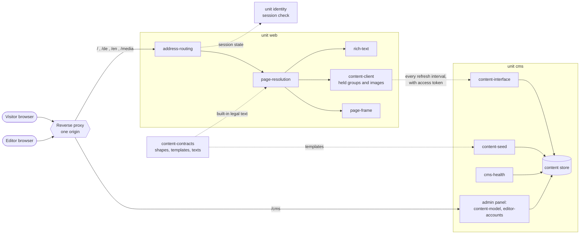
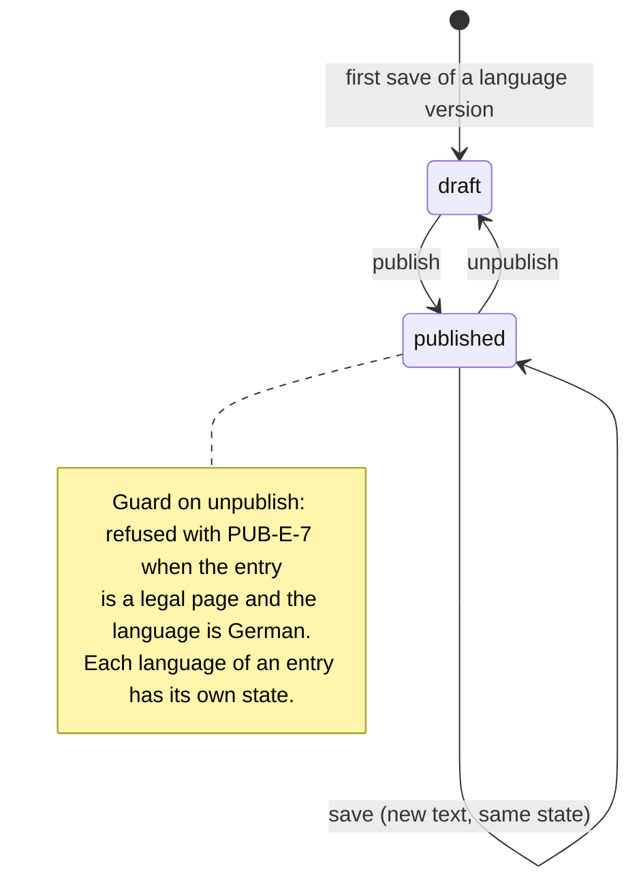
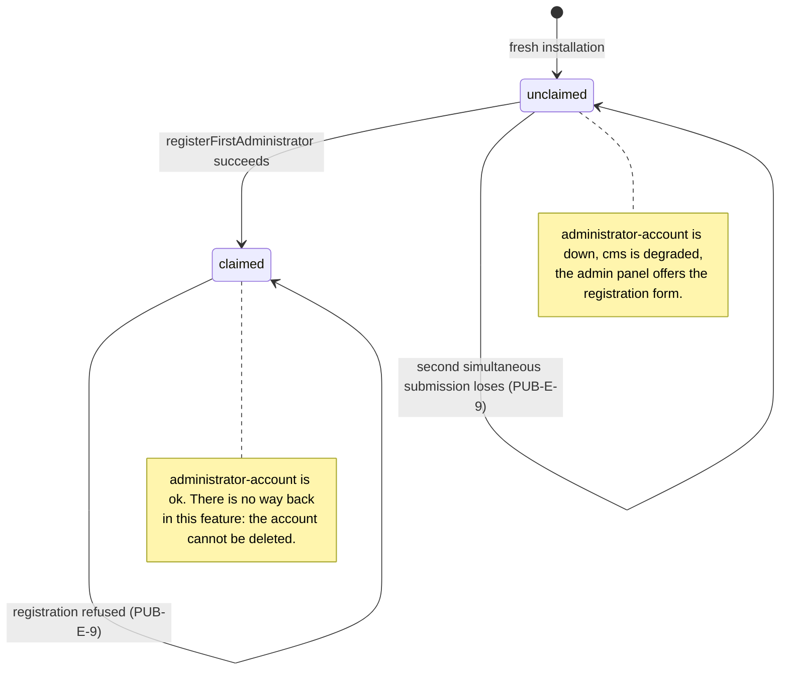
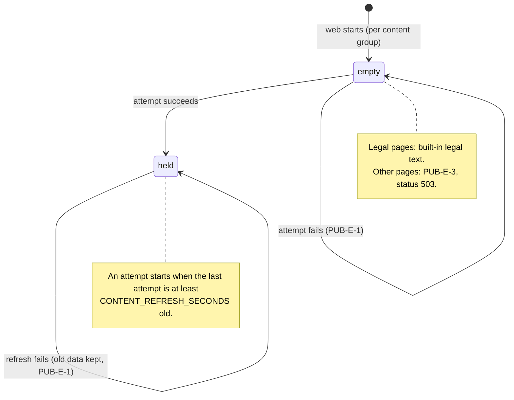

# Public content: landing page, help center, changelog, legal pages Concept

The specification of roadmap feature R11: the pages anyone reads without an account, and the way content editors maintain them. It is written for the feature's owner (trutscf1), its reviewers, and the agents that will implement it. Part H is the plain-language view; Part S is binding.

# Part H — For Human Readers

This part adds no rule. It summarizes Part S and cites its IDs; where the two disagree, Part S wins (P-HUM-3).

## H1. In one sentence

Visitors and members read the landing page, the help center, the changelog, and the legal pages without logging in, and content editors maintain them without touching code. This serves success signal `G-1.S3` (scope of the project application), because the application promises exactly these pages, maintained through a content management system.

## H2. Who benefits and how

- **Visitor (`R-4`)**: sees what the product offers, can read help, changelog, and the three legal pages, in German or English, and finds the way to registration and login.
- **Member (`R-1`)**: reaches the help article that fits the place in the app they came from, and sees what each release changed.
- **Content editor (`R-5`)**: changes any public page in the admin panel; the change is public within a minute.
- **Operator (`R-2`)**: gets legal pages that exist from the first start, as templates to fill in, and sees on the status page, with the reason named, when nobody has claimed the admin panel yet.

## H3. How it works, step by step

1. The operator starts the system. Example content for every page is created in German and English ([PUB-AC-1.5] seed content). The legal pages hold templates with placeholders and say so in their first sentence ([PUB-AC-4.6] legal templates).
2. The status page shows the content unit as `degraded` and names the reason `administrator-account` until the first person registers as CMS administrator in the admin panel ([PUB-AC-1.7] unclaimed administrator). After that, only an administrator creates further editor accounts.
3. A visitor opens the address of the installation and lands on the landing page in German or English, chosen by their browser ([PUB-AC-5.2] first visit). A signed-in member lands on the dashboard instead ([PUB-AC-2.6] signed-in member).
4. From every page, the footer leads to imprint, terms, and privacy policy ([PUB-AC-4.1] footer links); a language switch opens the same page in the other language ([PUB-AC-5.1] language in the address).
5. In the help center, articles are grouped by category and can be searched ([PUB-AC-3.1] help articles). A help link inside the app opens the article assigned to that place ([PUB-AC-3.3] contextual help).
6. An editor changes an entry and publishes it. Within 60 seconds the public page shows the change ([PUB-AC-1.4] cached delivery).
7. If the content unit is down, every page keeps showing what it showed last, including its images ([PUB-AC-1.6] CMS unavailable, [PUB-F-32] images through `web`). Legal pages are shown even if content was never loaded, from a text built into the product ([PUB-AC-4.5] built-in legal text).

## H4. What it deliberately does not do

- It does not translate the app itself; only the public pages are in two languages (§12).
- It does not copy `CHANGELOG.md` into the changelog page; editors write one entry per release by hand (§13, Q2).
- It does not let editors sign in with their member account; editor accounts are separate (§13, Q5).
- It does not track visitors and loads nothing from the internet ([PUB-NF-2] no internet requests, [PUB-NF-3] no tracking).
- It sells nothing: the terms page is a legal text, not a price list (`G-1.N3`).

## H5. How it is built, in plain words

The content lives in the `cms` unit as content entries: landing-page sections, help categories and articles, changelog entries, three legal pages, and images with their source and licence (§8). The `web` unit reads published entries, keeps the last version of every page with its images, and renders the public pages. The feature touches ten existing parts of the system (§14); four of them need a change in another document (§15): a fresh installation may start as `degraded`, the status page names failed checks, the Identity concept supplies the captcha notice, and each release gets a step for the changelog entry. The code is split into two units and one shared package (§16). In the `cms` unit, five modules keep the content and its rules (`content-model`, `editor-accounts`, `content-interface`, `content-seed`, `cms-health`). In the `web` unit, five modules read, route, render, and frame the pages (`content-client`, `address-routing`, `rich-text`, `page-resolution`, `page-frame`). `content-client` asks the `cms` unit again whenever the last attempt is at least `CONTENT_REFRESH_SECONDS` old (at most 60 seconds), and it keeps the last good version of every group and all images, which is why the pages survive a stopped `cms` unit. Two things keep state: each language version of an entry is a draft or published (a German legal page can never go back to draft), and an installation is unclaimed until the first administrator registers ([PUB-F-6] refresh interval, [PUB-F-8] last version, [PUB-F-24] fixed legal pages, [PUB-F-10] first administrator). The work is cut into seven slices of about 3 hours each; the first three build the `cms` unit and the delivery by `web`, the other four add one story each.

## H6. How we know it works

n/a — the test concept (§17) is written in Phase 6; until then every acceptance criterion has at least one requirement in §4–§6.

## H7. Key decisions

| Question | Decision | Reason |
| --- | --- | --- |
| Q2 Changelog source | Editors write changelog entries by hand | The project application promises a changelog maintained in the CMS |
| Q3 CMS unavailable | Last version of every page, plus a built-in text for legal pages | Legal pages must always be reachable (school rule) |
| Q4, Q7, Q9 Languages | German and English as an own story (Should); German is default and fallback | English must not delay the German legal pages |
| Q5 Editor access | Admin panel through the proxy, with separate editor accounts | Editors work from any browser; no dependency on Identity (R3) |
| Q6 Legal texts | Templates with placeholders | Every operator is responsible for their own installation |
| Q8, Q10 First administrator | The first visitor of the admin panel registers; the status page warns until then | Decided by the owner; the warning makes the open time visible |
| Q28 Unpublished legal page | The German version of a legal page cannot be unpublished | Otherwise an editor could make a legal page disappear |
| Q17 Fresh stack is degraded | A fresh installation may show `cms` as `degraded` until an administrator registers | Keeps the warning of Q10 without a second way to create an administrator |
| Q18 Reason on the status page | The status page names the checks that failed | `degraded` alone does not tell the operator what to do |
| Q19 Changelog at a release | Writing the changelog entry is a release step; the seed keeps one entry | Follows Q2: entries are written by hand |

# Part S — Specification (normative)

## 0. Synthesis Context

### Development Path

Path A (frontloaded). Phase 1 (grill) and Phase 3 (artifact interactions) were completed on 2026-10-06. From Phase 2, the legal questions Q12–Q14 are still open with the school management (§13); they concern the content of the team's own installation, not the behavior specified here. The Phase 4 gate was passed with the approval of `schwaigc`; §16 (Phase 5) and §17 (Phase 6) were written on 2026-10-20 with the assumptions A37 to A54 of the question log, which the owner reviews.

### Synthesis Dependencies

- [scaffolding.md](scaffolding.md) — the `cms` and `web` units, the reverse proxy, the health report, the status page, the content management capability [SCF-C-5].
- [design-system.md](design-system.md) — design tokens and themes of the public pages (story DSA-US-1).
- [identity.md](identity.md) — the member session ([PUB-F-12], [PUB-F-33]) and the bot protection with its notice text ([PUB-F-23]).

### Synthesis Scope

The `cms` and `web` parts of this feature, the content contracts, and the setup guide step can be synthesized from this document, the work items, `STACK.md`, and the dependencies above: the modules and slices are in §16, the tests in §17. Not specified here, and stubbed in the tests: the session check and the bot protection notice (Identity concept), the address of the dashboard, the registration page, and the login page (configuration values with placeholder defaults, §8).

### Owner

trutscf1, per [ROADMAP.md](../ROADMAP.md).

## 1. Purpose & Goal Trace

**Feature goal:** Visitors and members read landing page, help center, changelog, and legal pages without login, and editors maintain them without code.

**Serves:** `G-1.S3` in [GOAL.md](../GOAL.md), as stated in the *Serves* column of [ROADMAP.md](../ROADMAP.md): the project application lists a public landing page, a help center, and a changelog maintained through a headless content management system; the legal pages are a school rule (`docs/anforderungen_software_projekte.md`, section 13). No non-goal is touched: the terms page sells nothing (`G-1.N3`).

## 2. Ubiquitous Language & Context

Defined in [CONTEXT.md](../CONTEXT.md) and used here exactly: **unit**, **health report**, **dependency check**, **public page**, **legal page**, **content entry**, **content language**, **editor account**, **CMS administrator**, **help context**, **legal template**, **built-in legal text**.

Used only in this document:

- **Admin panel**: the part of the `cms` unit in which content editors sign in and maintain content entries.
- **Content interface**: the part of the `cms` unit from which the `web` unit reads published content entries.
- **Publish**: to change a content entry from draft to published in one content language.
- **Content store**: the database of the `cms` unit that holds the content entries and the editor accounts ([PUB-F-1]).
- **Content group**: one of four sets of published content entries that the `web` unit loads and holds together: `landing` (sections and their images), `help` (categories and articles), `changelog`, `legal` (§16).
- **Held content**: the last successfully loaded version of a content group and its image files in the `web` unit; the "last version" of [PUB-F-8].
- **Fixed text**: a text of the public pages that belongs to the web client and not to a content entry (§8).

## 3. User Stories & Acceptance Criteria

The user stories and their acceptance criteria are the work items in [work-items/public-content/](../work-items/public-content/feature.md); they are not repeated here (P-DOC-6).

## 4. Functional Requirements

| ID | Title | Requirement | Derives from |
| --- | --- | --- | --- |
| PUB-F-1 | Own content store | The `cms` unit MUST keep all content entries and editor accounts in a database of its own, which no other unit reads or writes. | PUB-AC-1.1 (CMS container) |
| PUB-F-2 | Content types | The `cms` unit MUST offer exactly the content types of §8: landing section, help category, help article, changelog entry, legal page, image. | PUB-AC-1.2 (Content types) |
| PUB-F-3 | Two roles | The `cms` unit MUST have exactly two roles. An editor MUST be able to create, edit, publish, and unpublish every content entry, within the limits of [PUB-F-24] (fixed legal pages). A CMS administrator MUST be able to do the same and to create and delete editor accounts. An editor MUST NOT be able to create or delete editor accounts. | PUB-AC-1.3 (Editor roles) |
| PUB-F-4 | No anonymous access | The admin panel MUST be reachable under the proxy path prefix of `cms` and MUST show a person without an editor session only the login form. The content interface MUST answer only requests that carry the access token of the `web` unit and MUST refuse all others with [PUB-E-2] (unauthorized content request). | PUB-AC-1.3 (Editor roles) |
| PUB-F-5 | Draft and published | A content entry MUST be either draft or published, separately per content language. Public pages MUST show only published versions. | PUB-AC-1.4 (Cached delivery) |
| PUB-F-6 | Refresh interval | The `web` unit MUST show a published, changed, or unpublished content entry on its public page at most `CONTENT_REFRESH_SECONDS` seconds after the editor's action (configuration value, default 60). | PUB-AC-1.4 (Cached delivery), PUB-AC-4.4 (Maintained in the CMS) |
| PUB-F-7 | Seed on first start | When the `cms` unit starts and holds no content entry, it MUST create the seed content of §8 in German and English, all published. When it holds at least one content entry, it MUST NOT create, change, or delete any. | PUB-AC-1.5 (Seed content) |
| PUB-F-8 | Last version | When the content interface does not answer, the `web` unit MUST show every public page in the version it loaded last, as described in [PUB-E-1] (CMS unreachable). | PUB-AC-1.6 (CMS unavailable) |
| PUB-F-9 | Administrator check | The health report of `cms` MUST contain the non-essential dependency check `administrator-account`. It MUST be `down` while no CMS administrator exists and `ok` otherwise. | PUB-AC-1.7 (Unclaimed administrator) |
| PUB-F-10 | First administrator | While no CMS administrator exists, the admin panel MUST show a registration form; the first person who submits it becomes CMS administrator. Once one exists, the admin panel MUST NOT offer registration. | PUB-AC-1.7 (Unclaimed administrator) |
| PUB-F-11 | Landing page | The `web` unit MUST show the landing page at `/de` and `/en` to a person without a session. It MUST consist of the published landing sections in the order the editor set. | PUB-AC-2.1 (Public and from the CMS) |
| PUB-F-12 | Signed-in member | When a person with a valid member session opens `/`, `/de`, or `/en`, the `web` unit MUST redirect them to the dashboard. | PUB-AC-2.6 (Signed-in member) |
| PUB-F-13 | Source and licence | The `cms` unit MUST refuse to save an image without a source and a licence with [PUB-E-4] (image without licence). It does not judge the licence itself: using only licence-free images is the duty of the content editor. Every image of the seed content MUST be licence-free. Icons that are part of the web client MUST be listed with source and licence in the licence notes of the README ([SCF-F-28] of [scaffolding.md](scaffolding.md)). | PUB-AC-2.3 (Licence-free media) |
| PUB-F-14 | Call to action | A landing section of kind `call-to-action` MUST show one link to the registration page and one to the login page. The seed content MUST contain one such section. | PUB-AC-2.4 (Call to action) |
| PUB-F-15 | Meta tags | Every public page MUST carry a title, a description, and the Open Graph properties title, description, type, and address. Title and description come from the content entry; if a description is empty, the description of the first landing section of kind `hero` is used. | PUB-AC-2.5 (Meta tags) |
| PUB-F-16 | Help by category | The start page of the help center MUST list every help category that has at least one published article, in the editor's order, each with the titles of its published articles, ordered alphabetically by title in the content language shown, ignoring upper and lower case. A help article counts as published only if its German version is published ([PUB-F-29]). Each title MUST link to the article's page. | PUB-AC-3.1 (Help articles) |
| PUB-F-17 | Help search | The help center MUST offer a search field. A search term of at least 2 characters MUST return every published help article of the current content language whose title or text contains the term, ignoring upper and lower case, titles matching first. | PUB-AC-3.1 (Help articles) |
| PUB-F-18 | Changelog order | The changelog page MUST show every published changelog entry with version, release date, title, and text, ordered by release date, newest first; entries with the same date are ordered by version, highest first. | PUB-AC-3.2 (Changelog page) |
| PUB-F-19 | Contextual help | The address `/<language>/help/context/<help context>` MUST redirect to the published help article assigned to that help context. If none is assigned, it MUST redirect to the start page of the help center ([PUB-E-6], unknown help context). A help context MUST be assigned to at most one help article. | PUB-AC-3.3 (Contextual help) |
| PUB-F-20 | Help and changelog public | The help center, every help article, and the changelog page MUST be shown to a person without a session. | PUB-AC-3.4 (Public) |
| PUB-F-21 | Footer links | Every page of the `web` unit, including login and registration, MUST show a footer with links to imprint, terms, and privacy policy. The three legal pages MUST be shown to a person without a session. | PUB-AC-4.1 (Footer links) |
| PUB-F-22 | Privacy content | The legal template of the privacy policy MUST contain one paragraph per kind of personal data the product stores (member accounts, editor accounts, uploaded files, audit log with IP addresses, IP addresses kept for the login rate limit) and one per service outside the installation that can be switched on (bot protection, each external login provider, e-mail delivery), each naming the data and its purpose. | PUB-AC-4.2 (Privacy content) |
| PUB-F-23 | Captcha notice | On every page that runs bot protection with a hidden badge, the `web` unit MUST show the notice text that the provider of the bot protection prescribes. When bot protection is switched off by configuration, it MUST NOT show the notice. The text is specified with the bot protection in the Identity concept (R3). | PUB-AC-4.3 (Captcha notice) |
| PUB-F-24 | Fixed legal pages | Exactly three legal pages MUST exist, with the kinds `imprint`, `terms`, and `privacy`. An editor MUST be able to edit them and MUST NOT be able to create a fourth or delete one. The German version of a legal page MUST stay published: the `cms` unit MUST refuse an attempt of either role to unpublish it with [PUB-E-7] (legal page must stay published). The English version MAY be unpublished ([PUB-F-29], missing translation). | PUB-AC-4.1 (Footer links), PUB-AC-4.4 (Maintained in the CMS) |
| PUB-F-25 | Built-in legal text | When the `web` unit has never loaded a legal page from the content interface, it MUST show the built-in legal text of that page in the requested content language. | PUB-AC-4.5 (Built-in legal text) |
| PUB-F-26 | Legal templates | The seed content and the built-in legal text of each legal page MUST be the same legal template. It MUST mark every value the operator has to supply as `[[name of the value]]` and MUST start with the template notice of §8. | PUB-AC-4.6 (Legal templates) |
| PUB-F-27 | Language in the address | The address of every public page MUST start with the content language, `/de` or `/en`, and the page MUST be shown in that language. | PUB-AC-5.1 (Language in the address) |
| PUB-F-28 | First visit | When a person without a session opens `/`, the `web` unit MUST redirect to `/en` if the first language the browser prefers among German and English is English, and to `/de` in every other case. | PUB-AC-5.2 (First visit) |
| PUB-F-29 | Missing translation | When a content entry has no published English version, its page under `/en` MUST show the published German version together with the note of [PUB-U-4] (translation note). When a help article has no published German version, its page MUST behave as [PUB-E-5] (page not found) in both languages. A landing section or a changelog entry without a published German version MUST be left out of its page in both languages. A legal page always has a published German version ([PUB-F-24], fixed legal pages). | PUB-AC-5.3 (Missing translation) |
| PUB-F-30 | Separate language versions | The admin panel MUST let an editor edit and publish the German and the English version of a content entry separately; publishing one MUST NOT change the other. | PUB-AC-5.4 (Maintained per language) |
| PUB-F-31 | Content store check | The health report of `cms` MUST contain the essential dependency check `content-store`. It MUST be `ok` when the content store answers within `HEALTH_CHECK_TIMEOUT_MS` ([SCF-NF-3] of [scaffolding.md](scaffolding.md)) and `down` otherwise. | PUB-AC-1.1 (CMS container) |
| PUB-F-32 | Images through `web` | Every image of a public page MUST be delivered by the `web` unit from the installation's own origin, and the `web` unit MUST keep it together with the last loaded version of its page ([PUB-F-8]). The address of an image is `/media/<id of the image>` (§8); a request for an image the `web` unit does not hold MUST be answered with "not found" and no page. The `cms` unit MUST hand out an image file only to a request that carries the access token of the `web` unit or an editor session, and MUST refuse all others with [PUB-E-2] (unauthorized content request). | PUB-AC-1.3 (Editor roles), PUB-AC-1.6 (CMS unavailable) |
| PUB-F-33 | Unknown session | When the `web` unit cannot find out whether a person has a valid member session — the `identity` unit does not exist yet, does not answer within the time the Identity concept sets for the session check (until it sets one: `SESSION_CHECK_TIMEOUT_MS`, §8), or answers with an error — it MUST treat the person as a person without a session. | PUB-AC-2.6 (Signed-in member) |
| PUB-F-34 | Registration step in the setup guide | The setup guide (the quick start in `README.md`) MUST contain, as a numbered step of its own directly after the start command, the instruction to open the admin panel and register the CMS administrator, and MUST say that until then anyone who reaches the admin panel can do so. | PUB-AC-1.7 (Unclaimed administrator) |
| PUB-F-35 | Image limits | The `cms` unit MUST accept only image files of the types `image/png`, `image/jpeg`, and `image/webp`, determined from the content of the file and not from its name, and only up to 2 097 152 bytes (2 MiB). It MUST refuse every other file with [PUB-E-8] (image not allowed). | PUB-AC-2.3 (Licence-free media) |
| PUB-F-36 | Rich text format | A rich text field MUST hold text in the rich text markup of §8. The `web` unit MUST show it as the structure the markup defines and MUST show everything else, including raw markup elements and links with another scheme than `http`, `https`, or `mailto`, as plain text. | PUB-AC-1.2 (Content types) |
| PUB-F-37 | Editor data rules | The `cms` unit MUST accept an editor account only with a name of 1 to 100 characters, an e-mail address that no other account uses, and a password of 12 to 128 characters, and MUST refuse anything else with [PUB-E-10] (invalid editor data). Only accounts of the role `editor` are created and deleted in the admin panel; the account of the CMS administrator MUST NOT be deleted there. | PUB-AC-1.3 (Editor roles) |

## 5. User Interaction Requirements

| ID | Title | Requirement | Derives from |
| --- | --- | --- | --- |
| PUB-U-1 | Mobile first | Every public page MUST be readable at a width of 320 pixels without horizontal scrolling and MUST use the full width up to 1280 pixels. | PUB-AC-2.2 (Responsive and accessible) |
| PUB-U-2 | Language switch | Every public page MUST show a language switch that names both content languages as text ("Deutsch", "English") and opens the same page in the other language. | PUB-AC-5.1 (Language in the address) |
| PUB-U-3 | Empty search | When a help search finds nothing, the help center MUST show "Keine Hilfeartikel gefunden." under `/de` and "No help articles found." under `/en`. A term shorter than 2 characters MUST start no search. | PUB-AC-3.1 (Help articles) |
| PUB-U-4 | Translation note | A page that shows German text under `/en` MUST show the note "This page is not available in English." above the text, and the text MUST be marked as German for screen readers. | PUB-AC-5.3 (Missing translation) |
| PUB-U-5 | Captcha notice placement | The captcha notice MUST be visible without scrolling past the form it protects, as text, not as an image. | PUB-AC-4.3 (Captcha notice) |

## 6. Non-Functional Requirements

| ID | Title | Requirement | Derives from |
| --- | --- | --- | --- |
| PUB-NF-1 | Accessibility | The automated accessibility check MUST report 0 violations on every public page, in both content languages. | PUB-AC-2.2 (Responsive and accessible), G-1.S2 |
| PUB-NF-2 | No internet requests | A public page MUST NOT load anything from a host other than the installation's own origin: fonts, images, and scripts are served by the installation. | G-1.S1 |
| PUB-NF-3 | No tracking | A public page MUST NOT set a cookie for a person without a session and MUST NOT record which person read which page. | PUB-US-2 (Public landing page) |
| PUB-NF-4 | Minimal editor data | An editor account MUST hold exactly: name, e-mail address, password hash, role. The `cms` unit MUST NOT ask for or store further data about the person. | PUB-US-1 (Set up the headless CMS with Strapi) |
| PUB-NF-5 | Password storage | The password of an editor account MUST be stored only as a hash made with a memory-hard hashing function; the function is named in `STACK.md`. | PUB-US-1 (Set up the headless CMS with Strapi) |
| PUB-NF-6 | No author in public | A public page and the content interface MUST NOT reveal which editor account created or changed a content entry. | PUB-US-1 (Set up the headless CMS with Strapi) |
| PUB-NF-7 | Keeping and deleting editor accounts | An editor account MUST be kept until a CMS administrator deletes it; there is no automatic expiry. Deleting MUST remove name, e-mail address, and password hash in the same action; the content entries of the account stay, without a reference to the person. | PUB-US-1 (Set up the headless CMS with Strapi) |
| PUB-NF-8 | Own data | A content editor MUST be able to see and change the name, e-mail address, and password of their own editor account in the admin panel. | PUB-US-1 (Set up the headless CMS with Strapi) |

## 7. Capability Requirements

Mapped to technology in `documentation/STACK.md`; its capability index lists every row below, and the technology of each is to be chosen by the owner (assumption A46 in the question log). The self-hosted content management system itself is [SCF-C-5] of [scaffolding.md](scaffolding.md); [PUB-C-1] states what this feature needs from it beyond that.

| ID | Title | Requirement | Derives from |
| --- | --- | --- | --- |
| PUB-C-1 | Localized content management | The content management system of [SCF-C-5] MUST offer: content types with fields of the neutral types of §8; one version per content language of an entry, each with its own state draft or published; two roles with an admin panel and editor sessions; the upload of image files; and a read interface that answers only requests carrying a secret token. Acceptance: (a) an entry saved only in German has no English version; (b) publishing the English version leaves the state of the German version unchanged; (c) a read request without the token is refused. | PUB-AC-1.2 (Content types), PUB-AC-1.3 (Editor roles), PUB-AC-5.4 (Maintained per language) |
| PUB-C-2 | Password hashing | One-way hashing of passwords with a memory-hard function, a random salt per password, and a verification operation. Acceptance: hashing the same password twice gives two different hashes; verification accepts the right password and rejects every other; the hash does not contain the password. | PUB-US-1 |
| PUB-C-3 | Safe rich text rendering | Conversion of the rich text markup of §8 into a structured document of blocks and inline parts, without any way to carry markup elements, scripts, or other schemes through. Acceptance: input with a raw markup element yields that text as plain characters; a link with the scheme `javascript` yields plain text; a heading of level 1 yields a plain paragraph. | PUB-AC-1.2 (Content types) |
| PUB-C-4 | Accessibility check of public pages | The automated accessibility checker of [SCF-C-20] MUST be run against every public page of §8 in both content languages. Acceptance: it reports the number of violations per page, and a page with a missing text alternative of an image makes it report at least one. | PUB-AC-2.2 (Responsive and accessible) |

## 8. Data Model

Neutral record types. Every record has a surrogate `id`; references use it (P-DES-5). A field marked *per language* exists once for `de` and once for `en`; each language version has its own `state` and exists only if an editor created it. The named types below are built from the neutral types of the manifest (assumption A42); a length range counts characters.

```text
ContentState   = enum(draft|published)
Language       = enum(de|en)
Text(a..b)     = string of at least a and at most b characters
RichText(a..b) = Text(a..b) in the rich text markup defined below
CalendarDate   = string of the form YYYY-MM-DD that names a real date
EmailAddress   = string of the form local@domain without spaces
HelpContext    = string matching [a-z0-9-]{1,64}

LandingSection {
  id: uuid,
  kind: enum(hero|feature|text-with-image|call-to-action),
  position: integer >= 1,            // unique; order on the landing page
  heading: Text(1..120),             // per language
  body: RichText(0..2000),           // per language
  imageId: optional<uuid>,           // the id of an Image; not allowed for kind call-to-action
  state: ContentState                // per language
}

HelpCategory {
  id: uuid,
  position: integer >= 1,            // unique
  name: Text(1..60)                  // per language; both languages are required
}

HelpArticle {
  id: uuid,
  categoryId: uuid,                  // the id of a HelpCategory; exactly one
  helpContext: optional<HelpContext>,   // unique among help articles
  title: Text(1..120),               // per language
  body: RichText(1..20000),          // per language
  description: Text(0..160),         // per language; meta description
  state: ContentState                // per language
}

ChangelogEntry {
  id: uuid,
  version: string matching <integer>.<integer>.<integer>,   // unique
  releaseDate: CalendarDate,
  title: Text(1..120),               // per language
  body: RichText(1..5000),           // per language
  state: ContentState                // per language
}

LegalPage {
  id: uuid,
  kind: enum(imprint|terms|privacy), // unique; exactly three records exist
  title: Text(1..120),               // per language
  body: RichText(1..50000),          // per language
  state: ContentState                // per language
}

Image {
  id: uuid,
  file: binary,                      // PNG, JPEG, or WebP by content, at most 2 097 152 bytes ([PUB-F-35])
  alternativeText: Text(0..200),     // per language; empty only for decorative images
  source: Text(1..300),              // where the image comes from; required
  licence: Text(1..100)              // name of the licence; required
}

EditorAccount {
  id: uuid,
  name: Text(1..100),
  email: EmailAddress,               // unique
  passwordHash: string,
  role: enum(administrator|editor)
}
```

A help context names a place in the web client, not an article: it is declared in the shared contracts by the feature that places the help link, and a help article points to it. This concept declares none; the features of the web client add theirs.

**Rich text markup.** A rich text field holds lines of text. The following, and nothing else, has a meaning ([PUB-F-36]); every other character sequence, including `<`, `>`, and `![`, is plain text.

| Element | Written as | Result |
| --- | --- | --- |
| Paragraph | text lines; a blank line ends the paragraph | one paragraph |
| Heading | a line that starts with two, three, or four `#` characters and a space | a heading of level 2, 3, or 4; a line that starts with one `#` and a space is a paragraph |
| Bold | `**text**` | bold text |
| Italic | `*text*` | italic text |
| Unordered list | consecutive lines that start with a hyphen and a space | one list, one item per line |
| Ordered list | consecutive lines that start with a number, a full stop, and a space (`1.`, `2.`, and so on) | one numbered list, one item per line |
| Link | `[text](address)` where the address starts with `http://`, `https://`, `mailto:`, or `/` | a link; with any other start the whole sequence is plain text |

**Configuration.** Every value comes from the environment (P-DES-6, [SCF-NF-8]); a missing required value or one outside its range stops the unit as [SCF-E-1] (invalid configuration) of [scaffolding.md](scaffolding.md), naming the variable and the reason and never the value. The names are those of the example configuration ([SCF-F-17]).

| Name | Used by | Type | Default | Valid range | Boundary behavior |
| --- | --- | --- | --- | --- | --- |
| `CONTENT_REFRESH_SECONDS` | `web` | integer | 60 | 1 to 60 | 1 and 60 are accepted; 0 and 61 stop the unit |
| `CONTENT_TIMEOUT_MS` | `web` | integer | 2000 | 100 to 30000 | 100 and 30000 are accepted; 99 and 30001 stop the unit |
| `CONTENT_ACCESS_TOKEN` | `cms`, `web` | string, secret | none; the example configuration holds a dummy value | at least 32 characters, no spaces | 32 characters are accepted, 31 or none stop the unit; the value never appears in a log, a response, or a health report |
| `CMS_INTERNAL_URL` | `web` | string, address | the internal address of `cms` (port in [scaffolding.md](scaffolding.md) §8) | starts with `http://` or `https://` | anything else stops the unit |
| `PUBLIC_BASE_URL` | `web` | string, address | the origin of the local stack | starts with `http://` or `https://`, no trailing `/` | anything else stops the unit |
| `SESSION_CHECK_TIMEOUT_MS` | `web` | integer | 500 | 50 to 5000 | 50 and 5000 are accepted; 49 and 5001 stop the unit |
| `DASHBOARD_PATH` | `web` | string, path | `/dashboard` | starts with `/`; is not `/de` or `/en` and does not start with `/de/` or `/en/` | anything else stops the unit |
| `REGISTRATION_PATH` | `web` | string, path | `/register` | as `DASHBOARD_PATH` | as `DASHBOARD_PATH` |
| `LOGIN_PATH` | `web` | string, path | `/login` | as `DASHBOARD_PATH` | as `DASHBOARD_PATH` |

The paths and the session check time are placeholders until the Identity and web client concepts set theirs (assumption A43). `HEALTH_CHECK_TIMEOUT_MS` is that of [SCF-NF-3].

**Template notice** (first sentence of every legal template):

- German: "Diese Seite ist eine Vorlage. Der Betreiber dieser Installation hat sie noch nicht ausgefüllt."
- English: "This page is a template. The operator of this installation has not filled it in yet."

**Seed content** (all published in both content languages): one landing section of each kind; two help categories with two articles each; one changelog entry for version `0.1.0`; the three legal pages with their legal templates; every image used, with source and licence.

**Fixed texts of the public pages.** Texts that belong to the web client and not to a content entry. The note of [PUB-U-4], the empty search of [PUB-U-3], and the unavailable page of [PUB-E-3] are fixed in their requirements.

| Place | German | English |
| --- | --- | --- |
| Footer link to the imprint | Impressum | Imprint |
| Footer link to the terms | AGB | Terms |
| Footer link to the privacy policy | Datenschutz | Privacy policy |
| Language switch | Deutsch / English | Deutsch / English |
| Label of the help search field | Hilfe durchsuchen | Search help |
| Title of the help center start page | Hilfe | Help |
| Title of the changelog page | Änderungsprotokoll | Changelog |
| Page not found ([PUB-E-5]), title and text | Seite nicht gefunden | Page not found |
| Call to action, link to registration | Registrieren | Register |
| Call to action, link to login | Anmelden | Log in |

**Legal template outline.** The legal templates are one set of text files, held once in the shared contracts and read by the `cms` unit (seed) and the `web` unit (built-in legal text), so that [PUB-F-26] holds. Each template starts with the template notice, then has these headings in this order; the wording under them is written by the author of the templates and is not legal advice (open question Q14). Every value the operator has to supply is written `[[name of the value]]`.

| Kind | Headings (German / English) | Placeholders |
| --- | --- | --- |
| `imprint` | Betreiber / Operator; Kontakt / Contact | `[[name of the operator]]`, `[[street and number]]`, `[[postcode and city]]`, `[[e-mail address]]`, `[[telephone number]]` |
| `terms` | Geltungsbereich / Scope; Nutzung / Use; Konten / Accounts; Haftung / Liability; Änderungen / Changes; Anwendbares Recht / Applicable law | `[[name of the operator]]`, `[[date of the terms]]`, `[[country of the applicable law]]` |
| `privacy` | Verantwortlicher / Controller; Mitgliedskonten / Member accounts; Konten der Redakteure / Editor accounts; Hochgeladene Dateien / Uploaded files; Protokoll / Audit log; IP-Adressen bei der Anmelde-Begrenzung / IP addresses for the login rate limit; Bot-Schutz / Bot protection; Externe Anmeldung / External login providers; E-Mail-Versand / E-mail delivery; Ihre Rechte / Your rights | `[[name of the operator]]`, `[[e-mail address of the data protection contact]]`, `[[retention period of the audit log]]` |

Under each heading of the privacy template from "Mitgliedskonten" to "E-Mail-Versand", the first sentence names the data concerned and the second names the purpose ([PUB-F-22]). The last three services are named even when switched off, with the sentence that they apply only when switched on.

**Addresses of the public pages** (`<l>` is `de` or `en`):

| Page | Address |
| --- | --- |
| Landing page | `/<l>` |
| Help center start | `/<l>/help` |
| Help search | `/<l>/help?q=<search term>` |
| Help article | `/<l>/help/<id of the help article>` |
| Help by context | `/<l>/help/context/<help context>` |
| Changelog | `/<l>/changelog` |
| Legal page | `/<l>/legal/<kind>` |
| Image (no page, no language) | `/media/<id of the image>` |

## 9. Error Conditions

| ID | Title | Trigger | Required behavior | Fallback | Derives from |
| --- | --- | --- | --- | --- | --- |
| PUB-E-1 | CMS unreachable | The content interface does not answer within `CONTENT_TIMEOUT_MS` (configuration value, default 2000) or answers with an error. | The `web` unit shows the last loaded version of the page and tries again at the next refresh interval. | A legal page never loaded: built-in legal text ([PUB-F-25]). Any other page never loaded: [PUB-E-3]. | PUB-AC-1.6 (CMS unavailable) |
| PUB-E-2 | Unauthorized content request | A request to the content interface carries no access token or a wrong one. | The `cms` unit answers "not authorized" and returns no content. | None. | PUB-AC-1.3 (Editor roles) |
| PUB-E-3 | Content unavailable | A public page other than a legal page was never loaded and the content interface does not answer. | The `web` unit answers "service unavailable" with a page saying "Inhalt derzeit nicht verfügbar." or "Content is currently unavailable.", including the footer of [PUB-F-21]. | None. | PUB-AC-1.6 (CMS unavailable) |
| PUB-E-4 | Image without licence | An editor saves an image with an empty source or an empty licence. | The `cms` unit refuses to save and names the empty field. | None. | PUB-AC-2.3 (Licence-free media) |
| PUB-E-5 | Page not found | An address names a language other than `de` or `en`, an unknown legal kind, or a help article that does not exist or has no published German version. | The `web` unit answers "not found" with a page in the language of the address, German if that language is unknown, including the footer of [PUB-F-21]. | None. | PUB-AC-5.1 (Language in the address) |
| PUB-E-6 | Unknown help context | No published help article is assigned to the help context in the address. | The `web` unit redirects to the start page of the help center in the same language. | None. | PUB-AC-3.3 (Contextual help) |
| PUB-E-7 | Legal page must stay published | An editor or a CMS administrator tries to unpublish the German version of a legal page. | The `cms` unit refuses, leaves the page published, and says that a legal page must stay published in German. | None. | PUB-AC-4.1 (Footer links) |
| PUB-E-8 | Image not allowed | An editor saves an image file whose content is not PNG, JPEG, or WebP, or that is larger than 2 097 152 bytes. | The `cms` unit refuses to save and says which of the two limits was broken. | None. | PUB-AC-2.3 (Licence-free media) |
| PUB-E-9 | Registration closed | Someone submits the registration form of the admin panel while a CMS administrator exists, including the second of two submissions that arrive at the same time. | The `cms` unit refuses, creates no account, and says that registration is closed. | None. | PUB-AC-1.7 (Unclaimed administrator) |
| PUB-E-10 | Invalid editor data | An editor account is saved with a name, e-mail address, or password that breaks [PUB-F-37], or with an e-mail address another account uses. | The `cms` unit refuses to save and names the field. | None. | PUB-AC-1.3 (Editor roles) |
| PUB-E-11 | Invalid content value | A content entry is saved with a value that breaks §8: a length outside its range, a wrong format, a `position`, `version`, or `helpContext` that another entry of the same type already uses, an image on a section of kind `call-to-action`, a missing category, or a help category without both names. | The `cms` unit refuses to save, keeps the stored entry unchanged, and names the field. | None. | PUB-AC-1.2 (Content types), PUB-AC-3.3 (Contextual help) |
| PUB-E-12 | Action not permitted | A person without an editor session asks for anything but the login form, signs in with data that does not match an account, or a signed-in person asks for an action beyond the role: an editor creates or deletes an editor account, anyone deletes the CMS administrator account or a legal page or creates a fourth legal page, or an editor changes the account of someone else. | The `cms` unit refuses and changes nothing; a failed sign-in gets the one message "E-mail address or password is wrong." whichever part is wrong. | None. | PUB-AC-1.3 (Editor roles), PUB-AC-4.1 (Footer links) |

## 10. Worked Examples

**Example 1 — first visit ([PUB-F-28], [PUB-F-12]).**

| Person | Preferred languages of the browser | Opens | Result |
| --- | --- | --- | --- |
| no session | `de-AT, en` | `/` | redirect to `/de` |
| no session | `en-US, de` | `/` | redirect to `/en` |
| no session | `fr, en, de` | `/` | redirect to `/en` |
| no session | `fr, it` | `/` | redirect to `/de` |
| no session | none sent | `/` | redirect to `/de` |
| member session | `en-US` | `/` | redirect to the dashboard |
| member session | any | `/en` | redirect to the dashboard |
| session cookie sent, `identity` does not answer ([PUB-F-33]) | `de-AT` | `/` | redirect to `/de` |

**Example 2 — refresh interval ([PUB-F-6]), with `CONTENT_REFRESH_SECONDS` = 60.** The privacy policy shows text A. At 10:00:00 an editor publishes text B. A visitor at 10:00:20 may see A or B; a visitor at 10:01:00 or later sees B.

**Example 3 — missing translation ([PUB-F-29]).**

| German version | English version | `/de/help/<id>` | `/en/help/<id>` |
| --- | --- | --- | --- |
| published | published | German text | English text |
| published | draft | German text | German text with the note of [PUB-U-4] |
| published | none | German text | German text with the note of [PUB-U-4] |
| draft | published | [PUB-E-5] | [PUB-E-5] |

A landing section or a changelog entry in the state of the last row is left out of the landing page or the changelog page in both languages. A legal page cannot reach that state ([PUB-F-24]).

**Example 4 — content unit down ([PUB-F-8], [PUB-F-25], [PUB-E-3]).**

| Page | Loaded before? | Shown while `cms` is down |
| --- | --- | --- |
| `/de/changelog` | yes, at 09:00 | version of 09:00 |
| `/de/changelog` | never | [PUB-E-3] "Inhalt derzeit nicht verfügbar." |
| `/en/legal/imprint` | yes, at 09:00 | version of 09:00 |
| `/en/legal/imprint` | never | built-in legal text in English |
| image of a landing section on `/de` ([PUB-F-32]) | yes, at 09:00 | image of 09:00, delivered by `web` |

**Example 5 — help search ([PUB-F-17], [PUB-U-3]).** Published German articles: "Dateien hochladen" (text mentions "Ordner") and "Ordner teilen". Under `/de/help`, the term `ordner` returns "Ordner teilen" first (title match), then "Dateien hochladen" (text match). The term `o` starts no search. The term `xyz` shows "Keine Hilfeartikel gefunden."

**Example 6 — administrator check ([PUB-F-9], [PUB-F-10], [PUB-F-31]).** Fresh installation: the health report of `cms` holds the check `content-store` with `essential: true`, `status: ok` and the check `administrator-account` with `essential: false`, `status: down`, so the report's status is `degraded` ([SCF-F-6] of [scaffolding.md](scaffolding.md)). The status page shows the row `cms`, `degraded`, `administrator-account` (§15). A person submits the registration form with name "Ada Admin" and e-mail `ada@example.org`: the editor account is created with role `administrator`, the check becomes `ok`, the status `ok`, and the admin panel shows only the login form from then on.

**Example 7 — legal page stays published ([PUB-F-24], [PUB-E-7]).** The imprint is published in German and English. An editor unpublishes the English version: `/en/legal/imprint` shows the German text with the note of [PUB-U-4]. The editor then tries to unpublish the German version: the `cms` unit refuses with [PUB-E-7], and `/de/legal/imprint` keeps showing the imprint. A CMS administrator who tries the same gets the same refusal.

**Example 8 — rich text ([PUB-F-36]).**

| Input (one line or block) | Result on the public page |
| --- | --- |
| `## Ordner teilen` | a heading of level 2 with the text "Ordner teilen" |
| `# Titel` | a paragraph with the text "# Titel" |
| `Ein **wichtiger** Hinweis` | a paragraph: "Ein ", bold "wichtiger", " Hinweis" |
| `<b>x</b>` | a paragraph with the characters `<b>x</b>`; no bold text |
| `[Start](/de/help)` | a link with the text "Start" to `/de/help` |
| `[Hilfe](javascript:alert(1))` | a paragraph with the characters `[Hilfe](javascript:alert(1))`; no link |
| `` | a paragraph with the characters ``; no image |
| `- a` and `- b` on two lines | one list with the items "a" and "b" |

**Example 9 — changelog order ([PUB-F-18]).** Published entries: `0.9.0` of 2026-11-02, `0.1.0` of 2026-10-05, `0.10.0` of 2026-11-02, `0.2.0` of 2026-10-26. The page shows them in this order: `0.10.0`, `0.9.0` (same date, the higher version first, compared number by number: 10 is higher than 9), `0.2.0`, `0.1.0`.

**Example 10 — images ([PUB-F-35], [PUB-F-13], [PUB-E-4], [PUB-E-8]).**

| File | Source | Licence | Result |
| --- | --- | --- | --- |
| PNG, 1 048 576 bytes | "own work" | "CC0-1.0" | saved |
| WebP, 2 097 152 bytes | "own work" | "CC0-1.0" | saved (the limit itself is allowed) |
| JPEG, 2 097 153 bytes | "own work" | "CC0-1.0" | refused with [PUB-E-8], size |
| SVG | "own work" | "CC0-1.0" | refused with [PUB-E-8], type |
| named `logo.png`, content is a PDF | "own work" | "CC0-1.0" | refused with [PUB-E-8], type |
| PNG, 1 024 bytes | empty | "CC0-1.0" | refused with [PUB-E-4], names the field source |

**Example 11 — configuration (§8).** `web` started with `CONTENT_REFRESH_SECONDS=61`, a `CONTENT_ACCESS_TOKEN` of 31 characters, and `CONTENT_TIMEOUT_MS` not set:

```text
Invalid configuration for unit "web":
  CONTENT_REFRESH_SECONDS: expected an integer from 1 to 60
  CONTENT_ACCESS_TOKEN: expected at least 32 characters
```

The exit code is non-zero, no request is accepted, and neither value is printed. `CONTENT_TIMEOUT_MS` falls back to 2000 and is not reported. With `CONTENT_REFRESH_SECONDS=60` and a token of 32 characters, nothing is printed and the unit starts.

**Example 12 — addresses and help contexts ([PUB-F-27], [PUB-F-19], [PUB-E-5], [PUB-E-6]).** Help article `a1` is published in German and English and assigned to the help context `upload-files`; article `a2` has only a draft in German and is assigned to `old-place`.

| Request | Result |
| --- | --- |
| `/fr` | "not found" (404), German page "Seite nicht gefunden" with footer |
| `/en/legal/cookies` | "not found" (404), English page "Page not found" with footer |
| `/de/help/a2` | "not found" (404), German page |
| `/en/help/context/upload-files` | redirect to `/en/help/a1` |
| `/de/help/context/old-place` | redirect to `/de/help` (the article has no published German version) |
| `/en/help/context/unknown-place` | redirect to `/en/help` |
| `/en/help/context/Upload Files` | redirect to `/en/help` (not a valid help context) |
| `/media/<id of an image web holds>` | the image file, status 200 |
| `/media/<unknown id>` | "not found" (404) without a page |

**Example 13 — meta tags ([PUB-F-15]).** `PUBLIC_BASE_URL` is `https://nimbus.example`; the first hero section has the German body "Nimbus speichert **Ihre** Dateien auf Ihrem eigenen Server."

| Page | Title | Description | `og:type` | `og:url` |
| --- | --- | --- | --- | --- |
| `/de/help/a1`, description "Wie Sie Dateien hochladen." | the article title | "Wie Sie Dateien hochladen." | `article` | `https://nimbus.example/de/help/a1` |
| `/de/help/a3`, empty description | the article title | "Nimbus speichert Ihre Dateien auf Ihrem eigenen Server." (plain text of the hero body) | `article` | `https://nimbus.example/de/help/a3` |
| `/de/changelog`, no hero section exists | "Änderungsprotokoll" | "Änderungsprotokoll" (the title) | `website` | `https://nimbus.example/de/changelog` |
| `/de`, hero body of 200 characters | the heading of the first hero section | its first 160 characters | `website` | `https://nimbus.example/de` |

## 11. Integration Points

Where this feature meets other parts of the system. The interferences behind each point are in §14.

| Point | Between | What crosses it | Specified in |
| --- | --- | --- | --- |
| Content interface | `web` → `cms` | Published content entries and image files, requested with the access token of the `web` unit | [PUB-F-4], [PUB-F-5], [PUB-F-32], [PUB-E-1], [PUB-E-2] |
| Admin panel | browser of a content editor → reverse proxy → `cms` | Login, content entries, editor accounts, under the proxy path prefix of `cms` | [PUB-F-3], [PUB-F-4], [PUB-F-10]; routing in [scaffolding.md](scaffolding.md) §7 |
| Health report of `cms` | `cms` → status page of `web` | The dependency checks `content-store` and `administrator-account` | [PUB-F-9], [PUB-F-31]; contract in [scaffolding.md](scaffolding.md) §7 |
| Member session | `web` → `identity` | The question whether a request carries a valid member session | [PUB-F-12], [PUB-F-33]; answer specified in [identity.md](identity.md) |
| Bot protection notice | `identity` concept → `web` | The notice text and whether the badge is hidden | [PUB-F-23], [PUB-U-5] |
| Help contexts | features of the web client → shared contracts → `web` | The declared help contexts a help link may name | [PUB-F-19], §8 |
| Design tokens | design system → public pages | Colors, type, spacing, and the four themes | [PUB-U-1], [PUB-NF-1]; [design-system.md](design-system.md) |

## 12. Out of Scope

- The language of the app itself (dashboard, file browser, forms): only public pages have two content languages.
- More than two content languages.
- Signing in to the admin panel with a member account (single sign-on).
- A review step between writing and publishing.
- Generating changelog entries from `CHANGELOG.md` or from commits.
- Comments, ratings, or contact forms on public pages.
- The bot protection itself and the wording of its notice (Identity, R3); this feature only places the notice.
- The correctness of the legal texts of an installation: the operator replaces the legal templates.

## 13. Resolved Questions & ADRs

Verbatim rounds: [public-content.qa-log.md](public-content.qa-log.md). No ADR was needed: no decision changes `GOAL.md` or deviates from a `P-…` ID.

| Q | Title | Decision | Rationale |
| --- | --- | --- | --- |
| Q1 | Deviations | Standing decisions and assumptions A1–A8 apply unchanged | — |
| Q2 | Changelog source | Changelog entries are written by hand in the `cms` unit, one per release; `CHANGELOG.md` stays the developer record | Matches the project application |
| Q3 | CMS unavailable | Last loaded version for every page; built-in legal text for legal pages never loaded | Legal pages must always be reachable |
| Q4 | Content language | German and English | Owner's decision |
| Q5 | Editor access | Admin panel through the proxy with separate editor accounts; the content interface answers only the `web` unit | Editors work from any browser; no dependency on Identity (R3) |
| Q6 | Legal texts | Legal templates with placeholders and a template notice | Every operator is the responsible party of their installation |
| Q7 | Missing translation | German is default and fallback; German text with a note under `/en` | The legal texts are binding in German |
| Q8 | First administrator | The first person who submits the registration form of the admin panel becomes CMS administrator | Owner's decision; the recommendation was creation from configuration |
| Q9 | Two languages in the work items | Own story [PUB-US-5] (public pages in German and English), priority Should | The other stories stay deliverable in German alone |
| Q10 | Unclaimed admin panel | Non-essential dependency check `administrator-account` in the health report of `cms`; the setup guide tells the operator to register right after the first start, as a step of its own ([PUB-F-34]) | Makes the risk of Q8 visible on the status page |
| Q11 | Shared understanding | Confirmed; work items and concept written | — |
| Q16 | School answers | Q12–Q14 are still open; Phase 3 continues without them | They concern the team's own installation, not the product's behavior |
| Q17 | Fresh stack is degraded | [SCF-NF-1] is narrowed: after the start no unit is `down`, and `cms` may be `degraded` only because of `administrator-account` (§15) | Keeps Q8 and Q10 without a second way to create an administrator |
| Q18 | Reason on the status page | The row of a unit that is not `ok` names its checks that are `down` (§15) | `degraded` alone does not tell the operator what to do |
| Q19 | Changelog at a release | The release steps get a step for writing the changelog entry; the seed content keeps the one entry for `0.1.0` (§15) | Follows Q2; a growing seed would be a second source next to the hand-written entries |
| Q20 | Shared understanding | Confirmed; Phase 3 written | — |
| Q28 | Unpublished legal page | The German version of a legal page cannot be unpublished ([PUB-F-24], [PUB-E-7]) | Legal pages must always be reachable (Q3); found in the review of the Phase 4 gate |

Process questions that changed no behavior (Q15, Q21 to Q27, Q29) are only in the question log. The assumptions A37 to A54 of Phases 5 and 6 (configuration ranges, image limits, rich text markup, editor data rules, capabilities, slices) are in round 12 of the question log; the owner reviews them, and a rejected one becomes a numbered question.

Accepted risk of Q8: between the first start and the first registration, anyone who reaches the admin panel can become CMS administrator. [PUB-F-9] (administrator check) shows this state; it does not prevent it.

**Open questions for the school management** (legal; not decided by the team or an agent):

| Q | Title | Question |
| --- | --- | --- |
| Q12 | Operator of the team's installation | Who is named as operator in the imprint and as responsible party in the privacy policy of the team's own installation — the school or the project team? |
| Q13 | Lawful basis for editor accounts | On which lawful basis does an operator store name and e-mail address of content editors, and does the team's installation need a consent or an agreement for it? |
| Q14 | Review of the legal templates | Do the shipped legal templates need a review by the school before the final submission? |

## 14. Artifact Interactions & Interferences

The existing parts of the system this feature touches, checked on 2026-10-06 (Phase 3). Each interference is closed by the requirement or the change named in its row.

| Artifact | Interaction | Interference | Resolved by |
| --- | --- | --- | --- |
| Health report of `cms` ([scaffolding.md](scaffolding.md) §7) | `cms` reports the checks `content-store` and `administrator-account`. | A fresh installation reports `degraded`, but [SCF-NF-1] demands `ok` on all units after the start. The public health report shows that no CMS administrator exists; the registration form of the admin panel shows the same, so nothing new is revealed. | [PUB-F-9], [PUB-F-31]; [SCF-NF-1] narrowed (§15, Q17) |
| Status page of `web` ([SCF-F-8]) | The operator reads the state of `cms` there ([PUB-AC-1.7]). | The page shows only `degraded`, not the reason. | [SCF-F-8] and [SCF-U-1] extended (§15, Q18) |
| Reverse proxy ([SCF-F-4]) | The admin panel is served under the prefix of `cms`; the public pages under `/de` and `/en` belong to `web`. | No address of a public page (§8) starts with the prefix of another unit. Image files requested from `cms` directly would be refused by [PUB-F-4]. | [PUB-F-32] |
| Page frame of `web` | The footer with the legal links appears on every page, also on pages other features build (login, dashboard, share links, status page). | A feature that builds its own page frame would lose the footer. Whether legal pages can be read offline is not decided here. | [PUB-F-21]; the footer is part of the one page frame of `web` (architecture, §16). Offline reading belongs to [offline-mode.md](offline-mode.md). |
| Member session ([identity.md](identity.md)) | `web` asks whether a visitor is a signed-in member ([PUB-F-12]). | Identity is built later and can be down; the landing page must still open. A person without a session gets no cookie ([PUB-NF-3]), so the language is carried by the address, never by a cookie. | [PUB-F-33], [PUB-F-27] |
| Bot protection ([IDN-F-5], captcha) | `web` places the notice the provider prescribes ([PUB-F-23]). | The Identity concept does not hold the notice text or a setting for the hidden badge yet. | Change to `identity.md` (§15) |
| Personal data of other features | The privacy template names every kind of personal data and every outside service ([PUB-F-22]). | The list goes stale when a feature stores a new kind of personal data, for example the IP address in the audit log ([TPM-AC-4.2]). | [PUB-F-22] extended; a feature that adds a kind of personal data adds its paragraph to the legal template in the same MR |
| Shared contracts ([SCF-F-9]) | Help contexts are declared there by the feature that places a help link (§8). | None: this feature declares no help context, and an undeclared one leads to the help center ([PUB-E-6]). | — |
| `CHANGELOG.md` and the release steps (`WORKFLOW.md`, "Releases") | The public changelog is written by hand (Q2), next to the generated developer changelog ([SCF-F-16]). | Nothing reminds the team to write the public entry at a release. | Release step (§15, Q19) |
| Scaffold on `dev` (`next/`, `docker-compose.yml`) | The application shows a placeholder page at `/`; the local stack has one relational database and no `cms` service. | The placeholder occupies the address of the landing page and links to hosts on the internet ([PUB-NF-2]). The content store must not share its data with another unit ([PUB-F-1]). | The placeholder is replaced with [PUB-US-2] (public landing page); the `cms` service and its content store are added with [PUB-US-1] (set up the headless CMS) |

## 15. Schema Extensions

**Contracts.** None. The health report contract of [scaffolding.md](scaffolding.md) §7 stays unchanged: the name of a dependency check is free text, so `content-store` and `administrator-account` need no new field. The content types of §8 are new and extend nothing.

**Required changes to other documents.** This concept does not edit documents of other owners (P-TEAM-4); each change is in the inbox of the handle named.

| Document | Change | Reason | Carried out by |
| --- | --- | --- | --- |
| [scaffolding.md](scaffolding.md), [SCF-NF-1] | New wording: the local stack MUST start without internet access with no unit `down`; a unit MAY be `degraded` only because of a non-essential check, and on a fresh installation that is exactly `administrator-account` of `cms`. | Q17 | `trutscf1`, with the migration of `scaffolding.md` (legacy format, P-DOC-5) |
| [scaffolding.md](scaffolding.md), [SCF-F-8] and [SCF-U-1] | The row of a unit whose status is not `ok` MUST also show, as text, the names of its dependency checks that are `down`. | Q18, [PUB-AC-1.7] | `trutscf1` in the concept (same migration); `schwaigc` in the status page (#16) |
| [identity.md](identity.md) | Specify the notice text the provider of the bot protection prescribes, in German and English, and the configuration value that hides the badge. | [PUB-F-23] | `tschudea07` |
| `WORKFLOW.md`, "Releases" | New step: a content editor writes and publishes the changelog entry of the release in the team's installation. | Q19 | `trutscf1`, in the MR that delivers [PUB-US-3] (help center and changelog) |

## 16. Architecture & Vertical Slices

The feature lives in two units, `cms` and `web`, plus the shared contracts. The unit split and routing are fixed by [scaffolding.md](scaffolding.md) §16 and its ADR; this chapter adds the modules inside them. A module is named by its job; `STACK.md` decides how a module becomes files and packages (P-DES-3). Every module hides much behavior behind a small interface (P-DES-1): the `web` side has one operation to read content, one to decide an address, one to build a page, and one to wrap it.

### Module Overview & Tree

```text
apps/cms                    unit cms
├── content-model           content types, language versions, states, validation, legal page rules, images
├── editor-accounts         roles, accounts, first administrator, sign-in, password storage
├── content-interface       the read interface for the web unit: token check, published versions only, image files
├── content-seed            example content on the first start
└── cms-health              health report with the checks content-store and administrator-account
apps/web                    unit web
├── content-client          reads the content interface, keeps the last version of every group and its images
├── address-routing         language of the address, first visit, signed-in redirect, unknown addresses
├── rich-text               rich text markup to a safe structure
├── page-resolution         content group + route + language to a page, a redirect, or an error page
└── page-frame              footer, language switch, meta tags, notices, layout, no tracking
packages/contracts          shared by both units
└── content-contracts       shapes of the content interface, legal templates, fixed texts, configuration shapes
README.md                   setup-guide: the registration step of the quick start
```

### Vertical Slices Breakdown

The slices and their issues stand in the story files (P-DOC-6); this table says which modules each slice builds or extends. Each slice is demoable on its own and fits into 4 h (`WORKFLOW.md`, "Issues and weight"); weights are the proposal of assumption A48.

| Story | Slice | Weight | Modules built or extended | Demo |
| --- | --- | --- | --- | --- |
| PUB-US-1 | 1 — CMS runs with its content types | 3 | `content-contracts` (shapes, legal templates), `content-model`, `content-seed`, `cms-health` (check `content-store`) | `docker compose up`: the `cms` container reports `ok` and holds the seed content |
| PUB-US-1 | 2 — Editor roles and first administrator | 2 | `editor-accounts`, `content-interface`, `cms-health` (check `administrator-account`), `setup-guide` | the status data of `cms` is `degraded` with `administrator-account` until the first registration; content requests without the token are refused |
| PUB-US-1 | 3 — Delivery by `web` | 3 | `content-client`, `address-routing`, `rich-text`, `page-resolution` (legal pages, unavailable page), `page-frame` (frame, meta tags, no tracking), fixed texts | a legal page at `/de/legal/privacy` shows the published text, changes after 60 s, and survives a stopped `cms` with its images |
| PUB-US-2 | 1 — whole story | 3 | `page-resolution` (landing page), `address-routing` (signed-in redirect), `page-frame` (layout, accessibility check) | `/de` shows the landing page; a signed-in member lands on the dashboard |
| PUB-US-3 | 1 — whole story | 3 | `page-resolution` (help center, search, contextual help, changelog) | the help center with search, an article, a help context link, and the changelog |
| PUB-US-4 | 1 — whole story | 3 | `page-frame` (footer, notice slot), `content-contracts` (completed legal templates), `page-resolution` (built-in legal text) | the three legal pages from the footer, also with a never-reached `cms` |
| PUB-US-5 | 1 — whole story | 3 | `address-routing` (first visit), `page-frame` (language switch, translation note), `page-resolution` (missing translation), `content-model` (language versions checked) | `/` leads to `/en` for an English browser; an article without English shows German with the note |

Order: US-1 slice 1, then 2, then 3; US-2 to US-5 each depend only on US-1 (slice 3 supplies the web foundation they extend).

### Module Specifications

All records use the neutral types and the named types of §8. `Language` and `ContentState` are those of §8. A module's *Traces to* line lists the requirements it implements; *Requires* lists the capabilities (§7) and the other modules it calls.

**Shared records (`content-contracts`).** Everything that crosses the content interface; a version map holds only the languages whose version is `published`.

```text
ContentGroup = enum(landing|help|changelog|legal)
RouteKind    = enum(landing|help-start|help-article|help-context|changelog|legal)
LegalKind    = enum(imprint|terms|privacy)

LandingText   { heading: string, body: string }
HelpText      { title: string, body: string, description: string }
ChangelogText { title: string, body: string }
LegalText     { title: string, body: string }

PublishedLandingSection { id: uuid, kind: enum(hero|feature|text-with-image|call-to-action),
                          position: integer, imageId: optional<uuid>, text: map<Language, LandingText> }
PublishedImage          { id: uuid, mediaType: string, alternativeText: map<Language, string> }
PublishedHelpCategory   { id: uuid, position: integer, name: map<Language, string> }
PublishedHelpArticle    { id: uuid, categoryId: uuid, helpContext: optional<string>, text: map<Language, HelpText> }
PublishedChangelogEntry { id: uuid, version: string, releaseDate: string, text: map<Language, ChangelogText> }
PublishedLegalPage      { id: uuid, kind: LegalKind, text: map<Language, LegalText> }

ContentGroupData {
  group: ContentGroup,
  landingSections: list<PublishedLandingSection>,   // group landing, else empty
  images: list<PublishedImage>,                     // group landing, else empty
  helpCategories: list<PublishedHelpCategory>,      // group help, else empty
  helpArticles: list<PublishedHelpArticle>,         // group help, else empty
  changelogEntries: list<PublishedChangelogEntry>,  // group changelog, else empty
  legalPages: list<PublishedLegalPage>              // group legal, else empty
}

ImageFile { mediaType: string, bytes: binary }

legalTemplate(kind: LegalKind, language: Language) -> string   // template notice first, outline of §8
fixedText(key: string, language: Language) -> string           // the fixed texts of §8
```

Traces to: [PUB-F-22], [PUB-F-26], [PUB-F-25]. Requires: the shared contracts package of [SCF-F-9].

**`content-model`** (unit `cms`)

```text
save(actor: Actor, type: ContentType, entry: map<string,string>, language: Language) -> Entry
publish(actor: Actor, type: ContentType, id: uuid, language: Language) -> Entry
unpublish(actor: Actor, type: ContentType, id: uuid, language: Language) -> Entry   // may fail with PUB-E-7
delete(actor: Actor, type: ContentType, id: uuid) -> nothing
saveImage(actor: Actor, file: binary, source: string, licence: string,
          alternativeText: map<Language,string>) -> Image
  errors: PUB-E-4, PUB-E-7, PUB-E-8, PUB-E-11, PUB-E-12

rules:
  1. The only content types are those of §8 and they live in the cms unit's own content store.
  2. Before any change, ask editor-accounts.canDo(actor.role, action); on false raise PUB-E-12.
  3. save validates every field against §8 and raises PUB-E-11 with the first broken field;
     a stored entry is never changed by a refused save.
  4. A language version saved for the first time has state draft. publish and unpublish change
     the state of the named language only (PUB-F-30).
  5. LegalPage: exactly three records exist, one per kind. create of a fourth and delete of any raise
     PUB-E-12. unpublish of language de raises PUB-E-7 for both roles; language en may be unpublished.
  6. saveImage checks in this order: media type from the file content (png, jpeg, webp) and size
     (at most 2097152 bytes) -> PUB-E-8; source non-empty, then licence non-empty -> PUB-E-4.
  7. No stored record names or references the actor (PUB-NF-6).
```

Traces to: [PUB-F-1], [PUB-F-2], [PUB-F-5], [PUB-F-13], [PUB-F-24], [PUB-F-30], [PUB-F-35], [PUB-NF-6], [PUB-E-4], [PUB-E-7], [PUB-E-8], [PUB-E-11]. Requires: [PUB-C-1]; `editor-accounts`.

**`editor-accounts`** (unit `cms`)

```text
hasAdministrator() -> boolean
registerFirstAdministrator(name: string, email: string, password: string) -> EditorAccount
createEditor(actor: Actor, name: string, email: string, password: string) -> EditorAccount
deleteEditor(actor: Actor, id: uuid) -> nothing
changeOwn(actor: Actor, name: optional<string>, email: optional<string>, password: optional<string>) -> EditorAccount
signIn(email: string, password: string) -> Session
canDo(role: enum(administrator|editor), action: enum(content.write|content.publish|account.create|account.delete)) -> boolean
  errors: PUB-E-9, PUB-E-10, PUB-E-12

rules:
  1. registerFirstAdministrator runs as one atomic step: if hasAdministrator() is true it raises PUB-E-9;
     of two simultaneous calls exactly one succeeds. The account gets role administrator.
  2. Data rules of PUB-F-37 (name, e-mail address unique, password 12 to 128 characters) raise PUB-E-10 naming the field.
  3. The password is stored only as the hash of PUB-C-2 (PUB-NF-5). An account holds id, name, email,
     passwordHash, role and nothing else (PUB-NF-4).
  4. canDo: role editor -> content.write and content.publish true, account.create and account.delete false;
     role administrator -> all four true.
  5. createEditor creates role editor only. deleteEditor deletes accounts of role editor only and removes
     name, e-mail address, and hash in the same step; content entries are untouched (PUB-NF-7).
     Deleting the administrator account raises PUB-E-12.
  6. changeOwn changes the actor's own account only; another account raises PUB-E-12 (PUB-NF-8).
  7. signIn failure, whatever part is wrong, raises PUB-E-12 with the one message of §9.
  8. The admin panel shows a person without session only the login form, or the registration form while
     hasAdministrator() is false (PUB-F-4, PUB-F-10).
```

Traces to: [PUB-F-3], [PUB-F-4], [PUB-F-10], [PUB-F-37], [PUB-NF-4], [PUB-NF-5], [PUB-NF-7], [PUB-NF-8], [PUB-E-9], [PUB-E-10], [PUB-E-12]. Requires: [PUB-C-1], [PUB-C-2].

**`content-interface`** (unit `cms`)

```text
getGroup(token: optional<string>, group: ContentGroup) -> ContentGroupData
getImageFile(token: optional<string>, session: optional<Session>, id: uuid) -> ImageFile
  errors: PUB-E-2

rules:
  1. A missing token, or one different from CONTENT_ACCESS_TOKEN, raises PUB-E-2 and returns nothing.
     getImageFile also accepts an editor session.
  2. getGroup returns, per entry, only language versions whose state is published; an entry without any
     published version is left out; images are those of the returned landing sections.
  3. No result holds an editor account, an author, or the source or licence of an image (PUB-NF-6).
  4. The interface is reachable on the internal address of cms and, like the admin panel, under the proxy
     prefix; the token check applies to both.
```

Traces to: [PUB-F-4], [PUB-F-5], [PUB-F-32], [PUB-NF-6], [PUB-E-2]. Requires: [PUB-C-1]; `content-model`.

**`content-seed`** (unit `cms`)

```text
seedIfEmpty() -> nothing

rules:
  1. Called at every start of cms after the content store answers.
  2. If the number of content entries of all types is 0: create the seed content of §8 in German and
     English, all published; legal pages from legalTemplate(kind, language); the seed images are simple
     generated graphics with source "created for this project" and licence "CC0-1.0".
  3. If it is at least 1: create, change, and delete nothing (PUB-F-7).
  4. The step is all-or-nothing; if it fails, the unit exits with a non-zero code and keeps no entry.
```

Traces to: [PUB-F-7], [PUB-F-13], [PUB-F-14], [PUB-F-26]. Requires: `content-model`, `content-contracts`.

**`cms-health`** (unit `cms`)

```text
health() -> HealthReport      // HealthReport and DependencyCheck of scaffolding.md §8

rules:
  1. unit = cms; check content-store (essential): ok if a read of the content store answers within
     HEALTH_CHECK_TIMEOUT_MS, else down.
  2. check administrator-account (essential: false): ok if editor-accounts.hasAdministrator() is true;
     down otherwise, and also down while content-store is down.
  3. status by SCF-F-6: ok, degraded (only the non-essential check is down), or down.
  4. No host, port, credential, or version of a dependency appears (SCF-NF-4).
```

Traces to: [PUB-F-9], [PUB-F-31]. Requires: `editor-accounts`; [SCF-F-5], [SCF-F-6].

**`content-client`** (unit `web`)

```text
get(group: ContentGroup) -> LoadResult     // LoadResult { data: optional<ContentGroupData>, loadedAt: optional<timestamp> }
image(id: uuid) -> optional<ImageFile>
held(group: ContentGroup) -> optional<ContentGroupData>   // what is held now; never starts an attempt
  errors: PUB-E-1 (never raised to the caller; the caller sees held or absent data)

state per group: data, loadedAt, lastAttemptAt, attemptInFlight
rules:
  1. get(group) starts an attempt when the group was never attempted, or now - lastAttemptAt >= CONTENT_REFRESH_SECONDS,
     and none is in flight. A caller that arrives while an attempt is in flight waits for it and uses its result.
  2. An attempt requests getGroup with CONTENT_ACCESS_TOKEN at CMS_INTERNAL_URL within CONTENT_TIMEOUT_MS. For
     the group landing it then requests every image file it does not hold, each within the same timeout.
  3. On success: replace data and loadedAt; hold the new image files and drop those the data no longer refers to.
     On any failure, or a timeout, of the group or one image: PUB-E-1; keep all held data and images.
  4. lastAttemptAt is set to the time the attempt started, success or not.
  5. If nothing is held after an attempt, get returns data absent; the caller decides (page-resolution).
  6. image(id) returns only a held file; it never asks the content interface. held(group) returns the held data.
```

Traces to: [PUB-F-6], [PUB-F-8], [PUB-F-32], [PUB-E-1], [PUB-E-3]. Requires: `content-contracts`; the clock seam (§16, design for testability).

**`address-routing`** (unit `web`)

```text
decide(request: RequestInfo) -> RouteDecision
  RequestInfo   { path: string, acceptLanguage: optional<string>, hasSessionCookie: boolean, cookies: string }
  RouteDecision { kind: enum(redirect|render|notFound), status: integer, redirectTo: optional<string>,
                  language: Language, routeKind: optional<RouteKind>, articleId: optional<string>,
                  context: optional<string>, legalKind: optional<LegalKind>, query: optional<string> }
  errors: PUB-E-5

SessionState = enum(valid|none|unknown)    // answered by the session check of the Identity concept

rules (first match wins; a single trailing slash is ignored):
  1. path "/": state = sessionState(request). valid -> redirect DASHBOARD_PATH. Otherwise redirect to /en if
     preferredLanguage(acceptLanguage) is en, else /de.
  2. path /de or /en: state valid -> redirect DASHBOARD_PATH; otherwise render routeKind landing.
  3. /<l>/help (query q optional) -> help-start; /<l>/help/context/<c> -> help-context with context c;
     /<l>/help/<id> -> help-article with articleId id; /<l>/changelog -> changelog;
     /<l>/legal/<kind> with kind in imprint, terms, privacy -> legal. l is de or en.
  4. Any other path, any other language, or an unknown legal kind: notFound, status 404, language de if the
     first path part is not de or en (PUB-E-5).
  5. sessionState: no session cookie -> none without a call. Otherwise ask the session check; no answer within
     SESSION_CHECK_TIMEOUT_MS, an error, or a missing Identity unit -> unknown, treated as none (PUB-F-33).
  6. preferredLanguage: split acceptLanguage at commas; each entry has a tag and a quality (default 1; entries with
     quality 0 are ignored); order by quality, highest first, ties in written order; the first entry whose primary
     subtag, ignoring case, is "de" or "en" decides; none -> de.
```

Traces to: [PUB-F-12], [PUB-F-27], [PUB-F-28], [PUB-F-33], [PUB-E-5]. Requires: the session check of [identity.md](identity.md) (seam).

**`rich-text`** (unit `web`)

```text
render(source: string) -> list<RichBlock>
  RichBlock  { kind: enum(paragraph|heading|unordered-list|ordered-list), level: optional<integer>,
               inlines: list<RichInline>, items: list<list<RichInline>> }   // inlines for paragraph and heading, items for lists
  RichInline { kind: enum(text|bold|italic|link), text: string, address: optional<string> }

rules:
  1. Split the source into lines; blank lines end a paragraph or list. Line starts decide the block (§8 table);
     a line start that is not in the table is a paragraph line.
  2. Inside a line, scan left to right: **x** is bold, *x* is italic, [x](a) is a link when a starts with
     http://, https://, mailto:, or "/" and x and a are non-empty and a holds no space; anything unmatched is text.
     Bold, italic, and link text do not nest.
  3. The result carries no raw markup element and no address with another scheme (PUB-C-3).
```

Traces to: [PUB-F-36]. Requires: [PUB-C-3].

**`page-resolution`** (unit `web`)

```text
resolve(decision: RouteDecision, content: content-client) -> PageResult
  PageResult { status: integer, language: Language, redirectTo: optional<string>, page: optional<PageModel> }
  PageModel  { routeKind: RouteKind, title: string, description: string, ogType: enum(website|article),
               blocks: list<PageBlock>, translationNote: boolean }
  PageBlock  { kind: enum(section|category|article|changelog-entry|legal|search-results|message),
               heading: optional<string>, body: list<RichBlock>, imageId: optional<uuid>, imageAlt: optional<string>,
               links: list<PageLink>, contentLanguage: Language }
  PageLink   { text: string, address: string }
  errors: PUB-E-3, PUB-E-5, PUB-E-6

rules:
  1. pick(textMap, language): if language is en and en is present -> en; else if de is present -> de; else none.
     A result of de under an en request sets translationNote and marks that block contentLanguage de.
  2. visible(entry): the entry has a de version. Landing sections and changelog entries that are not visible are left
     out in both languages; a help article that is not visible, or unknown, is PUB-E-5 and does not count as
     published for lists, search, or help contexts. Legal pages are always visible (PUB-F-24).
  3. A route needs one group: landing -> landing; help-* -> help; changelog -> changelog; legal -> legal.
     get(group) returns no data and the route is not legal: status 503, message block with the fixed text of PUB-E-3.
  4. landing: sections ordered by position, each with its heading and body (rich-text.render), its image, and for kind
     call-to-action two links: REGISTRATION_PATH and LOGIN_PATH with the fixed texts of §8.
  5. help-start: categories in position order that hold at least one visible article, each with its visible articles
     ordered by title in the shown language, ignoring case. With query q: q trimmed; fewer than 2 characters -> normal
     start page; else search results: articles with a version in the shown language whose title or plain text of the
     body contains q, ignoring case; title matches first, then text-only matches, each group ordered by title; no
     match -> the empty-search text of PUB-U-3.
  6. help-article: visible -> the picked version; else PUB-E-5 (status 404). help-context: c matching [a-z0-9-]{1,64}
     and a visible article with that helpContext -> redirect /<l>/help/<id>; otherwise redirect /<l>/help (PUB-E-6).
  7. changelog: visible entries ordered by releaseDate descending, then version descending compared number by number.
  8. legal: group loaded -> the picked version (translation note when de is shown under en). Group never loaded
     -> legalTemplate(kind, language) as the page text, status 200 (PUB-F-25).
  9. Page meta: title and description per §10 example 13 (title of the entry; description of the entry, else the plain
     text of the body of the first hero section cut after 160 characters, else the title). ogType article for a help
     article, else website. The hero text is taken from content.held(landing); if the landing group is not held, the fallback is the title.
```

Traces to: [PUB-F-11], [PUB-F-14], [PUB-F-15], [PUB-F-16], [PUB-F-17], [PUB-F-18], [PUB-F-19], [PUB-F-20], [PUB-F-24], [PUB-F-25], [PUB-F-29], [PUB-U-3], [PUB-E-3], [PUB-E-5], [PUB-E-6]. Requires: `content-client`, `rich-text`, `content-contracts`.

**`page-frame`** (unit `web`)

```text
frame(result: PageResult, route: RouteDecision, notice: optional<string>) -> HtmlResponse
notice: optional<string>      // the notice text from the Identity concept; present only when bot protection is on and its badge hidden

rules:
  1. Every page, including not found, unavailable, login, registration, share-link, and status pages built by other
     features, is drawn by this one frame: header with the language switch, main content, footer (PUB-F-21).
  2. Footer: links to /<l>/legal/imprint, /terms, /privacy with the fixed texts of §8, in the page language.
  3. Language switch (PUB-U-2): "Deutsch" and "English" as text; it links to the same route in the other language,
     for an error page to /<other>.
  4. Head: title, description, og:title, og:description, og:type, og:url = PUBLIC_BASE_URL + the path of the page
     (PUB-F-15). The document language is the page language; German passages under /en carry lang de.
  5. translationNote true: the text "This page is not available in English." above the content (PUB-U-4).
  6. notice present: show it as text directly below the form it protects; absent: nothing (PUB-F-23, PUB-U-5).
  7. Exactly one level-1 heading; one column up to 320 pixels, content width up to 1280 pixels (PUB-U-1, PUB-NF-1).
  8. The response sets no cookie, and the page holds no analytics; every resource address is on the own origin;
     images are /media/<id> (PUB-NF-2, PUB-NF-3, PUB-F-32).
  9. GET /media/<id>: content-client.image(id) -> the file with its media type, else "not found" without a page.
```

Traces to: [PUB-F-15], [PUB-F-21], [PUB-F-23], [PUB-F-32], [PUB-U-1], [PUB-U-2], [PUB-U-4], [PUB-U-5], [PUB-NF-1], [PUB-NF-2], [PUB-NF-3]. Requires: [PUB-C-4]; design tokens of [design-system.md](design-system.md); `content-client` (images).

**`setup-guide`** (`README.md`): the quick start of [SCF-F-19] holds, directly after the start command, the numbered step "Open `<origin>/cms` and register the CMS administrator", and the sentence that until then anyone who reaches the admin panel can do so. Traces to: [PUB-F-34].

### Pipeline Flow

Request paths (solid), the refresh of held content (dotted), and the editor's path.



Handling of one page request in `web`, in order:

1. The proxy passes the request to `web`. A path `/media/<id>` is answered by `page-frame` rule 9 and ends there.
2. `address-routing.decide` classifies the path; for `/`, `/de`, `/en` it asks the session check only if a session cookie is present.
3. A `redirect` or `notFound` decision is answered at once (a not-found page is drawn by `page-frame`).
4. For `render`, `page-resolution.resolve` asks `content-client.get(group)`, which refreshes the group first if the last attempt is at least `CONTENT_REFRESH_SECONDS` old.
5. `page-resolution` renders rich text through `rich-text`, picks language versions, and returns a `PageResult` (page, redirect, 404, or 503).
6. `page-frame.frame` wraps the page and sends it without a cookie.

### Inter-Module Interfaces

| Interface | Provided by | Used by | Inputs and outputs | Error conditions |
| --- | --- | --- | --- | --- |
| Content interface | `content-interface` (`cms`) | `content-client` | `getGroup(token, group)` → ContentGroupData; `getImageFile(token, session, id)` → ImageFile | [PUB-E-2] |
| Content client | `content-client` (`web`) | `page-resolution`, `page-frame` | `get(group)` → LoadResult; `image(id)` → optional ImageFile; `held(group)` → optional ContentGroupData | [PUB-E-1] (inside), [PUB-E-3] (caller) |
| Address decision | `address-routing` | request handler of `web` | RequestInfo → RouteDecision | [PUB-E-5] |
| Session check | Identity concept ([identity.md](identity.md)) | `address-routing` | cookies → SessionState (`valid`, `none`, `unknown`) | none; no answer counts as `unknown` ([PUB-F-33]) |
| Page resolution | `page-resolution` | request handler | RouteDecision + `content-client` → PageResult | [PUB-E-3], [PUB-E-5], [PUB-E-6] |
| Rich text | `rich-text` | `page-resolution` | string → list of RichBlock | none |
| Page frame | `page-frame` | request handler, other features' pages | PageResult + RouteDecision + optional notice → HtmlResponse | none |
| Bot protection notice | Identity concept | `page-frame` | language → optional string | none |
| Content operations | `content-model` | admin panel | `save`, `publish`, `unpublish`, `delete`, `saveImage` | [PUB-E-4], [PUB-E-7], [PUB-E-8], [PUB-E-11], [PUB-E-12] |
| Account operations | `editor-accounts` | admin panel, `content-model` | `registerFirstAdministrator`, `createEditor`, `deleteEditor`, `changeOwn`, `signIn`, `canDo`, `hasAdministrator` | [PUB-E-9], [PUB-E-10], [PUB-E-12] |
| Health endpoint | `cms-health` | status page, proxy, container health check | `GET /health` → HealthReport | [SCF-E-2] |
| Seed | `content-seed` | start of `cms` | `seedIfEmpty()` | none |
| Contracts | `content-contracts` | `cms` units and `web` | records, `legalTemplate`, `fixedText` | none |

### State Machine Diagram

Three things keep state: the language version of a content entry, the claim of the administrator account, and the held content of `web`.







### Design for Testability

The seams at which tests run (P-DES-2); everything behind a seam is exercised through it, and each seam can be replaced by a stub with fixed answers:

- **Content interface** (HTTP, token): the `web` tests replace it by a stub that answers per ContentGroupData, delays, or stays silent; the `cms` tests call the real one with the real content store (a database of the test run).
- **Content and account operations**: the admin panel is the product named by [PUB-C-1]; tests call the operations of `content-model` and `editor-accounts` as the panel does, with an `Actor` of either role.
- **Clock**: `content-client` reads the time from an injected clock, so the 60 s rule is tested without waiting.
- **Session check** and **bot protection notice**: replaced by stubs that answer `valid`, `none`, `unknown`, a delay, or a notice text.
- **Health endpoint**: HTTP request to `/health` of `cms`, with the content store stopped or slowed for the negative cases.
- **Page requests to `web`**: HTTP requests to the unit with all stubs above; assertions read status, redirect target, headers (cookies), and the document (text, headings, links, meta tags, resource addresses).
- **Repository files**: the README quick start, the licence notes, the example configuration, the seed data, and the legal templates are read as data.
- **Configuration**: a unit is started with environment values as in §10 example 11 and its output and exit code are read.
- **Accessibility checker** and **viewport**: the accessibility checker ([PUB-C-4]) and a browser at 320 and 1280 pixels run against the started `web` unit with the stubs.

### Requirement Traceability Matrix

`G-1.S3` → story → acceptance criteria → requirements → modules → tests. All stories serve `G-1.S3`; the requirements `PUB-NF-1` to `PUB-NF-3` also derive from `G-1.S2`, `G-1.S1`, and the story `PUB-US-2`. The tests column lists the acceptance and integration tests of §17; the unit tests of each module are in the second table.

| Story | Acceptance criteria | Requirements | Modules | Tests |
| --- | --- | --- | --- | --- |
| PUB-US-1 | PUB-AC-1.1 to PUB-AC-1.7 | PUB-F-1 to PUB-F-10, PUB-F-31, PUB-F-32, PUB-F-34, PUB-F-37; PUB-NF-4 to PUB-NF-8; PUB-E-1, PUB-E-2, PUB-E-7, PUB-E-9 to PUB-E-12; PUB-C-1, PUB-C-2 | `content-model`, `editor-accounts`, `content-interface`, `content-seed`, `cms-health`, `content-client`, `content-contracts`, `setup-guide` | PUB-T-1 to PUB-T-7, PUB-T-28, PUB-T-29, PUB-T-32, PUB-T-34, PUB-T-35 |
| PUB-US-2 | PUB-AC-2.1 to PUB-AC-2.6 | PUB-F-11 to PUB-F-15, PUB-F-33, PUB-F-35, PUB-F-36; PUB-U-1; PUB-NF-1 to PUB-NF-3; PUB-E-4, PUB-E-8; PUB-C-3, PUB-C-4 | `page-resolution`, `address-routing`, `page-frame`, `rich-text`, `content-model` | PUB-T-8 to PUB-T-13, PUB-T-31, PUB-T-33 |
| PUB-US-3 | PUB-AC-3.1 to PUB-AC-3.4 | PUB-F-16 to PUB-F-20; PUB-U-3; PUB-E-6 | `page-resolution`, `content-model` | PUB-T-14 to PUB-T-17, PUB-T-33 |
| PUB-US-4 | PUB-AC-4.1 to PUB-AC-4.6 | PUB-F-21 to PUB-F-26; PUB-U-5; PUB-E-3 | `page-frame`, `page-resolution`, `content-contracts`, `content-seed` | PUB-T-18 to PUB-T-23, PUB-T-29 |
| PUB-US-5 | PUB-AC-5.1 to PUB-AC-5.4 | PUB-F-27 to PUB-F-30; PUB-U-2, PUB-U-4; PUB-E-5 | `address-routing`, `page-frame`, `page-resolution`, `content-model` | PUB-T-24 to PUB-T-27, PUB-T-30 |

| Module | Unit tests |
| --- | --- |
| `content-model` | PUB-T-36 to PUB-T-50 |
| `editor-accounts` | PUB-T-51 to PUB-T-64 |
| `content-interface` | PUB-T-65 to PUB-T-69 |
| `content-seed` | PUB-T-70 to PUB-T-73 |
| `cms-health` | PUB-T-74 to PUB-T-77 |
| `content-client` | PUB-T-78 to PUB-T-88 |
| `address-routing` | PUB-T-89 to PUB-T-104 |
| `rich-text` | PUB-T-105 to PUB-T-112 |
| `page-resolution` | PUB-T-113 to PUB-T-137 |
| `page-frame` | PUB-T-138 to PUB-T-150 |
| `content-contracts` | PUB-T-151 to PUB-T-157 |
| `setup-guide` | PUB-T-7 (acceptance test, README read as data) |

Every module traces to at least one requirement (the *Traces to* lines above), every requirement of §4 to §6 and §9 is named by at least one module, and every module has tests in §17. The per-requirement view is the *Covers* columns of §17.
