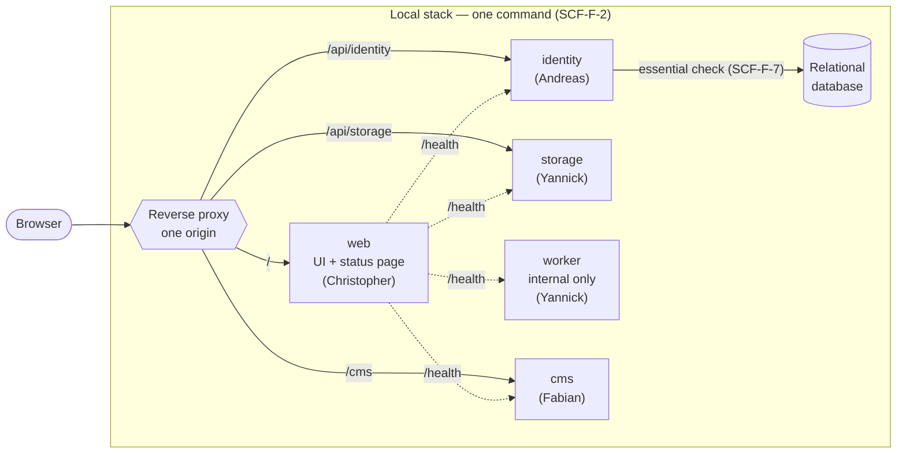

# Scaffolding & Shared Contracts Concept — Consolidated Requirements

Roadmap item R1. Requirement prefix `SCF`. Q&A transcript: [scaffolding.qa-log.md](scaffolding.qa-log.md).

## 0. Synthesis Context

### Development Path

A: Frontloaded.

### Synthesis Dependencies

None. Every later roadmap item depends on this document.

### Synthesis Scope

From this document and `STACK.md`: the repository structure, the five runnable units with health endpoints, the shared contracts package, the local stack, the status page, the commit and changelog tooling, and the CI pipeline. No feature logic.

### Phase status

| Phase | Status |
| --- | --- |
| 1 Grill | Done (Q1–Q11, A1–A10) |
| 2 Open questions | Done (Q12 decided with the sign-off) |
| 3 Artifact interactions | Done (§13) |
| 4 PM review gate | Signed off 2026-09-29 by Fabian Trutschnig (project controlling) |
| 5 Architecture | Tracks and interfaces done (§15); module specifications in each track's plan file, `STACK.md` sections by their owners |
| 6 Test concept | Open |

## 1. Purpose

Give the four team members a repository in which each can build their own area in parallel without touching the others' files, and in which every change is checked the same way. R1 proves the path end to end: one command starts the whole system, and a status page shows that every unit is reachable and healthy.

## 2. Ubiquitous Language & Context

| Term | Meaning |
| --- | --- |
| Unit | A separately running process of the system, built and started as its own container. There are exactly five (SCF-F-1). |
| Contract | A shared, machine-checked definition of a data shape that crosses a unit boundary: an HTTP request/response, a job payload, or a unit's configuration. |
| Health report | The response of a unit's health endpoint (§7). |
| Dependency check | One entry of a health report: the state of one thing the unit depends on. |
| Local stack | All units plus reverse proxy and relational database, started by one command on a developer machine. |
| Owner | The team member responsible for a unit (`docs/projektantrag.md`, "Projektgruppe"). |

Terms are promoted to `CONTEXT.md` (repo root) when the first domain feature (R3) introduces the glossary.

## 3. Functional Requirements

| ID | Requirement |
| --- | --- |
| SCF-F-1 | The system MUST consist of exactly five units: `web`, `identity`, `storage`, `worker`, `cms`. Each MUST run as its own container. |
| SCF-F-2 | One command MUST start the local stack: all five units, the reverse proxy, and the relational database. |
| SCF-F-3 | A second command MUST start all five units natively with automatic reload on code change, using reverse proxy and relational database from the container stack. |
| SCF-F-4 | The reverse proxy MUST serve `web`, `identity`, `storage`, and `cms` under one origin, routed by the path prefixes in §7. `worker` MUST NOT be reachable through the proxy. |
| SCF-F-5 | Every unit MUST expose a health endpoint that returns a health report (§7). For proxied units it MUST also be reachable through the proxy at `<prefix>/health`. |
| SCF-F-6 | A health report's `status` MUST be `ok` when all dependency checks are `ok`, `degraded` when only non-essential checks are `down`, and `down` when at least one essential check is `down`. A unit without dependencies reports `ok`. |
| SCF-F-7 | In R1, `identity` MUST check the relational database as an essential dependency. The other units have no dependency checks. |
| SCF-F-8 | `web` MUST provide a status page with one row per unit showing the unit name and its health status. The page's server side MUST query each unit's internal health endpoint (§7), including `worker`. |
| SCF-F-9 | A shared contracts package MUST hold every contract: HTTP request/response shapes, job payload shapes, and one configuration shape per unit. Units MUST import contracts from it and MUST NOT redefine a contract shape locally. |
| SCF-F-10 | One command MUST generate an OpenAPI description from the HTTP contracts. The generated file MUST NOT be edited by hand. |
| SCF-F-11 | Every unit MUST validate its configuration against its configuration contract at startup, before accepting requests (E-1). |
| SCF-F-12 | Every unit and package MUST provide the tasks `dev`, `build`, `lint`, `typecheck`, `test`. One root command per task MUST run it across all units and packages. |
| SCF-F-13 | Commit messages MUST be checked against Conventional Commits 1.0.0 and the format in `documentation/WORKFLOW.md`, locally before the commit is created and again in CI (E-4). |
| SCF-F-14 | Before every commit, local hooks MUST run the secret scan, code scan, and dependency audit prescribed in `docs/security_next_js.md` (E-6). |
| SCF-F-15 | The CI pipeline MUST run on every MR into `dev` and every push to `dev` and `main`, with the jobs: lint, typecheck, test, build, commit-message check, secret scan, code scan, dependency audit, container image scan. An MR MUST NOT be mergeable unless all jobs pass (E-5). |
| SCF-F-16 | `CHANGELOG.md` MUST follow Keep a Changelog 1.1.0. One command MUST generate a draft section for the next release from the commits since the last release tag (mapping in §9, example 5); the release MR author edits the draft before merging. |
| SCF-F-17 | Every unit MUST ship an example configuration file listing each of its configuration variables with a dummy value. |

## 4. User Interaction Requirements

| ID | Requirement |
| --- | --- |
| SCF-U-1 | The status page MUST show each unit's status as text (`ok`, `degraded`, `down`); color MAY be added but MUST NOT be the only signal. |
| SCF-U-2 | The status page MUST be fully operable by keyboard and readable by screen readers (table with header cells). |
| SCF-U-3 | The status page reflects the state at load time; reloading the page refreshes it. |

## 5. Non-Functional Requirements

| ID | Requirement |
| --- | --- |
| SCF-NF-1 | The local stack MUST start and reach `ok` on all units without internet access, once images and dependencies are present locally. |
| SCF-NF-2 | Every feature that uses a service on the internet MUST have a configuration switch that disables it; the example configuration sets it to disabled. (Applies from R3 on; R1 has no such service.) |
| SCF-NF-3 | A health endpoint MUST respond within the unit's health timeout (configuration `HEALTH_TIMEOUT_MS`, default 2000). Each dependency check MUST finish within `HEALTH_CHECK_TIMEOUT_MS` (default 1000) or count as `down` (E-2). |
| SCF-NF-4 | Health reports and error responses MUST NOT contain hosts, ports, credentials, stack traces, or dependency versions. |
| SCF-NF-5 | All code MUST be TypeScript with explicit types; `lint` MUST fail on unspecified types. |
| SCF-NF-6 | The dependency audit and the container image scan MUST fail on any vulnerability of severity high or critical. |
| SCF-NF-7 | Internal APIs are not versioned: a contract change and every consumer's adaptation MUST be in the same MR. |
| SCF-NF-8 | Configuration values MUST NOT be hard-coded (P-DES-6); secrets MUST NOT be committed. |

## 6. Capability Requirements

Mapped to technology in `documentation/STACK.md`, one section per track (§15). The project proposal fixes several mappings already (`docs/projektantrag.md`, "Technische Ziele").

| ID | Capability |
| --- | --- |
| SCF-C-1 | Workspace management for several units and packages in one repository, with one lockfile and a task runner that runs a task across all of them with caching. |
| SCF-C-2 | Schema definitions usable at runtime in browser and server, with type inference and OpenAPI generation. |
| SCF-C-3 | Web application framework for `web` with server-side routes. |
| SCF-C-4 | HTTP server framework that validates requests against SCF-C-2 schemas; mapped separately for `identity` and `storage` by their owners. |
| SCF-C-5 | Content management system for `cms`, self-hosted. |
| SCF-C-6 | Reverse proxy with path-prefix routing (TLS termination later in R14). |
| SCF-C-7 | Container runtime with a multi-container definition started by one command. |
| SCF-C-8 | Relational database. |
| SCF-C-9 | CI service integrated with the GitLab MR merge checks. |
| SCF-C-10 | Secret scanner, static code scanner, dependency auditor, container image vulnerability scanner. |
| SCF-C-11 | Commit message linter for Conventional Commits 1.0.0. |
| SCF-C-12 | Changelog draft generator reading Conventional Commits. |
| SCF-C-13 | Unit test runner (shared, root) and browser end-to-end test runner (`web`). |

## 7. Data Model

```
HealthReport {
  unit: enum(web|identity|storage|worker|cms),
  version: string,                  // release version of the build; "0.0.0-dev" for local builds
  status: enum(ok|degraded|down),
  checks: list<DependencyCheck>
}

DependencyCheck {
  name: string,                     // logical name, e.g. "relational-database"
  essential: boolean,
  status: enum(ok|down)
}
```

Unit routing table (defaults; every value is configuration, SCF-NF-8):

| Unit | Proxy path prefix | Health via proxy | Internal port (default) | Owner |
| --- | --- | --- | --- | --- |
| `web` | `/` | `/health` | 3000 | Christopher |
| `identity` | `/api/identity` | `/api/identity/health` | 3001 | Andreas |
| `storage` | `/api/storage` | `/api/storage/health` | 3002 | Yannick |
| `worker` | – (not proxied) | – | 3003 | Yannick |
| `cms` | `/cms` | `/cms/health` | 1337 | Fabian |

Every unit serves its health endpoint internally at `/health` on its internal port.

## 8. Error Conditions

| ID | Trigger | Required behavior |
| --- | --- | --- |
| SCF-E-1 | A unit starts with a missing or invalid configuration variable. | The unit MUST NOT accept requests; it exits with a non-zero code and prints one line per invalid variable: name and reason, never the value. |
| SCF-E-2 | A dependency check does not complete within `HEALTH_CHECK_TIMEOUT_MS`. | The check is reported `down`; the report's status follows SCF-F-6. |
| SCF-E-3 | The status page cannot reach a unit, or the response does not match the HealthReport contract. | That unit's row shows `down`; all other rows render normally. |
| SCF-E-4 | A commit message violates the commit format. | Locally the commit is rejected with the linter's reason; in CI the commit-message job fails and names the commit. |
| SCF-E-5 | Any CI job fails. | The MR cannot be merged until a new pipeline passes. |
| SCF-E-6 | The secret scan finds a secret in the staged changes. | The commit is rejected and the finding (file, line, rule) is printed. |

## 9. Worked Examples

**Example 1 — healthy unit.** `identity`, database answers in 40 ms:

```json
{ "unit": "identity", "version": "0.1.0", "status": "ok",
  "checks": [{ "name": "relational-database", "essential": true, "status": "ok" }] }
```

**Example 2 — essential dependency times out.** `identity`, database does not answer within 1000 ms (E-2):

```json
{ "unit": "identity", "version": "0.1.0", "status": "down",
  "checks": [{ "name": "relational-database", "essential": true, "status": "down" }] }
```

The status page row for `identity` shows `down`.

**Example 3 — invalid configuration (E-1).** `storage` started with `PORT=abc` and without `HEALTH_TIMEOUT_MS` set, where it is optional with a default:

```
Invalid configuration for unit "storage":
  PORT: expected an integer between 1 and 65535
```

Exit code non-zero. `HEALTH_TIMEOUT_MS` falls back to its default 2000 and is not reported.

**Example 4 — commit messages (SCF-F-13).**

| Message | Result |
| --- | --- |
| `feat(storage): add health endpoint [SCF-F-5]` + footer `Refs: #14` | accepted |
| `fix(web)!: rename status route [SCF-F-8]` + footer `BREAKING CHANGE: status page moved to /status` | accepted |
| `Added health endpoint` | rejected: no type |
| `feat(backend): add health endpoint [SCF-F-5]` | rejected: scope not a unit name or `contracts` / `deps` / `ci` / `repo` |

**Example 5 — changelog draft (SCF-F-16).** Commits since tag `v0.1.0`:

- `feat(identity): add e-mail registration [IDN-F-1]`
- `fix(web): show status text next to color [SCF-U-1]`
- `feat(storage)!: move uploads to /api/storage/uploads [STO-F-2]` with `BREAKING CHANGE: old upload path removed`
- `chore(deps): update dependencies [no-req]`

Draft:

```markdown
## [Unreleased]

### Added
- identity: add e-mail registration [IDN-F-1]

### Changed
- storage: move uploads to /api/storage/uploads [STO-F-2] — BREAKING: old upload path removed

### Fixed
- web: show status text next to color [SCF-U-1]
```

`chore`, `ci`, `build`, `test`, `docs`, `refactor`, `style` commits are omitted from the draft. The release MR author rewrites entries for readers and may move them into `Deprecated`, `Removed`, or `Security`.

## 10. Integration Points

- `docs/security_next_js.md`: its pre-commit configuration, secret-scanner allowlist, and code-scanner rules are adopted as the starting configuration for SCF-F-14.
- GitLab project settings (`docs/git_workflow_commands.md` §2.3): "pipeline must succeed" is enabled once SCF-F-15 is merged.

## 11. Out of Scope

Observability (R2), any feature logic, databases other than the relational one, deployment and TLS (R14), accessibility checks in CI (R4), who may see the status page (R3).

## 12. Resolved Questions & ADRs

| # | Question | Decision | Rationale |
| --- | --- | --- | --- |
| Q1 | Runnable units | `web`, `identity`, `storage`, `worker`, `cms`; observability is infrastructure | Proposal demands a distributed architecture; one unit per owner avoids working in others' code. ADR 0001 |
| Q2 | Contract scope | HTTP APIs, job payloads, unit configuration; OpenAPI from HTTP; consumer owner reviews contract changes | One source for every cross-unit shape |
| Q3 | Done bound for R1 | Walking skeleton (§1; checked by #22) | Every owner can start their feature immediately afterwards |
| Q4 | CI host | GitLab CI (deviation from proposal, recorded in `WORKFLOW.md`) | MRs and merge checks live on GitLab |
| Q5 | Deployment in R1 | No; new roadmap item R14 | No server and domain yet |
| Q6 | Language | English for code, commits, `documentation/`; German for presentation and `docs/` | — |
| Q7 | Changelog | Draft generated in the release MR, curated by hand | Proposal wants generated, Keep a Changelog wants curated |
| Q8 | CC / Keep a Changelog scope | This project only, bound in `WORKFLOW.md` | User decision |
| Q9 | Browser routing | Directly through the proxy by path prefix (§7) | Large uploads bypass `web`; one origin for the session cookie |
| Q10 | Local development | Container stack (SCF-F-2) and native units (SCF-F-3) | School demands one-command start; native gives fast reload |
| Q11 | CI scope in R1 | SCF-F-15; accessibility checks with R4 | School demands containers without vulnerabilities |
| Q12 | How does the status page get `worker`'s health, given `worker` is not proxied (Q9)? | The status page's server side queries every unit's internal `/health`; the proxy routing test (#21) checks the proxied health paths | Keeps Q9; proves proxy routing in a test instead of on the page |
| Q13 | How is the work split? | Complete separation per person: one track each with exclusive paths, own plan file, own issues; tracks meet only at interfaces fixed in this document; every issue merges feature → `dev`, releases `dev` → `main` (§15) | User decision: everyone plans and implements separately |

Assumptions A1–A10: see the Q&A log.

## 13. Artifact Interactions & Interferences

The repository contains only documentation. Interactions: `docs/security_next_js.md` (adopted, §10); `documentation/WORKFLOW.md` (commit format and CI deviation are bound there). No interference.

## 14. Schema Extensions

None: no data exists yet. The relational database starts empty in R1.

## 15. Architecture & Vertical Slices

Module specifications are written per track in the track's plan file. The track split below is final. The unit split and routing are recorded in `docs/adr/0001-five-units-behind-one-origin.md`.

### System Overview (Pipeline Flow)

Local stack after R1: request paths through the reverse proxy (solid) and internal health queries of the status page (dotted).



`worker` has no proxy route (SCF-F-4); the status page reaches it only through the internal `/health` query (Q12). All five units import their shapes from the `contracts` package (SCF-F-9); it is a build-time dependency, not a running unit. TLS on the proxy follows with R14.

### Tracks — complete separation per person

Decided in Q13. Rules:

1. **One track per person.** A track owns exclusive paths, its own plan file, its own issues, and its own branches. Nobody changes another track's paths; a needed change there becomes an issue for that track's owner.
2. **Tracks meet only at interfaces fixed in this document:** the task names (SCF-F-12), the HealthReport shape and the routing table (§7), configuration validation and its error output (SCF-F-11, SCF-E-1, §9 example 3), and the commit format (`WORKFLOW.md`). Each owner builds and tests against these specifications with local stubs; no track waits for another track's work to start.
3. **Two interfaces are code every unit imports**, so they are the first MR of their track in week 1: the workspace root (Fabian, #6) and the contracts core (Yannick, #7). Until they are merged, a unit is developed and tested standalone in its own folder.
4. **Shared files are split into owned parts:** `STACK.md` has one section per track; the contracts package has one folder per unit, owned by the unit's owner; the root lockfile is regenerated with the package manager on conflict, never merged by hand (`docs/git_workflow_commands.md` §17.4).
5. **Merging:** every issue goes feature branch → MR into `dev` (reviewed by another person) as soon as it is done. Once per sprint, Fabian merges the release MR `dev` → `main` (`WORKFLOW.md`, "Sprints and time budget").

| Track | Owner | Owned paths | Provides | Consumes (interface only) | Plan |
| --- | --- | --- | --- | --- | --- |
| Platform & cms | Fabian | repository root config (workspace, root tasks, shared lint/format/type config, ignore files), `CHANGELOG.md`, container stack definition, reverse proxy config, unit folder `cms`, contracts folder `cms`, `STACK.md` §1 | workspace root and root tasks, local stack, proxy routes of §7, `cms` health, release | HealthReport (§7), container build of each unit in its unit folder | [scaffolding.track-platform.md](scaffolding.track-platform.md) |
| Contracts, storage & worker | Yannick | contracts package core (health, configuration helper, OpenAPI generation), unit folders `storage` and `worker`, their contracts folders, `STACK.md` §2 | contracts core, `storage` and `worker` health | root task names (SCF-F-12) | [scaffolding.track-storage.md](scaffolding.track-storage.md) |
| Identity & CI | Andreas | unit folder `identity`, contracts folder `identity`, CI definition, hook and scanner configuration, `STACK.md` §3 | `identity` health with database check, CI pipeline, local hooks | HealthReport and configuration helper, root task names, relational database of the local stack | [scaffolding.track-identity-ci.md](scaffolding.track-identity-ci.md) |
| Web | Christopher | unit folder `web`, contracts folder `web`, `STACK.md` §4 | `web` health, status page | HealthReport, routing table and internal health paths (§7) | [scaffolding.track-web.md](scaffolding.track-web.md) |

Each owner writes the "Plan" section of their plan file (module specification in neutral pseudocode per `MANIFEST.md` Phase 5, order of work, test cases from §9) before their first MR.

### Issues per track (Sprint 1)

Weight = estimated hours. Week = planned start week (W1 = 2026-09-30…10-06, W2 = 10-07…10-13, W3 = 10-14…10-20, W4 = 10-21…10-26).

| Track | Issue | Title | Weight | Week |
| --- | --- | --- | --- | --- |
| Platform & cms | #4 | Set up project documentation and agent guidance | 1 | W1 |
| Platform & cms | #5 | `STACK.md` platform section | 1 | W1 |
| Platform & cms | #6 | Workspace root, shared tooling config, `CHANGELOG.md` skeleton | 3 | W1 |
| Platform & cms | #18 | Local container stack and reverse proxy routing | 4 | W2 |
| Platform & cms | #19 | `cms` unit with health endpoint | 4 | W3 |
| Platform & cms | #21 | Proxy routing test for all health paths | 2 | W4 |
| Platform & cms | #22 | Integration check and release v0.1.0 | 2 | W4 |
| Contracts, storage & worker | #7 | Contracts core: HealthReport, configuration helper | 4 | W1 |
| Contracts, storage & worker | #8 | OpenAPI generation command | 2 | W2 |
| Contracts, storage & worker | #12 | `storage` unit with health endpoint | 3 | W2 |
| Contracts, storage & worker | #13 | `worker` unit with internal health endpoint | 3 | W3 |
| Identity & CI | #9 | CI pipeline: lint, typecheck, test, build, commit-message check | 4 | W1 |
| Identity & CI | #10 | `identity` unit with health endpoint and database check | 4 | W2 |
| Identity & CI | #11 | CI security jobs | 4 | W3 |
| Identity & CI | #17 | Pre-commit and commit-msg hooks | 3 | W3 |
| Web | #15 | `web` unit skeleton with health endpoint | 3 | W1 |
| Web | #16 | Accessible status page | 4 | W2 |

Sprint 2 (Platform & cms): #20 native dev command (SCF-F-3), #14 changelog draft command (SCF-F-16). The `v0.1.0` changelog is curated by hand.

Load in Sprint 1 against 16 h capacity: Fabian 17 h, Andreas 15 h, Yannick 12 h, Christopher 7 h. Issue #2 (Corporate Identity, Christopher and Andreas, no estimate) was added to Sprint 1 by the team and is not part of R1. Free capacity (Christopher 9 h, Yannick 4 h) goes to Phase 1 of the owner's next roadmap item in their own area (R4, R5).

### Requirement Traceability Matrix

| Requirement | Track (issue) |
| --- | --- |
| SCF-F-1 | every track for its own units |
| SCF-F-2, F-4 | Platform (#18, verified by #21) |
| SCF-F-3 | Platform (#20, Sprint 2) |
| SCF-F-5, F-6, F-11, F-17 | each unit's owner: #10, #12, #13, #15, #19 |
| SCF-F-7 | Identity & CI (#10) |
| SCF-F-8, U-1…3, E-3 | Web (#16) |
| SCF-F-9 | Contracts core (#7); each owner for their contracts folder |
| SCF-F-10 | Contracts (#8) |
| SCF-F-12 | Platform (#6); each owner provides the tasks in their units |
| SCF-F-13, F-14, F-15, NF-6 | Identity & CI (#9, #11, #17) |
| SCF-F-16 | Platform (#14, Sprint 2) |
| SCF-NF-1 | Platform (#22) |
| SCF-NF-2 | all later features |
| SCF-NF-3, NF-4 | Contracts core (#7); each unit's owner |
| SCF-NF-5 | Platform (#6) |
| SCF-NF-7, NF-8 | every MR review |

## 16. Test Concept & TDD Contract

Open (Phase 6). Worked examples 1–5 are the first test cases.
