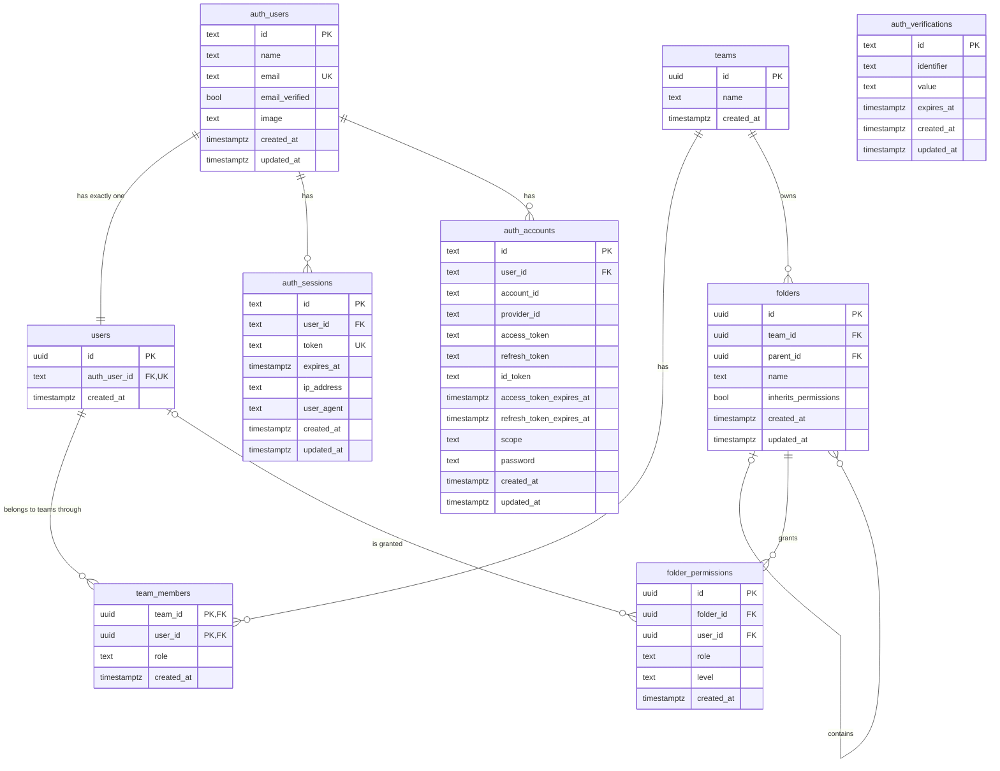
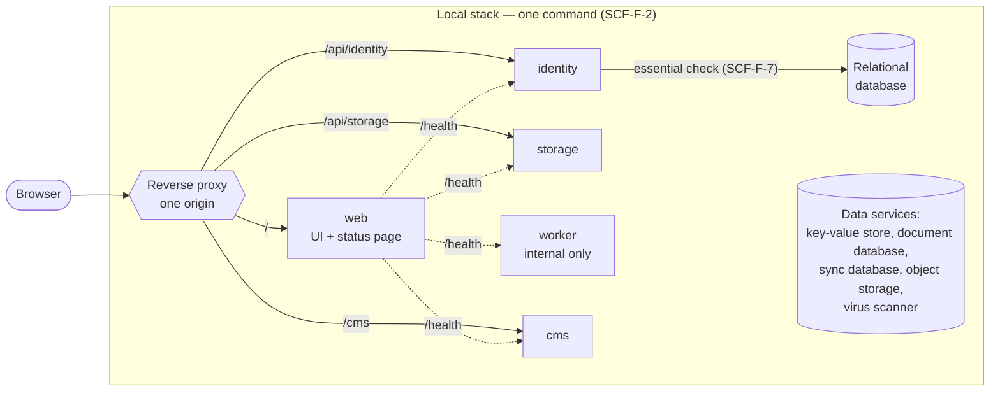

# Scaffolding & shared contracts Concept

The specification of roadmap feature R1: the repository, the local stack, the shared contracts, and the checks every change passes. It is written for the feature's owner (trutscf1), the four track owners, their reviewers, and the agents that implement it. Part H is the plain-language view; Part S is binding. Question log: [scaffolding.qa-log.md](scaffolding.qa-log.md).

# Part H — For Human Readers

This part adds no rule. It summarizes Part S and cites its IDs; where the two disagree, Part S wins (P-HUM-3).

## H1. In one sentence

Every developer starts the whole system with one command and builds their own area in parallel, and every change is checked the same way before it is merged. This serves success signal `G-1.S1` (self-hosting): the one command that starts the system on a developer machine is the same one an operator will use on their own server.

## H2. Who benefits and how

- **Operator (`R-2`)**: starts everything with one command, also without internet, and sees on a status page whether every unit is reachable and healthy ([SCF-US-8] units reachable and visible).
- **Developers of the team** (not a role of `GOAL.md`; the stories of this feature are written for them): get a repository in which lint, typecheck, build, and test work the same way everywhere ([SCF-US-1] set up the monorepo), a local stack ([SCF-US-2] local development environment), contracts that are defined once ([SCF-US-3] shared contracts), a documented data model ([SCF-US-4] data model), a pipeline that stops faulty changes ([SCF-US-5] CI pipeline), and uniform commits with a changelog ([SCF-US-6] Conventional Commits).
- **Teacher or new team member**: finds architecture, setup, Definition of Done, data model, and licences in one place ([SCF-US-7] project documentation).

## H3. How it works, step by step

1. A developer clones the repository and follows the quick start ([SCF-AC-1.5] quick start). One workspace holds the five units and the shared packages ([SCF-AC-1.1] workspace layout).
2. One command starts the local stack: the data services, the reverse proxy, and every unit that exists ([SCF-AC-2.1] one start command). Every long-running container reports whether it is healthy, and a unit waits for what it needs, including one-shot jobs such as the migration ([SCF-AC-2.4] health checks).
3. A unit checks its configuration before it accepts requests and stops with a clear message if a value is wrong ([SCF-AC-2.6] invalid configuration).
4. The reverse proxy serves the units under one address ([SCF-AC-8.1] one origin). Every unit answers a health request with its status ([SCF-AC-8.2] health report), and the status page shows one row per unit ([SCF-AC-8.4] status page).
5. Request and response shapes are defined once in the contracts package; client and server import the same definition ([SCF-AC-3.2] same schema on both sides).
6. Before a commit, hooks check the message and scan for secrets ([SCF-AC-6.1] commit check). After a push, the pipeline runs lint, typecheck, tests, build, and the security scans, and a failed job blocks the merge ([SCF-AC-5.3] failing conditions).
7. At a release, a changelog draft is generated from the commits and the release gets a version tag ([SCF-AC-6.2] changelog from commits, [SCF-AC-6.3] release tags).

## H4. What it deliberately does not do

- It contains no feature logic: no login, no upload, no search (§12).
- It does not deploy anything and sets up no TLS; that is roadmap item R14 (§12).
- It collects no metrics, logs, or traces; that is the observability baseline R2 (§12).
- It does not decide who may see the status page; that follows with the Identity concept (§12).
- It runs no production service for external users (`G-1.N4`).

## H5. How it is built, in plain words

The system consists of five separately running units — `web`, `identity`, `storage`, `worker`, `cms` — behind one reverse proxy, plus the data services they use (§16). Four people work in four tracks with paths of their own; the tracks meet only at a few fixed interfaces: the names of the root tasks, the shape of a health report, the routing table, the way a unit reports a wrong configuration, the error response, and the commit format (§16, "Inter-Module Interfaces"). A health report is a small record with the unit's name, its version, a status, and one entry per thing the unit depends on (§8). The relational data model — users, teams, folders, folder permissions, and the tables of the login library — is drawn in §8; one shared package holds its schema, its migrations, and the test data, and a one-shot container applies the migrations before any unit that needs the database starts (Q21, Q25). Which technology fills each capability stands only in `STACK.md`.

## H6. How we know it works

Every acceptance criterion has one acceptance test in §17 ([SCF-T-1] to [SCF-T-40]). Most of them read the repository or the definition of the stack and the pipeline; the tests of the health reports, the proxy, and the status page run against the started stack. Tests for the criteria of [SCF-US-1], [SCF-US-5], and [SCF-US-6] exist already in `tests/` and carry the `AC` ID in their names; the others follow with their stories.

## H7. Key decisions

| Question | Decision | Reason |
| --- | --- | --- |
| Q1 Runnable units | Five units; observability is infrastructure | One unit per owner avoids working in others' code |
| Q4 CI host | GitLab CI instead of GitHub Actions | Merge requests and merge checks live on GitLab |
| Q9 Browser routing | Directly through the proxy by path prefix | Large uploads bypass `web`; one origin for the session |
| Q10 Local development | Container stack and native start | The school demands one command; native start reloads faster |
| Q13 Work split | One track per person with exclusive paths | Everyone plans and implements separately |
| Q14 Missing story | New story [SCF-US-8] for status page, health reports, and proxy | They had requirements but no story |
| A11 Data services | The local stack holds all data services from the start | [SCF-AC-2.1] demands it; the earlier assumption A3 is withdrawn |
| Q23 Own users table | The database creates the `users` row with every auth user | Holds for every way a user is created, in one transaction |

# Part S — Specification (normative)

## 0. Synthesis Context

### Development Path

Path A (frontloaded). Written on 2026-09-29 in the predecessor format and migrated to the current format on 2026-10-13 (P-DOC-5). Phases 1–4 are done; Phase 4 was signed off on 2026-09-29 by `trutscf1` (project controlling). The migration added a story, two acceptance criteria, and the requirements the team's stories had no counterpart for (§13, Q14–Q16); these additions pass the review gate with the merge request of the migration. Phase 5: tracks and interfaces are fixed (§16); the module specifications are written per track in the track's plan file. Phase 6: the acceptance tests are in §17; unit tests are specified in the track plans.

### Synthesis Dependencies

None. Every later roadmap item depends on this document.

### Synthesis Scope

From this document, the track plan files, and `STACK.md`: the repository structure, the five units with health endpoints, the shared contracts package, the local stack, the status page, the relational data model with its migrations, the commit and changelog tooling, the CI pipeline, and the project documentation. No feature logic.

### Owner

trutscf1, per [ROADMAP.md](../ROADMAP.md). Each track has its own owner (§16).

## 1. Purpose & Goal Trace

**Feature goal:** Every developer starts the whole system with one command and builds their own area in parallel, and every change is checked the same way before it is merged.

**Serves:** `G-1.S1` in [GOAL.md](../GOAL.md), as stated in the *Serves* column of [ROADMAP.md](../ROADMAP.md): the complete system starts on one own server with one command and without a required service on the internet. No non-goal is touched: the local stack is a development and self-hosting setup, not a production service with an availability guarantee (`G-1.N4`).

## 2. Ubiquitous Language & Context

Defined in [CONTEXT.md](../CONTEXT.md) and used here exactly: **unit**, **contract**, **health report**, **dependency check**, **local stack**, **track**.

Used only in this document:

- **Data service**: a database, store, or scanner that units use and that runs as its own container in the local stack ([SCF-F-2]).
- **Owner**: the team member responsible for a track (§16), named by handle (`team/TEAM.md`).

## 3. User Stories & Acceptance Criteria

The user stories and their acceptance criteria are the work items in [work-items/scaffolding/](../work-items/scaffolding/feature.md); they are not repeated here (P-DOC-6).

## 4. Functional Requirements

| ID | Title | Requirement | Derives from |
| --- | --- | --- | --- |
| SCF-F-1 | Five units | The system MUST consist of exactly five units: `web`, `identity`, `storage`, `worker`, `cms`. Each MUST run as its own container. | SCF-AC-1.1 (Workspace layout), SCF-AC-2.1 (One start command) |
| SCF-F-2 | One start command | One command MUST start the local stack: the reverse proxy, the data services — relational database [SCF-C-8], key-value store [SCF-C-14], document database [SCF-C-15], sync database [SCF-C-16], object storage [SCF-C-17], virus scanner [SCF-C-18] — and every unit. A unit joins the local stack in the merge request that makes it runnable; until then the stack starts without it. | SCF-AC-2.1 (One start command) |
| SCF-F-3 | Native start | A second command MUST start all units natively with automatic reload on code change, using the reverse proxy and the data services from the container stack. | SCF-AC-2.7 (Native start) |
| SCF-F-4 | One origin | The reverse proxy MUST serve `web`, `identity`, `storage`, and `cms` under one origin, routed by the path prefixes in §8. `worker` MUST NOT be reachable through the proxy. The proxy MUST remove the request headers `traceparent`, `tracestate`, and `baggage` from every incoming request before forwarding it ([OBS-F-16] in [observability.md](observability.md)). | SCF-AC-8.1 (One origin) |
| SCF-F-5 | Health endpoint | Every unit MUST expose a health endpoint that returns a health report (§8). For proxied units it MUST also be reachable through the proxy at `<prefix>/health`. | SCF-AC-8.1 (One origin), SCF-AC-8.2 (Health report) |
| SCF-F-6 | Status of a health report | A health report's `status` MUST be `ok` when all dependency checks are `ok`, `degraded` when only non-essential checks are `down`, and `down` when at least one essential check is `down`. A unit without dependency checks reports `ok`. | SCF-AC-8.2 (Health report), SCF-AC-8.3 (Failed dependency) |
| SCF-F-7 | Database check of `identity` | `identity` MUST check the relational database as an essential dependency, with the check name `relational-database`. This document defines no dependency check for the other units; the concept of the feature that gives a unit a dependency defines its check. | SCF-AC-8.3 (Failed dependency) |
| SCF-F-8 | Status page | `web` MUST provide a status page with one row per unit showing the unit name and its health status. The row of a unit whose status is not `ok` MUST also show the names of its dependency checks that are `down`. The page's server side MUST query each unit's internal health endpoint (§8), including `worker`. | SCF-AC-8.4 (Status page) |
| SCF-F-9 | Shared contracts | A shared contracts package MUST hold every contract: HTTP request and response shapes, job payload shapes, and one configuration shape per unit, each request or response in a file of its own. Units MUST import contracts from it and MUST NOT redefine a contract shape locally. | SCF-AC-3.1 (Contracts package), SCF-AC-3.2 (Same schema on both sides), SCF-AC-3.5 (Breaking change fails) |
| SCF-F-10 | Generated API description | One command MUST generate an OpenAPI description from the HTTP contracts. The generated file MUST NOT be edited by hand. `web` MUST serve it at the path `/api/docs`. | SCF-AC-3.3 (Generated OpenAPI) |
| SCF-F-11 | Configuration validation | Every unit MUST validate its configuration against its configuration contract at startup, before accepting requests, and behave as [SCF-E-1] (invalid configuration) if it is invalid. | SCF-AC-2.6 (Invalid configuration) |
| SCF-F-12 | Tasks everywhere | Every unit and package MUST provide the tasks `dev`, `build`, `lint`, `typecheck`, `test`. One root command per task MUST run it across all units and packages. | SCF-AC-1.3 (Root tasks) |
| SCF-F-13 | Commit message check | Commit messages MUST be checked against Conventional Commits 1.0.0 and the format in `documentation/WORKFLOW.md`, locally before the commit is created and again in CI ([SCF-E-4], commit message rejected). | SCF-AC-6.1 (Commit check) |
| SCF-F-14 | Scans before a commit | Before every commit, local hooks MUST run the secret scan, the code scan, and the dependency audit prescribed in `docs/security_next_js.md` ([SCF-E-6], secret found). | SCF-AC-2.2 (Configuration by environment) |
| SCF-F-15 | CI pipeline | The CI pipeline MUST run on every push to a branch and on every merge request, with one pipeline per change. Its jobs are: lint, typecheck, test, build, commit-message check, accessibility check, secret scan, code scan, dependency audit, container image scan. A merge request MUST NOT be mergeable unless all jobs pass ([SCF-E-5], failed CI job), and its pipeline status MUST be visible on the merge request. | SCF-AC-5.1 (Pipeline triggers), SCF-AC-5.2 (Pipeline steps), SCF-AC-5.3 (Failing conditions), SCF-AC-5.5 (Visible status) |
| SCF-F-16 | Changelog draft | `CHANGELOG.md` MUST follow Keep a Changelog 1.1.0. One command MUST generate a draft section for the next release from the commits since the last release tag (mapping in §10, example 5); the release merge request author edits the draft before merging. | SCF-AC-6.2 (Changelog from commits) |
| SCF-F-17 | Example configuration | The repository MUST hold an example configuration file that lists every configuration variable of the local stack and of every unit with a dummy value. | SCF-AC-2.2 (Configuration by environment) |
| SCF-F-18 | Workspace layout | The repository MUST be one workspace with one lockfile that holds the five units and the shared packages `contracts`, `ui`, and `config`. | SCF-AC-1.1 (Workspace layout) |
| SCF-F-19 | Quick start | The README MUST contain a quick start of at most 30 lines that names every step from a fresh clone to the running project, and every command it names MUST exist in the repository. | SCF-AC-1.5 (Quick start) |
| SCF-F-20 | Container health checks | Every long-running container of the local stack MUST define a health check. The container of a unit MUST start only after the containers it depends on report healthy; a one-shot container (`restart: "no"`, such as the migrating container of [SCF-F-26]) has no health check, and its dependents wait until it completed successfully (Q173). | SCF-AC-2.4 (Health checks) |
| SCF-F-21 | Uniform error response | Every HTTP endpoint of a unit MUST answer a failed request with an `ErrorResponse` (§8) and the matching HTTP status. | SCF-AC-3.4 (Uniform error format) |
| SCF-F-22 | Data model diagram | The project documentation MUST hold the entity-relationship diagram of the relational data model (§8, "Relational data model"), with plural snake_case table names. The diagram MUST be drawn in the diagram tool [SCF-C-21], and its export MUST be embedded next to the text form in §8 (Q27). | SCF-AC-4.1 (ER diagram), SCF-AC-7.4 (ER diagram included) |
| SCF-F-23 | Versioned migrations | The relational schema MUST be defined in one schema definition, in the shared package `db` (Q21), that holds exactly the tables and columns of the diagram of [SCF-F-22]. Every change to it MUST be a versioned migration in the repository, created from the schema definition by the planning command of the access layer [SCF-C-19]; the migrations MUST form one chain from the empty database to the current schema definition. An applied migration MUST NOT be edited. | SCF-AC-4.2 (Schema matches diagram) |
| SCF-F-24 | Own users table | The relational schema MUST hold an own table `users` with exactly one row per user of the authentication library, in a 1:1 relation to that library's user table `auth_users` (Q22). The database itself MUST create the `users` row in the same transaction that inserts the `auth_users` row and MUST delete it with that row (Q23); a second `users` row for the same auth user MUST be rejected. | SCF-AC-4.3 (Own users table) |
| SCF-F-25 | Seed data | One command MUST fill a migrated local database with the test data of §10, example 8: one user, one team with that user as owner, the team's root folder, and one folder inside it. A second run MUST change nothing (Q29). | SCF-AC-4.4 (Seed data) |
| SCF-F-26 | Migrations at start | When the local stack starts, a one-shot container MUST apply all pending migrations once the relational database is healthy, list them first, and exit; every container that uses the relational database MUST start only after it completed successfully (Q25, [SCF-E-7], failed migration). | SCF-AC-4.5 (Migrations at start) |
| SCF-F-27 | Release tag | Every release MUST be an annotated tag `v<MAJOR>.<MINOR>.<PATCH>` on `main` and a release on the git host that holds the changelog section of that version. | SCF-AC-6.3 (Release tags) |
| SCF-F-28 | Project documentation | The README MUST contain: an architecture overview with a diagram of the four areas and all databases; a setup guide for the start with and without internet access; notes on operation and deployment; a link to the Definition of Done in `documentation/WORKFLOW.md`, named as binding; and licence notes for all used content and dependencies. | SCF-AC-7.1 (Architecture overview), SCF-AC-7.2 (Setup guide), SCF-AC-7.3 (Definition of Done), SCF-AC-7.5 (Licence notes) |

## 5. User Interaction Requirements

| ID | Title | Requirement | Derives from |
| --- | --- | --- | --- |
| SCF-U-1 | Status as text | The status page MUST show each unit's status as text (`ok`, `degraded`, `down`) and the names of the dependency checks of [SCF-F-8] as text; color MAY be added but MUST NOT be the only signal. | SCF-AC-8.4 (Status page), SCF-AC-8.5 (Accessible status page) |
| SCF-U-2 | Keyboard and screen reader | The status page MUST be fully operable by keyboard and readable by screen readers: it is a table with header cells. | SCF-AC-8.5 (Accessible status page) |
| SCF-U-3 | State at load time | The status page reflects the state at load time; reloading the page refreshes it. | SCF-AC-8.4 (Status page) |

## 6. Non-Functional Requirements

| ID | Title | Requirement | Derives from |
| --- | --- | --- | --- |
| SCF-NF-1 | Start without internet | The local stack MUST start without internet access, once images and dependencies are present locally, with no unit `down`. A unit MAY be `degraded` only because of a non-essential dependency check. | SCF-AC-2.3 (Start without internet) |
| SCF-NF-2 | Switch for internet services | Every feature that uses a service on the internet MUST have a configuration switch that disables it or replaces it by a local service; the example configuration sets it to disabled or local. | SCF-AC-2.3 (Start without internet) |
| SCF-NF-3 | Health timeouts | A health endpoint MUST respond within the unit's health timeout (configuration `HEALTH_TIMEOUT_MS`, default 2000). Each dependency check MUST finish within `HEALTH_CHECK_TIMEOUT_MS` (default 1000) or count as `down` ([SCF-E-2], dependency timeout). | SCF-AC-8.3 (Failed dependency) |
| SCF-NF-4 | No internals in responses | Health reports and error responses MUST NOT contain hosts, ports, credentials, stack traces, database statements, or dependency versions. | SCF-AC-3.4 (Uniform error format), SCF-AC-8.2 (Health report) |
| SCF-NF-5 | Explicit types | All code MUST be TypeScript in strict mode with explicit types; `lint` MUST fail on unspecified types. | SCF-AC-1.2 (Strict TypeScript) |
| SCF-NF-6 | No high or critical vulnerability | The dependency audit of the production dependencies (`docs/security_next_js.md`) and the container image scan MUST fail on any vulnerability of severity high or critical that has a fix; an accepted exception needs a written reason and an expiry date (`../qa-log.md`, Q26, Q31). | SCF-AC-2.5 (Clean images), SCF-AC-5.3 (Failing conditions) |
| SCF-NF-7 | Unversioned internal APIs | Internal APIs are not versioned: a contract change and every consumer's adaptation MUST be in the same merge request, and a change that breaks a consumer MUST fail the typecheck. | SCF-AC-3.5 (Breaking change fails) |
| SCF-NF-8 | No hard-coded configuration | Configuration values MUST NOT be hard-coded (P-DES-6); every setting of the local stack comes from the environment file, and secrets MUST NOT be committed. | SCF-AC-2.2 (Configuration by environment) |
| SCF-NF-9 | Pinned versions | The runtime version MUST be pinned in the repository in a version file and in the package manifest. The minimum versions of the runtime and the frameworks are in `STACK.md`. | SCF-AC-1.4 (Pinned versions) |
| SCF-NF-10 | Pipeline run time | A pipeline run with a warm task cache MUST finish in less than 10 minutes. | SCF-AC-5.4 (Run time) |

## 7. Capability Requirements

Mapped to technology in `documentation/STACK.md`, one section per track (§16); its capability index lists every row below. The project proposal fixes several mappings already (`docs/projektantrag.md`, "Technische Ziele").

| ID | Title | Requirement | Derives from |
| --- | --- | --- | --- |
| SCF-C-1 | Workspace and task runner | Workspace management for several units and packages in one repository, with one lockfile and a task runner that runs a task across all of them with caching. | SCF-AC-1.1 (Workspace layout), SCF-AC-1.3 (Root tasks) |
| SCF-C-2 | Schemas | Schema definitions usable at runtime in browser and server, with type inference and OpenAPI generation. | SCF-AC-3.1 (Contracts package), SCF-AC-3.3 (Generated OpenAPI) |
| SCF-C-3 | Web application framework | Web application framework for `web` with server-side routes. | SCF-AC-8.4 (Status page) |
| SCF-C-4 | HTTP server framework | HTTP server framework that validates requests against [SCF-C-2] schemas; mapped separately for `identity` and `storage` by their owners. | SCF-AC-3.2 (Same schema on both sides) |
| SCF-C-5 | Content management system | Content management system for `cms`, self-hosted. | SCF-AC-2.1 (One start command) |
| SCF-C-6 | Reverse proxy | Reverse proxy with path-prefix routing (TLS termination later in R14). | SCF-AC-8.1 (One origin) |
| SCF-C-7 | Container runtime | Container runtime with a multi-container definition started by one command, with health checks and start order. | SCF-AC-2.1 (One start command), SCF-AC-2.4 (Health checks) |
| SCF-C-8 | Relational database | Relational database. | SCF-AC-2.1 (One start command) |
| SCF-C-9 | CI service | CI service integrated with the GitLab merge request checks. | SCF-AC-5.1 (Pipeline triggers), SCF-AC-5.5 (Visible status) |
| SCF-C-10 | Scanners | Secret scanner, static code scanner, dependency auditor, container image vulnerability scanner. | SCF-AC-5.2 (Pipeline steps), SCF-AC-2.5 (Clean images) |
| SCF-C-11 | Commit message linter | Commit message linter for Conventional Commits 1.0.0. | SCF-AC-6.1 (Commit check) |
| SCF-C-12 | Changelog draft generator | Changelog draft generator reading Conventional Commits. | SCF-AC-6.2 (Changelog from commits) |
| SCF-C-13 | Test runners | Unit test runner (shared, root) and browser end-to-end test runner (`web`). | SCF-AC-5.2 (Pipeline steps) |
| SCF-C-14 | Key-value store | In-memory key-value store for sessions, cache, and job queues. | SCF-AC-2.1 (One start command) |
| SCF-C-15 | Document database | Document database for file metadata. | SCF-AC-2.1 (One start command) |
| SCF-C-16 | Sync database | Database with replication to the browser, for offline use. | SCF-AC-2.1 (One start command) |
| SCF-C-17 | Object storage | Self-hosted object storage for file contents. | SCF-AC-2.1 (One start command) |
| SCF-C-18 | Virus scanner | Virus scanner that runs as its own service. | SCF-AC-2.1 (One start command) |
| SCF-C-19 | Database access layer | Database access layer with one schema definition and versioned migrations. | SCF-AC-4.2 (Schema matches diagram), SCF-AC-4.5 (Migrations at start) |
| SCF-C-20 | Accessibility checker | Automated accessibility checker that runs in the pipeline. | SCF-AC-5.2 (Pipeline steps) |
| SCF-C-21 | Data model diagram tool | Tool in which the entity-relationship diagram is drawn and from which it is exported into the documentation. | SCF-AC-4.1 (ER diagram) |

## 8. Data Model

```text
HealthReport {
  unit: enum(web|identity|storage|worker|cms),
  version: string,                  // release version of the build; "0.0.0-dev" for local builds
  status: enum(ok|degraded|down),
  checks: list<DependencyCheck>
}

DependencyCheck {
  name: string,                     // logical name, e.g. "relational-database"
  essential: boolean,
  status: enum(ok|down)
}

ErrorResponse {
  code: enum(validation-failed|not-found|method-not-allowed|internal-error),  // stable, machine-readable
  message: string                   // one plain sentence for the caller; no internals (SCF-NF-4)
}
```

Every code has one HTTP status and one fixed message, never taken from the failure itself ([SCF-F-21], [SCF-NF-4]); a failed schema validation is `validation-failed`, every other failure inside a unit is `internal-error` (§10, example 6). A new code is added to this table first.

| Code | HTTP status | Message |
| --- | --- | --- |
| `validation-failed` | 400 | The request body is not valid. |
| `not-found` | 404 | The requested resource does not exist. |
| `method-not-allowed` | 405 | The method is not allowed for this path. |
| `internal-error` | 500 | The request could not be processed. |

Unit routing table (defaults; every value is configuration, [SCF-NF-8]):

| Unit | Proxy path prefix | Health via proxy | Internal port (default) | Owner |
| --- | --- | --- | --- | --- |
| `web` | `/` | `/health` | 3000 | `schwaigc` |
| `identity` | `/api/identity` | `/api/identity/health` | 3001 | `tschudea07` |
| `storage` | `/api/storage` | `/api/storage/health` | 3002 | `schauby1` |
| `worker` | – (not proxied) | – | 3003 | `schauby1` |
| `cms` | `/cms` | `/cms/health` | 1337 | `trutscf1` |

Every unit serves its health endpoint internally at `/health` on its internal port.

The proxy removes the request headers `traceparent`, `tracestate`, and `baggage` from every request that arrives from outside, before it forwards the request to a unit, so that every trace starts at the first unit ([OBS-F-16] in [observability.md](observability.md), delivered with `OBS-US-1` slice 1). The row of `/observability` follows with `OBS-US-2` slice 5.

### Relational data model

The entity-relationship diagram of [SCF-F-22] (Q24). Its text form below is binding for the schema definition of [SCF-F-23]: the acceptance tests compare the two table by table and column by column ([SCF-T-18], [SCF-T-19]). Types are the database's own column types; `PK` is the primary key, `FK` a foreign key, `UK` a unique column. Later features extend the model with migrations of their own and update this diagram in the same merge request.

> **Human step (open):** the diagram has to be drawn in Vertabelo, the tool the school prescribes ([SCF-C-21]), exported as PNG to `documentation/images/er-diagram.png`, and embedded here. This is slice 2 of [SCF-US-4] (#151, `qa-log.md` Q213). Until then the text form is the draft, and the acceptance test of the export is marked as open (`todo`) in [SCF-T-18].



Rules the diagram cannot show:

| Table | Rule |
| --- | --- |
| `auth_users`, `auth_sessions`, `auth_accounts`, `auth_verifications` | The four core tables of the authentication library, under plural names (Q22). The library writes them; its own model and field names are mapped onto these names by its configuration in the identity unit. Its identifiers are text that the library generates. |
| `users` | The own users table of [SCF-F-24]: exactly one row per `auth_users` row, created by the database when the `auth_users` row is inserted and deleted with it (Q23). The features add their own columns here, never to `auth_users`. |
| `team_members` | `role` is one of `owner`, `admin`, `editor`, `viewer` (the roles of the teams concept, R7). |
| `folders` | One tree per team. The root folder has no parent, and a team has at most one root folder. Names are unique among the children of one folder. `inherits_permissions` is `true` unless the folder overrides the inheritance of its parent's permissions. Deleting a folder deletes its subtree. |
| `folder_permissions` | Granted either to one member (`user_id`) or to a team role (`role`), never both and never neither; `level` is one of `read`, `write`, `manage`. At most one permission per folder and member, and one per folder and role. |
| all | Every foreign key deletes with its parent row. Own identifiers are UUIDs the database generates; time stamps are stored with time zone and default to the time of the insert. |

## 9. Error Conditions

| ID | Title | Trigger | Required behavior | Fallback | Derives from |
| --- | --- | --- | --- | --- | --- |
| SCF-E-1 | Invalid configuration | A unit starts with a missing or invalid configuration variable. | The unit MUST NOT accept requests; it exits with a non-zero code and prints one line per invalid variable: name and reason, never the value. | None. | SCF-AC-2.6 (Invalid configuration) |
| SCF-E-2 | Dependency timeout | A dependency check does not complete within `HEALTH_CHECK_TIMEOUT_MS`. | The check is reported `down`; the report's status follows [SCF-F-6]. | None. | SCF-AC-8.3 (Failed dependency) |
| SCF-E-3 | Unit unreachable | The status page cannot reach a unit, or the response does not match the HealthReport contract. | That unit's row shows `down`; all other rows render normally. | None. | SCF-AC-8.4 (Status page) |
| SCF-E-4 | Commit message rejected | A commit message violates the commit format. | Locally the commit is rejected with the linter's reason; in CI the commit-message job fails and names the commit. | None. | SCF-AC-6.1 (Commit check) |
| SCF-E-5 | Failed CI job | Any CI job fails. | The merge request cannot be merged until a new pipeline passes. | None. | SCF-AC-5.3 (Failing conditions), SCF-AC-5.5 (Visible status) |
| SCF-E-6 | Secret found | The secret scan finds a secret in the staged changes. | The commit is rejected and the finding (file, line, rule) is printed. | None. | SCF-AC-2.2 (Configuration by environment) |
| SCF-E-7 | Failed migration | A pending migration cannot be applied at the start of the local stack. | The migrating container exits with a non-zero code; its output names the pending migrations and the operation that failed. The run is rolled back as a whole, so the database stays at its previous version, and the containers that depend on it do not start. | None. | SCF-AC-4.5 (Migrations at start) |

## 10. Worked Examples

**Example 1 — healthy unit.** `identity`, database answers in 40 ms:

```json
{ "unit": "identity", "version": "0.1.0", "status": "ok",
  "checks": [{ "name": "relational-database", "essential": true, "status": "ok" }] }
```

**Example 2 — essential dependency times out.** `identity`, database does not answer within 1000 ms ([SCF-E-2]):

```json
{ "unit": "identity", "version": "0.1.0", "status": "down",
  "checks": [{ "name": "relational-database", "essential": true, "status": "down" }] }
```

The status page row for `identity` shows `down` and the check name `relational-database`.

**Example 3 — invalid configuration ([SCF-E-1]).** `storage` started with `PORT=abc` and without `HEALTH_TIMEOUT_MS` set, where it is optional with a default:

```text
Invalid configuration for unit "storage":
  PORT: expected an integer between 1 and 65535
```

Exit code non-zero. `HEALTH_TIMEOUT_MS` falls back to its default 2000 and is not reported.

**Example 4 — commit messages ([SCF-F-13]).**

| Message | Result |
| --- | --- |
| `feat(storage): add health endpoint [SCF-F-5]` + footer `Refs: #14` | accepted |
| `fix(web)!: rename status route [SCF-F-8]` + footer `BREAKING CHANGE: status page moved to /status` | accepted |
| `Added health endpoint` | rejected: no type |
| `feat(backend): add health endpoint [SCF-F-5]` | rejected: scope not a unit name or `contracts` / `deps` / `ci` / `repo` |

**Example 5 — changelog draft ([SCF-F-16]).** Commits since tag `v0.1.0`:

- `feat(identity): add e-mail registration [IDN-F-1]`
- `fix(web): show status text next to color [SCF-U-1]`
- `feat(storage)!: move uploads to /api/storage/uploads [STO-F-2]` with `BREAKING CHANGE: old upload path removed`
- `chore(deps): update dependencies [no-req]`

Draft:

```markdown
## [Unreleased]

### Added
- identity: add e-mail registration [IDN-F-1]

### Changed
- storage: move uploads to /api/storage/uploads [STO-F-2] — BREAKING: old upload path removed

### Fixed
- web: show status text next to color [SCF-U-1]
```

`chore`, `ci`, `build`, `test`, `docs`, `refactor`, `style` commits are omitted from the draft. The release merge request author rewrites entries for readers and may move them into `Deprecated`, `Removed`, or `Security`.

**Example 6 — error response ([SCF-F-21], [SCF-NF-4]).** A request to `storage` with an invalid body is answered with HTTP status 400 and:

```json
{ "code": "validation-failed", "message": "The request body is not valid." }
```

A failure inside the unit is answered with HTTP status 500 and `{ "code": "internal-error", "message": "The request could not be processed." }`; the cause goes to the unit's log, never into the response.

**Example 7 — status page with a stopped unit ([SCF-F-8], [SCF-E-3]).** `storage` is stopped, `identity` reports example 2, the other units report `ok`:

| Unit | Status | Failed checks |
| --- | --- | --- |
| `web` | `ok` | |
| `identity` | `down` | `relational-database` |
| `storage` | `down` | |
| `worker` | `ok` | |
| `cms` | `ok` | |

**Example 8 — seed data ([SCF-F-25]).** After the seed command on a migrated, empty database (fictitious values, no personal data; fixed identifiers, so a second run finds every row and adds nothing):

| Table | Row |
| --- | --- |
| `auth_users` | `id` `seed-auth-user-1`, `name` `Demo Member`, `email` `demo@stash.local`, `email_verified` `true` |
| `users` | one row with `auth_user_id` `seed-auth-user-1` (created by the database, [SCF-F-24]) |
| `teams` | `id` `00000000-0000-4000-8000-000000000001`, `name` `Demo team` |
| `team_members` | that team, that user, `role` `owner` |
| `folders` | root folder `00000000-0000-4000-8000-000000000011` `Demo team` without parent; folder `00000000-0000-4000-8000-000000000012` `Documents` inside it |

The seed user has no password and cannot log in yet; logging in arrives with the identity concept (R3), which also seeds a password if it needs one.

**Example 9 — failed migration ([SCF-E-7]).** A table `teams` exists already in an otherwise empty database. The migrating container lists `20261102T1544_create_relational_schema` as the migration it will run, then stops with `MIGRATION.EXECUTION_FAILED` and the operation that failed (adding the foreign key `folders_team_id_fkey`), exits with a non-zero code, and leaves no table of the migration behind.

## 11. Integration Points

- `docs/security_next_js.md`: its pre-commit configuration, secret-scanner allowlist, and code-scanner rules are adopted as the starting configuration for [SCF-F-14].
- GitLab project settings (`docs/git_workflow_commands.md` §2.3): "pipeline must succeed" is enabled once [SCF-F-15] is merged.
- Later concepts add dependency checks to the health report of their unit ([SCF-F-7]) and their variables to the example configuration ([SCF-F-17]).
- The identity concept (R3) configures the authentication library with the table and column names of §8 ("Relational data model") and adds its plugin tables with migrations of its own; the teams concept (R7) and the storage concept (R5) build on `teams`, `team_members`, `folders`, and `folder_permissions` and may change them with migrations.

## 12. Out of Scope

Observability (R2), any feature logic — including the use of the data services beyond starting them —, deployment and TLS (R14), the pages the accessibility check covers (R4), who may see the status page (R3), and the tables of later features: audit log, quotas, files, share links, and the plugin tables of the authentication library (two-factor, passkeys) come with their concepts as migrations of their own.

## 13. Resolved Questions & ADRs

Verbatim rounds: [scaffolding.qa-log.md](scaffolding.qa-log.md). ADR: `documentation/adr/0001-five-units-behind-one-origin.md` (Q1, Q9).

| Q | Title | Decision | Rationale |
| --- | --- | --- | --- |
| Q1 | Runnable units | `web`, `identity`, `storage`, `worker`, `cms`; observability is infrastructure | The proposal demands a distributed architecture; one unit per owner avoids working in others' code. ADR 0001 |
| Q2 | Contract scope | HTTP APIs, job payloads, unit configuration; OpenAPI from HTTP; the consumer's owner reviews contract changes | One source for every cross-unit shape |
| Q3 | Done bound for R1 | Walking skeleton (§1) | Every owner can start their feature immediately afterwards |
| Q4 | CI host | GitLab CI (deviation from the proposal, recorded in `WORKFLOW.md`) | Merge requests and merge checks live on GitLab |
| Q5 | Deployment in R1 | No; roadmap item R14 | No server and domain yet |
| Q6 | Language | English for code, commits, `documentation/`; German for presentation and `docs/` | — |
| Q7 | Changelog | Draft generated in the release merge request, curated by hand | The proposal wants generated, Keep a Changelog wants curated |
| Q8 | Scope of Conventional Commits and Keep a Changelog | This project only, bound in `WORKFLOW.md` | Owner's decision |
| Q9 | Browser routing | Directly through the proxy by path prefix (§8) | Large uploads bypass `web`; one origin for the session cookie |
| Q10 | Local development | Container stack ([SCF-F-2]) and native units ([SCF-F-3]) | The school demands a one-command start; native gives fast reload |
| Q11 | CI scope in R1 | [SCF-F-15]; superseded on 2026-10-13 (`../qa-log.md`, Q27; A13): the accessibility check is a job of the R1 pipeline, R4 adds its pages | [SCF-AC-5.2] (pipeline steps) names it |
| Q12 | Health of `worker` on the status page | The status page's server side queries every unit's internal `/health`; a test checks the proxied health paths ([SCF-T-36]) | Keeps Q9; proves proxy routing in a test instead of on the page |
| Q13 | Work split | Complete separation per person: one track each with exclusive paths, own plan file, own issues; tracks meet only at interfaces fixed in this document (§16) | Owner's decision: everyone plans and implements separately |
| Q14 | Requirements without a story | New story [SCF-US-8] (units reachable and visible) with five acceptance criteria; [SCF-AC-2.6] (invalid configuration) and [SCF-AC-2.7] (native start) added to [SCF-US-2] | Status page, health reports, proxy routing, configuration validation, and native start had requirements but no story |
| Q15 | Test concept at the migration | One acceptance test per acceptance criterion in §17; unit tests stay in the track plans | The check accepts all criteria covered or no test table |
| Q16 | Tracking issue | #111 | `WORKFLOW.md`: every concept branch has an issue |
| Q21 | Home of the relational schema | Shared package `db` (`packages/db`): schema definition, migrations, seed, database client; the empty scaffold in `apps/web` moves there | `identity`, `storage`, and `web` all use the schema; one package keeps one migration chain |
| Q22 | Tables of the authentication library | Its four core tables are part of the schema, under the plural names `auth_users`, `auth_sessions`, `auth_accounts`, `auth_verifications` | One migration chain for the whole database; the school's plural rule holds for every table |
| Q23 | How the 1:1 relation is kept | A database trigger creates the `users` row with the `auth_users` row; delete cascades; a unique foreign key | Holds for every way the library creates a user (registration, first OAuth login) and is atomic |
| Q24 | Scope of the data model in R1 | `users`, `teams`, `team_members`, `folders`, `folder_permissions` besides the four auth tables (§8) | The story names users, teams, permissions, and folders; later features add their tables |
| Q25 | Applying migrations at start | A one-shot container `db-migrate`; the units that use the database wait for its success | One place applies migrations; no unit races another |
| Q26 | Command names of Prisma 8 | `prisma migration plan` creates, `prisma db migrate` applies; [SCF-AC-4.5] names `prisma db migrate` | Prisma 8 has no `migrate dev` or `migrate deploy` any more |
| Q27 | Diagram tool | Text form (Mermaid) in §8 as the binding draft; the Vertabelo export follows as a human step | Vertabelo needs a human account; the text form can be tested |
| Q28 | Tests against the database | A real PostgreSQL named by `TEST_DATABASE_URL`, one temporary database per test; a PostgreSQL service in the CI job `test`; skipped without the variable | The trigger and the migrations can only be proven on the real database |
| Q29 | Seed data | Fixed, fictitious rows of §10, example 8, idempotent | Repeatable local starts; no personal data |

Assumptions A1–A10: see the question log. Assumptions of the migration, stated on 2026-10-13 and not rejected — where a story and the earlier concept disagreed, the story decides, because it is the higher level (P-GOAL-3):

| A | Title | Assumption |
| --- | --- | --- |
| A11 | Data services | [SCF-F-2] names all data services of [SCF-AC-2.1]; a unit joins the stack when it becomes runnable (`qa-log.md`, Q35). This withdraws A3 ("data services join the local stack with the feature that first needs them"). |
| A12 | Relational schema in R1 | The database does not start empty: schema, migrations, own `users` table, and seed come from [SCF-AC-4.1] to [SCF-AC-4.5]. |
| A13 | Accessibility check | It is a job of the pipeline ([SCF-AC-5.2]); this changes Q11. |
| A14 | Pipeline on feature branches | [SCF-F-15] also covers pushes to feature branches ([SCF-AC-5.1]). |
| A15 | Error response | `ErrorResponse { code, message }` (§8); the owner of the contracts core refines it in the track plan. |
| A16 | Issue table | The table of the issues #4–#22, deleted on 2026-09-29, is removed; slices and issue numbers stand in the work items. |
| A17 | Section references | References to sections of this document are updated in `documentation/`; in the plan files of other owners only these references change. |
| A18 | Branch | `concept/migrate-scaffolding`. |
| A19 | Address of the API description | `web` serves it, because `/api/docs` falls under the prefix `/` of the routing table. |
| A20 | Capability index | `STACK.md` gets one index table of all capabilities; the tables of the track sections stay unchanged, so open merge requests on them do not conflict. |
| A21 | Owner of [SCF-US-4] | `trutscf1` implements the story since 2026-10-27 (#41, taken over from `tschudea07`, who reviews it as owner of the Identity & CI track); the module specification of the package `db` stands in §16 of this document, not in the track plan. |
| A22 | Commit scope | The new package gets the commit scope `db` (`WORKFLOW.md`, `commitlint.config.ts`). |
| A23 | Columns of the auth tables | The columns of the four auth tables are those of the authentication library's core schema, in snake_case; the identity concept may add columns with a migration. |

Changes decided in [public-content.md](public-content.md) (its Q17 and Q18) and carried out here: [SCF-NF-1] allows `degraded` because of a non-essential check, and [SCF-F-8] and [SCF-U-1] show the names of the failed checks.

## 14. Artifact Interactions & Interferences

| Artifact | Interaction | Interference | Resolved by |
| --- | --- | --- | --- |
| `docs/security_next_js.md` | Its hook and scanner configuration is the starting point of [SCF-F-14]. | None. | §11 |
| `documentation/WORKFLOW.md` | The commit format, the pipeline triggers, and the CI deviation from the proposal are bound there. | None. | — |
| Scaffold on `dev` (`docker-compose.yml`, `apps/`) | The local stack already holds a relational and a document database; four units are empty packages. | The stack has no health checks, no reverse proxy, and no unit container. | [SCF-F-2], [SCF-F-20]; slices of [SCF-US-2] and [SCF-US-8] |
| Public content (R11) | Its concept relies on the status page and on the health report of `cms`. | A fresh `cms` is `degraded`, and the status page did not show why. | [SCF-NF-1], [SCF-F-8], [SCF-U-1] |

## 15. Schema Extensions

n/a — this feature creates the first schema ([SCF-F-23]); there is no existing schema to extend.

## 16. Architecture & Vertical Slices

Module specifications are written per track in the track's plan file. The track split below is final. The unit split and routing are recorded in `documentation/adr/0001-five-units-behind-one-origin.md`.

### Module Overview & Tree

```text
repository root        workspace, root tasks, shared lint / format / type configuration,
                       container stack definition, reverse proxy configuration, CI definition
├── apps/web           unit web: user interface, status page, API description
├── apps/identity      unit identity: health endpoint with database check, relational schema
├── apps/storage       unit storage
├── apps/worker        unit worker (internal only)
├── apps/cms           unit cms
├── packages/contracts shared contracts: health, configuration helper, error response, OpenAPI generation
├── packages/ui        shared user-interface components
├── packages/config    shared type configuration
├── packages/db        relational schema definition, migrations, seed, database client (Q21)
└── tests              acceptance tests of this document (§17)
```

### Vertical Slices Breakdown

The slices and their issues stand in the story files (P-DOC-6); this table only says which track delivers which story.

| Story | Track |
| --- | --- |
| SCF-US-1 Set up the monorepo | Platform & cms |
| SCF-US-2 Local development environment with Docker Compose | Platform & cms; each owner adds the container build of their unit |
| SCF-US-3 Shared contracts with Zod and OpenAPI | Contracts, storage & worker |
| SCF-US-4 Data model and Prisma schema | Identity & CI; implemented by `trutscf1` since 2026-10-27 (A21) |
| SCF-US-5 CI pipeline with quality and security checks | Identity & CI |
| SCF-US-6 Conventional Commits and generated changelog | Identity & CI (hooks, changelog draft, release job; #44); Platform & cms merges the release |
| SCF-US-7 Project documentation and Definition of Done | shared by all four |
| SCF-US-8 Units reachable and visible | each owner for the health endpoint of their unit; Platform & cms (proxy routes); Web (status page) |

### Tracks — complete separation per person

Decided in Q13. Rules:

1. **One track per person.** A track owns exclusive paths, its own plan file, its own issues, and its own branches. Nobody changes another track's paths; a needed change there becomes an issue for that track's owner.
2. **Tracks meet only at the interfaces of "Inter-Module Interfaces" below.** Each owner builds and tests against these specifications with local stubs; no track waits for another track's work to start.
3. **Two interfaces are code every unit imports:** the workspace root (Platform & cms) and the contracts core (Contracts, storage & worker). Until they are merged, a unit is developed and tested standalone in its own folder.
4. **Shared files are split into owned parts:** `STACK.md` has one section per track; the contracts package has one folder per unit, owned by the unit's owner; the root lockfile is regenerated with the package manager on conflict, never merged by hand (`docs/git_workflow_commands.md` §17.4).
5. **Merging:** every issue goes feature branch → merge request into `dev`, reviewed by another person, as soon as it is done. Once per sprint, the release merge request `dev` → `main` is merged (`WORKFLOW.md`, "Sprints and time budget").

| Track | Owner | Owned paths | Provides | Consumes (interface only) | Plan |
| --- | --- | --- | --- | --- | --- |
| Platform & cms | `trutscf1` | repository root configuration (workspace, root tasks, shared lint / format / type configuration, ignore files), `CHANGELOG.md`, container stack definition, reverse proxy configuration, unit folder `cms`, contracts folder `cms`, `STACK.md` §1 | workspace root and root tasks, local stack, proxy routes of §8, `cms` health, release | HealthReport (§8), container build of each unit in its unit folder | [scaffolding.track-platform.md](scaffolding.track-platform.md) |
| Contracts, storage & worker | `schauby1` | contracts package core (health, configuration helper, error response, OpenAPI generation), unit folders `storage` and `worker`, their contracts folders, `STACK.md` §2 | contracts core, `storage` and `worker` health | root task names ([SCF-F-12]) | [scaffolding.track-storage.md](scaffolding.track-storage.md) |
| Identity & CI | `tschudea07` | unit folder `identity`, contracts folder `identity`, relational schema and migrations, CI definition, hook and scanner configuration, `STACK.md` §3 | `identity` health with database check, relational schema, CI pipeline, local hooks | HealthReport and configuration helper, root task names, relational database of the local stack | [scaffolding.track-identity-ci.md](scaffolding.track-identity-ci.md) |
| Web | `schwaigc` | unit folder `web`, contracts folder `web`, `STACK.md` §4 | `web` health, status page, API description at `/api/docs` | HealthReport, routing table and internal health paths (§8) | [scaffolding.track-web.md](scaffolding.track-web.md) |

Each owner writes the "Plan" section of their plan file (module specification in neutral pseudocode per `MANIFEST.md` Phase 5, order of work, unit test cases from §10) before their first merge request.

### Module Specifications

Written per track in the plan files named in the table above, so that every owner specifies their own modules (Q13). One exception: the package `db` of [SCF-US-4] is specified here, because its implementer is not the owner of its track (A21).

**Package `db`** — traces to [SCF-F-22] to [SCF-F-26], [SCF-E-7]; requires the relational database [SCF-C-8] and the access layer [SCF-C-19].

```text
schema definition      tables, columns, keys, and checks of §8 ("Relational data model")
migrations             chain of migration packages, the first from the empty database;
                       each created by the planning command from the schema definition.
                       The first one also creates the trigger of [SCF-F-24]:
                         after insert on auth_users: insert users(auth_user_id = new.id)
migrate                list the pending migrations; apply them in one transaction;
                       exit 0, or exit non-zero with the failed operation ([SCF-E-7])
seed(databaseUrl)      in one transaction, insert the rows of §10, example 8,
                       each "on conflict do nothing"; the users row follows from the trigger
client(databaseUrl)    database client typed by the schema definition, for the units
container db-migrate   build: workspace with this package's dependencies;
                       run migrate against DATABASE_URL, then exit
```

### Pipeline Flow

Local stack: request paths through the reverse proxy (solid), internal health queries of the status page (dotted), and the data services.



`worker` has no proxy route ([SCF-F-4]); the status page reaches it only through the internal `/health` query (Q12). The data services start with the stack ([SCF-F-2]); which unit uses which of them is specified by the later concepts. All five units import their shapes from the `contracts` package ([SCF-F-9]); it is a build-time dependency, not a running unit. TLS on the proxy follows with R14.

### Inter-Module Interfaces

| Interface | Provided by | Used by | Inputs and outputs | Error conditions |
| --- | --- | --- | --- | --- |
| Root tasks | Platform & cms | every unit and package | The task names `dev`, `build`, `lint`, `typecheck`, `test` ([SCF-F-12]) | — |
| Health endpoint | every unit | status page, reverse proxy, container health checks | `GET /health` on the internal port → HealthReport (§8) | [SCF-E-2] |
| Routing table | Platform & cms | browser, status page | Path prefixes and internal ports of §8 | [SCF-E-3] |
| Configuration helper | contracts core | every unit | Configuration contract + environment → validated configuration, or the output of §10, example 3 | [SCF-E-1] |
| Error response | contracts core | every HTTP endpoint | ErrorResponse (§8) | — |
| Commit format | `WORKFLOW.md` | hooks, CI | Message → accepted or rejected (§10, example 4) | [SCF-E-4] |

### State Machine Diagram

n/a — no part of this feature keeps state between requests; a health report is computed anew for every request.

### Design for Testability

The seams at which the acceptance tests of §17 run (P-DES-2):

- **Repository content**: tests read the workspace definition, the manifests, the configuration files, the README, the stack definition, and the pipeline definition as data. The stack definition is read in its resolved form, as the container runtime prints it for the example configuration.
- **Health endpoint**: an HTTP request to a unit's `/health`; the dependency behind a check is replaced by a stub that answers or stays silent.
- **Reverse proxy**: HTTP requests to the proxied paths of the started local stack.
- **Status page**: the rendered page of `web`, with the health endpoints of the units stubbed.
- **Command line**: the exit code and output of a command (unit start with a wrong configuration, commit check, seed, changelog draft).
- **Relational database** (Q28): a PostgreSQL server named by `TEST_DATABASE_URL`. Each test creates an empty database of its own, applies the migrations with the command of the migrating container, works on it with plain SQL — an insert into `auth_users` is exactly what the authentication library does when it creates a user — and drops it afterwards.

### Requirement Traceability Matrix

`G-1.S1` → story → requirements → track → tests. The acceptance criteria of each story stand in its story file.

| Story | Requirements | Track | Tests |
| --- | --- | --- | --- |
| SCF-US-1 | SCF-F-1, F-12, F-18, F-19; SCF-NF-5, NF-9; SCF-C-1 | Platform & cms | SCF-T-1 to T-5 |
| SCF-US-2 | SCF-F-1, F-2, F-3, F-11, F-14, F-17, F-20; SCF-NF-1, NF-2, NF-6, NF-8; SCF-E-1, E-6; SCF-C-5, C-7, C-8, C-14 to C-18 | Platform & cms | SCF-T-6 to T-12 |
| SCF-US-3 | SCF-F-9, F-10, F-21; SCF-NF-4, NF-7; SCF-C-2, C-4 | Contracts, storage & worker | SCF-T-13 to T-17 |
| SCF-US-4 | SCF-F-22 to F-26; SCF-E-7; SCF-C-19, C-21 | Identity & CI | SCF-T-18 to T-22 |
| SCF-US-5 | SCF-F-15; SCF-NF-6, NF-10; SCF-E-5; SCF-C-9, C-10, C-13, C-20 | Identity & CI | SCF-T-23 to T-27 |
| SCF-US-6 | SCF-F-13, F-16, F-27; SCF-E-4; SCF-C-11, C-12 | Identity & CI | SCF-T-28 to T-30 |
| SCF-US-7 | SCF-F-22, F-28 | shared | SCF-T-31 to T-35 |
| SCF-US-8 | SCF-F-4 to F-8; SCF-U-1 to U-3; SCF-NF-3, NF-4; SCF-E-2, E-3; SCF-C-3, C-6 | every owner; Platform & cms; Web | SCF-T-36 to T-40 |

## 17. Test Concept & TDD Contract

### Unit Tests & Test Case Tables

n/a — unit tests are specified per track in the plan files, from the worked examples of §10 (Q15).

### Acceptance Tests

One test per acceptance criterion; test names in code carry the `AC` ID. On `dev`, `tests/` already holds tests for `SCF-AC-1.1` to `SCF-AC-1.5` (`monorepo.test.ts`, `typescript.test.ts`), `SCF-AC-5.1` to `SCF-AC-5.5` (`ci-pipeline.test.ts`, `ci-docs-job.test.ts`, `accessibility/`), and `SCF-AC-6.1` to `SCF-AC-6.3` (`commit-format.test.ts`, `changelog.test.ts`). They read the repository and the pipeline definition, so the parts of [SCF-T-25], [SCF-T-27], and [SCF-T-30] that need the git host are not covered by them yet.

| ID | Title | Covers | Given | When | Then |
| --- | --- | --- | --- | --- | --- |
| SCF-T-1 | Workspace lists units and packages | SCF-AC-1.1, SCF-F-1, SCF-F-18 | a fresh clone | the workspace definition and the manifests are read | the units `web`, `identity`, `storage`, `worker`, `cms` and the packages `contracts`, `ui`, `config` are members of one workspace with one lockfile |
| SCF-T-2 | Unspecified type fails lint | SCF-AC-1.2, SCF-NF-5 | a file `any-probe.ts` with `const x: any = 1` in a unit or package | `lint` runs in it | it exits with a non-zero code and names the unspecified type; the type configuration of every unit and package resolves to strict mode |
| SCF-T-3 | Root tasks run everywhere | SCF-AC-1.3, SCF-F-12 | the repository on `dev` | the root commands for `lint`, `typecheck`, and `build` are read and run | each one runs its task in every unit and package and exits with 0; every unit and package defines `dev`, `build`, `lint`, `typecheck`, `test` |
| SCF-T-4 | Versions are pinned | SCF-AC-1.4, SCF-NF-9 | the repository root | the version file and the package manifest are read | both name Node.js 24.14.0 or higher of the 24 line; the manifests name Next.js 16.3 or higher and React 19.2 or higher |
| SCF-T-5 | Quick start is complete | SCF-AC-1.5, SCF-F-19 | the README | its quick start is read | it has at most 30 lines, names clone, install, configuration, and start, and every command it names exists in the repository |
| SCF-T-6 | Stack defines all services | SCF-AC-2.1, SCF-F-2 | the resolved stack definition | its services are listed | it holds the reverse proxy, the relational database with image `postgres:18-alpine`, key-value store, document database, sync database, object storage, virus scanner, and one service per unit that is runnable |
| SCF-T-7 | Settings come from the environment | SCF-AC-2.2, SCF-F-14, SCF-F-17, SCF-NF-8, SCF-E-6 | the stack definition and the example configuration | every variable the stack definition reads is collected | each one is listed in the example configuration with a dummy value; the stack definition holds no credential; a staged file with a secret is rejected by the secret scan, which prints file, line, and rule |
| SCF-T-8 | Stack starts without internet | SCF-AC-2.3, SCF-NF-1, SCF-NF-2 | a machine with the images present and the network disconnected, the example configuration unchanged | the local stack starts | no unit is `down`, and every service on the internet (external login, bot protection, e-mail delivery) is disabled or replaced by a local service |
| SCF-T-9 | Containers have health checks | SCF-AC-2.4, SCF-F-20 | the resolved stack definition | its services are read | every long-running service defines a health check, and every unit's service waits for each service it depends on to be healthy, or, for a one-shot service, to have completed successfully |
| SCF-T-10 | Image scan passes | SCF-AC-2.5, SCF-NF-6 | the images the stack definition names | the container image scan runs on them | it reports no vulnerability of severity high or critical that has a fix, apart from accepted exceptions with a written reason and an expiry date; an image with such a vulnerability makes it exit with a non-zero code |
| SCF-T-11 | Invalid configuration stops a unit | SCF-AC-2.6, SCF-F-11, SCF-E-1 | a unit started with `PORT=abc` and without `HEALTH_TIMEOUT_MS` | it starts | it exits with a non-zero code and prints the output of §10, example 3, without the value `abc`; it accepts no request |
| SCF-T-12 | Native start reloads | SCF-AC-2.7, SCF-F-3 | the reverse proxy and the data services running in containers | the second start command runs and a source file of a unit is changed | all units run outside containers, and the changed unit restarts without a new command |
| SCF-T-13 | One file per contract | SCF-AC-3.1, SCF-F-9 | the contracts package | its files are listed | every HTTP request and response shape has a file of its own, and no unit folder defines a shape with the same name |
| SCF-T-14 | Client and server share a schema | SCF-AC-3.2, SCF-F-9 | a form in `web` and its endpoint in a unit | their imports are read | both import the same schema from the contracts package |
| SCF-T-15 | API description is generated and served | SCF-AC-3.3, SCF-F-10 | the contracts package with one HTTP contract | the generation command runs and `/api/docs` is requested | the generated description names that contract, and the response of `/api/docs` equals the generated file |
| SCF-T-16 | Errors have one format | SCF-AC-3.4, SCF-F-21, SCF-NF-4 | an endpoint of a unit | a request with an invalid body and a request that fails inside the unit are sent | the responses are those of §10, example 6: an ErrorResponse with status 400 and one with status 500, without stack trace, database statement, host, or port |
| SCF-T-17 | Breaking contract change fails typecheck | SCF-AC-3.5, SCF-NF-7 | a contract field that a unit reads | the field is removed from the contract | `typecheck` exits with a non-zero code and names the unit's file |
| SCF-T-18 | Diagram uses plural table names | SCF-AC-4.1, SCF-F-22 | the entity-relationship diagram in §8 | its table names are read, and the embedded export is looked for | every table name is a plural snake_case noun, the tables `users`, `teams`, and `folders` exist, and the Vertabelo export is embedded (open until slice 2 of SCF-US-4, the human step of §8, is done) |
| SCF-T-19 | Schema and migrations match | SCF-AC-4.2, SCF-F-23 | the diagram, the schema definition, and the migrations | the schema definition is compared with the diagram, the migration chain is read, and the migrations are applied to an empty database | tables and columns with their types are the same in diagram and schema definition; the chain starts empty and ends at the schema definition; the migrated database matches the schema definition strictly |
| SCF-T-20 | Users table mirrors the auth users | SCF-AC-4.3, SCF-F-24 | an empty database with the migrations applied | a row is inserted into `auth_users` as the authentication library does, a second `users` row for it is tried, and the auth user is deleted | `users` holds exactly one row for it, the second row is rejected, and the row is gone after the delete |
| SCF-T-21 | Seed creates test data | SCF-AC-4.4, SCF-F-25 | a fresh local database with the migrations applied | the seed command runs twice | the rows of §10, example 8 exist exactly once: one user, one team with that user as owner, the root folder and `Documents` inside it |
| SCF-T-22 | Migrations run at the start | SCF-AC-4.5, SCF-F-26, SCF-E-7 | the stack definition; an empty database; a database with a table in the way | the stack definition is read; the command of the migrating container runs on each database | `db-migrate` runs that command once `postgres` is healthy, and every other service that uses the database waits for its success; the empty database is migrated; on the other one the command exits non-zero, names the migration and the failed operation, and leaves no table behind (§10, example 9) |
| SCF-T-23 | Pipeline runs on every change | SCF-AC-5.1, SCF-F-15 | the pipeline definition | its rules are evaluated for a push to a feature branch, to `dev`, to `main`, a merge request, and a push with an open merge request | each case starts exactly one pipeline |
| SCF-T-24 | Pipeline holds all jobs | SCF-AC-5.2, SCF-F-15 | the pipeline definition | its jobs are listed | it holds lint, typecheck, test, build, commit-message check, accessibility check, secret scan, code scan, dependency audit, and container image scan |
| SCF-T-25 | Failing job blocks the merge | SCF-AC-5.3, SCF-NF-6, SCF-E-5 | a merge request with a lint error, one with a failing test, and one with a dependency of severity high | their pipelines run | each pipeline fails, and none of the merge requests can be merged |
| SCF-T-26 | Pipeline is fast enough | SCF-AC-5.4, SCF-NF-10 | a pipeline run with a warm task cache | it finishes | it took less than 10 minutes, and every job has a time limit of 10 minutes |
| SCF-T-27 | Status is visible on the merge request | SCF-AC-5.5, SCF-F-15 | an open merge request | a reviewer opens it | it shows the status of its pipeline |
| SCF-T-28 | Commit messages are checked | SCF-AC-6.1, SCF-F-13, SCF-E-4 | the four messages of §10, example 4 | the commit check runs on each | the first two are accepted, the last two are rejected with the reason of the example |
| SCF-T-29 | Changelog draft from commits | SCF-AC-6.2, SCF-F-16 | the four commits of §10, example 5, since the last release tag | the draft command runs | it prints the draft of the example |
| SCF-T-30 | Release has tag and release | SCF-AC-6.3, SCF-F-27 | a published release | its tag and its release on the git host are read | the tag is annotated, matches `v<MAJOR>.<MINOR>.<PATCH>`, points to `main`, and the release holds the changelog section of that version |
| SCF-T-31 | Architecture overview with diagram | SCF-AC-7.1, SCF-F-28 | the README | its architecture overview is read | it holds a diagram that shows the four areas and every database of the local stack |
| SCF-T-32 | Setup guide with and without internet | SCF-AC-7.2, SCF-F-28 | the README | its setup sections are read | it describes the start with internet, the start without internet, and operation and deployment |
| SCF-T-33 | Definition of Done is linked | SCF-AC-7.3, SCF-F-28 | the README | its section on the Definition of Done is read | it links `documentation/WORKFLOW.md`, calls the Definition of Done binding, and the linked section exists |
| SCF-T-34 | Data model diagram is embedded | SCF-AC-7.4, SCF-F-22 | the README | its data model section is read | it embeds the entity-relationship diagram of [SCF-F-22] |
| SCF-T-35 | Licence notes are complete | SCF-AC-7.5, SCF-F-28 | the README and the manifests of all units and packages | the direct dependencies and the committed images, fonts, and icons are compared with the licence notes | each one is listed with its licence |
| SCF-T-36 | Proxy routes every health path | SCF-AC-8.1, SCF-F-4, SCF-F-5 | the started local stack | `/health`, `/api/identity/health`, `/api/storage/health`, and `/cms/health` are requested at the one origin, and then every path of the routing table with the name of `worker` | the four requests return the health report of `web`, `identity`, `storage`, and `cms`; no request returns a report of `worker` |
| SCF-T-37 | Healthy unit reports ok | SCF-AC-8.2, SCF-F-5, SCF-F-6, SCF-NF-4 | `identity` whose database stub answers in 40 ms | its health endpoint is requested | the response is the report of §10, example 1, and holds no host, port, credential, or version of a dependency |
| SCF-T-38 | Timed-out dependency reports down | SCF-AC-8.3, SCF-F-6, SCF-F-7, SCF-NF-3, SCF-E-2 | `identity` whose database stub does not answer within 1000 ms | its health endpoint is requested | the response arrives within 2000 ms and is the report of §10, example 2 |
| SCF-T-39 | Status page shows every unit | SCF-AC-8.4, SCF-F-8, SCF-U-1, SCF-U-3, SCF-E-3 | the health endpoints stubbed as in §10, example 7 | the status page is loaded, and loaded again after `storage` answers `ok` | the first page shows the five rows of the example; the second shows `storage` as `ok` |
| SCF-T-40 | Status page is accessible | SCF-AC-8.5, SCF-U-1, SCF-U-2 | the status page with one unit `down` | it is checked with the accessibility checker and read as a table | the checker reports 0 violations, every cell has a header cell, and the status of every row is text |

### Integration Tests

n/a — the acceptance tests [SCF-T-8] and [SCF-T-36] already run against the started local stack, and [SCF-T-19] to [SCF-T-22] against a real relational database; a further end-to-end scenario follows with the first feature.

### Synthetic Test Data Strategy

The values of §10 are the test data: the two health reports, the configuration output, the commit messages, the changelog draft, the two error responses, and the status table. Tests keep them as data next to the test, not inside the test code. The seed data of [SCF-F-25] is §10, example 8; the seed command and its test read it from one data file of the package `db`.

### CI Test Constraints

Tests that read the repository run in the `test` job without network. The database tests of [SCF-US-4] run in the same job against its PostgreSQL service (Q28); its credentials are throwaway values of the job. Tests that need the started local stack ([SCF-T-8], [SCF-T-12], [SCF-T-36]) run where a container runtime is available; until the pipeline offers one, they are run locally and their result is stated in the merge request. No test calls a service on the internet.

### Test Coverage Matrix & Untested Justifications

Every acceptance criterion and every requirement of §4–§6 and §9 is named in the *Covers* column above. The capabilities of §7 are not tested by themselves; they are covered through the requirements that use them.
