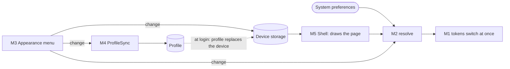
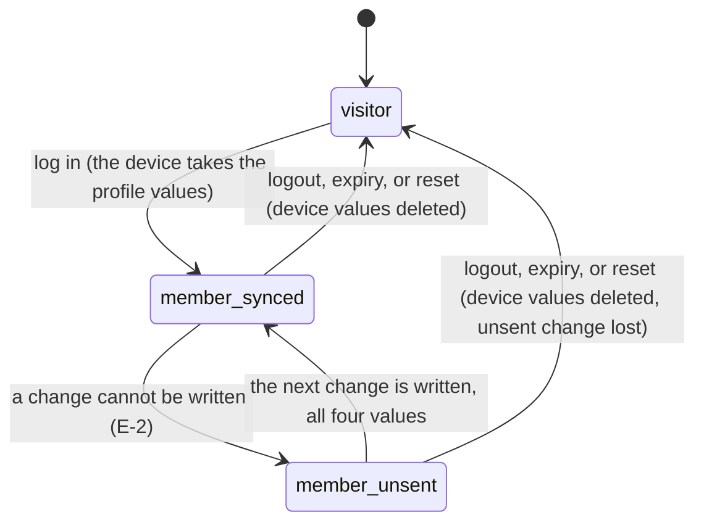

# Design system & accessibility modes Concept

The specification of roadmap feature R4: how members choose a theme, a colour mode, a font size, and reduced motion in one Appearance menu, how the shell of the web client and the Appearance menu work by keyboard and screen reader, and which rules every other screen follows. It is written for the feature's owner (schwaigc), its reviewers, the owners of the other screens who must follow its cross-cutting rules, and the agents that implement it. Part H is the plain-language view; Part S is binding. The grilling rounds Q377–Q401 are distilled in §13; their verbatim text is in the chat export `docs/prompts/`.

# Part H — For Human Readers

This part adds no rule. It summarizes Part S and cites its IDs; where the two disagree, Part S wins (P-HUM-3).

## H1. In one sentence

Members choose theme, colour mode, font size, and reduced motion in one Appearance menu, and the shell and shared rules make stash usable by keyboard and screen reader, so that everyone can use it. This serves the project goal `G-1` (store, find, and use files on the organisation's own server) because everyone in the organisation — also with a screen reader, keyboard only, or high contrast — can then use the files on their own server. It serves the success signal `G-1.S2` (accessibility: automated checks with 0 violations on every page) through the member role `R-1` (member), who needs the product "also with a screen reader, keyboard only, or high contrast". It touches no non-goal (assumption A1 of Q377: R4 serves `G-1.S2` and violates no non-goal).

## H2. Who benefits and how

- **Member (`R-1`)**: finds one button "Appearance" in the header of every page ([DSA-U-1] (Appearance menu)). In it they pick one of four themes ([DSA-F-2] (four themes)), one of four colour modes ([DSA-F-19] (one colour mode)), one of three font sizes ([DSA-F-20] (font sizes)), and reduced motion ([DSA-F-8] (reduced motion)); every choice can be reset to what the system asks for ([DSA-F-26] (follow system)), and the menu shows what is stored about them ([DSA-NF-15] (right of access)). A change takes effect at once ([DSA-U-3] (applies at once)) and follows the member to every device they log in on ([DSA-F-9] (preferences in the profile), [DSA-F-16] (theme in the profile), [DSA-F-22] (profile wins)). The shell gives every page a skip link, a visible focus indicator, landmarks, and spoken status messages ([DSA-US-3] (keyboard and screen reader shell)).
- **Visitor (`R-4`) and link recipient (`R-3`)**: see no Appearance menu; the page follows what their system asks for (dark or light, more contrast, less motion), and nothing is stored about them ([DSA-F-21] (system preferences), [DSA-NF-14] (nothing stored for visitors)). Their pages are checked for accessibility as well ([DSA-F-15] (automated check)).
- **Owners of other screens** (not a role of `GOAL.md`): link the cross-cutting rules for keyboard operation ([DSA-NF-6] (keyboard operation)), tab order ([DSA-NF-7] (tab order)), names and roles ([DSA-NF-8] (names and roles)), and status messages ([DSA-NF-9] (live regions)) instead of writing them again.
- **Operator (`R-2`), content editor (`R-5`)**: nothing changes for them.

## H3. How it works, step by step

1. A page for a logged-in member is drawn with the choices stored on the device, so the first picture is already right ([DSA-F-17] (preferences remembered on the device)). Where a value is missing, the page follows the system: dark or light colour scheme, more contrast, reduced motion ([DSA-F-21] (system preferences)). A page for a person without a session ignores and deletes any such device values ([DSA-F-23] (device values end without a session)).
2. A logged-in member opens "Appearance" in the header, with the mouse, the Enter key, or the Space key, and sees the four controls with the stored values selected ([DSA-AC-2.8] (Appearance menu), [DSA-U-2] (controls and labels), [DSA-U-5] (stored value shown)). Escape closes the menu and returns focus to the button.
3. Choosing a theme changes the look at once ([DSA-AC-1.2] (four themes)). Choosing a colour mode switches exactly one of four modes on: high contrast gives text a contrast of at least 7:1; the two alternative-colours modes change the status and accent colours so that they stay apart for people with red-green or blue-yellow colour vision ([DSA-AC-2.1] (high contrast), [DSA-AC-2.2] (alternative colours red-green), [DSA-AC-2.6] (alternative colours blue-yellow), [DSA-AC-2.7] (one colour mode)). Light and sepia use the light palette of a mode, dark and night the dark one. "Follow system" goes back to what the system asks for ([DSA-AC-2.10] (follow system)).
4. Choosing a font size scales all text to 87.5 %, 100 %, or 125 % ([DSA-AC-4.3] (font size)); switching reduced motion on stops every animation and transition ([DSA-AC-4.2] (reduced motion by hand)). At the font size normal, in a window 1280 px wide, the layout still holds when the browser text is raised to 200 % ([DSA-AC-4.4] (zoom 200 %)). "Normal", "Follow system", and switching reduced motion off delete the stored value; when all four are deleted, the profile record is deleted ([DSA-AC-4.6] (reset to the system)).
5. Each change is kept on the device and in the member's profile. When the member logs in on another device, the values of the profile replace what the device holds ([DSA-AC-2.4] (colour mode saved), [DSA-AC-4.5] (font size and reduced motion saved), [DSA-AC-1.6] (theme in the profile)). If the profile cannot be reached, the change stays on the device and is sent again with the next change; a change that is still unsent at logout is lost ([DSA-E-2] (profile not reachable), A16 of §13).
6. Without a mouse, the first Tab press shows a link "Skip to main content"; Tab then walks through every control in reading order, each with a clearly visible focus indicator ([DSA-AC-3.1] (no mouse needed), [DSA-AC-3.2] (skip link)). A screen reader finds one header and one main landmark ([DSA-AC-3.6] (landmarks)) and hears status messages without losing its place ([DSA-AC-3.7] (status announcer)).
7. In the pipeline an automated accessibility check opens every page as a logged-in member in each of the 16 combinations of theme and colour mode, and as a visitor on every public page and the share-link page with the system's light or dark scheme and contrast preference, and fails on one violation of any severity ([DSA-AC-3.5] (automated check)). A written protocol records manual runs with two common screen readers ([DSA-AC-3.4] (manual tests)).

## H4. What it deliberately does not do

- It does not give visitors a menu or store anything for them (§12; [DSA-NF-14] (nothing stored for visitors)).
- It does not specify the accessibility of the file browser, dialogs, or the upload progress; those screens belong to the R6 web client, which links the rules of §6 (§12, §14).
- It does not make a separate high-contrast palette per theme: one light and one dark palette serve the four themes (§12, Q379).
- It stores only the four display choices and no attribute derived from them; labels describe the display, never the person ([DSA-NF-10] (four values only), [DSA-U-4] (neutral labels)). Whether the four values count as health data is an open legal question (L1).
- It does not decide the legal questions L1 and L2; they go to the school management (§13). The slices that store into the profile wait for the answer to L1; device storage goes ahead while L2 is open, and a consent step follows if L2 is answered no (Q399).

## H5. How it is built, in plain words

The shared UI package holds the design tokens — every colour, size, and spacing value in one place — and switches whole sets of them by theme, colour mode, and font size ([DSA-F-1] (central tokens)). Six palettes serve the colour modes: for each of high contrast and the two alternative-colours modes a light and a dark one ([DSA-F-6] (high contrast), [DSA-F-7] (alternative colours red-green), [DSA-F-18] (alternative colours blue-yellow)). The same package has small helper functions that read the stored values, check them, combine them with the system preferences into the values that apply, and write them back ([DSA-F-17], [DSA-F-21], §8, §16 module M2), and the components: the Appearance menu, the status announcer, and the status badge that always shows a status by icon and text ([DSA-NF-4] (no colour alone)).

The web client draws the shell around every page: skip link, header with the Appearance menu for a logged-in member, one main landmark, and the announcer. It reads the stored values before drawing and, after login, the profile ([DSA-F-22] (profile wins)). The profile holds at most four values per member, in a record of its own that is deleted with the last value and with the account ([DSA-NF-10], [DSA-NF-13] (deleted with the account), [DSA-F-27] (profile record ends with the last value)). Everything that checks colours (contrast, colour distance for simulated colour-vision deficiencies) is computed inside the tests ([DSA-C-6] (colour measurement)).

## H6. How we know it works

Every acceptance criterion of the four stories has one acceptance test in §17, for example [DSA-T-4] (contrast in every theme), [DSA-T-10] (colour mode saved), [DSA-T-20] (Appearance menu), and [DSA-T-16] (automated check). The tests of colours — contrast, colour distance, and the simulated colour vision ([DSA-T-4], [DSA-T-7] (high contrast), [DSA-T-8] (alternative colours red-green)) — read the token stylesheet and run in the test job without a browser; the unit tests with the values of §10 cover the colour measures, the values that apply, the adoption of the profile at login, and the announcer ([DSA-T-32] (contrast measure) to [DSA-T-47] (menu names and roles)). Integration tests cover the error conditions and the privacy rules ([DSA-T-26] (profile not reachable), [DSA-T-29] (no values in logs)). The checks in a real browser — motion, 200 % zoom, the keyboard walk, the first picture after login, and the automated check in 16 combinations plus the visitor runs — run in one pipeline job against the built web client ([DSA-T-9] (reduced motion), [DSA-T-11] (zoom 200 %), [DSA-T-12] (keyboard only), [DSA-T-16]). Manual screen-reader runs are recorded by a person in the protocol ([DSA-T-15] (manual screen-reader tests)).

## H7. Key decisions

Decided with the owner on 2026-11-17 (rounds Q377–Q401); the full table is §13.

| Question | Decision | Reason |
| --- | --- | --- |
| Q378 Theme model | Four themes; high contrast, alternative colours, reduced motion are modes ([ADR-0010](../adr/0010-four-themes-with-colour-modes.md)) | The project proposal says four UI systems and modes; `docs/` wins over the profile's six themes |
| Q379 High contrast | A light and a dark palette; text at least 7:1 | Keeps the member's brightness; WCAG AAA |
| Q380, Q381 Colour modes | One choice with four values; two alternative-colours modes, each in a light and a dark palette | One state is simpler to use and to test than independent switches |
| Q388 Colour distance | ΔE2000 of at least 15 between every pair of status and accent colours in the simulated vision | "Distinguishable" becomes a number |
| Q382 Storage | Four values, in the profile and on the device; profile replaces the device at login; nothing derived, nothing logged, deleted with the account | Preferences can point to a disability; store the minimum |
| Q383 Appearance menu | One menu in the header owned by R4; account settings only link to it | One home for the controls |
| Q384 Cross-cutting rules | Keyboard, tab order, names, and live regions are `DSA-NF` rules every screen links; the acceptance criterion for the file-browser names and roles moves to R6 | R4 cannot test screens it does not own |
| Q385, Q398 Automated check | 0 violations of any severity in every theme and colour mode, and for visitors on every public page and the share-link page | Matches `G-1.S2` |
| Q387 Story split | DSA-US-2 colour modes, new DSA-US-4 font size and reduced motion | Each story fits into one sprint slice set |
| Q399 Legal questions | Profile slices wait for the answer to L1; device storage goes ahead while L2 is open | Health data may not be stored before the school management answers |
| Q400 Follow system | Each choice can be reset; the menu shows the stored values; the profile record goes with the last value | The member keeps control and can see what is stored |

# Part S — Specification (normative)

## 0. Synthesis Context

### Development Path

Path A (frontloaded). The first draft of 2026-10-06 came from the team's tracker issues. It was grilled with its owner on 2026-11-17 (Phases 1–3, rounds Q377–Q401, §13); Phases 5 and 6 (§16, §17) were written in the same change. An adversarial check of the goal trace and Part H (Q391) ran on one reviewer; its 22 findings are resolved in §13 (Q398–Q401, A13–A16). The Phase 4 review gate is pending: the PM approver `trutscf1` signs it off by approving the merge request. The code of the issues #68, #106, #71, and #72 predates this grilling; §14 lists where it differs and §16 names the slices that rework it. Open: the legal questions L1 and L2 for the school management; the slices that store into the profile wait for L1 (Q399).

### Synthesis Dependencies

- [scaffolding.md](scaffolding.md) — the monorepo with the shared UI package (SCF-F-18), the web unit and its shell, the own `users` table that every member has exactly once (SCF-F-24), the example configuration, and the browser test runner.
- [identity.md](identity.md) — login, logout, the session that tells the web client whether a person is a logged-in member, and the deletion of an account (IDN-US-8).
- [public-content.md](public-content.md) — the public pages; a visitor sees them following the system preferences and without the menu, a logged-in member sees the menu on them like on every page ([PUB-NF-3] no tracking).
- [web-client.md](web-client.md) — the R6 screens that follow the cross-cutting rules of §6, and the account settings that link to the Appearance menu.
- [observability.md](observability.md) — [OBS-NF-2] (no person identifiers): the four values never enter telemetry.

### Synthesis Scope

From this document and `STACK.md` §4: the token stylesheet with its themes, colour-mode palettes, font sizes, motion rule, and focus rule; the preference helpers; the Appearance menu, the status announcer, and the status badge; the shell of the web client (skip link, header, landmarks, announcer); the profile record and its read and write; the automated browser check; and the screen-reader protocol.

### Owner

schwaigc, per [ROADMAP.md](../ROADMAP.md).

## 1. Purpose & Goal Trace

**Feature goal:** Members choose theme, colour mode, font size, and reduced motion in one Appearance menu, and the shell and shared rules make stash usable by keyboard and screen reader, so that everyone can use it.

**Serves:** `G-1` and `G-1.S2` in [GOAL.md](../GOAL.md), as stated in the *Serves* column of [ROADMAP.md](../ROADMAP.md). It serves `G-1` itself because everyone in the organisation, also with a screen reader, keyboard only, or high contrast, can then use the files on their own server (the member role `R-1` needs the product "also with a screen reader, keyboard only, or high contrast"). It serves `G-1.S2` (accessibility: automated checks on every page with 0 violations in the pipeline of every release): the check of [DSA-F-15] (automated check) is the measurement of the signal. No non-goal is touched; no part of `GOAL.md` changes (Q377, assumption A1 (R4 serves `G-1.S2` and violates no non-goal)). The theme model deviates from the engineering profile rule P-DES-9 (six colour themes and three font sizes), not from the project proposal: [ADR-0010](../adr/0010-four-themes-with-colour-modes.md).

## 2. Ubiquitous Language & Context

Defined in [CONTEXT.md](../CONTEXT.md) and used here exactly: **member**, **account**, **profile**, **session**, **theme**, **colour mode**, **font size**, **reduced motion**, **appearance menu**, **appearance preferences**, **public page**.

Used only in this document:

- **Design token**: a named value (colour, spacing, type size, radius) defined once in the shared UI package; a *semantic colour token* names a role (`background`, `foreground`, `muted`, `accent`, `accent-foreground`, `border`, `surface`, `status-success`, `status-warning`, `status-danger`, `status-info`), never a colour.
- **Palette**: the set of values of the colour tokens in one theme or one colour mode. A *light palette* serves the themes light and sepia, a *dark palette* the themes dark and night.
- **Base size**: the browser's default font size, 16 px in the tests.
- **System preferences**: what the person's operating system or browser asks for: colour scheme (`light`, `dark`, or none), contrast (`more` or none), reduced motion (yes or no).
- **Device storage**: the browser's own memory on one device, readable by the web client when it draws a page.
- **Skip link**: the first focusable element of a page, a link "Skip to main content".
- **Landmark**: a named region of a page (banner, main) that a screen reader lists.
- **Focus indicator**: the visible mark on the control that has keyboard focus.
- **Status announcer**: the part of the shell that makes a status or error message audible to a screen reader without moving focus.
- **Status colours**: the four colours `status-success`, `status-warning`, `status-danger`, `status-info`; they only mark a status, text or an icon always says it.

## 3. User Stories & Acceptance Criteria

The user stories and their acceptance criteria are the work items in [work-items/E04-design-system/](../work-items/E04-design-system/epic.md); they are not repeated here (P-DOC-6). The behaviour for a person without a session (visitor `R-4`, link recipient `R-3`) is specified by requirements only ([DSA-F-21], [DSA-NF-14], [DSA-F-15]); no story has the role `R-3` or `R-4`, and [PUB-NF-3] (no tracking) of [public-content.md](public-content.md) holds.

## 4. Functional Requirements

| ID | Title | Requirement | Derives from |
| --- | --- | --- | --- |
| DSA-F-1 | Central tokens | The shared UI package MUST define every colour, spacing, type-size, and radius value of the interface as a design token in one place, and a component or page MUST use colours only through semantic colour tokens, never a fixed colour value. | DSA-AC-1.1 (Central tokens) |
| DSA-F-2 | Four themes | The Appearance menu MUST offer exactly the four themes light, dark, sepia, and night; choosing one MUST change the theme at once without a reload and MUST keep it as [DSA-F-16] and [DSA-F-17] say. High contrast, alternative colours, and reduced motion MUST NOT be themes. | DSA-AC-1.2 (Four themes) |
| DSA-F-3 | Component base | Every component of the design system MUST be built from the project's component library and the design tokens of [DSA-F-1]. | DSA-AC-1.3 (Component base) |
| DSA-F-4 | Contrast | In each of the four themes in the colour mode standard, every text colour token MUST reach a contrast of at least 4.5:1 (WCAG AA) against the background colour token it is shown on: `foreground`, `muted`, and `accent` on `background` and on `surface`, and `accent-foreground` on `accent`. | DSA-AC-1.4 (Contrast) |
| DSA-F-5 | Component catalogue | Every exported component of the shared UI package MUST have at least one entry in the component catalogue ([DSA-C-3]), which MUST show it in each of the four themes. | DSA-AC-1.5 (Component catalogue) |
| DSA-F-6 | High contrast | In the colour mode high contrast, every text colour token MUST reach at least 7:1 (WCAG AAA) against the background colour token it is shown on, as in [DSA-F-4]. The themes light and sepia MUST use the light high-contrast palette, the themes dark and night the dark one. | DSA-AC-2.1 (High contrast) |
| DSA-F-7 | Alternative colours red-green | In the colour mode alternative colours red-green, the system MUST replace the status colours and the accent colour by the palette of the brightness of the theme: the light palette for light and sepia, the dark palette for dark and night. All other colours MUST follow the theme. | DSA-AC-2.2 (Alternative colours red-green) |
| DSA-F-8 | Reduced motion | While reduced motion is on, because the member switched it on or because the system preference asks for it, no animation and no transition MUST run on any page, and scrolling MUST NOT animate. Switching the switch off MUST delete the stored value and MUST NOT override a reduced-motion system preference. | DSA-AC-4.1 (System reduced motion), DSA-AC-4.2 (Reduced motion by hand) |
| DSA-F-9 | Preferences in the profile | When a logged-in member changes the colour mode, the font size, or reduced motion, the system MUST save the new value in their profile so that it applies on every device they log in on. | DSA-AC-2.4 (Colour mode saved), DSA-AC-4.5 (Font size and reduced motion saved) |
| DSA-F-10 | Zoom 200 % | At the font size normal, in a window 1280 px wide, with the browser text size raised to 200 % (root font size 32 px at the base size 16 px), every page MUST show no content that overlaps other content, no content that is cut off by its box, and no horizontal scroll bar. | DSA-AC-4.4 (Zoom 200 %) |
| DSA-F-11 | Visible focus indicator | One global rule MUST give every focusable element a focus indicator of an outline 2 px wide in the accent colour at a distance of 2 px, and no component MUST remove it without an equal replacement. | DSA-AC-3.1 (No mouse needed) |
| DSA-F-12 | Skip link | The first focusable element of every page MUST be the link "Skip to main content"; it MUST be hidden until it has focus, MUST then be shown in the top corner of the page, and activating it MUST move focus to the main content. | DSA-AC-3.2 (Skip link) |
| DSA-F-14 | Manual tests | The documentation set MUST hold a protocol for manual tests with two common screen readers, one per desktop platform, with steps per page and control and one result table (date, tester handle, screen reader and version, browser, result `pass`, `pass with findings`, or `fail`, findings); the criterion counts as met once one run per screen reader is recorded. | DSA-AC-3.4 (Manual tests) |
| DSA-F-15 | Automated check | A browser check MUST run the automated accessibility check ([DSA-C-7]) on every page of the web client, logged in as a test member, in each of the 4 themes combined with each of the 4 colour modes, with the Appearance menu closed and open; and it MUST run it without a session, as a visitor, on every public page and on the share-link page, with the system colour scheme light and dark, each with and without the system contrast preference `more` (4 combinations). The pipeline MUST fail when the check reports one violation of any severity. A failure message MUST name the page, the combination, and the violated rule. | DSA-AC-3.5 (Automated check) |
| DSA-F-16 | Theme in the profile | When a logged-in member chooses a theme, the system MUST save it in their profile so that it applies on every device they log in on. | DSA-AC-1.6 (Theme in the profile) |
| DSA-F-17 | Preferences remembered on the device | When a logged-in member changes an appearance preference, the system MUST apply it to the page at once and MUST keep the values the member chose, never the values that apply, on the device so that the next page is drawn with them from its first picture; a kind the member reset is not kept. Each of the four kept values MUST be readable on its own, so that an unknown or missing value does not affect the others. | DSA-AC-1.2 (Four themes), DSA-AC-2.4 (Colour mode saved), DSA-AC-4.5 (Font size and reduced motion saved) |
| DSA-F-18 | Alternative colours blue-yellow | In the colour mode alternative colours blue-yellow, the system MUST replace the status colours and the accent colour by the palette of the brightness of the theme: the light palette for light and sepia, the dark palette for dark and night. All other colours MUST follow the theme. | DSA-AC-2.6 (Alternative colours blue-yellow) |
| DSA-F-19 | One colour mode | The colour mode MUST be exactly one of standard, high contrast, alternative colours red-green, and alternative colours blue-yellow; choosing one MUST switch the previously chosen one off. | DSA-AC-2.7 (One colour mode) |
| DSA-F-20 | Font sizes | The font size MUST be one of small, normal, and large, which scale all text sizes and spacing to 87.5 %, 100 %, and 125 % of the base size; without a stored choice it MUST be normal, and choosing "Normal" MUST delete the stored value. | DSA-AC-4.3 (Font size) |
| DSA-F-21 | System preferences | For each of theme, colour mode, and reduced motion without a stored value, the system MUST follow the system preferences: the system colour scheme dark gives the theme dark and every other case the theme light; the contrast preference `more` gives the colour mode high contrast and every other case standard; the reduced-motion preference gives reduced motion on. A stored value MUST win over the system preference, except that reduced motion is on when either asks for it. | DSA-AC-2.9 (System preferences), DSA-AC-4.1 (System reduced motion) |
| DSA-F-22 | Profile wins | When a person logs in, the system MUST replace the four values on the device with the four values of their profile; a kind without a profile value MUST become not stored. | DSA-AC-1.6 (Theme in the profile), DSA-AC-2.4 (Colour mode saved), DSA-AC-4.5 (Font size and reduced motion saved) |
| DSA-F-23 | Device values end without a session | Device values MUST apply only while a valid session exists. A page drawn for a person without a valid session MUST ignore the four values on the device and MUST delete them, whatever ended the session (logout, expiry, or a password reset), so that the next person on the device starts from the system preferences. | DSA-AC-2.9 (System preferences) |
| DSA-F-24 | Landmarks | Every page of the web client MUST have exactly one banner landmark, the header, and exactly one main landmark that holds the content of the page; a page MUST NOT add a second main landmark. | DSA-AC-3.6 (Landmarks) |
| DSA-F-25 | Status announcer | The shell MUST provide one status announcer with the function `announce(message, urgency)`; a message of urgency `status` MUST be announced after the current speech, a message of urgency `error` at once, both without moving focus, and the announcer MUST NOT be a stop in the tab order. | DSA-AC-3.7 (Status announcer) |
| DSA-F-26 | Follow system | Each of the four choices MUST have a value that deletes the stored value of its kind on the device and in the profile: "Follow system" for the theme and the colour mode, "Normal" for the font size (the base size), and the switch off for reduced motion. The kind then follows the system preferences or its default ([DSA-F-21], [DSA-F-20]). | DSA-AC-2.10 (Follow system), DSA-AC-4.6 (Reset to the system) |
| DSA-F-27 | Profile record ends with the last value | When the last of the four values of a member is deleted, the system MUST delete the member's profile record; a record MUST exist only while at least one value is stored. | DSA-AC-4.6 (Reset to the system) |

## 5. User Interaction Requirements

The users of these requirements are logged-in members. Labels are the English texts of the interface.

| ID | Title | Requirement | Derives from |
| --- | --- | --- | --- |
| DSA-U-1 | Appearance menu | The header of every page, a public page included, MUST show a button "Appearance" to a logged-in member and MUST NOT show it to a person without a session. The button MUST open a menu with the four controls of [DSA-U-2] by mouse and by the Enter or Space key; the Escape key MUST close the menu and return focus to the button. Theme, colour mode, font size, and reduced motion MUST be changed nowhere else; another screen MAY link to the menu. | DSA-AC-2.8 (Appearance menu) |
| DSA-U-2 | Controls and labels | The menu MUST hold: the control "Theme" with the options "Follow system", "Light", "Dark", "Sepia", and "Night"; the control "Colour mode" with the options "Follow system", "Standard", "High contrast", "Alternative colours red-green", and "Alternative colours blue-yellow", exactly one selected; the control "Font size" with the options "Small", "Normal", and "Large"; and the switch "Reduced motion". | DSA-AC-2.8 (Appearance menu), DSA-AC-2.10 (Follow system), DSA-AC-4.2 (Reduced motion by hand), DSA-AC-4.3 (Font size) |
| DSA-U-3 | Applies at once | A change in the menu MUST take effect on the page being viewed without a reload, without a navigation, and without the control losing focus. | DSA-AC-1.2 (Four themes), DSA-AC-2.7 (One colour mode), DSA-AC-4.2 (Reduced motion by hand), DSA-AC-4.3 (Font size) |
| DSA-U-4 | Neutral labels | A label, tooltip, help text, or announcement of the interface MUST NOT name a condition or an impairment of a person; labels describe the display ("Alternative colours red-green"), never the user ("colour-blind"). | DSA-AC-2.2 (Alternative colours red-green), DSA-AC-2.6 (Alternative colours blue-yellow) |
| DSA-U-5 | Stored value shown | The menu MUST show the stored value of each kind as selected, and "Follow system" (theme, colour mode) or "Normal" (font size) when none is stored; beside "Follow system" it MUST show the value that applies, for example "Follow system (Dark)". While the system asks for reduced motion and no value is stored, the switch "Reduced motion" MUST be off and show the text "On: the system asks for it". | DSA-AC-2.8 (Appearance menu), DSA-AC-2.9 (System preferences), DSA-AC-4.1 (System reduced motion) |

## 6. Non-Functional Requirements

DSA-NF-1 to DSA-NF-9 are cross-cutting: every concept that specifies a screen links the rows it needs instead of restating them (Q384). They apply to every page and component of the web client, in every theme and colour mode.

| ID | Title | Requirement | Derives from |
| --- | --- | --- | --- |
| DSA-NF-1 | Text contrast in every combination | In each of the 16 combinations of the 4 themes and the 4 colour modes, every text colour MUST reach at least 4.5:1 against the background it is shown on, and in the colour mode high contrast at least 7:1. | DSA-AC-1.4 (Contrast), DSA-AC-2.1 (High contrast), DSA-AC-2.2 (Alternative colours red-green), DSA-AC-2.6 (Alternative colours blue-yellow) |
| DSA-NF-2 | Colours stay apart | In the colour mode alternative colours red-green, every pair among the four status colours and the accent colour (10 pairs) MUST differ by a CIE ΔE2000 of at least 15 as seen with simulated protanopia and as seen with simulated deuteranopia; in the colour mode alternative colours blue-yellow, as seen with simulated tritanopia. The simulation MUST use severity 1.0, and the measure MUST hold in the light and in the dark palette. | DSA-AC-2.2 (Alternative colours red-green), DSA-AC-2.6 (Alternative colours blue-yellow) |
| DSA-NF-3 | High contrast stays apart | In the colour mode high contrast, the same 10 pairs MUST differ by a CIE ΔE2000 of at least 15 as seen with simulated protanopia, with simulated deuteranopia, and with simulated tritanopia, in the light and in the dark palette. | DSA-AC-2.1 (High contrast) |
| DSA-NF-4 | No colour alone | In every theme and colour mode, no information MUST be conveyed by colour alone: every status and every state of a control MUST also be shown by a text or by an icon whose shape differs per status. | DSA-AC-2.2 (Alternative colours red-green), DSA-AC-2.6 (Alternative colours blue-yellow) |
| DSA-NF-5 | Marks reach 3:1 | The focus indicator and each status colour MUST reach a contrast of at least 3:1 against `background` and against `surface` in each of the 16 combinations (WCAG 1.4.11). | DSA-AC-3.1 (No mouse needed), DSA-AC-2.2 (Alternative colours red-green) |
| DSA-NF-6 | Keyboard operation | Every function of every page MUST be operable with the keyboard alone, and every focusable element MUST show the focus indicator of [DSA-F-11]. | DSA-AC-3.1 (No mouse needed) |
| DSA-NF-7 | Tab order | The tab order MUST follow the reading order, an element MUST NOT have a positive tab index, and a composite widget (toggle group, radio group, menu) MUST be one tab stop whose parts the arrow keys move between. | DSA-AC-3.1 (No mouse needed) |
| DSA-NF-8 | Names and roles | Every interactive element, region, and dialog MUST have an accessible name and a role that describes it (a role, name, and state exposed to assistive technology where the element itself does not carry them), and a state that changes (expanded, selected, checked, busy) MUST be exposed. | DSA-US-3 (Keyboard and screen reader shell) |
| DSA-NF-9 | Live regions | A progress or status message MUST be exposed to a screen reader through a live region, in this feature through the status announcer ([DSA-F-25]), so that it is announced without moving focus. | DSA-AC-3.7 (Status announcer) |
| DSA-NF-10 | Four values only | The system MUST store at most four values per member — theme, colour mode, font size, reduced motion — in the profile and on the device, and MUST NOT store any attribute derived from them or from the use of a mode (for example "impaired" or "colour-blind"). | DSA-AC-1.6 (Theme in the profile), DSA-AC-2.4 (Colour mode saved), DSA-AC-4.5 (Font size and reduced motion saved) |
| DSA-NF-11 | Not in logs or telemetry | The four values MUST NOT appear in any log entry, metric, span, or audit-log entry, in a message, an attribute, or a label. | DSA-AC-2.4 (Colour mode saved), DSA-AC-4.5 (Font size and reduced motion saved) |
| DSA-NF-12 | Only the member reads them | Only the logged-in member to whom the four values belong MUST be able to read them; an administrator, a team owner, or an operator MUST NOT be able to read them through the product. | DSA-AC-2.4 (Colour mode saved), DSA-AC-4.5 (Font size and reduced motion saved) |
| DSA-NF-13 | Deleted with the account | When an account is deleted, the system MUST delete the member's profile values in the same step. | DSA-AC-2.4 (Colour mode saved), DSA-AC-4.5 (Font size and reduced motion saved) |
| DSA-NF-14 | Nothing stored for visitors | For a person without a session, the system MUST NOT write any appearance value to the device storage or to the server; deleting a value on the device is allowed ([DSA-F-23]). | DSA-AC-2.9 (System preferences) |
| DSA-NF-15 | Right of access | A logged-in member MUST be able to see in the Appearance menu every value stored about them, and which kinds have none stored ([DSA-U-5]). | DSA-AC-2.8 (Appearance menu) |

## 7. Capability Requirements

Mapped to technology in `STACK.md` §4 (track Web) and listed in its capability index.

| ID | Title | Requirement | Derives from |
| --- | --- | --- | --- |
| DSA-C-1 | Design token mechanism | A mechanism to define named design values (colour, spacing, type size, radius) once and to switch whole sets of them per theme, per colour mode and its brightness variant, and per font size at run time without a reload, and to use them in every component. | DSA-AC-1.1 (Central tokens), DSA-AC-2.1 (High contrast), DSA-AC-4.3 (Font size) |
| DSA-C-2 | Accessible component primitives | A library of unstyled interface components (menu, toggle group, radio group, switch) that handles keyboard operation, focus movement, and roles, names, and states for assistive technology itself and can be styled with the design tokens. | DSA-AC-1.3 (Component base), DSA-AC-2.8 (Appearance menu) |
| DSA-C-3 | Component catalogue | A tool that shows each component in isolation, with a toolbar to switch theme, and that builds in the pipeline. | DSA-AC-1.5 (Component catalogue) |
| DSA-C-4 | System preference query | Reading the system colour scheme, the contrast preference, and the reduced-motion preference in the browser, in the styles and in code. | DSA-AC-2.9 (System preferences), DSA-AC-4.1 (System reduced motion) |
| DSA-C-5 | Device storage on request | A storage on the device that the web client can read when it draws a page, so that the first picture is right, with a lifetime of one year. | DSA-AC-1.2 (Four themes), DSA-AC-2.4 (Colour mode saved) |
| DSA-C-6 | Colour measurement | Computing, from `#rrggbb` values and without network, the WCAG contrast ratio, the CIE ΔE2000 distance, and the colour as seen with simulated protanopia, deuteranopia, and tritanopia at severity 1.0. | DSA-AC-1.4 (Contrast), DSA-AC-2.2 (Alternative colours red-green), DSA-AC-2.6 (Alternative colours blue-yellow) |
| DSA-C-7 | Automated accessibility check | An engine that runs accessibility rules (WCAG 2.x A, AA, and best practice) in a real browser on a rendered page, in a state the test sets, and reports each violation with its rule and impact; it needs the browser test runner of `scaffolding.md` (SCF-C-13). | DSA-AC-3.5 (Automated check) |
| DSA-C-8 | Screen readers for manual tests | Two common screen readers, one per desktop platform, available to testers for the manual protocol. | DSA-AC-3.4 (Manual tests) |

## 8. Data Model

Neutral record types.

```text
Theme        = enum(light|dark|sepia|night)
ColourMode   = enum(standard|high-contrast|alternative-red-green|alternative-blue-yellow)
FontSize     = enum(small|normal|large)
Brightness   = enum(light|dark)        // light for the themes light and sepia, dark for dark and night

AppearancePreferences {                // the at most four stored values of one member (DSA-NF-10); a deleted value is absent
  theme: optional<Theme>,              // absent: follows the system colour scheme (DSA-F-21)
  colourMode: optional<ColourMode>,    // absent: follows the system contrast preference (DSA-F-21)
  fontSize: optional<FontSize>,        // absent: normal (DSA-F-20); "Normal" is stored as absent (DSA-F-26)
  reducedMotion: optional<boolean>     // true: switched on by hand; absent: not switched on (the switch off deletes it)
}

SystemPreferences {
  colourScheme: enum(light|dark|none),
  contrast: enum(more|none),
  reducedMotion: boolean
}

EffectiveAppearance {                  // what a page is drawn with
  theme: Theme,
  colourMode: ColourMode,
  fontSize: FontSize,
  reducedMotion: boolean
}

StatusMessage { message: string, urgency: enum(status|error) }   // message 1..200 characters after trim
```

The palette variant of a colour mode is the brightness of the theme: light and sepia use `light`, dark and night use `dark`. The colour tokens of each of the 4 themes and the palettes of the 3 non-standard colour modes in 2 brightness variants (6 palettes) are the design tokens of [DSA-F-1]; their values are chosen so that [DSA-NF-1] to [DSA-NF-5] hold. The font size scale is `small` 0.875, `normal` 1.0, `large` 1.25 of the base size. The effective appearance is computed by the function `resolve` (§16, module M2).

### Persisted layout

The profile values of one member, one record in a 1:1 relation to the own `users` record of `scaffolding.md`. A member without a row has no stored choice; the row exists only while at least one value is stored ([DSA-F-27]).

| Record | Stored as | Field | Stored field | Type | Encoding | Nullable | Unique | Key | References | Default | On delete |
| --- | --- | --- | --- | --- | --- | --- | --- | --- | --- | --- | --- |
| AppearancePreferences | appearance_preferences | member | user_id | uuid | — | no | yes | primary, foreign | users.id | — | cascade |
| AppearancePreferences | appearance_preferences | theme | theme | enum(light, dark, sepia, night) | lowercase as in §8 | yes | no | none | — | — | — |
| AppearancePreferences | appearance_preferences | colourMode | colour_mode | enum(standard, high-contrast, alternative-red-green, alternative-blue-yellow) | lowercase with hyphens as in §8 | yes | no | none | — | — | — |
| AppearancePreferences | appearance_preferences | fontSize | font_size | enum(small, normal, large) | lowercase as in §8 | yes | no | none | — | — | — |
| AppearancePreferences | appearance_preferences | reducedMotion | reduced_motion | boolean | — | yes | no | none | — | — | — |

### Seed records

n/a — no record is needed before first use; a member without a row follows the system preferences.

This feature has no configuration parameter; every value is fixed by a requirement.

## 9. Error Conditions

| ID | Title | Trigger | Required behavior | Fallback | Derives from |
| --- | --- | --- | --- | --- | --- |
| DSA-E-1 | Unknown stored value | A stored value, on the device or in the profile, is not an allowed value of §8, or cannot be decoded. | The system treats only that value as not stored; the other three values stay as stored. The menu shows the value that applies. | The system preference or the default of [DSA-F-21] and [DSA-F-20]. | DSA-AC-2.9 (System preferences) |
| DSA-E-2 | Profile not reachable | The profile cannot be read at login, or a change cannot be written to it. | At login the page follows the system preferences until the profile can be read; the web client tries again on each next page drawn for the member. A change applies at once and stays on the device, and the status announcer announces with urgency `status` "Your appearance settings could not be saved to your profile." With the next change the system sends all four values on the device again. A change still unsent at logout is lost (trade-off A16, §13). | The device values while the session lasts. | DSA-AC-2.4 (Colour mode saved), DSA-AC-4.5 (Font size and reduced motion saved), DSA-AC-1.6 (Theme in the profile) |
| DSA-E-3 | Device storage unavailable | The device refuses to keep the values. | A change applies to the page being viewed and is saved in the profile. The web client reads the profile on every page drawn for the member. | The system preferences if the profile cannot be read either. | DSA-AC-1.2 (Four themes), DSA-AC-2.4 (Colour mode saved) |
| DSA-E-4 | Save without a session | A request to save appearance preferences carries no valid session. | The system refuses it as not logged in and stores nothing. | None. | DSA-AC-2.9 (System preferences) |
| DSA-E-5 | Value not allowed in a save request | A save request holds a value outside §8. | The system refuses it as invalid and stores none of the values of that request. | None. | DSA-AC-2.4 (Colour mode saved) |

## 10. Worked Examples

**Example 1 — the values that apply ([DSA-F-21], [DSA-F-20], [DSA-F-8]).** Stored values and system preferences go in; `resolve` returns the effective appearance.

| # | Stored (theme, colour mode, font size, reduced motion) | System (colour scheme, contrast, reduced motion) | Effective (theme, colour mode, font size, reduced motion) |
| --- | --- | --- | --- |
| 1 | none | dark, more, no | dark, high-contrast (dark palette), normal, off |
| 2 | none | light, none, yes | light, standard, normal, on |
| 3 | theme sepia | dark, more, no | sepia, high-contrast (light palette), normal, off |
| 4 | theme night, colour mode standard | none, more, no | night, standard (the stored value wins over the contrast preference), normal, off |
| 5 | font size large, reduced motion false | none, none, yes | light, standard, large, on (the system asks, a member cannot switch it off) |
| 6 | theme dark, reduced motion true | light, none, no | dark, standard, normal, on |

**Example 2 — palette variant of a colour mode ([DSA-F-6], [DSA-F-7], [DSA-F-18]).**

| Theme | Brightness | Colour mode high contrast | Colour mode alternative colours red-green |
| --- | --- | --- | --- |
| light | light | light high-contrast palette | light red-green palette |
| sepia | light | light high-contrast palette | light red-green palette |
| dark | dark | dark high-contrast palette | dark red-green palette |
| night | dark | dark high-contrast palette | dark red-green palette |

**Example 3 — contrast measure ([DSA-C-6], [DSA-NF-1]).**

| Foreground | Background | Ratio | Meets 4.5:1 | Meets 7:1 |
| --- | --- | --- | --- | --- |
| `#000000` | `#ffffff` | 21.00 | yes | yes |
| `#333333` | `#ffffff` | 12.63 | yes | yes |
| `#767676` | `#ffffff` | 4.54 | yes | no |
| `#777777` | `#ffffff` | 4.48 | no | no |

**Example 4 — colour distance ([DSA-C-6], [DSA-NF-2]).** CIE ΔE2000 of two colours given as CIE Lab values (published reference pairs of Sharma, Wu, and Dalal, 2005), and of the standard palette's `status-danger` `#b91c1c` and `status-success` `#15803d` as seen with simulated vision at severity 1.0.

| Colour A | Colour B | Vision | ΔE2000 | At least 15 |
| --- | --- | --- | --- | --- |
| Lab 50.0000, 2.6772, −79.7751 | Lab 50.0000, 0.0000, −82.7485 | — | 2.04 | no |
| Lab 50.0000, 2.5000, 0.0000 | Lab 73.0000, 25.0000, −18.0000 | — | 27.15 | yes |
| `#b91c1c` | `#15803d` | protanopia | 16.02 | yes |
| `#b91c1c` | `#15803d` | deuteranopia | 8.46 | no |
| `#b91c1c` | `#15803d` | tritanopia | 59.47 | yes |

The pair of the standard palette fails under deuteranopia (8.46), which is why the colour mode alternative colours red-green exists; the standard palette also uses the same blue `#1d4ed8` for `accent` and `status-info` in the theme light (ΔE2000 0.00), so the alternative-colours palettes must separate them ([DSA-NF-2] counts the pair accent and info).

**Example 5 — login on a second device ([DSA-F-22], [DSA-AC-2.4], [DSA-AC-4.5]).**

| Step | State | Result |
| --- | --- | --- |
| 1 | A member logged in on device A chooses theme sepia, colour mode high contrast, font size large, and reduced motion on. | The page changes at once. The profile holds sepia, high-contrast, large, true; the device storage of A holds the same four values. |
| 2 | The member logs in on device B, whose device storage is empty. | B shows sepia, high contrast with the light palette, large, and no animation, from the first page after login. The device storage of B now holds sepia, high-contrast, large, true. |
| 3 | Another member, whose profile holds only theme dark, logs in on B after the first member logged out. | B shows dark, standard (the system asks for no more contrast), normal, off; nothing of the first member remains. |
| 4 | A member whose profile holds only theme sepia and whose system prefers more contrast logs in. | The device shows sepia, high-contrast (light palette, from the system preference), normal, off; the colour mode is not stored, so it follows the system. |

**Example 6 — an unknown stored value ([DSA-E-1]).** The device storage holds theme `dark`, colour mode `sepia-contrast`, font size `large`. The colour mode is not allowed, so it counts as not stored: with the system contrast preference `none`, the page shows dark, standard, large; the menu shows "Standard" as selected.

**Example 7 — profile not reachable ([DSA-E-2]).** A logged-in member chooses font size small while the profile cannot be written. The page changes to 87.5 % at once, the device storage holds small, and the status announcer announces "Your appearance settings could not be saved to your profile." The member then chooses the theme night; the profile is reachable again and receives all four values of the device: night and small. Had the member logged out before the second change, small would be lost.

**Example 8 — a visitor ([DSA-F-21], [DSA-NF-14], [DSA-U-1]).** A person without a session opens a public page; their system prefers the dark colour scheme and more contrast. The page shows the theme dark in the colour mode high contrast (dark palette); the header has no "Appearance" button; the response sets nothing on the device and the request writes nothing on the server.

**Example 9 — a session ends ([DSA-F-23]).** A member with theme sepia kept on the device lets the session expire. The next page request carries no valid session: the page follows the system preferences (Example 1, row 1 or 2), shows no "Appearance" button, and deletes the four values from the device storage. After the next login the profile applies again (Example 5, step 2).

**Example 10 — status announcer ([DSA-F-25]).**

| Call | Announced | Focus moves |
| --- | --- | --- |
| `announce("Upload finished", status)` while the screen reader reads a paragraph | "Upload finished", after the paragraph | no |
| `announce("Upload failed", error)` while the screen reader reads a paragraph | "Upload failed", at once, interrupting the paragraph | no |
| `announce("   ", status)` | nothing | no |

**Example 11 — the keyboard walk of a page ([DSA-F-11], [DSA-F-12], [DSA-NF-7]).** On a page with the shell and no other control, logged in: Tab 1 focuses "Skip to main content" and shows it in the top corner; Enter moves focus to the main content. From the top, Tab 1 is the skip link, Tab 2 the button "Appearance"; Enter opens the menu and focus moves to its first control; the toggle group "Theme" is one stop and the arrow keys move between "Light", "Dark", "Sepia", and "Night"; Escape closes the menu and focus is on "Appearance" again.

**Example 12 — reset to the system ([DSA-F-26], [DSA-F-27], [DSA-U-5]).** A logged-in member has theme sepia and font size large in the profile; the system prefers the dark colour scheme.

| Step | Action | Result |
| --- | --- | --- |
| 1 | The member opens the menu. | "Theme" shows "Sepia" selected, "Colour mode" shows "Follow system (Standard)", "Font size" shows "Large", "Reduced motion" is off. |
| 2 | They choose "Follow system" under "Theme". | The stored theme is deleted on the device and in the profile; the page shows dark; "Theme" shows "Follow system (Dark)". The profile still holds font size large. |
| 3 | They choose "Normal" under "Font size". | The stored font size is deleted; no value is stored any more, so the profile record is deleted; the page shows dark, standard, normal, off. |

## 11. Integration Points

Where this feature meets other parts of the system. The interferences behind each point are in §14.

| Point | Between | What crosses it | Specified in |
| --- | --- | --- | --- |
| Device storage | web client ↔ the member's device | The values the member chose, read when a page is drawn for a logged-in member and kept at each change; deleted by a page drawn without a session | [DSA-F-17], [DSA-F-23], [DSA-E-3] |
| Profile read and write | web client ↔ the stored profile | The at most four values of a logged-in member, read at login and written at each change; the record is deleted with the last value | [DSA-F-9], [DSA-F-16], [DSA-F-22], [DSA-F-27], [DSA-E-2], [DSA-E-4], [DSA-E-5] |
| Session | web client ← `identity` | Whether the person has a valid session, that is, is a logged-in member (menu shown, device values apply) | [DSA-U-1], [DSA-NF-14]; [identity.md](identity.md) |
| Account deletion | `identity` → profile | The profile record is deleted with the account | [DSA-NF-13] |
| System preferences | browser → web client | Colour scheme, contrast, reduced motion | [DSA-F-21], [DSA-C-4] |

External contracts: none. The web unit reads and writes the profile record on the server through the database package (Q394); no other unit calls it.

## 12. Out of Scope

- The accessibility of the file browser, dialogs, and the upload progress (the earlier DSA-AC-3.3): the R6 web client owns those screens and their stories ([web-client.md](web-client.md), §14); this feature supplies the rules of §6 and the status announcer.
- Choices of visitors and link recipients: no menu, nothing stored, only the system preferences ([DSA-NF-14]).
- A high-contrast palette per theme: one light and one dark palette serve the four themes (Q379).
- More themes than the four (Q378).
- A font size above "Large" or an own zoom: the browser's zoom and text size serve the rest ([DSA-F-10]).
- The accessibility of tools of other units that are not pages of the web client, such as the operations dashboards ([observability.md](observability.md), §12).
- Language of the interface labels beyond English; the content languages of the public pages belong to [public-content.md](public-content.md).

## 13. Resolved Questions & ADRs

The grilling of 2026-11-17 with the owner (schwaigc), rounds Q377–Q401 (chat export in `docs/prompts/`). Assumptions A1–A12 were confirmed in Q377 and the rounds named below; A13–A16 come from the adversarial check of the same day. [ADR-0010](../adr/0010-four-themes-with-colour-modes.md) records the deviation from P-DES-9.

| Q | Title | Decision | Rationale |
| --- | --- | --- | --- |
| Q377 | Deviations and assumptions | Applied profile decisions unchanged. A1: R4 serves `G-1.S2` and violates no non-goal. A2: only logged-in members see the appearance controls; visitors get the system preference or the default theme and nothing is stored (earlier Q65, [PUB-NF-3] of `public-content.md`). A3: the stories stay; DSA-US-1 (done) changes only where needed. A4: technology words move to `STACK.md` | The concept is stack-neutral (P-DES-4); a visitor has no account to keep a choice in |
| Q378 | Theme model | Project proposal plus parts of P-DES-9: four themes (light, dark, sepia, night); high contrast, alternative colours, and reduced motion are modes; three font sizes; without a stored choice the app follows the system colour scheme, contrast, and motion preferences; labels describe the display, never the user; components use only semantic colour tokens ([DSA-F-1], [DSA-F-20], [DSA-F-21], [DSA-U-4]). ADR-0010 | `docs/` wins over `PROFILE.md`; the proposal says four UI systems and modes |
| Q379 | High-contrast palettes | A light and a dark palette; light and sepia use the light one, dark and night the dark one; text at least 7:1 ([DSA-F-6]) | WCAG AAA; the member keeps a light or dark interface |
| Q380 | Alternative colours | Two modes: "Alternative colours red-green" (protanopia and deuteranopia) and "Alternative colours blue-yellow" (tritanopia). A8: each as a light and a dark palette following the theme's brightness, six extra palettes in total ([DSA-F-7], [DSA-F-18]) | Three separate modes would triple the matrix; two cover the three vision types |
| Q381 | One colour mode | One choice with four values, exactly one active ([DSA-F-19]); the high-contrast palettes are chosen so that they also stay distinguishable for colour-vision deficiencies ([DSA-NF-3]) | One state is simpler to use and to test than independent switches |
| A5 | Font size and zoom | Small 87.5 %, normal 100 %, large 125 % of the base size; the layout also holds 200 % browser zoom ([DSA-F-20], [DSA-F-10]) | The old DSA-AC-2.5 stays as a check |
| A6 | Follow the system | Without a stored value: system colour scheme → light or dark, contrast preference → high contrast, reduced-motion preference → reduced motion; reduced motion can also be switched on by hand and then only adds ([DSA-F-21], [DSA-F-8]) | Respects the person's setting without asking |
| A7 | No colour alone | In every mode no information is conveyed by colour alone ([DSA-NF-4]) | WCAG 1.4.1 |
| Q382, A11 | Storage and privacy | The four values are stored in the member's profile and on the device; after login the profile replaces the device values; only these four values, no derived attribute; never in logs, telemetry, or the audit log; only the member can read them; deleted with the account ([DSA-F-9], [DSA-F-16], [DSA-F-17], [DSA-F-22], [DSA-NF-10] to [DSA-NF-13]) | Preferences can point to a disability; store the minimum (`/gam-v-privacy-by-design`) |
| Q383 | Appearance menu | One menu "Appearance" in the header, owned by R4; the account settings of WEB-US-3 (R6) only link to it; the theme switcher becomes part of it ([DSA-U-1], [DSA-U-2]) | One home for the controls |
| Q384 | Keyboard and screen reader | Keyboard and screen-reader rules are cross-cutting `DSA-NF` requirements ([DSA-NF-6] to [DSA-NF-9]) that every screen concept links. DSA-US-3 delivers the shell: skip link, focus indicator, landmarks, status announcer, the automated check, and the manual test documentation. The old DSA-AC-3.3 (file browser, dialog, upload progress) moves to the R6 stories | R4 cannot specify screens it does not own |
| Q385 | Automated check | 0 violations of any severity on every page in every theme and every colour mode; the pipeline fails otherwise ([DSA-F-15]) | Matches `G-1.S2`; `GOAL.md` unchanged |
| Q386, Q389 | Roles | The roles in DSA-US-2 and DSA-US-3 become "member"; the benefit goes into "so that" | `GOAL.md` has the role member; a condition of the person is not a role |
| Q387 | Story split | DSA-US-2 "Colour modes" (high contrast, alternative colours, colour mode in the profile; weight 5) and the new DSA-US-4 "Font size and reduced motion" (weight 3); order in the epic: US-1, US-2, US-4, US-3 | Each story gets a slice set of at most 4 h per slice |
| Q388 | Measured colours | In the mode red-green (simulated protanopia and deuteranopia) and blue-yellow (simulated tritanopia), every pair of status and accent colours differs by at least ΔE2000 15, and text keeps at least 4.5:1 ([DSA-NF-2], [DSA-NF-1]) | "Distinguishable" becomes testable like the contrast of [DSA-F-4] |
| A9 | INVEST of DSA-US-1 | No findings; in DSA-AC-1.3 and DSA-AC-1.5 the technology words became neutral | Technology goes to `STACK.md` |
| A10 | Dependencies | DSA-US-2, DSA-US-3, and DSA-US-4 depend on DSA-US-1; their profile slices depend on IDN-US-2 (log in, #46) | The profile exists only after login |
| A12 | INVEST of DSA-US-2, -3, -4 | No further findings | — |
| Q390 | Shared understanding | Confirmed | — |
| Q391 | Adversarial check | Ran on 2026-11-17 on one fresh reviewer (cross-model review skipped, Q392); 22 findings, resolved as the table below shows | Input to the Phase 4 gate |
| Q392 | Cross-model review | Skipped; the adversarial check runs on one fresh reviewer | Only four appearance values are stored |
| Q393 | Commit timing | Commit and merge request after the adversarial check and `doc-check` | — |
| Q394 | Profile record | The four values are an own record in a 1:1 relation to the own `users` record, deleted with the account; the web unit reads and writes it on the server through the database package (§8, §11) | Keeps `users` lean; one owner of the read and write |
| Q395 | Theme for visitors | Visitors get light or dark by the system colour scheme, nothing is stored ([DSA-F-21]); A57 of `public-content.md` is aligned by its owner (inbox of `trutscf1`) | Same rule as for a member without a stored value; [PUB-NF-3] holds |
| Q396 | Assumptions of the draft | Confirmed: device values deleted at logout, extended by A15 to every end of a session ([DSA-F-23]); ΔE2000 at least 15 also for the high-contrast palettes ([DSA-NF-3]); reduced motion can only be added, a stored "off" never overrides the system preference ([DSA-F-8]); the status announcer has two urgencies, status and error ([DSA-F-25]); the zoom check raises the text size to 200 % in a window 1280 px wide ([DSA-F-10], WCAG 1.4.4); the system-preference criterion DSA-AC-2.9 stands in DSA-US-2 | Confirmed by the owner |
| Q398 | Check without a session | The automated check also runs as a visitor on every public page and on the share-link page, with the system colour scheme light and dark and with and without the system contrast preference; 0 violations there too ([DSA-F-15], DSA-AC-3.5) | A visitor must reach the same accessibility as a member (`G-1.S2`: every page) |
| Q399 | Legal questions and slices | The slices that store into the profile (DSA-US-1 slice 3 #112, DSA-US-2 slice 4 #161, DSA-US-4 slice 3) are blocked until the school management answers L1. Device storage is allowed while L2 is open; if L2 is answered no, a consent step for the device storage follows as the fallback | Health data must not be stored before the legal question is answered; the device storage is needed for the first picture |
| Q400 | Follow system | Each choice can be reset: "Follow system" (theme, colour mode), "Normal" (font size), the switch off (reduced motion) delete the stored value on the device and in the profile; when all four are deleted the profile record is deleted; the menu shows the stored values (right of access) ([DSA-F-26], [DSA-F-27], [DSA-NF-15], [DSA-U-5]). The earlier exclusion of a theme that follows the system is removed from §12 | The member keeps control and can see what is stored (Article 15 of the GDPR) |
| Q401 | DSA-US-1 benefit | The *so that* of DSA-US-1 is "I can read stash comfortably in my lighting and for long sessions"; the story stays done | The earlier benefit "stash looks the way I prefer" named no need |
| A13 | Editorial fixes | Adversarial check, 2026-11-17: Part H and §1 give titles at the first mention of every ID, also of P-DES-9 and A1; palettes, tests, and limits of Part H match Part S; the round range is Q377–Q401; technology leaves the requirements (status codes, ARIA, the package name) and stays in `STACK.md`; terms follow `CONTEXT.md` (login and logout, the term *Profile*, no "accessibility mode" as a name for the colour mode; the roadmap name "Design system & accessibility modes" stays as the title of the epic and the concept); §0, H4, and ADR-0010 are corrected | P-HUM-2, P-DES-4, P-DOC-2 |
| A14 | Goal wording | Adversarial check, 2026-11-17: the feature goal promises keyboard and screen-reader use of the shell and the Appearance menu and the shared rules every screen follows, not "every page"; §1 and H1 say how the feature serves `G-1` itself; DSA-US-3 has a matching *so that* | The feature cannot promise the screens of R6 |
| A15 | Shared device | Adversarial check, 2026-11-17: device values apply only while a valid session exists; a page drawn without a session ignores and deletes them, whatever ended the session ([DSA-F-23]); the device holds the values the member chose, never the values that apply ([DSA-F-17]); at login the profile replaces the device values ([DSA-F-22]); AC-1.2, AC-1.6, AC-2.4, AC-4.5 and the tests start from an empty device storage. ADR-0010 records the second deviation from P-DES-9 | An expired session sends no logout; the next person on a shared device must not inherit values |
| A16 | Unsent changes | Adversarial check, 2026-11-17: a change that did not reach the profile ([DSA-E-2]) is sent again with the next change, as all four values of the device; a change still unsent at logout is lost, a recorded trade-off | Simple and safe; retries in the background would need a queue for four values |
| ADR-0010 | Four themes with colour modes | Written on 2026-11-17 with the status `proposed` and a provisional number; it becomes `accepted` with the merge; overrides P-DES-9 | See the ADR |

**Open questions for the school management** (legal; not decided by the team or an agent; the data-protection contact is the school management):

| Q | Title | Question |
| --- | --- | --- |
| L1 | Preferences as health data | Do the four appearance values (for example the colour mode "High contrast" or the font size "Large") count as special-category data on health under Article 9 of the GDPR, when stored in the profile? |
| L2 | Consent for device storage | Does keeping the four values in the device storage need the member's consent, or is it strictly necessary for the function the member asked for? |

**Adversarial check 2026-11-17 (single model, cross-model skipped Q392).** A fresh reviewer on the judge tier checked §1 and Part H and returned 22 findings (0 blocker, 11 major, 11 minor); its list is kept verbatim in the chat export (`docs/prompts/`). Below they are grouped by topic with their resolution; none was dropped as noise.

| # | Finding | Resolved by |
| --- | --- | --- |
| 1 | The feature goal promised "every page" by keyboard and screen reader, which R4 cannot deliver for screens it does not own | A14; §1, H1, DSA-US-3 |
| 2 | §1 did not say how the feature serves `G-1` itself | A14; §1, H1 |
| 3 | The *so that* of DSA-US-3 did not match the goal | A14; DSA-US-3 |
| 4 | The automated check covered only logged-in members; visitors' pages were unchecked | Q398; [DSA-F-15], DSA-AC-3.5, §14, H6 |
| 5 | Storing the profile values while the health-data question L1 is open | Q399; blocked slices, Part H |
| 6 | Device storage while the consent question L2 is open | Q399; allowed, consent step as fallback |
| 7 | No way to return a choice to the system | Q400; [DSA-F-26], [DSA-U-2] |
| 8 | The member could not see what is stored | Q400; [DSA-NF-15], [DSA-U-5] |
| 9 | §12 excluded a system-following choice that members need | Q400; exclusion removed |
| 10 | The benefit of DSA-US-1 named no need | Q401 |
| 11 | A device value outlived an expired session and passed to the next person | A15; [DSA-F-23] |
| 12 | "Second device" tests did not say what the device held | A15; DSA-AC-2.4, DSA-AC-4.5, [DSA-T-6], [DSA-T-10], [DSA-T-23] |
| 13 | The device kept effective values instead of the chosen ones | A15; [DSA-F-17] |
| 14 | DSA-AC-1.2 and DSA-AC-1.6 did not fit the rule that device values live with the session | A15; DSA-US-1 |
| 15 | A change lost between a failed write and logout was not stated | A16; [DSA-E-2] |
| 16 | H5 said eight palettes, §8, §16, and the ADR say six | A13; H5 |
| 17 | H3 and H6 missed limits and named the tests wrongly (zoom limits, Space key, unit versus acceptance tests, stylesheet tests without a browser) | A13; H3, H6 |
| 18 | IDs in Part H and §1 had no title at the first mention, also P-DES-9 and A1 | A13 |
| 19 | The round range stood at Q377–Q391 | A13; line 11, H7, §0, §13, story introductions |
| 20 | Technology in requirements: status codes, ARIA, the package name | A13; [DSA-E-4], [DSA-E-5], [DSA-NF-8], [DSA-F-1], [DSA-F-5], DSA-AC-1.1 |
| 21 | Terms against `CONTEXT.md`: accessibility modes, profile versus account, sign-in versus login | A13; glossary term *Profile*, login and logout throughout |
| 22 | §0 said public pages carry no menu, H4 said the feature stores no condition, ADR-0010 read the proposal too freely and said DSA-US-1 is unchanged; visitor behaviour had no story | A13; §0, H4, ADR-0010; §3 (visitor behaviour by requirements only) |

## 14. Artifact Interactions & Interferences

The existing parts of the system this feature touches, checked on 2026-11-17 (Phase 3). Each interference is closed by the requirement or the change named in its row.

| Artifact | Interaction | Interference | Resolved by |
| --- | --- | --- | --- |
| Web client R6 ([web-client.md](web-client.md), WEB-US-1 to WEB-US-4) | R6 draws the screens and follows the cross-cutting rules of §6; the old DSA-AC-3.3 (names, roles, and live regions of the file browser, a dialog, and the upload progress) now belongs to R6, which owns those screens. WEB-US-3 (account settings) links to the Appearance menu. | The R6 stories must carry the acceptance criterion of the old DSA-AC-3.3 and link [DSA-NF-6] to [DSA-NF-9]; WEB-F-10 lists "appearance (theme, accessibility)" as a settings section. | §12, §15; `web-client.md` is not edited by this change; its owner adds the criterion and the link |
| Identity R3 ([identity.md](identity.md)) | The profile values are read at login, kept for the account, deleted with it, and the device values end with the session, whatever ended it (logout, expiry, password reset). | Login and logout exist as stories (IDN-US-2) that do not know the profile record; account deletion (IDN-US-8) must include it; a session that ends by expiry sends no logout. | [DSA-F-22], [DSA-F-23], [DSA-NF-13]; §15 |
| Public pages ([public-content.md](public-content.md), [PUB-NF-3], assumption A57) | Public pages are drawn with the design tokens and follow the system preferences for a visitor. | A57 and rule 10 of `page-frame` say visitors see the default theme; this concept gives them the light or dark theme by the system colour scheme, and the high-contrast palette by the system contrast preference. A value kept on the device for a visitor would be device storage without a session, which [PUB-NF-3] forbids. | [DSA-F-21], [DSA-NF-14], [DSA-F-23]; §15 |
| Observability and audit log ([OBS-NF-2], R7 [TPM-AC-4.2]) | A change of the four values is a request the units handle. | A log entry, span, or audit entry could carry the values. | [DSA-NF-11] |
| Own users table ([SCF-F-24] of [scaffolding.md](scaffolding.md)) | The profile record references it 1:1 and is deleted with it. | The data model test of `scaffolding.md` lists the tables; a new table changes it. | §8, §15 |
| Accessibility check in the pipeline (SCF-C-20, [PUB-C-4]) | The check of [DSA-F-15] runs on every page, public pages included, logged in as a test member, and as a visitor on every public page and on the share-link page ([share-links.md](share-links.md)) in 4 combinations of the system preferences. | The existing check reports only critical violations and covers four themes with and without high contrast (8 combinations), logged in only; a visitor cannot choose sepia or night, so the visitor runs cover light and dark. | [DSA-F-15]; slice 3 of DSA-US-3 (§16) |
| Colour tokens of #68, #106, #71 | The stylesheet holds the four themes, the high-contrast palettes, three colour-vision palettes, the focus rule, and the motion rule. | The three colour-vision modes (protanopia, deuteranopia, tritanopia) become two modes; the measure is CIE ΔE2000 of at least 15, no longer a CIE76 distance of at least 30; the standard palettes use one blue for `accent` and `status-info`. | [DSA-F-7], [DSA-F-18], [DSA-NF-2]; slice 2 of DSA-US-2 |
| Device storage of #68 and #71 | One storage for the theme and one for the colour mode, font size, and motion, the second with a name that points to a condition. | Two storages, one named after accessibility, would show a derived attribute and need two readers; both are kept for any person today, also without a session. | [DSA-NF-10], [DSA-F-17], [DSA-F-23]; `STACK.md` §4 |
| Accessibility popover of #71 and theme switcher of #68 | Two controls in the header. | Two homes for the same choices. | [DSA-U-1]; slice 3 of DSA-US-2 |
| Protocol of manual tests (`gam-ai-knowledge/tests/screen-reader-protocol.md`) | It records manual runs and links this concept. | It names the controls "theme switcher" and "accessibility popover" and a decision of an earlier draft of §16. | [DSA-F-14]; the owner updates the protocol in slice 2 of DSA-US-3 |

## 15. Schema Extensions

**Stored data** (backward compatible: a new record):

- The record `AppearancePreferences` of §8 ("Persisted layout") as the table `appearance_preferences`, 1:1 with `users`, in the contract of the package `db`; deleted with the user.

**Required changes to other documents.** This concept does not edit documents of other owners (P-TEAM-4); each change is in the inbox of the handle named.

| Document | Change | Reason | Carried out by |
| --- | --- | --- | --- |
| [web-client.md](web-client.md) (R6) | Add the acceptance criterion of the old DSA-AC-3.3 (names, roles, and live regions for the file browser, a dialog, and the upload progress) to its stories, link [DSA-NF-6] to [DSA-NF-9], and let WEB-F-10 link to the Appearance menu instead of listing the appearance controls. | Q383, Q384 | `schwaigc`, when grilling R6 (inbox) |
| [public-content.md](public-content.md) ([PUB-NF-3], assumption A57, rule 10 of `page-frame`) | A person without a session sees the light or dark theme by the system colour scheme and the high-contrast palette by the system contrast preference, not always the default theme; no storage for them; its accessibility check also runs for visitors. | Q377 (A2), A6, Q398, [DSA-F-21] | `trutscf1`, owner of R10, when he next changes `public-content.md` |
| [identity.md](identity.md) (R3), IDN-US-2, IDN-US-8 | Read the profile at login, end the device values with the session whatever ended it, and delete the profile record with the account. | Q382, A15, [DSA-F-22], [DSA-F-23], [DSA-NF-13] | `tschudea07`, when grilling R3 (inbox) |
| [scaffolding.md](scaffolding.md) (data model test) | The new table `appearance_preferences`. | §8 | `schwaigc`, in the migration of DSA-US-1 slice 3 |
| [../tests/screen-reader-protocol.md](../tests/screen-reader-protocol.md) | Rename the controls in its steps to the Appearance menu; refer to this concept's §16 instead of the earlier assumption numbers. | [DSA-U-1] | `schwaigc`, in DSA-US-3 slice 2 |

## 16. Architecture & Vertical Slices

### Module Overview & Tree

```text
packages/ui                           shared package, track Web
├── M1 TokenStylesheet                themes, 6 colour-mode palettes, font sizes, motion rule, focus rule
├── M2 PreferenceHelpers              types, validation, resolve, device encode/decode, apply to the page
├── M3 AppearanceMenu                 button and menu with the four controls
├── M6 StatusAnnouncer                announce(message, urgency)
└── M7 StatusBadge                    a status by icon and text, colour only marks it
apps/web                              track Web
├── M4 ProfileSync                    read at login, write at each change, profile replaces the device
└── M5 Shell                          root layout: skip link, header, main landmark, announcer, first picture
tests                                 track Web
├── M8 AccessibilityCheck             browser check: 16 combinations, keyboard walk, motion, zoom
├── M9 ColourMeasures                 contrast, ΔE2000, vision simulation
└── M10 ScreenReaderProtocol          the written protocol with its result table (a document)
```

### Vertical Slices Breakdown

The slices stand in the story files (P-DOC-6); this table copies their issues and says which modules each builds. Every slice fits into 4 h (`WORKFLOW.md`, "Issues and weight").

| Story | Slice | Delivers | Modules | Blocked by | Issue |
| --- | --- | --- | --- | --- | --- |
| DSA-US-1 | 1 — Tokens and themes | DSA-AC-1.1, DSA-AC-1.2, DSA-AC-1.3 | M1, M2, M3 (theme control) | — | #68 (done) |
| DSA-US-1 | 2 — Contrast and component catalogue | DSA-AC-1.4, DSA-AC-1.5 | M1, M9 | 1 | #106 (done) |
| DSA-US-1 | 3 — Theme in the profile | DSA-AC-1.6 | M4 | 1, IDN-US-2 (#46), L1 (school management) | #112 |
| DSA-US-2 | 1 — high contrast in the browser | DSA-AC-2.1 | M1, M9 | — | #71 (merged) |
| DSA-US-2 | 2 — alternative colours and one colour mode | DSA-AC-2.2, DSA-AC-2.6, DSA-AC-2.7 | M1, M2, M7, M9 | 1 | — |
| DSA-US-2 | 3 — Appearance menu and system preferences | DSA-AC-2.8, DSA-AC-2.9, DSA-AC-2.10 | M2, M3, M5 | 1 | — |
| DSA-US-2 | 4 — colour mode in the profile | DSA-AC-2.4 | M4 | 2, IDN-US-2 (#46), DSA-US-1 slice 3 (#112), L1 (school management) | #161 |
| DSA-US-4 | 1 — reduced motion in the menu | DSA-AC-4.1, DSA-AC-4.2 | M1, M2, M3 | DSA-US-2 slice 3 | — |
| DSA-US-4 | 2 — font size | DSA-AC-4.3, DSA-AC-4.4 | M1, M2, M3, M8 | DSA-US-2 slice 3 | — |
| DSA-US-4 | 3 — font size and reduced motion in the profile | DSA-AC-4.5, DSA-AC-4.6 | M4 | 1, 2, IDN-US-2 (#46), DSA-US-1 slice 3 (#112), L1 (school management) | — |
| DSA-US-3 | 1 — keyboard, skip link, checks | DSA-AC-3.1, DSA-AC-3.2, DSA-AC-3.4, DSA-AC-3.5 (critical violations) | M1 (focus rule), M5, M8, M10 | — | #72 (merged) |
| DSA-US-3 | 2 — landmarks and status announcer | DSA-AC-3.6, DSA-AC-3.7 | M5, M6, M10 | 1 | — |
| DSA-US-3 | 3 — zero violations in every colour mode | DSA-AC-3.5 (0 violations, 16 combinations and 4 visitor combinations) | M8 | 2, DSA-US-2 slice 2 | — |

The three profile slices (DSA-US-1 slice 3, DSA-US-2 slice 4, DSA-US-4 slice 3) are blocked until the school management answers the legal question L1 (Q399). Device storage is not blocked while L2 is open; if L2 is answered no, a consent step for the device storage follows (Q399).

The earlier slice 2 of DSA-US-3 (#163, "screen reader for files", DSA-AC-3.3) is no longer a slice of this feature: its scope moves to the R6 web-client stories (§12, §14, §15); #163 is handled by the owner of R6. Slice 1 of DSA-US-2 and slice 1 of DSA-US-3 are merged in the form of the earlier draft; the slices after them rework what they built (§14).

### Module Specifications

**M1 TokenStylesheet** — Traces to: DSA-F-1, DSA-F-4, DSA-F-6, DSA-F-7, DSA-F-8, DSA-F-10, DSA-F-11, DSA-F-18, DSA-F-20, DSA-NF-1 to DSA-NF-5. Requires: DSA-C-1, DSA-C-4.

```text
Holds, as design tokens:
  1. the colour tokens of the four themes (base values are the light theme);
  2. the six palettes of the colour modes: for each of high-contrast, alternative-red-green,
     alternative-blue-yellow one light palette and one dark palette;
  3. the font size scale (0.875, 1.0, 1.25 of the base size) and every type, spacing, and radius value
     in units that scale with it;
  4. the rule that stops animation, transition, and animated scrolling while reduced motion is on;
  5. the global focus rule (outline 2 px, accent colour, offset 2 px).
Selection of the colour tokens for one page, in this order, the later step overriding the earlier:
  theme -> colour mode with the palette variant of the theme's brightness.
```

**M2 PreferenceHelpers** — Traces to: DSA-F-2, DSA-F-17, DSA-F-19, DSA-F-20, DSA-F-21, DSA-F-26, DSA-NF-10, DSA-E-1, DSA-E-3. Requires: DSA-C-4, DSA-C-5.

```text
function brightnessOf(theme: Theme) -> Brightness
  light, sepia -> light; dark, night -> dark

function resolve(stored: AppearancePreferences, system: SystemPreferences) -> EffectiveAppearance
  1. theme         = stored.theme         if present, else dark if system.colourScheme = dark, else light.
  2. colourMode    = stored.colourMode    if present, else high-contrast if system.contrast = more, else standard.
  3. fontSize      = stored.fontSize      if present, else normal.
  4. reducedMotion = (stored.reducedMotion = true) or system.reducedMotion.

function decode(text: optional<string>) -> AppearancePreferences
  Each of the four values is read on its own; a value that is missing or not allowed is absent (DSA-E-1).

function encode(preferences: AppearancePreferences) -> string       // inverse of decode for allowed values; an absent kind is left out

function choose(stored: AppearancePreferences, kind, value) -> AppearancePreferences
  The value "Follow system", "Normal", or reduced motion off deletes the kind (it becomes absent); any other value sets it (DSA-F-26).
  The result holds the values the member chose, never the values that apply (DSA-F-17).

function apply(page, effective: EffectiveAppearance) -> nothing
  Sets the four values on the page's root so that M1 switches the tokens at once, without a reload.
```

**M3 AppearanceMenu** — Traces to: DSA-F-2, DSA-F-19, DSA-F-20, DSA-U-1 to DSA-U-5. Requires: DSA-C-2.

```text
component AppearanceMenu(effective: EffectiveAppearance, system: SystemPreferences, onChange: function(AppearancePreferences))
  1. Renders the button "Appearance"; the menu opens with Enter, Space, or a click; Escape closes it and returns focus to the button.
  2. Renders the controls of DSA-U-2; the selected option is the value of `effective`; while the system asks for reduced motion
     the switch shows on and is disabled (DSA-U-5).
  3. On a change calls onChange with the changed kind only; M2 apply runs at once; the control keeps focus (DSA-U-3).
```

**M4 ProfileSync** — Traces to: DSA-F-9, DSA-F-16, DSA-F-22, DSA-F-27, DSA-NF-10 to DSA-NF-13, DSA-E-2, DSA-E-4, DSA-E-5. Requires: the relational database of `scaffolding.md`.

```text
function readAtLogin(memberId: uuid) -> AppearancePreferences
  1. profile = the row of memberId, or empty.                 On failure: return empty (DSA-E-2).
  2. The device storage takes the four values of the profile; a kind without a profile value becomes absent (DSA-F-22).

function save(session, values: AppearancePreferences) -> nothing      // the four values currently on the device
  1. Without a valid session: refuse as not logged in (DSA-E-4).
  2. A value outside §8: refuse as invalid, store none (DSA-E-5).
  3. Replace the row of the session's member by the values; create the row if missing; if no value is present, delete the row (DSA-F-27).
     On failure: DSA-E-2 (the device keeps the values; the next save sends all four again).
  4. No log entry, metric, span, or audit entry carries a value (DSA-NF-11).
Only the session's own member can read or write the row (DSA-NF-12). The row is deleted with the member (DSA-NF-13).
```

**M5 Shell** — Traces to: DSA-F-12, DSA-F-17, DSA-F-23, DSA-F-24, DSA-U-1, DSA-U-5, DSA-NF-14, DSA-NF-15. Requires: DSA-C-5.

```text
function drawPage(request) -> page
  1. member = the logged-in member of the session, or none.
  2. stored  = decode(device storage of the request) if member is present; otherwise empty, and the four values
     on the device are deleted (DSA-F-23, DSA-NF-14).
  3. effective = resolve(stored, system preferences) (M2); the page root carries it from the first picture.
  4. The page has, in this order: the skip link, the header (banner) with the Appearance menu only if member is present,
     one main landmark with id main-content that can take focus, the status announcer (M6).
If the device storage cannot be used or holds none of the four values, a page for a member reads the profile (DSA-E-3).
```

**M6 StatusAnnouncer** — Traces to: DSA-F-25, DSA-NF-9. Requires: DSA-C-2.

```text
function announce(message: string, urgency: enum(status|error)) -> nothing
  1. If trim(message) is empty or longer than 200 characters after trim: do nothing.
  2. Put the message into the live region of its urgency (status: after the current speech; error: at once).
  3. Messages of one urgency are announced in the order they were sent; focus never moves.
```

**M7 StatusBadge** — Traces to: DSA-NF-4, DSA-NF-5. Shows each of the four statuses by an icon whose shape differs per status and by text; the status colour only marks it.

**M8 AccessibilityCheck** — Traces to: DSA-F-8, DSA-F-10, DSA-F-15, DSA-NF-6, DSA-NF-7, DSA-NF-8. Requires: DSA-C-7.

```text
function run(pages: list<string>) -> exit code
  For each page, each theme (4), each colour mode (4), with the menu closed and open:
    1. Open the page logged in as a test member with the combination stored; confirm that the page shows the combination.
    2. Run the automated rules (DSA-C-7); any violation of any severity makes the exit code 1, the message names page,
       combination, and rule.
    3. Tab from the top of the page; compare the focus stops with the focusable elements in source order (composite
       widgets count once); each stop shows a visible focus indicator.
    4. With reduced motion on (by the value and by the system preference), no animation runs.
    5. With the root font size doubled in a window 1280 px wide, no horizontal scroll and no content wider than its box.
  For each public page and the share-link page, as a visitor, with the system colour scheme light and dark,
  each with and without the contrast preference more: step 2 only (no menu exists).
```

**M9 ColourMeasures** — Traces to: DSA-NF-1, DSA-NF-2, DSA-NF-3, DSA-NF-5. Requires: DSA-C-6. Functions `contrast(a, b)`, `distance2000(labA, labB)`, and `seenAs(colour, vision)` as in §10, examples 3 and 4.

**M10 ScreenReaderProtocol** — Traces to: DSA-F-14. Requires: DSA-C-8. A document: steps per page and control for two screen readers and one result table.

### Pipeline Flow



Without a session the shell reads nothing from the device storage, deletes what is there, and draws no menu; the page follows the system preferences ([DSA-F-21], [DSA-F-23], [DSA-NF-14]).

### Inter-Module Interfaces

| Interface | Provided by | Used by | Inputs and outputs | Error conditions |
| --- | --- | --- | --- | --- |
| `resolve` | M2 | M5, M3 | AppearancePreferences, SystemPreferences → EffectiveAppearance | — |
| `decode`, `encode` | M2 | M5, M3 | text ↔ AppearancePreferences | [DSA-E-1], [DSA-E-3] |
| `choose` | M2 | M3 | stored values, kind, value → AppearancePreferences | — |
| `apply` | M2 | M5, M3 | EffectiveAppearance → the page root | — |
| `readAtLogin` | M4 | M5 | member → AppearancePreferences | [DSA-E-2] |
| `save` | M4 | M3 | session, the four values of the device → nothing | [DSA-E-2], [DSA-E-4], [DSA-E-5] |
| `announce` | M6 | any part of the interface | message, urgency → nothing | — |
| Design tokens | M1 | every component | the root values of `apply` → colours, sizes, motion rule | — |
| `contrast`, `distance2000`, `seenAs` | M9 | the token tests, M8 | colours → numbers | — |

### State Machine Diagram

The state of the appearance preferences of one person on one device.



In the state `visitor` the page follows the system preferences and nothing is stored ([DSA-NF-14]).

### Design for Testability

The seams at which the tests of §17 run (P-DES-2):

- **Token stylesheet**: parsed as text, with the cascade of a visit (theme, colour mode, system preferences) resolved by a helper; catches wrong values, missing tokens, and contrast or distance failures in all 16 combinations; misses how a browser renders them.
- **Preference helpers** (M2): pure functions on plain objects, with the system preferences and the device text as parameters; catch resolution, validation, reset, and unknown-value errors; miss the browser's own storage behaviour.
- **Components rendered to markup** (M3, M6, M7): the output is read as data; catches labels, roles, and the icon and text of a status; misses focus and keyboard behaviour.
- **Profile read and write** (M4): a function with the stored record behind a test database; catches the adoption at login, the refusals, the minimum of stored fields, and the deletion with the account; misses how the web client calls it.
- **Rendered shell in a browser** (M5, M8): the built web client opened for each combination; catches the first picture, the skip link, landmarks, focus order, motion, and zoom; costs the most time, so it proves only what no smaller seam can.
- **Automated accessibility check** (M8): the engine runs on the rendered page; catches names, roles, contrast, and structure rules in 16 combinations and 4 visitor combinations; misses what only a screen reader user notices, which is why the manual protocol exists.

### Requirement Traceability Matrix

`G-1.S2` → story → requirements → modules → tests. The acceptance criteria of each story stand in its story file.

| Story | Requirements | Modules | Tests |
| --- | --- | --- | --- |
| DSA-US-1 | DSA-F-1 to F-5, F-16, F-17, F-22; DSA-U-3; DSA-NF-1, NF-10 to NF-13; DSA-E-2, E-3 | M1, M2, M3, M4, M9 | DSA-T-1 to T-6, T-17, T-26 to T-31, T-42, T-50 |
| DSA-US-2 | DSA-F-6, F-7, F-9, F-17 to F-19, F-21 to F-23, F-26, F-27; DSA-U-1 to U-5; DSA-NF-1 to NF-5, NF-10 to NF-15; DSA-E-1 to E-5 | M1 to M5, M7, M9 | DSA-T-7, T-8, T-10, T-17 to T-21, T-26 to T-44, T-48 |
| DSA-US-4 | DSA-F-8 to F-10, F-20, F-21, F-26, F-27; DSA-U-2, U-3, U-5 | M1, M2, M3, M4, M8 | DSA-T-9, T-11, T-22, T-23, T-35, T-49 |
| DSA-US-3 | DSA-F-11, F-12, F-14, F-15, F-24, F-25; DSA-NF-5 to NF-9 | M1, M5, M6, M8, M10 | DSA-T-12, T-13, T-15, T-16, T-24, T-25, T-41, T-45 to T-47 |

## 17. Test Concept & TDD Contract

DSA-T-1 to DSA-T-5 exist and run with the test command of `STACK.md` §6. DSA-T-7 to DSA-T-9, DSA-T-11 to DSA-T-13, DSA-T-15, DSA-T-16, and DSA-T-17 exist in the form of the earlier draft and are reworked by the slices of §16; every other row is planned, and its slice writes it first. DSA-T-14 (names, roles, and live regions of the file browser, a dialog, and the upload progress) was removed with DSA-AC-3.3 and moves to R6; its number is not reused. The manual runs of DSA-T-15 are recorded by a person in `gam-ai-knowledge/tests/screen-reader-protocol.md` and none is recorded yet. Each test name carries the `AC` ID it covers (`STACK.md` §6).

### Unit Tests & Test Case Tables

Values from §10.

| ID | Module | Input | Expected | Covers |
| --- | --- | --- | --- | --- |
| DSA-T-32 | M9 ColourMeasures | the four pairs of §10, example 3 | 21.00, 12.63, 4.54, 4.48 (two decimals); the first three meet 4.5:1, the last does not | DSA-NF-1 |
| DSA-T-33 | M9 ColourMeasures | the two Lab pairs of §10, example 4 | 2.04 and 27.15 (two decimals) | DSA-NF-2 |
| DSA-T-34 | M9 ColourMeasures | `#b91c1c` and `#15803d` seen with each simulated vision | 16.02, 8.46, 59.47 (two decimals) | DSA-NF-2 |
| DSA-T-35 | M2 PreferenceHelpers | the six rows of §10, example 1 | the effective values of each row | DSA-F-21, DSA-F-20, DSA-F-8, DSA-F-2 |
| DSA-T-36 | M2 PreferenceHelpers | the device text of §10, example 6 | theme `dark`, colour mode absent, font size `large`; resolve gives dark, standard, large | DSA-E-1 |
| DSA-T-37 | M2 PreferenceHelpers | the four values of §10, example 5, step 1, through encode then decode; the theme absent while the system prefers dark | equal to the input; a text with one unknown part keeps the other three; the encoded text holds no theme, because the member chose none | DSA-F-17 |
| DSA-T-38 | M4 ProfileSync | the four steps of §10, example 5 | the results of each step; the device storage after step 2 holds the profile values; a kind without a profile value is absent | DSA-F-22, DSA-F-16 |
| DSA-T-39 | M4 ProfileSync | a save without a session; a save with colour mode `sepia-contrast` | refused as not logged in and nothing stored; refused as invalid and none of the values stored | DSA-E-4, DSA-E-5 |
| DSA-T-40 | M4 ProfileSync | the stored record after a save of all four values | exactly the fields of §8 ("Persisted layout"), no other field | DSA-NF-10 |
| DSA-T-41 | M6 StatusAnnouncer | the three calls of §10, example 10 | the announcements and their order; focus unchanged; the empty message announces nothing | DSA-F-25, DSA-NF-9 |
| DSA-T-42 | M1 TokenStylesheet | each of the 16 combinations of themes and colour modes | every text pair of DSA-F-4 reaches 4.5:1, and 7:1 in high contrast | DSA-NF-1, DSA-F-4, DSA-F-6 |
| DSA-T-43 | M1 TokenStylesheet | the 10 pairs of status and accent colours in high contrast, light and dark palette, three simulated visions | every ΔE2000 is at least 15 | DSA-NF-3 |
| DSA-T-44 | M7 StatusBadge | each of the four statuses in each colour mode | the markup holds a text and an icon whose shape differs per status | DSA-NF-4 |
| DSA-T-45 | M1 TokenStylesheet | the focus indicator colour and the four status colours in each of the 16 combinations | at least 3:1 against `background` and `surface` | DSA-NF-5 |
| DSA-T-46 | M1, M3, M5 | the sources of `apps/` and `packages/` | no element with a positive tab index; no rule that removes the outline without a replacement | DSA-NF-7, DSA-F-11 |
| DSA-T-47 | M3 AppearanceMenu | the menu rendered to markup | every control has an accessible name and a role; the toggle group and the radio group are one tab stop each | DSA-NF-8, DSA-NF-7 |

### Acceptance Tests

One test per acceptance criterion; test names in code carry the `AC` ID.

| ID | Title | Covers | Given | When | Then |
| --- | --- | --- | --- | --- | --- |
| DSA-T-1 | Central tokens | DSA-AC-1.1, DSA-F-1 | The token stylesheet of the shared UI package | The test reads its base block | It declares colour, spacing, and type tokens |
| DSA-T-2 | Four themes switch and are remembered | DSA-AC-1.2, DSA-F-2, DSA-F-17 | The token stylesheet and the preference helpers | Each of dark, sepia, and night is applied, and the device value is written and read | Every theme sets every colour token, the page root carries the new theme, and an unknown or missing value falls back to the system preference |
| DSA-T-3 | Component base | DSA-AC-1.3, DSA-F-3 | The shared UI package and the web unit | The test reads their manifests and sources | The shared UI package depends on the component library and the token mechanism named in `STACK.md` §4, the theme control uses a primitive of that library, and the web unit loads the tokens |
| DSA-T-4 | Contrast in every theme | DSA-AC-1.4, DSA-F-4 | Each of the four themes in the colour mode standard | Every text colour is measured against its background | The contrast ratio is at least 4.5:1 |
| DSA-T-5 | Components in the catalogue | DSA-AC-1.5, DSA-F-5 | Every exported component of the shared UI package | The component catalogue is built | Each component has at least one entry |
| DSA-T-6 | Theme in the profile | DSA-AC-1.6, DSA-F-16 | A logged-in member who chose theme sepia on one device | They log in on a second device whose device storage is empty | The profile holds sepia and the second device shows sepia from the first page after login |
| DSA-T-7 | High contrast | DSA-AC-2.1, DSA-F-6, DSA-NF-3 | The colour mode high contrast in each of the four themes | Every text colour is measured against its background and the palette is read | The ratio is at least 7:1; light and sepia use the light palette, dark and night the dark one |
| DSA-T-8 | Alternative colours red-green | DSA-AC-2.2, DSA-F-7, DSA-NF-2, DSA-NF-4 | The colour mode alternative colours red-green in a light and in a dark theme | The 10 pairs of status and accent colours are measured with simulated protanopia and deuteranopia, and a status is shown | Every pair differs by ΔE2000 15 or more, text keeps 4.5:1, and the status carries a text and an icon |
| DSA-T-9 | Reduced motion | DSA-AC-4.1, DSA-AC-4.2, DSA-F-8 | A system that prefers reduced motion and no stored value; then a system without the preference and a member who switches the mode on | The web client opens in each case | No animation and no transition runs, and the menu shows the switch on and disabled in the first case |
| DSA-T-10 | Colour mode saved | DSA-AC-2.4, DSA-F-9, DSA-F-17, DSA-F-22 | A logged-in member who chose high contrast on device A; the device storage of B is empty | They log in on B | A applied it at once and the profile holds it; B shows high contrast from the first page after login |
| DSA-T-11 | Zoom 200 % | DSA-AC-4.4, DSA-F-10 | Every page of the web client at the font size normal, in a window 1280 px wide | The root font size is doubled | No content overlaps or is cut off and no horizontal scroll appears |
| DSA-T-12 | Keyboard only | DSA-AC-3.1, DSA-F-11, DSA-NF-6, DSA-NF-7 | Every page of the web client | It is walked through with Tab from the top | Every control is reached in reading order with a visible focus indicator |
| DSA-T-13 | Skip link | DSA-AC-3.2, DSA-F-12 | Any page | The first Tab is pressed and Enter follows | The link is focused and shown, and focus moves to the main content |
| DSA-T-15 | Manual screen-reader tests | DSA-AC-3.4, DSA-F-14 | The project documentation | A reader looks for the accessibility tests | The protocol for two screen readers holds steps and a result table, and one run per screen reader with date and result is recorded |
| DSA-T-16 | Automated check, member and visitor | DSA-AC-3.5, DSA-F-15, DSA-NF-8 | Every page of the web client in each of the 4 themes combined with each of the 4 colour modes as a logged-in member, menu closed and open; and every public page and the share-link page as a visitor with the system colour scheme light and dark, with and without the contrast preference more | The automated accessibility check runs in the pipeline | It reports 0 violations of any severity; with one injected violation the pipeline fails and the message names page, combination, and rule |
| DSA-T-17 | Preferences remembered on the device | DSA-AC-2.4, DSA-F-17 | The preference helpers | A value is applied, written to the device storage, and read again | The page root carries it at once, the storage returns it, and an unknown or missing value falls back to the system preference |
| DSA-T-18 | Alternative colours blue-yellow | DSA-AC-2.6, DSA-F-18, DSA-NF-2, DSA-NF-4 | The colour mode alternative colours blue-yellow in a light and in a dark theme | The 10 pairs of status and accent colours are measured with simulated tritanopia, and a status is shown | Every pair differs by ΔE2000 15 or more, text keeps 4.5:1, and the status carries a text and an icon |
| DSA-T-19 | One colour mode | DSA-AC-2.7, DSA-F-19 | A member with the colour mode high contrast | They choose alternative colours blue-yellow | High contrast is off, blue-yellow is on, and exactly one of the five options is selected |
| DSA-T-20 | Appearance menu | DSA-AC-2.8, DSA-U-1, DSA-U-2, DSA-U-3, DSA-U-4, DSA-U-5, DSA-NF-15 | A logged-in member with theme sepia stored and no colour mode stored, on a public page and on another page | They open "Appearance" with Enter, choose a theme and a colour mode, and press Escape | The menu holds the controls and labels of DSA-U-2 and shows "Sepia" and "Follow system (…)" as selected before the change; each change applies without a reload and without losing focus, and Escape returns focus to the button; no label names a condition of a person; a visitor's page has no such button |
| DSA-T-21 | System preferences | DSA-AC-2.9, DSA-F-21, DSA-NF-14 | A visitor and a member without stored values, with the system preferences of §10, example 1, rows 1 and 2 | They open a page | The pages show dark with high contrast and light with standard; a visitor's request writes nothing to the device storage or the server |
| DSA-T-22 | Font size | DSA-AC-4.3, DSA-F-20 | A logged-in member | They choose small, normal, and large | The root text size is 87.5 %, 100 %, and 125 % of the base size at once, and "Normal" deletes the stored font size |
| DSA-T-23 | Font size and reduced motion saved | DSA-AC-4.5, DSA-F-9, DSA-F-22 | A logged-in member who chose large and reduced motion on at device A; the device storage of B is empty | They log in on B | B shows large with no animation from the first page after login |
| DSA-T-24 | Landmarks | DSA-AC-3.6, DSA-F-24 | Every page of the web client | The landmarks are listed | Exactly one banner and exactly one main landmark exist |
| DSA-T-25 | Status announcer | DSA-AC-3.7, DSA-F-25, DSA-NF-9 | Any page | `announce("Upload finished", status)` and later `announce("Upload failed", error)` are called | The live regions receive the messages with their urgency, focus does not move, and the announcer is not a tab stop |
| DSA-T-48 | Follow system | DSA-AC-2.10, DSA-F-26 | A logged-in member with theme sepia and colour mode high contrast stored; the system prefers dark and no more contrast | They choose "Follow system" under "Theme" and under "Colour mode" | Both stored values are deleted on the device and in the profile; the page shows dark and standard at once; both controls show "Follow system" with the value that applies beside it |
| DSA-T-49 | Reset to the system | DSA-AC-4.6, DSA-F-26, DSA-F-27 | A logged-in member with the four values of §10, example 5, step 1, stored; the system sets no preference | They choose "Follow system" under "Theme" and "Colour mode", "Normal" under "Font size", and switch "Reduced motion" off | All four stored values are deleted on the device, the profile record is deleted, and the page shows light, standard, the base size, and moving content |

### Integration Tests

| ID | Title | Covers | Given | When | Then |
| --- | --- | --- | --- | --- | --- |
| DSA-T-26 | Profile not reachable | DSA-E-2 | A logged-in member and a profile that cannot be written | They choose font size small | The page changes at once, the device storage holds small, and the announcer announces the message of §10, example 7 |
| DSA-T-27 | Device storage unavailable | DSA-E-3 | A logged-in member in a browser that refuses storage | They choose the theme sepia and open the next page | The first page shows sepia and the profile holds it; the next page shows sepia, read from the profile |
| DSA-T-28 | Device values end without a session | DSA-F-23, DSA-NF-14 | A logged-in member with four values on the device, once with the session ended by logout and once by expiry | The next page is requested without a valid session | The page follows the system preferences, shows no "Appearance" button, and the device storage holds none of the four values |
| DSA-T-29 | No values in logs | DSA-NF-11 | A logged-in member and a recording sink for log entries, metrics, spans, and audit entries | They change all four values | No recorded item contains `sepia`, `high-contrast`, `large`, or the value `true` of the reduced-motion field |
| DSA-T-30 | Only the member reads | DSA-NF-12 | The profile of member A, a member B, and an account with the operator role | B and the operator try to read A's four values through the product | Both are refused; A reads them |
| DSA-T-31 | Deleted with the account | DSA-NF-13 | A member with a profile row | The account is deleted | The row of `appearance_preferences` is gone in the same step |
| DSA-T-50 | Unsent change is sent again | DSA-E-2, DSA-F-9 | A logged-in member and a profile that cannot be written, then can | They choose font size small, then the theme night | The profile holds night and small after the second change; with logout before the second change it holds neither |

### Synthetic Test Data Strategy

The values of §10 are the test data: the six resolution rows, the contrast and distance tables, the four login steps, the unknown device value, the announcer calls, and the reset steps. Tests keep them as data files next to the test, not inside the test code. The persisted record has one golden dump under `test-data/design-system/` (planned): one member with all four values and one without a row.

### CI Test Constraints

Unit and acceptance tests that read the stylesheet, the helpers, rendered markup, and the profile run in the `test` job without network. The browser checks of M8 (DSA-T-9, DSA-T-11 to DSA-T-13, DSA-T-16, and the first picture of DSA-T-10) run in one job against the built web client with a test member and without a session; no LLM and no external service is called. The manual runs of DSA-T-15 are done by a person.

### Test Coverage Matrix & Untested Justifications

Every acceptance criterion and every requirement of §4 to §6 and §9 is named in a *Covers* column above; the matrix of §16 lists them per story. The capabilities of §7 are covered through the requirements that use them.

No requirement is left untested; the table of untested justifications is empty.
