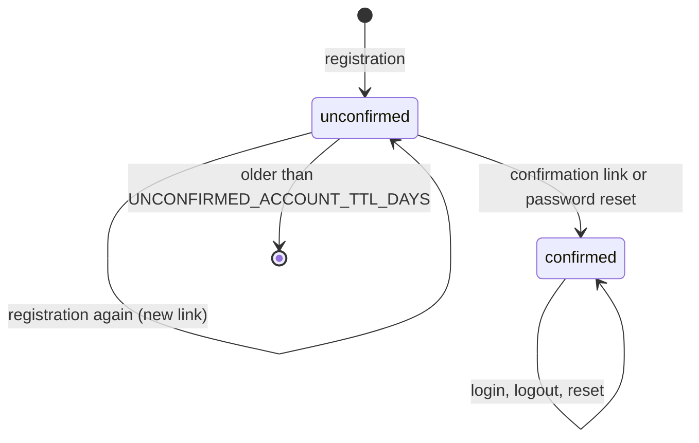

# Identity: accounts, external login, MFA Concept

The specification of roadmap feature R3: how a member gets an account, logs in and out, and resets a forgotten password, and how every other unit learns whether a request comes from a logged-in member. It is written for the feature's owner (tschudea07), its reviewers, the owner of `web` who builds the pages, and the agents that implement it. Part H is the plain-language view; Part S is binding. Question log: [identity.qa-log.md](identity.qa-log.md).

**Scope of this version (Q3).** Grilled and ready for generation: IDN-US-1 (Register by e-mail), IDN-US-2 (Log in and log out with rate limiting), IDN-US-6 (Reset the password). Still drafts, grilled before Sprint 3: IDN-US-3 (external login), IDN-US-4 (TOTP), IDN-US-5 (passkeys), and the new IDN-US-7 (operator role) and IDN-US-8 (delete my account). Their rows below are marked *draft* and are not part of the Phase 4 gate.

# Part H — For Human Readers

This part adds no rule. It summarizes Part S and cites its IDs; where the two disagree, Part S wins (P-HUM-3).

## H1. In one sentence

Members register with name, e-mail address, and password, confirm their address, log in and out, and reset a forgotten password, so that only they reach their files. This serves `G-1` ("so that their data stays under their control"): an installation of stash admits only accounts it knows, and it keeps `G-1.S1`, because the bot check is switched off and e-mail goes to the local mail catcher when the system runs without internet ([IDN-NF-6]).

## H2. Who benefits and how

- **Member (`R-1`)**: registers in under a minute, gets a confirmation link valid for 24 hours, logs in on any device, stays logged in for 7 days of use, and can set a new password by e-mail when it is forgotten ([IDN-US-1], [IDN-US-2], [IDN-US-6]).
- **Operator (`R-2`)**: can close the registration for an installation that should not admit strangers ([IDN-AC-1.7] registration closed), and gets protection against password guessing without configuring anything ([IDN-AC-2.3] lock after failed logins).
- **Owners of `web` and `storage`**: ask `identity` once per request whether a session is valid and get the member back, or "no session" ([ADR-0007](../adr/0007-session-check-through-identity.md), [IDN-F-37]).

## H3. How it works, step by step

1. A person opens the registration page and enters a display name, an e-mail address, and a password. The page checks the same rules the server checks: 12 to 128 characters, not one of the 10,000 most common passwords; a four-step strength bar gives advice ([IDN-AC-1.1], [IDN-AC-1.2]).
2. The bot check runs, unless the operator switched it off for an offline installation ([IDN-AC-1.5]). The server checks everything again, stores the password only as a hash, and sends a confirmation e-mail ([IDN-AC-1.3], [IDN-AC-1.4]).
3. The answer is always "Check your mailbox." — also when the address already has an account, so nobody learns which addresses are registered. The owner of an existing account gets a short notice instead; an address whose account is not confirmed yet gets a new link ([IDN-AC-1.6], A15).
4. The person clicks the link within 24 hours and can log in. An account that is never confirmed is deleted after 7 days ([IDN-AC-1.8]).
5. At login, a correct e-mail address and password open a session for 7 days, renewed while the member uses stash. A wrong combination gets one message that says nothing about which part was wrong ([IDN-AC-2.1], [IDN-AC-2.5], [IDN-AC-2.6]).
6. After 5 failed logins within a minute, the IP address is blocked for 15 minutes, and separately the password login of that account; resetting the password still works, so nobody can lock a member out for good ([IDN-AC-2.3]).
7. Logging out ends the session on the server at once; every unit refuses the old cookie from then on ([IDN-AC-2.2]).
8. A member who forgot the password requests a reset link, valid for 30 minutes and only once. Setting a new password ends every session and also confirms the e-mail address ([IDN-US-6]).

## H4. What it deliberately does not do

- No login with external accounts, second factor, or passkeys yet — those stories are drafts for Sprint 3 (§12).
- No "log out on all devices" button; only a password reset ends all sessions (§12).
- No invitations or domain allow lists; the operator can only open or close the registration (Q5).
- No account deletion yet; that is the draft story IDN-US-8 (Q6).
- No roles inside teams; those are R7 ([teams-permissions.md](teams-permissions.md)).

## H5. How it is built, in plain words

The unit `identity` runs a small HTTP server with the authentication library behind it (`STACK.md` §3). Accounts, password hashes, and confirmation and reset tokens live in the relational database, in the library's four tables and the own `users` table; sessions and the counters of failed attempts live in the session store, so a logout or a lock takes effect everywhere at once (§8). The rules for name, e-mail address, and password are one shared contract that the pages of `web` and the server both use (§16, M3). `web` builds the three pages and protects its member pages by asking `identity` for the session ([ADR-0007](../adr/0007-session-check-through-identity.md)); every story has one slice for `identity` and one for `web` (Q13).

## H6. How we know it works

Every acceptance criterion of the three ready stories has one acceptance test in §17, run against `identity` with a real database and session store, a mail catcher, and the bot check replaced by a stub that answers yes or no ([IDN-T-1] to [IDN-T-20]). The rules for passwords, locks, and links are unit tests with the values of §10.

## H7. Key decisions

| Question | Decision | Reason |
| --- | --- | --- |
| Q2 Product name | stash | One name in every story and page |
| Q3 Scope | US-1, -2, -6 ready now; the rest before Sprint 3 | Sprint 2 needs exactly these |
| Q5 Who may register | Everyone; the operator can close it | Simple start, one switch for closed installations |
| Q6, Q7 New stories | IDN-US-7 operator role from a configured address list; IDN-US-8 delete my account | R2 needs operator logins; the right to deletion |
| Q8 Lock | IP and account counted separately, 15 minutes; reset stays possible | Guessing is stopped without letting strangers lock a member out |
| Q9 Session check | Every unit asks `identity` per request (ADR-0007) | Logout takes effect everywhere at once |
| Q10, Q11 Technology | Turnstile, Hono (`STACK.md` §3) | No Google tracking; small TypeScript server |
| Q13 Pages | Built by the owner of `web` as slice 2 of each story | Tracks stay separate |

# Part S — Specification (normative)

## 0. Synthesis Context

### Development Path

Path A (frontloaded). The draft of 2026-10-06 was grilled on 2026-11-03 (rounds 1–4, Q1–Q13, A1–A16) for IDN-US-1, -2, and -6 (Q3). Phases 5 and 6 for these three stories are in the same merge request; its approval by another team member is the Phase 4 gate for them. IDN-US-3, -4, -5, -7, and -8 stay in Phase 1.

### Synthesis Dependencies

- [scaffolding.md](scaffolding.md) — the unit `identity`, its route prefix `/api/identity` and port in the routing table (§8), the health report, the configuration helper and [SCF-E-1] (invalid configuration), the error response ([SCF-F-21]), the data model with `auth_users`, `auth_sessions`, `auth_accounts`, `auth_verifications`, and `users` ([SCF-F-24]), the mail catcher and the switches `CAPTCHA_ENABLED` and `OAUTH_ENABLED` ([SCF-AC-2.3]).
- [public-content.md](public-content.md) — the member session on public pages ([PUB-F-12], [PUB-F-33]), the bot-check notice ([PUB-F-23]), and the privacy template ([PUB-F-22]).
- [observability.md](observability.md) — the log entry shape and the redaction of secrets ([OBS-F-4], [OBS-F-14]); the operator session for the dashboard tool ([OBS-F-27], draft IDN-US-7).
- [ADR-0001](../adr/0001-five-units-behind-one-origin.md) and [ADR-0007](../adr/0007-session-check-through-identity.md).

### Synthesis Scope

From this document and `STACK.md` §3: in `apps/identity` the HTTP server, the authentication library configuration, the endpoints of §8, the throttle, the bot check, the mailer with its templates, and the clean-up of unconfirmed accounts; in `packages/contracts` the shared identity rules (M3); in `apps/web` the pages register, confirm result, login, reset request, and new password, and the route guard (slices of the Web track, Q13).

### Owner

tschudea07, per [ROADMAP.md](../ROADMAP.md). The pages in `web` are built by schwaigc (Q13).

## 1. Purpose & Goal Trace

**Feature goal:** Members register and log in with password, external account, second factor, or passkey, so that only they reach their files.

**Serves:** `G-1` in [GOAL.md](../GOAL.md), as stated in the *Serves* column of [ROADMAP.md](../ROADMAP.md) ("data under their control"): only accounts of the installation reach its files. It keeps `G-1.S1`: without internet, the bot check is off and e-mail goes to the mail catcher ([IDN-NF-6]). No non-goal is touched; the cryptography comes from established libraries (`G-1.N5`, [IDN-C-2]).

## 2. Ubiquitous Language & Context

Defined in [CONTEXT.md](../CONTEXT.md) and used here exactly: **stash**, **unit**, **contract**, **member**, **account**, **session**, **confirmation link**, **reset link**, **lock**, **bot check**, **operator role**.

Used only in this document:

- **Session cookie**: the cookie `stash_session` that carries the token of a session.
- **Session check**: the question one unit asks `identity` whether a session token is valid ([IDN-F-37]).
- **Common-password list**: the bundled list of the 10,000 most common passwords ([IDN-F-2]).
- **Throttle**: the counters of requests and failed logins per IP address and per account in the session store ([IDN-F-9], [IDN-F-35]).
- **Notice e-mail**: the e-mail sent instead of a confirmation link when someone registers with the address of a confirmed account ([IDN-F-6]).

## 3. User Stories & Acceptance Criteria

The user stories and their acceptance criteria are the work items in [work-items/identity/](../work-items/identity/feature.md); they are not repeated here (P-DOC-6).

## 4. Functional Requirements

Rows of IDN-US-1, -2, and -6 are binding. Rows marked *draft* belong to stories still in Phase 1 and are rewritten when those stories are grilled.

| ID | Title | Requirement | Derives from |
| --- | --- | --- | --- |
| IDN-F-1 | Shared validation | `web` and `identity` MUST validate a registration with the same rules of the shared contract `RegistrationInput` (§8, M3): display name 1 to 100 characters after trimming, e-mail address of at most 254 characters in the form of §8, password per [IDN-F-2]. `identity` MUST check them again and answer an invalid body with [IDN-E-1]; it MUST NOT store anything then. | IDN-AC-1.1 (Shared validation) |
| IDN-F-2 | Password rules | A password MUST have 12 to 128 characters and MUST NOT equal, ignoring case, an entry of the common-password list. Both rules MUST be checked by `web` before sending and by `identity`. `web` MUST show a strength bar with the four levels `weak`, `fair`, `good`, `strong` computed by M3 (§8); the bar only advises and blocks nothing beyond the two rules. | IDN-AC-1.2 (Password rules) |
| IDN-F-3 | Password hashing | `identity` MUST store a password only as a hash of the algorithm and parameters of [IDN-C-2]. A password MUST NOT be stored, logged, or returned in plain text anywhere. | IDN-AC-1.3 (Password hashing) |
| IDN-F-4 | E-mail confirmation | After a registration with a new address, `identity` MUST create the account with `emailVerified = false` and send a confirmation e-mail with a confirmation link valid for `CONFIRMATION_LINK_TTL_HOURS` hours. Opening a valid link MUST set `emailVerified = true`, invalidate the link, and redirect to `/login?confirmed=1`. A login of an unconfirmed account MUST be refused with [IDN-E-5]. | IDN-AC-1.4 (E-mail confirmation) |
| IDN-F-5 | Bot check | While `CAPTCHA_ENABLED` is true, `identity` MUST verify the bot-check token of every registration and reset request with the provider of [IDN-C-5] before anything else and refuse a missing or rejected token with [IDN-E-2]. While it is false, `web` MUST NOT load the bot check and `identity` MUST NOT require or send a token. | IDN-AC-1.5 (Bot check), IDN-AC-6.5 (Protected endpoint) |
| IDN-F-6 | No account disclosure | A valid registration MUST always be answered with HTTP 202 and `{ "status": "check-mailbox" }`. For an address of a confirmed account, `identity` MUST NOT change the account and MUST send the notice e-mail instead of a confirmation link. For an address of an unconfirmed account, it MUST keep the account, replace its name and password hash by the new ones, and send a new confirmation link (A15). | IDN-AC-1.6 (No account disclosure) |
| IDN-F-7 | Password login | `POST /api/identity/login` with the e-mail address and password of a confirmed account MUST create a session ([IDN-F-34]) and answer 200 with the `SessionInfo` of §8 and the session cookie. | IDN-AC-2.1 (Password login) |
| IDN-F-8 | Logout | `POST /api/identity/logout` MUST delete the session of the session cookie from the session store, answer 204, and clear the cookie. From then on, a session check with that token MUST answer "no session" ([IDN-F-37]). Without a valid session it MUST also answer 204. | IDN-AC-2.2 (Logout ends the session) |
| IDN-F-9 | Lock after failed logins | `identity` MUST count failed logins per IP address and, separately, per e-mail address (also for addresses without an account) in windows of `LOGIN_FAILURE_WINDOW_SECONDS` seconds. When a counter reaches `LOGIN_MAX_FAILURES`, it MUST lock that IP address for every login, or that e-mail address for the password login, for `LOGIN_LOCK_MINUTES` minutes and answer [IDN-E-6]. A lock of an e-mail address MUST NOT block the reset request or the new password of [IDN-US-6]. A successful login MUST reset the counter of its e-mail address. | IDN-AC-2.3 (Lock after failed logins) |
| IDN-F-10 | Protected pages | A request to a page of `web` under `/files`, `/settings`, or `/dashboard` without a valid session MUST be redirected with 303 to `/login?next=<path>`, where `<path>` is the requested path; after a successful login `web` MUST go to `<path>` if it starts with a single `/`, else to `/dashboard`. | IDN-AC-2.4 (Protected pages) |
| IDN-F-11 | Generic login error | A login with an unknown e-mail address or a wrong password MUST be answered with [IDN-E-4], with the same status, body, and, within 50 ms, the same answer time in both cases. | IDN-AC-2.5 (Generic error) |
| IDN-F-12 | Provider buttons (*draft*) | The login page MUST show one login button for each external login provider configured, and none for the others. | IDN-AC-3.1 (Provider buttons) |
| IDN-F-13 | Account on first login (*draft*) | The first login of a person through an external provider MUST create the account together with its `users` row. | IDN-AC-3.2 (Account on first login) |
| IDN-F-14 | Link and unlink (*draft*) | A member MUST be able to link an external provider to the account and to unlink it in the account settings. | IDN-AC-3.3 (Link and unlink) |
| IDN-F-15 | Cancelled login (*draft*) | When a person cancels at the provider, the login page MUST show an understandable message. | IDN-AC-3.4 (Cancelled login) |
| IDN-F-16 | Activation (*draft*) | Scanning the QR code and entering a valid one-time code MUST activate the second factor. | IDN-AC-4.1 (Activation) |
| IDN-F-17 | Code at login (*draft*) | A login of an account with an active second factor MUST ask for the one-time code. | IDN-AC-4.2 (Code at login) |
| IDN-F-18 | Backup codes (*draft*) | Activating the second factor MUST create 10 single-use backup codes, shown exactly once. | IDN-AC-4.3 (Backup codes) |
| IDN-F-19 | Deactivation (*draft*) | Deactivating the second factor MUST require the password and a current code. | IDN-AC-4.4 (Deactivation) |
| IDN-F-20 | Encrypted secrets (*draft*) | The secret of a second factor MUST be stored encrypted with the authenticated encryption of the capability chosen when the story is grilled, with a key from configuration. | IDN-AC-4.5 (Encrypted secrets) |
| IDN-F-21 | Manage passkeys (*draft*) | A member MUST be able to register, rename, and delete passkeys in the account settings. | IDN-AC-5.1 (Manage passkeys) |
| IDN-F-22 | Browser support (*draft*) | The passkey login MUST work in the current versions of Chrome, Firefox, and Safari. | IDN-AC-5.2 (Browser support) |
| IDN-F-23 | Several passkeys (*draft*) | Every passkey of an account MUST work for it. | IDN-AC-5.3 (Several passkeys) |
| IDN-F-24 | Counts as second factor (*draft*) | A passkey login MUST count as a login with second factor. | IDN-AC-5.4 (Counts as MFA) |
| IDN-F-25 | Limited reset link | `POST /api/identity/password-reset/request` MUST, for the address of an existing account, send a reset link valid for `RESET_LINK_TTL_MINUTES` minutes. A reset link MUST be usable once; requesting a new one MUST invalidate every older reset link of the account. | IDN-AC-6.1 (Limited link) |
| IDN-F-26 | Same password rules | `POST /api/identity/password-reset` MUST check the new password with [IDN-F-2] and answer a violation with [IDN-E-1] without using up the link. | IDN-AC-6.2 (Same password rules) |
| IDN-F-27 | Sessions ended | A successful reset MUST replace the password hash, delete every session of the account, answer 204, and `web` MUST then show the login page with the message of [IDN-U-5]. | IDN-AC-6.3 (Sessions ended) |
| IDN-F-28 | Identical answer | A valid reset request MUST be answered with HTTP 202 and `{ "status": "check-mailbox" }` whether an account with the address exists or not; for an unknown address no e-mail MUST be sent. | IDN-AC-6.4 (Identical answer) |
| IDN-F-29 | Protected reset endpoint | The reset request MUST be counted by the request throttle of [IDN-F-35] and checked by the bot check of [IDN-F-5]. | IDN-AC-6.5 (Protected endpoint) |
| IDN-F-30 | Registration closed | While `REGISTRATION_ENABLED` is false, `identity` MUST refuse every registration with [IDN-E-8] and `web` MUST show the page `/register` with the message of [IDN-U-6] instead of the form. Login, logout, and reset MUST work unchanged. | IDN-AC-1.7 (Registration closed) |
| IDN-F-31 | Unconfirmed accounts removed | `identity` MUST delete, at least once per hour, every account with `emailVerified = false` created more than `UNCONFIRMED_ACCOUNT_TTL_DAYS` days ago, together with its `users` row, its credentials, and its open links. | IDN-AC-1.8 (Unconfirmed accounts removed) |
| IDN-F-32 | Own users row | Creating an account MUST create its `users` row in the same transaction ([SCF-F-24]); no account MAY exist without one. | IDN-AC-1.4 (E-mail confirmation) |
| IDN-F-33 | Reset confirms the address | A successful reset MUST set `emailVerified = true` (A9). | IDN-AC-6.6 (Reset confirms the address) |
| IDN-F-34 | Session lifetime | A session MUST expire `SESSION_TTL_DAYS` days after its last renewal. A session check of a session older than one day since its last renewal MUST renew it. An expired session MUST be treated as no session and be deleted from the session store. | IDN-AC-2.6 (Session lifetime) |
| IDN-F-35 | Request throttle | `identity` MUST count registrations and reset requests per IP address; the request after `REQUEST_LIMIT_PER_MINUTE` within 60 seconds MUST be refused with [IDN-E-3] until the 60 seconds have passed. | IDN-AC-1.9 (Registration throttled), IDN-AC-6.5 (Protected endpoint) |
| IDN-F-36 | Session cookie | The session cookie MUST be `stash_session`, `HttpOnly`, `SameSite=Lax`, `Path=/`, `Secure` when `PUBLIC_ORIGIN` starts with `https://`, and expire with the session. | IDN-AC-2.1 (Password login) |
| IDN-F-37 | Session check | `GET /api/identity/session` MUST answer 200 with the `SessionInfo` of the session cookie, or 401 with [IDN-E-9] for no or an invalid session. `web` and `storage` MUST use it for every request that needs a member ([ADR-0007](../adr/0007-session-check-through-identity.md)) and MUST treat no answer within `SESSION_CHECK_TIMEOUT_MS` milliseconds as no session ([PUB-F-33]). | IDN-AC-2.2 (Logout ends the session), IDN-AC-2.4 (Protected pages) |
| IDN-F-38 | Language of messages | E-mails and the messages of §5 MUST exist in German and English; `identity` MUST choose by the first supported language of the request's `Accept-Language` header and fall back to German (A13). | IDN-US-1 (Register by e-mail) |
| IDN-F-39 | Operator role (*draft*) | An account MUST have the operator role exactly when its confirmed e-mail address is in the configured list of operator addresses. | IDN-AC-7.1 (Role from the configuration) |
| IDN-F-40 | Operator check (*draft*) | `identity` MUST offer the reverse proxy an internal check that answers "allowed" with the login name for an operator session, "forbidden" for another session, and "no session" otherwise ([OBS-F-27]). | IDN-AC-7.2 (Check for the reverse proxy) |
| IDN-F-41 | Delete with password (*draft*) | Deleting an account MUST require the current password and MUST remove the account, its `users` row, its sessions, and its credentials, and log the member out. | IDN-AC-8.1 (Confirmed by password) |
| IDN-F-42 | Files of a deleted account (*draft*) | After deleting an account, `identity` MUST tell `storage`, which deletes the member's files and folders that no team owns. | IDN-AC-8.2 (Files deleted) |

## 5. User Interaction Requirements

The pages are built in `web` (Q13). Texts are given in English; the German texts are in §8 ("Message texts").

| ID | Title | Requirement | Derives from |
| --- | --- | --- | --- |
| IDN-U-1 | Field errors | The registration and new-password forms MUST show each rule violation next to its field before sending, as text linked to the field for screen readers, and MUST keep the entered name and e-mail address. | IDN-AC-1.1 (Shared validation) |
| IDN-U-2 | Strength bar | The strength bar MUST show its level as text (`Weak`, `Fair`, `Good`, `Strong`), not only as colour, and update while typing. | IDN-AC-1.2 (Password rules) |
| IDN-U-3 | Check your mailbox | After a registration or reset request, the page MUST show "Check your mailbox. If the address can be used, we have sent you an e-mail." | IDN-AC-1.6 (No account disclosure), IDN-AC-6.4 (Identical answer) |
| IDN-U-4 | Login messages | The login page MUST show "E-mail address or password is wrong." for [IDN-E-4], "Please confirm your e-mail address first. We have sent you a new link." for [IDN-E-5], and "Too many attempts. Try again in 15 minutes or reset your password." for [IDN-E-6]. | IDN-AC-2.5 (Generic error), IDN-AC-2.3 (Lock after failed logins) |
| IDN-U-5 | After reset | After a reset, the login page MUST show "Your password was changed. Please log in again." | IDN-AC-6.3 (Sessions ended) |
| IDN-U-6 | Registration closed | With the registration closed, `/register` MUST show "Registration is closed. Ask the operator of this installation for an account." | IDN-AC-1.7 (Registration closed) |
| IDN-U-7 | Invalid link | An invalid or expired confirmation or reset link MUST lead to a page that says "This link is invalid or has expired." and offers the action that sends a new one. | IDN-AC-1.4 (E-mail confirmation), IDN-AC-6.1 (Limited link) |

## 6. Non-Functional Requirements

| ID | Title | Requirement | Derives from |
| --- | --- | --- | --- |
| IDN-NF-1 | Minimal account data | An account of IDN-US-1 MUST hold only display name, e-mail address, confirmation state, password hash, and the time stamps of the library tables. | IDN-US-1 (Register by e-mail) |
| IDN-NF-2 | Keeping and deleting sessions | A session record MUST hold only token, account, expiry, IP address, and browser string, and MUST be deleted at logout, at expiry, and at a password reset. | IDN-US-2 (Log in and log out with rate limiting) |
| IDN-NF-3 | Keeping throttle data | Throttle counters and locks MUST expire with their window or lock and MUST NOT be stored anywhere else. | IDN-AC-2.3 (Lock after failed logins) |
| IDN-NF-4 | No secrets in logs | Log entries of `identity` MUST NOT contain a password, password hash, session token, confirmation or reset token, or bot-check token; their attribute keys are on the secret key list of [OBS-F-14] (§15). | IDN-AC-1.3 (Password hashing) |
| IDN-NF-5 | Single-use tokens | Confirmation and reset tokens MUST have at least 128 random bits and be stored only as a hash; using one MUST delete it. | IDN-AC-1.4 (E-mail confirmation), IDN-AC-6.1 (Limited link) |
| IDN-NF-6 | Start without internet | With `CAPTCHA_ENABLED=false` and the mail catcher of the local stack, registration, confirmation, login, logout, and reset MUST work without any service on the internet. | G-1.S1 |
| IDN-NF-7 | Session check time | A session check MUST be answered within 50 ms at the 95th percentile on the local stack. | IDN-F-37 (Session check) |

## 7. Capability Requirements

Mapped to technology in `STACK.md` §3 (track Identity & CI).

| ID | Title | Requirement | Derives from |
| --- | --- | --- | --- |
| IDN-C-1 | Authentication library | A self-hosted authentication library that registers accounts with e-mail and password, confirms addresses and resets passwords by token, keeps sessions in an external store, maps its tables onto the names of `scaffolding.md` §8, and offers external login, one-time codes, and passkeys for the later stories. | IDN-AC-2.1 (Password login) |
| IDN-C-2 | Password hash | A memory-hard password hash with a per-password salt, as required by the school, from an established library. | IDN-AC-1.3 (Password hashing) |
| IDN-C-3 | Shared schema library | A schema library whose rules run unchanged in the browser and in `identity`. | IDN-AC-1.1 (Shared validation) |
| IDN-C-4 | Form library | A form library for the pages of `web` that validates with the rules of IDN-C-3. | IDN-AC-1.1 (Shared validation) |
| IDN-C-5 | Bot check | A bot check with a visible widget whose token the server verifies, that can be switched off and sets no tracking cookie. | IDN-AC-1.5 (Bot check) |
| IDN-C-6 | Session store | A key-value store with expiry per key and atomic counters, shared by every replica of `identity`. | IDN-AC-2.2 (Logout ends the session), IDN-AC-2.3 (Lock after failed logins) |
| IDN-C-7 | HTTP server framework | A small HTTP server framework for `identity` on the runtime of the units. | IDN-US-1 (Register by e-mail) |
| IDN-C-8 | E-mail delivery | Sending e-mail over SMTP to a configured host. | IDN-AC-1.4 (E-mail confirmation) |

## 8. Data Model

**Stored data.** The tables `auth_users`, `auth_accounts` (credential row with `provider_id = "credential"` and the password hash in `password`), `auth_verifications` (confirmation and reset tokens), and `users` of `scaffolding.md` §8; `auth_sessions` is not used, because sessions live in the session store (IDN-C-6). No new column is needed for IDN-US-1, -2, and -6.

**Session store keys.**

```text
session:<token-hash>         -> SessionRecord, expiry = SESSION_TTL_DAYS days, renewed by IDN-F-34
account-sessions:<accountId> -> set of token hashes (for IDN-F-27)
fail:ip:<ip>                 -> counter, expiry = LOGIN_FAILURE_WINDOW_SECONDS
fail:email:<email-lowercase> -> counter, expiry = LOGIN_FAILURE_WINDOW_SECONDS
lock:ip:<ip>                 -> 1, expiry = LOGIN_LOCK_MINUTES
lock:email:<email-lowercase> -> 1, expiry = LOGIN_LOCK_MINUTES
req:ip:<ip>                  -> counter, expiry = 60 s (IDN-F-35)

SessionRecord { accountId: string, userId: uuid, expiresAt: timestamp, ipAddress: string, userAgent: string }
```

**Contracts** (package `contracts`, module M3):

```text
RegistrationInput { name: string 1..100 after trim, email: Email, password: Password, botToken: optional<string> }
LoginInput        { email: Email, password: string 1..128 }
ResetRequestInput { email: Email, botToken: optional<string> }
NewPasswordInput  { token: string 1..200, password: Password }
Email    = string 3..254, lowercased and trimmed, one "@" with at least one character before it and a dot in the part after it
Password = string 12..128, not in the common-password list (case-insensitive)
Strength = enum(weak|fair|good|strong)   // weak: < 12 chars or listed; fair: 12..15 chars of one character class;
                                         // good: 12..15 chars of two or more classes, or 16+ of one; strong: 16+ of two or more classes
SessionInfo { userId: uuid, name: string, email: Email }
Accepted    { status: "check-mailbox" }
```

Character classes: lower-case letters, upper-case letters, digits, everything else.

**Endpoints of `identity`** (below the prefix `/api/identity` of the routing table):

| Method and path | Body | Success | Errors |
| --- | --- | --- | --- |
| `POST /register` | `RegistrationInput` | 202 `Accepted` | E-1, E-2, E-3, E-8 |
| `GET /confirm?token=<t>` | — | 303 to `/login?confirmed=1` | 303 to `/link-invalid?kind=confirm` (E-7) |
| `POST /login` | `LoginInput` | 200 `SessionInfo` + session cookie | E-1, E-4, E-5, E-6 |
| `POST /logout` | — | 204, cookie cleared | — |
| `GET /session` | — | 200 `SessionInfo` | 401 E-9 |
| `POST /password-reset/request` | `ResetRequestInput` | 202 `Accepted` | E-1, E-2, E-3 |
| `POST /password-reset` | `NewPasswordInput` | 204 | E-1, E-7 |

**Error codes** added to the `ErrorResponse` table of `scaffolding.md` §8 (§15):

| Code | HTTP status | Message |
| --- | --- | --- |
| `bot-check-failed` | 400 | The bot check failed. |
| `too-many-requests` | 429 | Too many requests. Try again later. |
| `invalid-credentials` | 401 | E-mail address or password is wrong. |
| `address-not-confirmed` | 403 | Please confirm your e-mail address first. |
| `registration-closed` | 403 | Registration is closed. |
| `link-invalid` | 400 | This link is invalid or has expired. |
| `no-session` | 401 | No valid session. |

**Configuration of `identity`** (example values in `.env.example`; every value is checked at start, [SCF-E-1]):

| Variable | Valid values | Default |
| --- | --- | --- |
| `PUBLIC_ORIGIN` | absolute `http://` or `https://` URL | `http://localhost:8080` |
| `IDENTITY_AUTH_SECRET` | at least 32 characters | — (required) |
| `REDIS_URL` | `redis://` URL | — (required) |
| `REGISTRATION_ENABLED` | `true`, `false` | `true` |
| `CONFIRMATION_LINK_TTL_HOURS` | 1..168 | `24` |
| `UNCONFIRMED_ACCOUNT_TTL_DAYS` | 1..90 | `7` |
| `RESET_LINK_TTL_MINUTES` | 5..1440 | `30` |
| `SESSION_TTL_DAYS` | 1..90 | `7` |
| `LOGIN_MAX_FAILURES` | 3..20 | `5` |
| `LOGIN_FAILURE_WINDOW_SECONDS` | 10..3600 | `60` |
| `LOGIN_LOCK_MINUTES` | 1..1440 | `15` |
| `REQUEST_LIMIT_PER_MINUTE` | 1..100 | `5` |
| `CAPTCHA_ENABLED` | `true`, `false` | `false` in `.env.example` |
| `CAPTCHA_SITE_KEY`, `CAPTCHA_SECRET_KEY` | non-empty when `CAPTCHA_ENABLED=true` | — |
| `SMTP_HOST`, `SMTP_PORT`, `SMTP_FROM` | host, 1..65535, e-mail address | `mailpit`, `1025`, `no-reply@stash.local` |
| `SESSION_CHECK_TIMEOUT_MS` | 100..5000 (also read by `web` and `storage`) | `1000` |

**Message texts (German).** IDN-U-3: „Prüfe dein Postfach. Wenn die Adresse verwendet werden kann, haben wir dir eine E-Mail geschickt.“ IDN-U-4: „E-Mail-Adresse oder Passwort ist falsch.“, „Bitte bestätige zuerst deine E-Mail-Adresse. Wir haben dir einen neuen Link geschickt.“, „Zu viele Versuche. Versuche es in 15 Minuten wieder oder setze dein Passwort zurück.“ IDN-U-5: „Dein Passwort wurde geändert. Bitte melde dich neu an.“ IDN-U-6: „Die Registrierung ist geschlossen. Frag den Betreiber dieser Installation nach einem Konto.“ IDN-U-7: „Dieser Link ist ungültig oder abgelaufen.“

**E-mails.** Confirmation: subject "Confirm your e-mail address for stash" / „Bestätige deine E-Mail-Adresse für stash“, body with the link `<PUBLIC_ORIGIN>/api/identity/confirm?token=<t>` and its validity in hours. Notice: subject "Someone tried to register with your address" / „Jemand wollte sich mit deiner Adresse registrieren“, body without a link, with the advice to reset the password if it was the member. Reset: subject "Reset your stash password" / „Setze dein stash-Passwort zurück“, link `<PUBLIC_ORIGIN>/reset-password?token=<t>` and its validity in minutes.

## 9. Error Conditions

| ID | Title | Trigger | Required behavior | Fallback | Derives from |
| --- | --- | --- | --- | --- | --- |
| IDN-E-1 | Invalid input | A body does not match its contract of §8. | 400 `validation-failed` ([SCF-F-21]); nothing is stored and no e-mail is sent. | None. | IDN-AC-1.1 (Shared validation), IDN-AC-6.2 (Same password rules) |
| IDN-E-2 | Bot check failed | With `CAPTCHA_ENABLED=true`, the token is missing, rejected, or the provider does not answer within 5 seconds. | 400 `bot-check-failed`; nothing else is checked. | None: the request is refused, never let through. | IDN-AC-1.5 (Bot check) |
| IDN-E-3 | Too many requests | [IDN-F-35] refuses a request. | 429 `too-many-requests` with `Retry-After` in seconds. | None. | IDN-AC-1.9 (Registration throttled) |
| IDN-E-4 | Wrong credentials | Unknown e-mail address or wrong password. | 401 `invalid-credentials`; the failure counters of [IDN-F-9] increase. | None. | IDN-AC-2.5 (Generic error) |
| IDN-E-5 | Address not confirmed | Correct password of an unconfirmed account. | 403 `address-not-confirmed`; a new confirmation link is sent, at most once per `CONFIRMATION_LINK_TTL_HOURS`. | None. | IDN-AC-1.4 (E-mail confirmation) |
| IDN-E-6 | Locked | The IP address or e-mail address of a login is locked ([IDN-F-9]). | 429 `too-many-requests` with `Retry-After`; the password is not checked. | Reset stays possible. | IDN-AC-2.3 (Lock after failed logins) |
| IDN-E-7 | Link invalid | A confirmation or reset token is unknown, used, or expired. | Confirmation: 303 to `/link-invalid?kind=confirm`; reset: 400 `link-invalid`. | [IDN-U-7] offers a new link. | IDN-AC-1.4 (E-mail confirmation), IDN-AC-6.1 (Limited link) |
| IDN-E-8 | Registration closed | A registration while `REGISTRATION_ENABLED=false`. | 403 `registration-closed`. | None. | IDN-AC-1.7 (Registration closed) |
| IDN-E-9 | No session | A session check without cookie, with an unknown or expired token. | 401 `no-session`. | Callers treat it as no session. | IDN-AC-2.2 (Logout ends the session) |
| IDN-E-10 | Session store unreachable | The session store does not answer within 1 second. | Login, logout, session check, registration, and reset answer 500 `internal-error`; the health report of `identity` marks the session store `down`. | Callers of the session check treat it as no session ([PUB-F-33]). | IDN-AC-2.2 (Logout ends the session) |
| IDN-E-11 | E-mail not delivered | The SMTP host refuses or does not answer within 10 seconds. | The request is still answered as in §8; the failure is logged at level `error` without the address. | The person can request a new link ([IDN-U-7], [IDN-E-5]). | IDN-AC-1.4 (E-mail confirmation) |

## 10. Worked Examples

**Example 1 — password rules and strength ([IDN-F-2]).**

| Password | Valid | Strength |
| --- | --- | --- |
| `kurz123` | no — fewer than 12 characters | weak |
| `password1234` | no — on the common-password list | weak |
| `Password1234` | no — on the list, ignoring case | weak |
| `meinkatzenbaum` | yes | fair |
| `Katzenbaum42x` | yes | good |
| `dreiblauewolkenziehen` | yes | good |
| `Drei-blaue-Wolken-7` | yes | strong |
| 129 × `a` | no — more than 128 characters | weak |

**Example 2 — registration answers ([IDN-F-6], A15).** Three registrations with `RegistrationInput { name: "Ada", password: "Drei-blaue-Wolken-7" }`, all answered 202 `{ "status": "check-mailbox" }`:

| E-mail address | State before | Effect |
| --- | --- | --- |
| `ada@example.org` | no account | account created unconfirmed with its `users` row; confirmation e-mail |
| `ada@example.org` | unconfirmed account from yesterday | name and password hash replaced; old link invalid; new confirmation e-mail |
| `bob@example.org` | confirmed account | nothing changed; notice e-mail to `bob@example.org` |

**Example 3 — lock timeline ([IDN-F-9]), default values.** IP `203.0.113.7`, address `ada@example.org` (confirmed):

| Time | Request | Answer |
| --- | --- | --- |
| 10:00:00 – 10:00:20 | 4 logins with wrong passwords | 401 each |
| 10:00:30 | 5th wrong login | 401; both counters reach 5; IP and address locked until 10:15:30 |
| 10:00:40 | login with the right password from the same IP | 429, `Retry-After: 890` |
| 10:01:00 | login with the right password from `198.51.100.4` | 429 — the address is locked |
| 10:02:00 | reset request for `ada@example.org` from `198.51.100.4` | 202; reset e-mail sent |
| 10:15:31 | login with the right password from `203.0.113.7` | 200 |

**Example 4 — session lifetime ([IDN-F-34]).** Login on 2026-11-03 10:00 → expires 2026-11-10 10:00. Session check on 2026-11-03 18:00 (less than a day) → no renewal. Session check on 2026-11-05 09:00 → renewed, expires 2026-11-12 09:00. No use until 2026-11-12 09:01 → "no session".

**Example 5 — protected page ([IDN-F-10]).** Without a session, `GET /files/team-a` → 303 `/login?next=/files/team-a`; after login → `/files/team-a`. With `next=//evil.example` → after login `/dashboard`.

## 11. Integration Points

| Point | Between | What crosses it | Specified in |
| --- | --- | --- | --- |
| Pages and forms | browser → `web` → `identity` | The contracts of §8 over the endpoints of §8 | [IDN-F-1], §8; slice 2 of each story (Q13) |
| Session check | `web`, `storage` → `identity` | Session cookie → `SessionInfo` or 401 | [IDN-F-37], [ADR-0007](../adr/0007-session-check-through-identity.md) |
| Public pages | `web` → `identity` | Whether a member is logged in on public pages | [PUB-F-12], [PUB-F-33] |
| E-mail | `identity` → SMTP host (mail catcher locally) | Confirmation, notice, and reset e-mails | [IDN-C-8], §8 |
| Bot check | browser, `identity` → bot-check provider | Widget and token verification, only with `CAPTCHA_ENABLED=true` | [IDN-F-5], [IDN-C-5] |
| Relational database | `identity` → database | Accounts, credentials, tokens, `users` rows | §8; [SCF-F-24] |
| Reverse proxy | browser → `/api/identity/*` → `identity` | All endpoints of §8 | routing table of [scaffolding.md](scaffolding.md) §8 |

## 12. Out of Scope

- External login, one-time codes, passkeys, operator role, and account deletion: stories IDN-US-3, -4, -5, -7, -8, grilled before Sprint 3.
- Logging out of all devices except through a password reset.
- Invitations, domain allow lists, and admin-created accounts (Q5).
- Changing the e-mail address or the display name; that is part of the account settings (WEB-US-3) and specified with it.
- Roles in teams and permissions on folders (R7).

## 13. Resolved Questions & ADRs

Verbatim rounds: [identity.qa-log.md](identity.qa-log.md). ADR: [ADR-0007](../adr/0007-session-check-through-identity.md) (session check through `identity`, Q9), which closes the question ADR-0001 left to R3.

| Q | Title | Decision | Rationale |
| --- | --- | --- | --- |
| Q1 | Feature goal | Unchanged | Covers all stories and the proposal |
| Q2 | Product name | stash (glossary) | One name everywhere |
| Q3 | Scope | IDN-US-1, -2, -6 to Phase 6; the rest stays draft | Sprint 2 needs these three |
| Q4 | Operator role | New draft story IDN-US-7 | Requested by R2 ([OBS-F-27]) |
| Q5 | Who may register | Open; the operator closes it with `REGISTRATION_ENABLED` ([IDN-F-30]) | One switch covers closed installations |
| Q6 | Delete my account | New draft story IDN-US-8 | Right to deletion |
| Q7 | Who is operator | Accounts whose confirmed address is in a configured list (IDN-US-7) | The operator runs the server and its configuration |
| Q8 | Lock | IP and e-mail address counted separately, 15 minutes, reset stays possible ([IDN-F-9]) | Stops guessing without letting strangers lock out a member |
| Q9 | Session check | Every unit asks `identity` per request ([IDN-F-37], ADR-0007) | Logout takes effect at once |
| Q10 | Bot check | Turnstile (`STACK.md` §3) | No Google tracking, visible widget |
| Q11 | HTTP framework | Hono (`STACK.md` §3) | Small, TypeScript-first, supported by the library |
| Q12 | Shared understanding | Confirmed | — |
| Q13 | Pages in `web` | Slice 2 of each story, built by schwaigc | Tracks stay separate |
| Q14 | Merge request | Reviewed by `trutscf1`; its approval is the Phase 4 gate | Most affected by §15 |

**Open questions for the school management** (legal; not decided by the team or an agent):

| Q | Title | Question |
| --- | --- | --- |
| L1 | Lawful basis | On which lawful basis does an installation keep display name, e-mail address, and the IP address of sessions and failed logins, and is the privacy template ([PUB-F-22]) with the periods of [IDN-NF-2], [IDN-NF-3], and [IDN-F-31] sufficient? |
| L2 | Bot-check provider | Does switching on Turnstile need a data processing agreement with its provider and consent before the widget loads? |

## 14. Artifact Interactions & Interferences

| Artifact | Interaction | Interference | Resolved by |
| --- | --- | --- | --- |
| Data model ([SCF-F-24], `packages/db`) | Accounts and their `users` row. | `users` is filled by a database trigger; the library must not write `users` itself. | [IDN-F-32]; the trigger stays the only writer |
| `auth_sessions` table | Sessions live in the session store (Q9, IDN-C-6). | The table stays empty. | §8; kept for the later stories, no migration |
| Error response ([SCF-F-21]) | Seven new codes. | The code table of `scaffolding.md` §8 says "a new code is added to this table first". | §15 |
| Example configuration ([SCF-F-17], `.env.example`) | New variables of §8. | `tests/docker-compose.test.ts` requires every variable of `.env.example` to be used in `docker-compose.yml`. | The service `identity` in `docker-compose.yml` takes them (slice 1 of IDN-US-1) |
| Public pages ([PUB-F-12], [PUB-F-33], [PUB-F-23]) | Session check and bot-check notice. | `SESSION_CHECK_TIMEOUT_MS` was left to R3; the notice text too. | §8 (1000 ms); A16: no notice for a visible widget |
| Privacy template ([PUB-F-22]) | Member accounts, IP addresses of sessions and locks, bot check, e-mail delivery. | The template must name them. | Already listed in [PUB-F-22]; periods from §6 (§15) |
| Telemetry redaction ([OBS-F-14]) | New secret attribute keys. | `botToken`, `resetToken`, `confirmationToken` must be redacted. | §15 |
| Web track (`apps/web`, schwaigc) | Pages, forms, route guard. | Other track (WORKFLOW "Tracks"). | Slice 2 of each story (Q13) |

## 15. Schema Extensions

**Contracts:** the shapes of §8 in `packages/contracts` (new module `identity`), with the common-password list as a data file of that module.

**Required changes to other documents.** This concept does not edit documents of other owners (P-TEAM-4).

| Document | Change | Reason | Carried out by |
| --- | --- | --- | --- |
| [scaffolding.md](scaffolding.md) §8, `ErrorResponse` | Add the seven codes of §8 to the enum and the code table. | [SCF-F-21] | `trutscf1`, inbox; before slice 1 of IDN-US-1 is merged |
| [observability.md](observability.md) §8, secret key list | Add `botToken`, `confirmationToken`, `resetToken`. | [IDN-NF-4] | `trutscf1`, inbox |
| [public-content.md](public-content.md) [PUB-F-22] | Name the periods of [IDN-F-31], [IDN-NF-2], and [IDN-NF-3] in the paragraphs on member accounts and IP addresses. | Privacy | `trutscf1`, inbox |
| `web` (schwaigc) | Slices 2 of IDN-US-1, -2, -6: pages, forms, route guard. | Q13 | `schwaigc`, issues cut with `tickets` |

## 16. Architecture & Vertical Slices

### Module Overview & Tree

```text
packages/contracts/identity   shared, track Identity & CI
└── M3 IdentityRules          contracts of §8, password rules, strength, common-password list
apps/identity                 track Identity & CI
├── M1 Server                 HTTP server, routes of §8, error responses, health report
├── M2 AuthCore               library configuration: tables, hash, tokens, sessions in the session store
├── M4 Throttle               failure counters, locks, request counters
├── M5 BotCheck               token verification, switch
├── M6 Mailer                 three e-mails in German and English, SMTP
└── M7 Cleanup                hourly removal of unconfirmed accounts
apps/web                      track Web (schwaigc)
├── M8 AuthPages              /register, /login, /reset-password, /forgot-password, /link-invalid
└── M9 RouteGuard             session check before member pages, redirect with next
```

### Vertical Slices Breakdown

| Story | Slice | Track | Modules |
| --- | --- | --- | --- |
| IDN-US-1 | 1 — registration API, confirmation, clean-up, `identity` in the local stack | Identity & CI | M1, M2, M3, M5, M6, M7 |
| IDN-US-1 | 2 — registration page and confirmation result | Web | M8 |
| IDN-US-2 | 1 — login, logout, session check, locks | Identity & CI | M1, M2, M4 |
| IDN-US-2 | 2 — login page, logout button, route guard | Web | M8, M9 |
| IDN-US-6 | 1 — reset request and new password | Identity & CI | M1, M2, M4, M5, M6 |
| IDN-US-6 | 2 — forgot-password and new-password pages | Web | M8 |

### Module Specifications

**M3 IdentityRules** — Traces to: IDN-F-1, IDN-F-2. Requires: IDN-C-3.

```text
function passwordProblems(password) -> list<"too-short"|"too-long"|"common">
  1. if length < 12: add "too-short"; if length > 128: add "too-long"
  2. if lowercase(password) is in the common-password list: add "common"
function strength(password) -> Strength
  1. if passwordProblems(password) is not empty: return weak
  2. classes = number of character classes in password
  3. if length >= 16 and classes >= 2: return strong
  4. if length >= 16 or classes >= 2: return good
  5. return fair
```

**M4 Throttle** — Traces to: IDN-F-9, IDN-F-35. Requires: IDN-C-6.

```text
function beforeLogin(ip, email) -> ok | locked(retryAfterSeconds)
  1. if lock:ip:<ip> or lock:email:<email> exists: return locked(longest remaining expiry)
function afterLogin(ip, email, success)
  1. if success: delete fail:email:<email>; return
  2. increment fail:ip:<ip> and fail:email:<email> (expiry set on first increment)
  3. for each counter that reached LOGIN_MAX_FAILURES: set its lock key with expiry LOGIN_LOCK_MINUTES
function countRequest(ip) -> ok | refused(retryAfterSeconds)      // registration and reset request
```

**M2 AuthCore login order** — Traces to: IDN-F-7, IDN-F-9, IDN-F-11, IDN-E-5.

```text
1. validate LoginInput (E-1)
2. Throttle.beforeLogin (E-6)
3. verify password; for an unknown address hash a dummy password, so both cases take the same time
4. Throttle.afterLogin(success)
5. wrong: E-4; unconfirmed: E-5; else create session, set cookie, answer SessionInfo
```

### Inter-Module Interfaces

| Interface | Provided by | Used by | Inputs and outputs | Error conditions |
| --- | --- | --- | --- | --- |
| Contracts of §8 | M3 | M1, M8 | shapes, `passwordProblems`, `strength` | [IDN-E-1] |
| Endpoints of §8 | M1 | M8, M9, `storage` | HTTP | [IDN-E-1] to [IDN-E-11] |
| Session check | M1 | M9, `storage` | cookie → `SessionInfo` / 401 | [IDN-E-9], [IDN-E-10] |

### State Machine Diagram

The state of one account in IDN-US-1, -2, -6.



### Design for Testability

- **M3** is pure: tests call `passwordProblems` and `strength` with the values of §10, example 1.
- **M4** takes the session store and a clock as parameters; tests use a real store from the test stack and a fixed clock.
- **`identity` over HTTP**: tests start M1 with the test database (`TEST_DATABASE_URL`), a session store, a recording SMTP stub, and a bot-check stub that answers yes or no; they call the endpoints of §8 and read the stub's e-mails.
- **`web` pages**: the end-to-end runner of `STACK.md` §4 against `web` with `identity` running (slices 2).

### Requirement Traceability Matrix

| Story | Requirements | Modules | Tests |
| --- | --- | --- | --- |
| IDN-US-1 | IDN-F-1 to F-6, F-30 to F-32, F-35, F-38; IDN-U-1 to U-3, U-6, U-7; IDN-NF-1, NF-4 to NF-6; IDN-E-1 to E-3, E-7, E-8, E-11; IDN-C-2 to C-5, C-7, C-8 | M1 to M3, M5 to M8 | IDN-T-1 to T-9, T-21 to T-26 |
| IDN-US-2 | IDN-F-7 to F-11, F-34, F-36, F-37; IDN-U-4; IDN-NF-2, NF-3, NF-7; IDN-E-4 to E-6, E-9, E-10; IDN-C-1, C-6 | M1, M2, M4, M8, M9 | IDN-T-10 to T-15, T-27, T-28 |
| IDN-US-6 | IDN-F-25 to F-29, F-33; IDN-U-3, U-5, U-7; IDN-E-1 to E-3, E-7 | M1, M2, M4 to M6, M8 | IDN-T-16 to T-20 |

## 17. Test Concept & TDD Contract

### Unit Tests & Test Case Tables

| ID | Module | Input | Expected | Covers |
| --- | --- | --- | --- | --- |
| IDN-T-21 | M3 | the eight passwords of §10, example 1 | the "Valid" and "Strength" columns | IDN-F-2 |
| IDN-T-22 | M3 | `RegistrationInput` with name `"   "`, with a 101-character name, with e-mail `ada@example` | three `validation-failed` results naming the field | IDN-F-1 |
| IDN-T-23 | M4 | the requests of §10, example 3, with a fixed clock | the answers of example 3 | IDN-F-9 |
| IDN-T-24 | M4 | 6 `countRequest` calls from one IP within 60 s with `REQUEST_LIMIT_PER_MINUTE=5` | 5 × ok, the 6th refused with the remaining seconds | IDN-F-35 |
| IDN-T-25 | M7 | accounts unconfirmed 6 and 8 days old, a confirmed one 30 days old | only the 8-day-old account and its `users` row are gone | IDN-F-31 |
| IDN-T-26 | M6 | the three e-mails with `Accept-Language: en-GB,de;q=0.5` and with `fr` | English texts; German texts for `fr` | IDN-F-38 |
| IDN-T-27 | M2 | session checks at the times of §10, example 4 | the expiries of example 4 | IDN-F-34 |
| IDN-T-28 | M2 | 50 logins each with an unknown address and with a wrong password | the median answer times differ by less than 50 ms | IDN-F-11 |

### Acceptance Tests

One test per acceptance criterion; test names in code carry the `AC` ID.

| ID | Title | Covers | Given | When | Then |
| --- | --- | --- | --- | --- | --- |
| IDN-T-1 | Same rules on both sides | IDN-AC-1.1, IDN-F-1, IDN-E-1 | the rules of M3 and `identity` running | the invalid inputs of IDN-T-22 are checked by M3 and sent to `POST /register` | both refuse each input; `identity` answers 400 `validation-failed` and stores nothing |
| IDN-T-2 | Password rules | IDN-AC-1.2, IDN-F-2 | `identity` running | the passwords of §10, example 1, are registered | the invalid ones get 400, the valid ones 202 |
| IDN-T-3 | Only a hash is stored | IDN-AC-1.3, IDN-F-3, IDN-NF-4 | a registration with `Drei-blaue-Wolken-7` | the credential row and the log of `identity` are read | the row holds a hash of [IDN-C-2], never the password; the log contains neither password nor token |
| IDN-T-4 | Confirmation link | IDN-AC-1.4, IDN-F-4, IDN-F-32, IDN-E-5, IDN-E-7 | a new registration | login before confirming, then the link opened, the link opened again, then login | first login 403 `address-not-confirmed`; link → 303 `/login?confirmed=1`; second use → `/link-invalid?kind=confirm`; login 200; the account has one `users` row |
| IDN-T-5 | Bot check on and off | IDN-AC-1.5, IDN-F-5, IDN-E-2 | `CAPTCHA_ENABLED=true` with the stub answering no, then yes; then `false` | a registration is sent each time, the last without a token | 400 `bot-check-failed`; 202; 202 without a call to the stub |
| IDN-T-6 | Same answer for every address | IDN-AC-1.6, IDN-F-6 | the three states of §10, example 2 | the three registrations are sent | each answer is 202 `{ "status": "check-mailbox" }`; the SMTP stub holds the e-mails of example 2 |
| IDN-T-7 | Registration closed | IDN-AC-1.7, IDN-F-30, IDN-E-8 | `REGISTRATION_ENABLED=false` and a confirmed account | a registration, then a login are sent | 403 `registration-closed`; login 200 |
| IDN-T-8 | Unconfirmed account removed | IDN-AC-1.8, IDN-F-31 | an account registered 8 days ago by a fixed clock and never confirmed | the clean-up runs and the address registers again | the old account is gone; the new registration creates a fresh account |
| IDN-T-9 | Registration throttled | IDN-AC-1.9, IDN-F-35, IDN-E-3 | `identity` running | 6 registrations from one IP within 60 s | the 6th gets 429 `too-many-requests` with `Retry-After` |
| IDN-T-10 | Password login | IDN-AC-2.1, IDN-F-7, IDN-F-36 | a confirmed account | it logs in | 200 `SessionInfo`; cookie `stash_session` with `HttpOnly`, `SameSite=Lax`, `Path=/` |
| IDN-T-11 | Logout ends the session | IDN-AC-2.2, IDN-F-8, IDN-F-37, IDN-E-9 | a logged-in account | `GET /session`, `POST /logout`, `GET /session` with the old cookie | 200; 204; 401 `no-session` |
| IDN-T-12 | Lock after failed logins | IDN-AC-2.3, IDN-F-9, IDN-E-6 | a confirmed account and a fixed clock | the requests of §10, example 3 | the answers of example 3 |
| IDN-T-13 | Protected pages | IDN-AC-2.4, IDN-F-10 | `web` and `identity` running | the requests of §10, example 5 | the redirects of example 5 |
| IDN-T-14 | Generic error | IDN-AC-2.5, IDN-F-11, IDN-E-4 | a confirmed account | login with an unknown address, then with a wrong password | both 401 with the same body `invalid-credentials` |
| IDN-T-15 | Session lifetime | IDN-AC-2.6, IDN-F-34 | a fixed clock | the steps of §10, example 4 | the outcomes of example 4 |
| IDN-T-16 | Limited reset link | IDN-AC-6.1, IDN-F-25, IDN-E-7 | a confirmed account and a fixed clock | a reset link is requested twice, the first is used, then the second after 31 minutes | first link 400 `link-invalid`; second link 400 `link-invalid` after 31 minutes; a fresh link within 30 minutes gives 204 |
| IDN-T-17 | Same password rules at reset | IDN-AC-6.2, IDN-F-26 | a valid reset link | the new password `password1234`, then `Drei-blaue-Wolken-7` | 400 `validation-failed` and the link still works; then 204 |
| IDN-T-18 | Reset ends every session | IDN-AC-6.3, IDN-F-27 | an account logged in on two devices | the password is reset | both old cookies get 401; login with the new password 200 |
| IDN-T-19 | Identical reset answer | IDN-AC-6.4, IDN-F-28 | one known and one unknown address | a reset is requested for each | both 202 `{ "status": "check-mailbox" }`; only the known address gets an e-mail |
| IDN-T-20 | Reset protected and confirms | IDN-AC-6.5, IDN-AC-6.6, IDN-F-29, IDN-F-33 | `CAPTCHA_ENABLED=true` with the stub answering no; an unconfirmed account | a reset request without a passing token; 6 requests within 60 s; then a reset of the unconfirmed account | 400 `bot-check-failed`; the 6th gets 429; after the reset the account logs in without confirming |

### Synthetic Test Data Strategy

The values of §10 are the test data. Test accounts use addresses under `example.org`; the common-password list is the bundled file. `pnpm db:seed` adds one confirmed member `member@example.org` with the password `Drei-blaue-Wolken-7` for the tests of other features (R5).

### CI Test Constraints

All tests run in the `test` job with the `postgres:18-alpine` service and a session store service; the SMTP and bot-check stubs run inside the test. No test calls a service on the internet. [IDN-T-13] and the page tests of slices 2 run in the end-to-end job of the Web track.

### Test Coverage Matrix & Untested Justifications

Every acceptance criterion of the three ready stories and every binding requirement of §4–§6 and §9 is named in a *Covers* column above or below.

| ID | Reason |
| --- | --- |
| IDN-U-1 | Page behaviour of `web`; tested by the end-to-end tests of slices 2 (Web track, `STACK.md` §4), written with those slices. |
| IDN-U-2 | Page behaviour of `web`; tested by the end-to-end tests of slices 2 (Web track, `STACK.md` §4), written with those slices. |
| IDN-U-3 | Page behaviour of `web`; tested by the end-to-end tests of slices 2 (Web track, `STACK.md` §4), written with those slices. |
| IDN-U-4 | Page behaviour of `web`; tested by the end-to-end tests of slices 2 (Web track, `STACK.md` §4), written with those slices. |
| IDN-U-5 | Page behaviour of `web`; tested by the end-to-end tests of slices 2 (Web track, `STACK.md` §4), written with those slices. |
| IDN-U-6 | Page behaviour of `web`; tested by the end-to-end tests of slices 2 (Web track, `STACK.md` §4), written with those slices. |
| IDN-U-7 | Page behaviour of `web`; tested by the end-to-end tests of slices 2 (Web track, `STACK.md` §4), written with those slices. |
| IDN-NF-1 | Checked by reading the stored rows in IDN-T-3; no own test. |
| IDN-NF-2 | Checked by reading the session store in IDN-T-11 and IDN-T-18; no own test. |
| IDN-NF-3 | Checked by reading the expiry of the counters in IDN-T-12; no own test. |
| IDN-NF-5 | Checked by reading `auth_verifications` in IDN-T-4 and IDN-T-16; no own test. |
| IDN-NF-6 | Every acceptance test runs with `CAPTCHA_ENABLED=false` (except IDN-T-5, IDN-T-20) and the SMTP stub, without internet. |
| IDN-NF-7 | Measured with the load tests of R13. |
| IDN-E-10 | Unit test of M2 with a failing session store, written with slice 1 of IDN-US-2. |
| IDN-E-11 | Unit test of M6 with a failing SMTP stub, written with slice 1 of IDN-US-1. |
| IDN-F-12 | Draft row; its tests are written when its story is grilled. |
| IDN-F-13 | Draft row; its tests are written when its story is grilled. |
| IDN-F-14 | Draft row; its tests are written when its story is grilled. |
| IDN-F-15 | Draft row; its tests are written when its story is grilled. |
| IDN-F-16 | Draft row; its tests are written when its story is grilled. |
| IDN-F-17 | Draft row; its tests are written when its story is grilled. |
| IDN-F-18 | Draft row; its tests are written when its story is grilled. |
| IDN-F-19 | Draft row; its tests are written when its story is grilled. |
| IDN-F-20 | Draft row; its tests are written when its story is grilled. |
| IDN-F-21 | Draft row; its tests are written when its story is grilled. |
| IDN-F-22 | Draft row; its tests are written when its story is grilled. |
| IDN-F-23 | Draft row; its tests are written when its story is grilled. |
| IDN-F-24 | Draft row; its tests are written when its story is grilled. |
| IDN-F-39 | Draft row; its tests are written when its story is grilled. |
| IDN-F-40 | Draft row; its tests are written when its story is grilled. |
| IDN-F-41 | Draft row; its tests are written when its story is grilled. |
| IDN-F-42 | Draft row; its tests are written when its story is grilled. |
