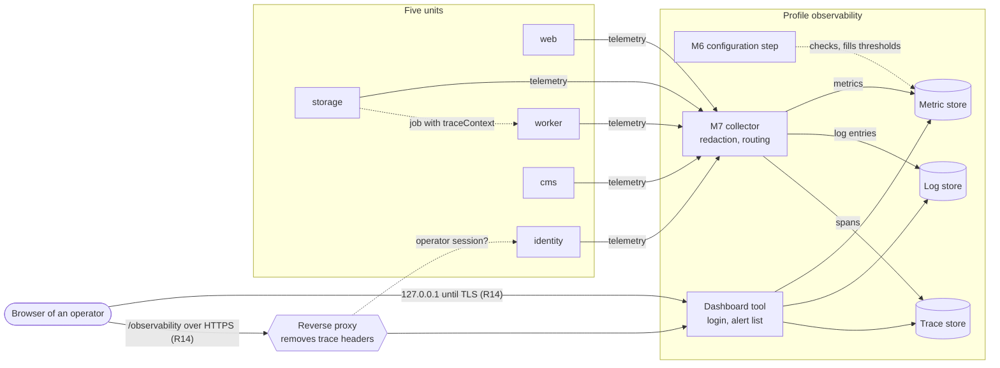
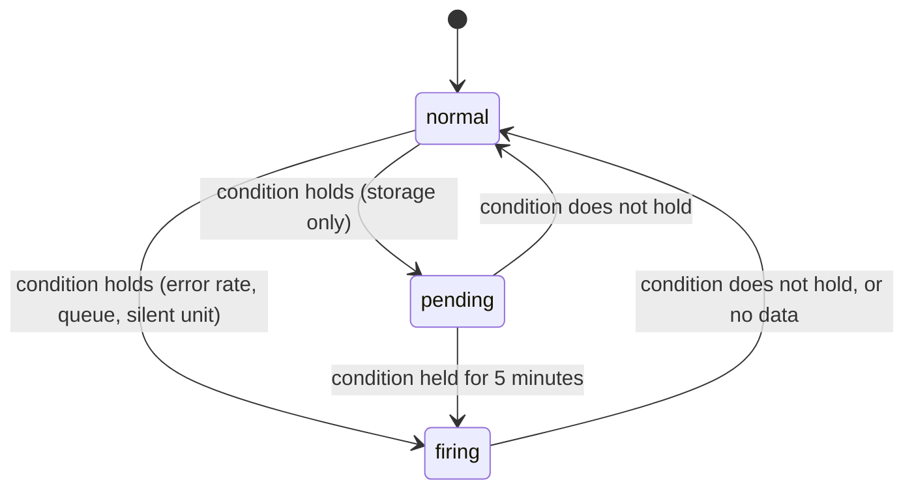

# Observability baseline Concept

The specification of roadmap feature R2: how every unit reports metrics, log entries, and traces, and how an operator reads them in operations dashboards with alerts. It is written for the feature's owner (trutscf1), its reviewers, the owners of the units who instrument their unit, and the agents that implement it. Part H is the plain-language view; Part S is binding. Question log: [observability.qa-log.md](observability.qa-log.md).

# Part H — For Human Readers

This part adds no rule. It summarizes Part S and cites its IDs; where the two disagree, Part S wins (P-HUM-3).

## H1. In one sentence

Operators see metrics, log entries, and traces of every unit in operations dashboards with alerts, so that errors and bottlenecks show at once. This serves the project goal `G-1` through the operator role `R-2`, who runs the platform on the organisation's own server and "needs to see errors and bottlenecks at once"; it keeps `G-1.S1`, because the observability stack starts with the same command, without internet: its profile is on by default (Q35).

## H2. Who benefits and how

- **Operator (`R-2`)**: gets the observability stack with the system, because its profile is on by default ([OBS-AC-1.5] observability profile); opens the operations dashboards on the server itself until TLS exists, and afterwards logs in through `identity` under `/observability` ([OBS-AC-2.5] login required); sees request rate, error rate, latency, uploads, waiting jobs, and storage usage, follows a slow request from the dashboard to its log entries and its trace, and finds four alerts in the alert list when something goes wrong ([OBS-US-2] Operations dashboards and alerts).
- **Member (`R-1`), link recipient (`R-3`), visitor (`R-4`), content editor (`R-5`)**: nothing changes in what they see, and no trace of them as a person is recorded: no IP address, no ID, no e-mail address, no file name ([OBS-AC-1.6] no person identifiers).
- **Developers of the team** (not a role of `GOAL.md`): get one shared package that instruments their unit with a single start call ([OBS-US-1] Telemetry of every unit), and see the path of a request across units and jobs while they build later features.

## H3. How it works, step by step

1. The operator starts the local stack with its usual command. The example configuration switches the observability profile on; an operator who does not want it removes it there ([OBS-AC-1.5] observability profile). A configuration step checks the retention times, the alert thresholds, and the port of the dashboard tool first; a wrong value stops only the observability stack, with one line per wrong value ([OBS-E-4] invalid stack configuration).
2. Every unit starts its telemetry before it accepts requests, writes a start log entry, and reports a heartbeat every 15 seconds ([OBS-AC-1.1] instrumented units).
3. Each request a unit answers is measured and traced under the route pattern it matched, never the raw address. When `web` calls `storage` and `storage` queues a job, the job carries the trace along, so the whole path is one trace ([OBS-AC-1.3] connected trace).
4. Log entries are JSON lines; an entry written while a request or a job is handled carries its trace ID, and passwords and tokens are replaced by `[redacted]` in the unit ([OBS-AC-1.4] structured logs), and the collector removes e-mail addresses, IP addresses, and request details a second time before anything is stored ([OBS-AC-1.6] no person identifiers).
5. The collector sends metrics, log entries, and traces to their three stores within a minute ([OBS-AC-1.2] collector routing). Logs and traces are kept 7 days, metrics 15 days.
6. The operator opens the operations dashboard "Operations overview" ([OBS-AC-2.1] operations overview) and follows links from a panel to log entries, from a log entry to its trace, and back ([OBS-AC-2.2] linked logs and traces). Until TLS exists (R14), the dashboard tool answers only on the server itself, for example through an SSH tunnel, and shows everything read-only. Afterwards it is served under `/observability` over HTTPS, and only a person with an operator session of `identity` gets in ([OBS-AC-2.5] login required).
7. Every minute the alert rules are checked. A high error rate, almost full storage, a growing queue, or a unit that went silent appears in the alert list ([OBS-AC-2.3], [OBS-AC-2.6], [OBS-AC-2.7], [OBS-AC-2.8]). Nothing is sent outside the installation.
8. When an operator switches the observability profile off, the units run exactly as before and still write their log entries to their standard output ([OBS-AC-1.7] units without the stack).

## H4. What it deliberately does not do

- It does not send alerts by e-mail or chat; they appear only in the alert list of the dashboard tool (§12, Q5).
- It does not record who did something; the audit log of R7 does that, with its own rules (§12, Q6).
- It does not measure anything in the browser; a trace starts at the first unit (§12, Q7).
- It does not make the dashboard tool accessible for screen readers or keyboard-only use beyond what the tool offers; `G-1.S2` covers the pages of the web client (§12).
- It does not run load tests; those are R13, which reads its results in these dashboards (§12).
- It runs no production monitoring service with an availability guarantee (`G-1.N4`).

## H5. How it is built, in plain words

The observability stack consists of six containers in a profile of the local stack that is on by default: a configuration step, a collector, a metric store, a log store, a trace store, and the dashboard tool; together they use at most 1.5 GB of memory ([OBS-NF-8] memory bound). Only the dashboard tool is reachable: on a port of the server itself until TLS exists, then through the reverse proxy over HTTPS, which first asks `identity` whether the person has an operator session; the dashboard tool keeps no password ([OBS-F-27]). The rest stays on the internal network (§16, "Pipeline Flow").

A new shared package `telemetry` does the work inside the units: one start call measures every request, writes log entries in one fixed shape (time, level, unit, version, message, trace ID, span ID, attributes), removes secrets, and keeps at most 2048 items per kind in memory when the collector is away (§8, §16). Six metrics form the contract between the units and the dashboard: a heartbeat, the request duration, received upload bytes, waiting jobs, and used and total storage (§8); the last four come from the storage and processing features R5 and R9, and their panels show "No data" until then.

The operations dashboard, the data sources, and the alert rules are files in the repository; the dashboard tool loads them at every start and refuses to save changes over them ([OBS-AC-2.4] dashboards as code). An alert rule is normal, pending, or firing (§16, "State Machine Diagram").

## H6. How we know it works

Every acceptance criterion has one acceptance test in §17 ([OBS-T-1] to [OBS-T-15]). The tests of the shared package, the collector's redaction, the alert rules, and the configuration step run in CI with the values of §10 and need no running stack ([OBS-T-21] to [OBS-T-38]). The tests of the started stack — routing, the connected trace, the login, the offline start — run in one CI job `stack-test` as soon as the pipeline offers a container runtime (SCF-US-5), and locally until then ([OBS-T-16] to [OBS-T-20], [OBS-T-39]).

## H7. Key decisions

The decisions of 2026-10-27 were taken by the agent on the owner's standing instruction; on 2026-11-02 the owner confirmed them and replaced four after the review of the gate (question log, round 6).

| Question | Decision | Reason |
| --- | --- | --- |
| Q3 Instrumented units | All five units | The goal says "every unit"; a missing unit is a blind spot |
| Q35 Observability profile (replaces Q4) | Profile on by default; an operator can switch it off; units unaffected without it | One command starts the complete system (`G-1.S1`) |
| Q5 Where alerts appear | Alert list of the dashboard tool only | E-mail is a service on the internet (`SCF-NF-2`) |
| Q6 Personal data | No person identifier in telemetry at all | Data minimization; the audit log of R7 records who did what |
| Q8 Silent unit | Fourth alert for a unit that stops reporting | A crashed unit sends no errors |
| Q11 Later metrics | R2 fixes the metric contract; panels show "No data" until R5 and R9 emit | R2 is built before storage and processing |
| Q36 Address (replaces Q12) | On the server itself until TLS (R14), then `/observability` through the reverse proxy over HTTPS only | No login over plain HTTP |
| Q37 Login (replaces Q22) | Through `identity`; the dashboard tool keeps no password | The school requires Argon2id hashes; `identity` has them |
| Q13 Retention | Logs and traces 7 days, metrics 15 days | Enough to investigate an incident, small on disk |
| Q17 Redaction | Two layers: the unit by attribute name, the collector by name and text pattern | One forgotten attribute must not leak a secret |
| Q21 Code location | New shared package `telemetry`; each owner adds the start call | One implementation, four tracks |
| Q24 Outside trace headers | Removed by the reverse proxy | A browser cannot attach its requests to someone else's trace |
| Q39 Stack tests (replaces Q31) | One CI job `stack-test` once the pipeline has a container runtime | Every acceptance test runs automatically |

# Part S — Specification (normative)

## 0. Synthesis Context

### Development Path

Path A (frontloaded). The draft of 2026-10-06 was grilled on 2026-10-27 (Phases 1–3, Q1–Q29), and Phases 5 and 6 were written in the same merge request (Q30–Q32, A17). Every decision of 2026-10-27 was taken by the agent on the owner's standing instruction; after the review of `tschudea07`, `trutscf1` confirmed them on 2026-11-02 and replaced Q4, Q12, Q22, and Q31 (round 6, Q35–Q41). The approval of that merge request by `tschudea07` is the Phase 4 review gate and signs off Phases 1–6 together (Q40); the PM approver `trutscf1` is its author (P-MR-2). Open: the legal questions Q33 and Q34 for the school management (§13).

### Synthesis Dependencies

- [scaffolding.md](scaffolding.md) — the five units, the local stack and its start command, the reverse proxy and its routing table (§8), the health endpoint, the configuration helper and [SCF-E-1] (invalid configuration), the contracts package and the job payloads ([SCF-F-9]), the container health checks ([SCF-F-20]), the image scan ([SCF-NF-6]).
- [storage-core.md](storage-core.md) and [background-processing.md](background-processing.md) — the upload, the object storage, and the job queues whose metrics this document specifies (§8, [OBS-F-21] to [OBS-F-23]).
- [identity.md](identity.md) — the login of an operator and the check of an operator session that the reverse proxy makes before it forwards to the dashboard tool ([OBS-F-27]; §15).
- [deployment.md](deployment.md) — TLS on the deployed server, which opens `/observability` over HTTPS, and the server running the observability profile ([OBS-F-24]; §15).

### Synthesis Scope

From this document and `STACK.md` §1: the shared package `telemetry`, the observability profile of the local stack (configuration step, collector, three stores, dashboard tool), the local port of the dashboard tool and, with R14, the proxy route `/observability` with the session check of `identity`, the operations dashboard "Operations overview", the four alert rules, and the start call in each unit. The metrics of uploads, queues, and storage capacity are emitted by the modules of R5 and R9, from the contract in §8.

### Owner

trutscf1, per [ROADMAP.md](../ROADMAP.md). The instrumentation of each unit is built by that unit's owner (§16, "Vertical Slices Breakdown").

## 1. Purpose & Goal Trace

**Feature goal:** Operators see metrics, logs, and traces of every unit in dashboards with alerts, so that errors and bottlenecks show at once.

**Serves:** `G-1` in [GOAL.md](../GOAL.md), as stated in the *Serves* column of [ROADMAP.md](../ROADMAP.md) ("on their own server"): the operator `R-2` runs the platform on the organisation's own server and needs to see errors and bottlenecks at once. The feature keeps `G-1.S1`: the observability stack starts with the same command and without any service on the internet ([OBS-NF-1]). No non-goal is touched: it is an operations aid for one installation, not a monitored production service with an availability guarantee (`G-1.N4`).

## 2. Ubiquitous Language & Context

Defined in [CONTEXT.md](../CONTEXT.md) and used here exactly: **unit**, **health report**, **dependency check**, **local stack**, **contract**, **track**, **telemetry**, **observability stack**, **trace**, **operations dashboard**, **alert rule**.

Used only in this document:

- **Collector**: the container of the observability stack that receives telemetry from the units and forwards it to the stores.
- **Metric store**, **log store**, **trace store**: the containers that keep metrics, log entries, and traces for their retention time.
- **Dashboard tool**: the container that shows operations dashboards and the alert list behind a login.
- **Operator session**: a session of `identity` whose account has the operator role. The dashboard tool takes the login name from the reverse proxy and keeps no account data of its own.
- **Span**: one timed step of a trace, for example the handling of one request by one unit or one job by `worker`.
- **Trace context**: the trace ID and span ID handed from one unit to the next, in the format of §8.
- **Route pattern**: the route of a unit that a request matched, with its parameters as `{name}`, for example `/api/storage/files/{id}`.
- **Heartbeat**: the metric `unit.running`, set by every running unit at every export interval.
- **Observability profile**: the named part of the stack definition that holds the observability stack. The example configuration switches it on, so the start command starts it unless an operator removes it (Q35).

## 3. User Stories & Acceptance Criteria

The user stories and their acceptance criteria are the work items in [work-items/E02-observability/](../work-items/E02-observability/epic.md); they are not repeated here (P-DOC-6).

## 4. Functional Requirements

| ID | Title | Requirement | Derives from |
| --- | --- | --- | --- |
| OBS-F-1 | Instrumented units | Each of the five units `web`, `identity`, `storage`, `worker`, `cms` MUST start its telemetry with `startTelemetry` (§16, module M1) with its unit name and version before it accepts a request or a job. While `TELEMETRY_ENABLED` is true, it MUST send its metrics, log entries, and spans to the collector at `TELEMETRY_ENDPOINT`. | OBS-AC-1.1 (Instrumented units) |
| OBS-F-2 | Collector routing | The collector MUST accept metrics, log entries, and spans over the telemetry protocol on the internal network of the local stack, and MUST forward metrics only to the metric store, log entries only to the log store, and spans only to the trace store. | OBS-AC-1.2 (Collector routing) |
| OBS-F-3 | Connected trace | A unit that calls another unit over HTTP while a span is active MUST send the trace context with the request, and the called unit MUST make its span a child of that context. A job queued while a span is active MUST carry the trace context ([OBS-F-15]), and the span of the job in `worker` MUST be a child of it. | OBS-AC-1.3 (Connected trace) |
| OBS-F-4 | Structured logs | A unit MUST write every log entry as one JSON object of the record `LogEntry` (§8) on one line of its standard output and MUST export the same entry to the collector. While a span is active, `traceId` and `spanId` MUST be set; otherwise they MUST be left out. A `message` longer than 2000 characters MUST be cut to 1999 characters followed by `…`. | OBS-AC-1.4 (Structured logs) |
| OBS-F-5 | Observability profile | The stack definition MUST hold the configuration step, the collector, the metric store, the log store, the trace store, and the dashboard tool in a profile named `observability`, and the example configuration ([SCF-F-17]) MUST switch it on with `COMPOSE_PROFILES=observability`, so that the start command of the local stack ([SCF-F-2]) starts all six. When the configuration does not name the profile, none of them MUST start. With the profile, all six MUST start, and the five long-running ones MUST report healthy through their container health checks ([SCF-F-20]). | OBS-AC-1.5 (Observability profile) |
| OBS-F-6 | Operations overview | The dashboard tool MUST hold the operations dashboard "Operations overview" with the six panels of §8 ("Operations overview"), each computed as stated there. | OBS-AC-2.1 (Operations overview) |
| OBS-F-7 | Linked logs and traces | Each of the panels "Requests per second", "Server errors", and "Latency (95th percentile)" MUST offer a link that opens the log entries of the selected unit for the time range shown. Each log entry with a `traceId` MUST offer a link that opens that trace. Each trace MUST offer a link that opens the log entries with its trace ID. | OBS-AC-2.2 (Linked logs and traces) |
| OBS-F-8 | Alert list | The alert rules of [OBS-F-17] to [OBS-F-20] MUST be evaluated every 60 seconds. Every firing alert MUST appear in the alert list of the dashboard tool with its name, the unit or queue it concerns, and its summary text ([OBS-U-4]). An alert rule for which no data exists MUST be normal, not firing. No alert MUST be sent to any address outside the installation. | OBS-AC-2.3 (Error rate alert), OBS-AC-2.6 (Storage usage alert), OBS-AC-2.7 (Queue growth alert), OBS-AC-2.8 (Silent unit alert) |
| OBS-F-9 | Dashboards as code | The data sources, the operations dashboards, and the alert rules MUST be files in the repository, loaded by the observability stack at every start. The dashboard tool MUST refuse to save a change to a loaded operations dashboard or alert rule; the files stay the only source. | OBS-AC-2.4 (Dashboards as code) |
| OBS-F-10 | Login required | Once the reverse proxy routes `/observability` ([OBS-F-24]), every operations dashboard, every telemetry query, and the alert list MUST require an operator session ([OBS-F-27]), and anonymous access MUST be off. The dashboard tool MUST have no login form, no self-registration, and no password of its own. Before that, while it is reachable only on the server itself, its anonymous access MUST be read-only and nothing MUST be savable. | OBS-AC-2.5 (Login required) |
| OBS-F-11 | Heartbeat | Every unit MUST set the metric `unit.running` (§8) to 1 at every export interval while it runs. | OBS-AC-1.1 (Instrumented units), OBS-AC-2.8 (Silent unit alert) |
| OBS-F-12 | Request metric | Every unit MUST record the duration of each HTTP request it answers in the metric `http.server.request.duration` (§8). Requests to its health endpoint `/health` MUST NOT be recorded in a metric, a log entry, or a span. | OBS-AC-2.1 (Operations overview) |
| OBS-F-13 | Route pattern | The route attribute and the name of a request span MUST use the route pattern the unit matched, with every path parameter written as `{name}`. A request that matches no route MUST have the route `unmatched`. The raw path and the query string MUST NOT be recorded. | OBS-AC-1.6 (No person identifiers) |
| OBS-F-14 | Secret redaction in the unit | Before a log entry is written or exported, the logger MUST replace with `[redacted]` the value of every attribute whose key contains, ignoring case, one of the secret key fragments of §8, or equals, ignoring case, one of its secret keys. | OBS-AC-1.4 (Structured logs) |
| OBS-F-15 | Trace context in job payloads | The envelope of every job payload MUST have the optional field `traceContext` (§8). The unit that queues a job while a span is active MUST set it to the active trace context; `worker` MUST start the span of the job as a child of it, or as the root of a new trace when it is missing or invalid ([OBS-E-6]). | OBS-AC-1.3 (Connected trace) |
| OBS-F-16 | Outside trace context removed | The reverse proxy MUST remove the request headers `traceparent`, `tracestate`, and `baggage` from every incoming request before forwarding it, so that every trace starts at the first unit. | OBS-AC-1.3 (Connected trace) |
| OBS-F-17 | Error rate alert rule | For each unit `u`, at each evaluation time `t`: let `N` be the number of requests of `u` recorded in `http.server.request.duration` within the 5 minutes before `t`, and `E` the number of those with a status code from 500 to 599. The alert "High error rate" for `u` MUST be firing when `N` ≥ `OBS_ALERT_MIN_REQUESTS` and `E / N × 100` > `OBS_ALERT_ERROR_RATE_PERCENT`, and normal otherwise. | OBS-AC-2.3 (Error rate alert) |
| OBS-F-18 | Storage usage alert rule | Let `p` be `storage.capacity.used / storage.capacity.total × 100`. When `p` > `OBS_ALERT_STORAGE_PERCENT` at an evaluation, the alert "Storage almost full" MUST become pending; it MUST become firing when the condition has held at every evaluation for 5 minutes, and normal at the first evaluation at which it does not hold. | OBS-AC-2.6 (Storage usage alert) |
| OBS-F-19 | Queue growth alert rule | For each queue `q`, at each evaluation time `t`: let `w(x)` be the newest value of `queue.jobs.waiting` for `q` at or before `x` and not older than 60 seconds. The alert "Queue growing" for `q` MUST be firing when `w(t − 15 min)` < `w(t − 10 min)` < `w(t − 5 min)` < `w(t)` and `w(t)` ≥ `OBS_ALERT_QUEUE_MIN_WAITING`, and normal otherwise, also when one of the four values does not exist. | OBS-AC-2.7 (Queue growth alert) |
| OBS-F-20 | Silent unit alert rule | For each unit `u`, at each evaluation time `t`: the alert "Unit silent" for `u` MUST be firing when a heartbeat of `u` was received within the 24 hours before `t` and none within the `OBS_ALERT_SILENT_MINUTES` minutes before `t`, and normal otherwise. | OBS-AC-2.8 (Silent unit alert) |
| OBS-F-21 | Upload throughput metric | `storage` MUST add the size in bytes of every upload chunk it has received completely to the metric `upload.received` (§8). It is built with the upload of [storage-core.md](storage-core.md). | OBS-AC-2.1 (Operations overview) |
| OBS-F-22 | Waiting jobs metric | `worker` MUST set the metric `queue.jobs.waiting` (§8) for every queue at every export interval to the number of jobs that wait in it and are not being processed. It is built with the queues of [background-processing.md](background-processing.md). | OBS-AC-2.1 (Operations overview), OBS-AC-2.7 (Queue growth alert) |
| OBS-F-23 | Storage capacity metrics | `storage` MUST set the metrics `storage.capacity.used` and `storage.capacity.total` (§8) every 60 seconds to the used and the total bytes of the object storage. They are built with the object storage of [storage-core.md](storage-core.md). | OBS-AC-2.1 (Operations overview), OBS-AC-2.6 (Storage usage alert) |
| OBS-F-24 | Address of the dashboard tool | While the observability profile runs and the deployed server has no TLS yet (R14), the dashboard tool MUST be reachable only on the host port `OBS_DASHBOARD_PORT` bound to `127.0.0.1`, and the reverse proxy MUST NOT route to it. With TLS, the reverse proxy MUST route `/observability` and every path below it to the dashboard tool over HTTPS only, and the host port MUST be removed. The collector, the metric store, the log store, and the trace store MUST NOT be routed by the proxy. | OBS-AC-2.5 (Login required) |
| OBS-F-25 | Start log entry | Every unit MUST write one log entry with level `info` and message `unit started` right after `startTelemetry` returns and before it accepts a request or a job. | OBS-AC-1.1 (Instrumented units) |
| OBS-F-26 | Setup guide | The notes on operation in the README ([SCF-F-28]) MUST say that the start command of the local stack starts the observability profile and how to switch it off in the configuration file, and MUST name the address of the dashboard tool: `http://127.0.0.1:<OBS_DASHBOARD_PORT>` on the server itself, reached from another machine through an SSH tunnel, and `/observability` once TLS exists. | OBS-AC-1.5 (Observability profile), OBS-AC-2.5 (Login required) |
| OBS-F-27 | Operator login through identity | Before the reverse proxy forwards a request under `/observability`, it MUST ask `identity` whether the request carries a session of an account with the operator role. Without a session it MUST send the person to the login of `identity`; with a session without the operator role it MUST answer 403. With an operator session it MUST forward the request with the login name in a header that it first removes from every incoming request, and the dashboard tool MUST take the person only from that header. | OBS-AC-2.5 (Login required) |
| OBS-F-28 | Configuration step | Before the stores and the dashboard tool start, the configuration step MUST check every variable of §8 ("Configuration of the observability stack") and write the four threshold values into the alert rule files. On an invalid value it MUST behave as [OBS-E-4] (invalid stack configuration). | OBS-AC-1.5 (Observability profile), OBS-AC-2.4 (Dashboards as code) |
| OBS-F-29 | Collector redaction | Before forwarding, the collector MUST: drop every span attribute whose key is not in the allowed span attribute list of §8; drop every log entry attribute whose key is in the client detail list of §8; replace with `[redacted]` the value of every log entry attribute whose key contains a secret key fragment or equals a secret key of §8; and replace every text matching a pattern of §8 ("Redaction patterns") in the message and in the attribute values of a log entry with `[redacted]`. | OBS-AC-1.4 (Structured logs), OBS-AC-1.6 (No person identifiers) |
| OBS-F-30 | Log level | A unit MUST write and export only log entries whose level is at or above `LOG_LEVEL`, in the order `debug` < `info` < `warn` < `error`. | OBS-AC-1.4 (Structured logs) |
| OBS-F-31 | Without the stack | When the collector does not answer, a unit MUST behave as [OBS-E-1] (collector unreachable). Telemetry MUST NOT be a dependency check of any health report. | OBS-AC-1.7 (Units without the stack) |

## 5. User Interaction Requirements

The users of these requirements are operators in the dashboard tool.

| ID | Title | Requirement | Derives from |
| --- | --- | --- | --- |
| OBS-U-1 | Panel titles and units | Every panel of "Operations overview" MUST carry the title of §8 and show its values with the unit of measure named there. | OBS-AC-2.1 (Operations overview) |
| OBS-U-2 | Default view | "Operations overview" MUST open with the time range "last 1 hour", refresh itself every 30 seconds, and show all units until the operator selects one unit in its unit selector. | OBS-AC-2.1 (Operations overview) |
| OBS-U-3 | No data | A panel for which no metric exists in the time range MUST show the text "No data", never the value 0. | OBS-AC-2.1 (Operations overview) |
| OBS-U-4 | Alert summary | Every alert MUST show the summary text of §8 ("Alert rules") with its values filled in. | OBS-AC-2.3 (Error rate alert), OBS-AC-2.6 (Storage usage alert), OBS-AC-2.7 (Queue growth alert), OBS-AC-2.8 (Silent unit alert) |

## 6. Non-Functional Requirements

| ID | Title | Requirement | Derives from |
| --- | --- | --- | --- |
| OBS-NF-1 | Start without internet | The observability profile MUST start without internet access once its images are present locally. No container of the observability stack MAY open a connection to a host outside the installation: update checks, usage reporting, and downloads of plugins or fonts MUST be off. | G-1.S1 |
| OBS-NF-2 | No person identifiers | Telemetry MUST NOT contain: an IP address of a client, a user agent, the ID of a member, an editor account, or an operator account, an e-mail address, the name of a person, the name of a file or folder, a share-link token, a raw path, a query string, the body of a request or response, or the value of a request or response header. | OBS-AC-1.6 (No person identifiers) |
| OBS-NF-3 | Visible within 60 seconds | While the collector and the stores run, a metric, log entry, or span MUST be visible in its store at most 60 seconds after the unit produced it. | OBS-AC-1.2 (Collector routing) |
| OBS-NF-4 | Retention | The metric store MUST keep metrics for `OBS_METRICS_RETENTION_DAYS` days, the log store log entries for `OBS_LOGS_RETENTION_DAYS` days, and the trace store traces for `OBS_TRACES_RETENTION_DAYS` days, and MUST delete older data automatically, at the latest 24 hours after it expired. No other copy of telemetry MAY be kept, apart from the container runtime's own buffer of standard output. | OBS-US-1 (Telemetry of every unit) |
| OBS-NF-5 | Minimal operator data | The dashboard tool MUST keep of an operator only the login name passed by the reverse proxy and a role. It MUST NOT keep a password, a password hash, an e-mail address, or a name. | OBS-US-2 (Operations dashboards and alerts) |
| OBS-NF-6 | No login of its own | The dashboard tool MUST NOT accept a password. The login of an operator is the login of `identity`, with its password hashing and its lockout after failed logins ([identity.md](identity.md); [OBS-E-5]). | OBS-AC-2.5 (Login required) |
| OBS-NF-7 | Internal only | The collector, the metric store, the log store, and the trace store MUST be reachable only on the internal network of the local stack and MUST NOT publish a port on the host. The host port of the dashboard tool ([OBS-F-24]) MUST be bound to `127.0.0.1` only. | OBS-AC-2.5 (Login required) |
| OBS-NF-8 | Memory bound | The stack definition MUST limit the memory of the six containers of the observability profile to at most 1536 MB together. | G-1.S1 |
| OBS-NF-9 | No waiting for telemetry | Exporting telemetry MUST NOT delay the start of a unit or the answer to a request: a unit whose collector does not answer MUST answer a request within the same time limits as with a running collector. | OBS-AC-1.7 (Units without the stack) |

## 7. Capability Requirements

Mapped to technology in `STACK.md` §1 (track Platform & cms) and listed in its capability index.

| ID | Title | Requirement | Derives from |
| --- | --- | --- | --- |
| OBS-C-1 | Instrumentation library | An instrumentation library for the runtime of the units that measures and traces incoming and outgoing HTTP requests with their route pattern, propagates the trace context in the W3C Trace Context format, samples traces by a configurable ratio, and exports metrics, log entries, and spans over one open telemetry protocol with a bounded buffer per kind. | OBS-AC-1.1 (Instrumented units), OBS-AC-1.3 (Connected trace) |
| OBS-C-2 | Telemetry collector | A collector that receives that protocol, keeps or drops attributes by key, replaces text by pattern, batches, and forwards each kind to its own store with retries and a bounded queue. | OBS-AC-1.2 (Collector routing), OBS-AC-1.6 (No person identifiers) |
| OBS-C-3 | Metric store | A time-series store with labels, rates and percentiles from histograms, alert rules with a pending period whose state it exposes, an offline test of alert rules against given series, and deletion by age. | OBS-AC-2.1 (Operations overview), OBS-AC-2.3 (Error rate alert) |
| OBS-C-4 | Log store | A store for log entries with the labels unit and level, a text filter that finds a trace ID, a time-range query, and deletion by age. | OBS-AC-1.2 (Collector routing), OBS-AC-2.2 (Linked logs and traces) |
| OBS-C-5 | Trace store | A store for spans with lookup by trace ID, search by unit and time range, and deletion by age. | OBS-AC-1.3 (Connected trace) |
| OBS-C-6 | Dashboard tool | A self-hosted dashboard tool that takes the person from a header set by a reverse proxy, with switchable read-only anonymous access, switchable self-registration and login form, data sources, dashboards, and alert rule views loaded from files and protected against saving, links from a log entry to a trace and from a trace to log entries, an alert list, serving under a path prefix, and no outgoing connection when update checks and usage reporting are off. | OBS-AC-2.1 (Operations overview), OBS-AC-2.4 (Dashboards as code), OBS-AC-2.5 (Login required) |
| OBS-C-7 | Session check in the reverse proxy | Before forwarding a request under a path prefix, the reverse proxy asks an address of another unit whether the request may pass, forwards the login name of the answer in a header, and removes that header from every incoming request. | OBS-AC-2.5 (Login required) |

## 8. Data Model

Neutral record types. Telemetry holds no surrogate ID of a person; the only IDs in it are trace IDs, span IDs, and IDs of jobs.

```text
UnitName = enum(web|identity|storage|worker|cms)
LogLevel = enum(debug|info|warn|error)

LogEntry {
  time: timestamp,                    // UTC, millisecond precision, written as ISO 8601 with "Z"
  level: LogLevel,
  unit: UnitName,
  version: string,                    // the same value as HealthReport.version of scaffolding.md §8
  message: string,                    // 1..2000 characters (OBS-F-4)
  traceId: optional<string>,          // 32 lowercase hexadecimal characters; only while a span is active
  spanId: optional<string>,           // 16 lowercase hexadecimal characters; only while a span is active
  attributes: map<string, string>     // keys 1..64 characters [a-zA-Z0-9._-]; values 0..500 characters
}

TraceContext = string matching 00-[0-9a-f]{32}-[0-9a-f]{16}-[0-9a-f]{2}
                                       // the "traceparent" value of the W3C Trace Context format

JobEnvelope {                         // the shared envelope of every job payload (contracts package)
  ...existing fields,
  traceContext: optional<TraceContext>
}

TelemetryConfig {                     // part of the configuration contract of every unit
  enabled: boolean,                   // TELEMETRY_ENABLED
  endpoint: string,                   // TELEMETRY_ENDPOINT
  exportIntervalMs: integer,          // TELEMETRY_EXPORT_INTERVAL_MS
  traceSampleRatio: decimal,          // TELEMETRY_TRACE_SAMPLE_RATIO
  bufferLimit: integer,               // TELEMETRY_BUFFER_LIMIT
  logLevel: LogLevel                  // LOG_LEVEL
}
```

**Configuration of a unit** (checked by the configuration helper at the start; an invalid value is [SCF-E-1], invalid configuration):

| Variable | Type | Default | Valid values |
| --- | --- | --- | --- |
| `TELEMETRY_ENABLED` | boolean | `true` | `true`, `false` |
| `TELEMETRY_ENDPOINT` | string | the internal address of the collector in the stack definition (`STACK.md` §1) | an absolute `http` or `https` address |
| `TELEMETRY_EXPORT_INTERVAL_MS` | integer | 15000 | 1000 to 60000 |
| `TELEMETRY_TRACE_SAMPLE_RATIO` | decimal | 1.0 | 0.0 to 1.0; 0.0 keeps no trace |
| `TELEMETRY_BUFFER_LIMIT` | integer | 2048 | 100 to 100000 items per kind |
| `LOG_LEVEL` | LogLevel | `info` | `debug`, `info`, `warn`, `error` |

**Configuration of the observability stack** (checked by the configuration step, [OBS-F-28]; an invalid or missing value is [OBS-E-4]):

| Variable | Type | Default | Valid values |
| --- | --- | --- | --- |
| `OBS_METRICS_RETENTION_DAYS` | integer | 15 | 1 to 90 |
| `OBS_LOGS_RETENTION_DAYS` | integer | 7 | 1 to 30 |
| `OBS_TRACES_RETENTION_DAYS` | integer | 7 | 1 to 30 |
| `OBS_ALERT_ERROR_RATE_PERCENT` | decimal | 5 | 0.1 to 100 |
| `OBS_ALERT_MIN_REQUESTS` | integer | 20 | 1 to 100000 |
| `OBS_ALERT_STORAGE_PERCENT` | decimal | 90 | 1 to 100 |
| `OBS_ALERT_QUEUE_MIN_WAITING` | integer | 10 | 1 to 1000000 |
| `OBS_ALERT_SILENT_MINUTES` | integer | 2 | 1 to 60 |
| `OBS_DASHBOARD_PORT` | integer | 3300 | 1024 to 65535; the host port of the dashboard tool on `127.0.0.1` until TLS ([OBS-F-24]) |

The example configuration ([SCF-F-17]) lists all fifteen variables with their defaults and `COMPOSE_PROFILES=observability` ([OBS-F-5]). None of them is a secret: the dashboard tool has no password of its own ([OBS-F-27]).

**Metrics** (the contract between the units and the operations dashboards; `STACK.md` §1 maps each name to its concrete name in the metric store):

| Metric | Kind | Measure | Attributes | Emitted by | Built with |
| --- | --- | --- | --- | --- | --- |
| `unit.running` | gauge, always 1 | — | unit, version | every unit, at every export interval ([OBS-F-11]) | OBS-US-1 |
| `http.server.request.duration` | histogram with the bucket bounds 0.005, 0.01, 0.025, 0.05, 0.1, 0.25, 0.5, 1, 2.5, 5, 10 | seconds | unit, route, method, status code | every unit, per answered request except `/health` ([OBS-F-12]) | OBS-US-1 |
| `upload.received` | counter | bytes | unit | `storage`, per received upload chunk ([OBS-F-21]) | R5 |
| `queue.jobs.waiting` | gauge | jobs | unit, queue | `worker`, per queue at every export interval ([OBS-F-22]) | R9 |
| `storage.capacity.used` | gauge | bytes | unit | `storage`, every 60 seconds ([OBS-F-23]) | R5 |
| `storage.capacity.total` | gauge | bytes | unit | `storage`, every 60 seconds ([OBS-F-23]) | R5 |

A metric MUST NOT carry an attribute that is not in its row.

**Allowed span attributes** ([OBS-F-29]; every other key is dropped by the collector): `unit`, `version`, `route`, `method`, `status code`, `peer unit` (the unit called by an outgoing request), `queue`, `job name`, `job id`, `outcome` (`ok` or `error`), `error type` (the name of the error class, never its message). `STACK.md` §1 maps each to the attribute key of the telemetry protocol. The name of a request span is `<method> <route>`, the name of a job span is `job <queue>/<job name>`.

**Client detail list** ([OBS-F-29]; log entry attributes with these keys are dropped by the collector): every key that, ignoring case, equals one of the following or ends with `.`, `_`, or `-` followed by one of them: `ip`, `client.address`, `remote.address`, `user_agent`, `user-agent`, `url`, `url.full`, `path`, `query`, `header`, `headers`, `email`, `name.first`, `name.last`, `member.id`, `user.id`, `file.name`, `folder.name`.

**Secret key fragments** ([OBS-F-14], [OBS-F-29]; an attribute whose key contains one of them, ignoring case, gets the value `[redacted]`): `password`, `passwd`, `secret`, `token`, `authorization`, `cookie`, `apikey`, `api_key`, `api-key`, `session`, `credential`, `totp`, `otp`, `backupcodes`, `recoverycode`.

**Secret keys** ([OBS-F-14], [OBS-F-29]; an attribute whose whole key equals one of them, ignoring case, gets the value `[redacted]`; as fragments they would also hit keys such as `statusCode` or `stateful`): `code`, `state`.

The secret key fragments and the secret keys are part of the contract of the package `telemetry`. A feature that adds a secret attribute — R3 for its login and multi-factor flows — extends both lists in its own concept and in the package (§15, A20).

**Redaction patterns** ([OBS-F-29]; matching text in a log message or attribute value is replaced by `[redacted]`):

| Pattern | Matches |
| --- | --- |
| E-mail address | one or more characters other than white space and `@`, then `@`, then one or more such characters, a `.`, and one or more such characters |
| IPv4 address | four groups of 1 to 3 digits separated by `.`, not part of a longer run of digits and dots |
| IPv6 address | 3 to 8 groups of 1 to 4 hexadecimal digits separated by `:` that contain `::`, or exactly 8 such groups; a time such as `10:00:00` has no `::` and fewer than 8 groups and is kept |

**Operations overview** (the operations dashboard of [OBS-F-6]; every value over the 5 minutes before each point in time, all units or the unit chosen in the unit selector):

| Panel title | Value | Measure | Source |
| --- | --- | --- | --- |
| Requests per second | requests per second, one line per unit | requests/s | `http.server.request.duration`, count |
| Server errors | share of requests with a status code from 500 to 599, one line per unit | % | `http.server.request.duration`, count by status code |
| Latency (95th percentile) | 95th percentile of the request duration, one line per unit | ms | `http.server.request.duration`, histogram |
| Upload throughput | received upload bytes per second | bytes/s | `upload.received` |
| Waiting jobs | waiting jobs, one line per queue | jobs | `queue.jobs.waiting` |
| Storage usage | `storage.capacity.used / storage.capacity.total × 100` | % | `storage.capacity.*` |

**Alert rules** ([OBS-F-17] to [OBS-F-20]; the thresholds are the configuration values of the observability stack):

| Alert | Per | Condition | Summary text |
| --- | --- | --- | --- |
| High error rate | unit | [OBS-F-17] | `Unit {unit}: {E / N × 100, one decimal} % of {N} requests failed in the last 5 minutes.` |
| Storage almost full | installation | [OBS-F-18] | `Object storage is {p, one decimal} % full.` |
| Queue growing | queue | [OBS-F-19] | `Queue {queue}: {w(t)} waiting jobs, growing for 15 minutes.` |
| Unit silent | unit | [OBS-F-20] | `Unit {unit} has sent no telemetry for {OBS_ALERT_SILENT_MINUTES} minutes.` |

Alert states: `normal`, `pending` (only "Storage almost full"), `firing` (§16, "State Machine Diagram").

**Proxy route** (extends the routing table of [scaffolding.md](scaffolding.md) §8, §15):

| Target | Proxy path prefix | Present |
| --- | --- | --- |
| dashboard tool | `/observability` | only with TLS (R14), while the observability profile runs, after the session check of `identity` ([OBS-F-27]) |

## 9. Error Conditions

| ID | Title | Trigger | Required behavior | Fallback | Derives from |
| --- | --- | --- | --- | --- | --- |
| OBS-E-1 | Collector unreachable | A unit cannot deliver telemetry to `TELEMETRY_ENDPOINT`, or the collector does not answer within 10 seconds. | The unit keeps answering requests and running jobs. It keeps at most `TELEMETRY_BUFFER_LIMIT` items per kind and drops the oldest item of that kind when a new one arrives; it retries the delivery at the next export interval. It writes at most one log entry per minute about it, with level `debug` and message `telemetry export failed`. | Standard output keeps every log entry ([OBS-F-4]). | OBS-AC-1.7 (Units without the stack) |
| OBS-E-2 | Store unreachable | The collector cannot deliver to one of the three stores. | The collector keeps the items of that kind for at most 5 minutes and retries after 1, 2, 4, 8, 16, and then every 30 seconds; it drops items older than 5 minutes. The other two kinds are forwarded unchanged. | None. | OBS-AC-1.2 (Collector routing) |
| OBS-E-3 | Dashboard tool absent | A request to `/observability` arrives while the observability profile is switched off, before TLS exists ([OBS-F-24]), or before the dashboard tool is healthy. | The reverse proxy answers with an HTTP status from 500 to 599 or 404; every other route answers unchanged. | None. | OBS-AC-2.5 (Login required) |
| OBS-E-4 | Invalid stack configuration | A variable of the observability stack (§8) is missing where required or outside its valid values. | The configuration step exits with a non-zero code and prints one line per invalid variable — name and reason, never the value — in the form of [SCF-E-1]. The stores and the dashboard tool do not start; the units and the data services start as without the profile. | None. | OBS-AC-1.5 (Observability profile) |
| OBS-E-5 | No operator session | A request under `/observability` arrives without a session of `identity`, or with a session whose account lacks the operator role. | Without a session the reverse proxy answers with a redirect to the login of `identity`; with a session without the operator role it answers 403. The dashboard tool receives neither request. Wrong passwords and locked logins are handled by the login of `identity`. | None. | OBS-AC-2.5 (Login required) |
| OBS-E-6 | Invalid trace context in a job | The field `traceContext` of a job payload does not match `TraceContext` (§8). | `worker` runs the job, starts its span as the root of a new trace, and writes a log entry with level `warn`, message `invalid trace context in job payload`, and the attributes `queue` and `job id`. | None. | OBS-AC-1.3 (Connected trace) |
| OBS-E-7 | Invalid unit telemetry configuration | A variable of `TelemetryConfig` (§8) is outside its valid values. | The unit behaves as [SCF-E-1] (invalid configuration) of [scaffolding.md](scaffolding.md). | None. | OBS-AC-1.1 (Instrumented units) |
| OBS-E-8 | Invalid provisioning file | A data source, operations dashboard, or alert rule file in the repository cannot be read. | The test of [OBS-T-11] fails in CI before the file reaches `dev`. At a start, the dashboard tool loads every other file and writes the name of the unreadable file to its log. | None. | OBS-AC-2.4 (Dashboards as code) |

## 10. Worked Examples

**Example 1 — log entry with secret attributes ([OBS-F-4], [OBS-F-14]).** `identity` (version `0.2.0`), inside the span `00f067aa0ba902b7` of trace `4bf92f3577b34da6a3ce929d0e0e4736`, logs level `warn`, message `login refused`, attributes `{ "password": "hunter2hunter2", "sessionToken": "s3cr3t", "X-Api-Key": "k-123", "reason": "locked" }`. Its standard output receives the line:

```json
{"time":"2026-11-03T09:15:02.417Z","level":"warn","unit":"identity","version":"0.2.0","message":"login refused","traceId":"4bf92f3577b34da6a3ce929d0e0e4736","spanId":"00f067aa0ba902b7","attributes":{"password":"[redacted]","sessionToken":"[redacted]","X-Api-Key":"[redacted]","reason":"locked"}}
```

The same log entry outside a span — for example the start log entry `unit started` — has no `traceId` and no `spanId` field (Q38).

**Example 2 — collector redaction ([OBS-F-29], [OBS-NF-2]).**

| Received from a unit | Stored |
| --- | --- |
| message `share link opened by ada@example.org from 203.0.113.7 at 10:00:00` | message `share link opened by [redacted] from [redacted] at 10:00:00` |
| message `upstream fe80::1 refused` | message `upstream [redacted] refused` |
| message `retry 1.2.3.4` | message `retry [redacted]` (a four-part number is taken as an address; accepted) |
| log attribute `client.address` = `203.0.113.7` | attribute removed |
| log attribute `user_agent` = `Firefox/140` | attribute removed |
| log attribute `jobId` = `j-881` | kept |
| span attribute `url.full` = `https://example.org/s/AbCdEf?x=1` | attribute removed (not in the allowed list) |
| span attribute `route` = `/s/{token}` | kept |

**Example 3 — route pattern ([OBS-F-13]).**

| Unit | Request | Route recorded | Span name |
| --- | --- | --- | --- |
| `storage` | `GET /api/storage/files/7c9e6679-7425-40de-944b-e07fc1f90ae7/download` | `/api/storage/files/{id}/download` | `GET /api/storage/files/{id}/download` |
| `web` | `GET /s/AbCdEf123?x=1` | `/s/{token}` | `GET /s/{token}` |
| `web` | `GET /no-such-page` | `unmatched` | `GET unmatched` |
| `storage` | `GET /health` | not recorded ([OBS-F-12]) | no span |

**Example 4 — connected trace ([OBS-F-3], [OBS-F-15], [OBS-F-16]).** A browser sends `POST /api/storage/uploads` with a header `traceparent: 00-aaaa…-bbbb…-01`; the proxy removes the header. `storage` starts trace `4bf92f3577b34da6a3ce929d0e0e4736` and queues the job `scan` in queue `processing` with `traceContext` = `00-4bf92f3577b34da6a3ce929d0e0e4736-00f067aa0ba902b7-01`. The trace store then holds:

| Span | Unit | Parent | Trace ID |
| --- | --- | --- | --- |
| `POST /api/storage/uploads` | `storage` | — (root) | `4bf92f35…4736` |
| `job processing/scan` | `worker` | the span of `storage` | `4bf92f35…4736` |

When the request starts in `web`, which calls `storage`, the span `POST /api/upload` of `web` is the root and the span of `storage` is its child; the job span stays a child of the span of `storage`. The trace ID `aaaa…` of the browser appears nowhere.

**Example 5 — error rate alert ([OBS-F-17]), defaults 5 % and 20 requests.**

| Requests of `storage` in the last 5 minutes | Of those with status 500–599 | State |
| --- | --- | --- |
| 19 | 10 | normal (fewer than 20 requests) |
| 100 | 5 | normal (5.0 % is not more than 5 %) |
| 100 | 6 | firing — `Unit storage: 6.0 % of 100 requests failed in the last 5 minutes.` |
| 200 | 30 with status 404 | normal (client errors do not count) |
| 0 | 0 | normal (no data) |

**Example 6 — storage usage alert ([OBS-F-18]), default 90 %, total 100 GB.**

| Time | Used | `p` | State |
| --- | --- | --- | --- |
| 10:00 | 89 GB | 89.0 | normal |
| 10:01 | 91 GB | 91.0 | pending |
| 10:02 to 10:05 | 91 GB | 91.0 | pending |
| 10:06 | 91 GB | 91.0 | firing — `Object storage is 91.0 % full.` |
| 10:07 | 90 GB | 90.0 | normal (90 % is not more than 90 %) |

Before R5 emits `storage.capacity.*`, the rule has no data and is normal.

**Example 7 — queue growth alert ([OBS-F-19]), default minimum 10.** Values of `w` at `t − 15`, `t − 10`, `t − 5`, `t` minutes:

| Queue | `w` | State |
| --- | --- | --- |
| `processing` | 3, 5, 8, 12 | firing — `Queue processing: 12 waiting jobs, growing for 15 minutes.` |
| `processing` | 3, 5, 5, 12 | normal (not growing at every step) |
| `processing` | 2, 4, 6, 9 | normal (9 is below 10) |
| `cleanup` | no value, 5, 8, 12 | normal (one value missing) |

**Example 8 — silent unit alert ([OBS-F-20]), default 2 minutes.**

| Unit | Newest heartbeat | Any heartbeat in the last 24 h | At 10:02:30 |
| --- | --- | --- | --- |
| `worker` | 10:00:00 | yes | firing — `Unit worker has sent no telemetry for 2 minutes.` |
| `web` | 10:02:20 | yes | normal |
| `cms` | never | no | normal (the unit has not reported yet, for example before it is built) |
| `identity` | yesterday 09:00 | no | normal (stopped more than 24 hours ago) |

**Example 9 — collector unreachable ([OBS-E-1]), `TELEMETRY_BUFFER_LIMIT` = 3.** The collector is down; `storage` produces the log entries L1 to L5. The buffer holds L3, L4, L5; L1 and L2 are dropped. Standard output holds L1 to L5. When the collector answers again, L3, L4, L5 are delivered at the next export interval. Every request in the meantime is answered as usual.

**Example 10 — invalid stack configuration ([OBS-E-4]).** `OBS_LOGS_RETENTION_DAYS=45`, `OBS_DASHBOARD_PORT=80`:

```text
Invalid configuration for the observability stack:
  OBS_LOGS_RETENTION_DAYS: expected an integer between 1 and 30
  OBS_DASHBOARD_PORT: expected an integer between 1024 and 65535
```

Exit code non-zero; the values `45` and `80` are not printed. The stores and the dashboard tool do not start; the units start.

## 11. Integration Points

Where this feature meets other parts of the system. The interferences behind each point are in §14.

| Point | Between | What crosses it | Specified in |
| --- | --- | --- | --- |
| Telemetry export | every unit → collector | Metrics, log entries, spans over the telemetry protocol on the internal network | [OBS-F-1], [OBS-F-2], [OBS-E-1] |
| Trace context between units | calling unit → called unit | The trace context with an HTTP request | [OBS-F-3] |
| Trace context in jobs | queueing unit → `worker` | `JobEnvelope.traceContext` | [OBS-F-15], [OBS-E-6]; contract in the contracts package ([SCF-F-9]) |
| Unit configuration | example configuration → every unit | The variables of `TelemetryConfig` | §8; [SCF-F-11], [SCF-F-17] |
| Reverse proxy | browser of an operator → proxy → dashboard tool | With TLS: operations dashboards under `/observability` after the session check; trace headers removed from every request | [OBS-F-16], [OBS-F-24], [OBS-E-3]; routing table in [scaffolding.md](scaffolding.md) §8 |
| Operator session | reverse proxy → `identity` | Whether a request carries a session of an account with the operator role; its login name | [OBS-F-27], [OBS-E-5]; [identity.md](identity.md) |
| Local port | operator on the server → dashboard tool | Read-only operations dashboards on `127.0.0.1` until TLS | [OBS-F-10], [OBS-F-24] |
| Metrics of later features | `storage`, `worker` → metric store | `upload.received`, `queue.jobs.waiting`, `storage.capacity.*` | [OBS-F-21] to [OBS-F-23]; [storage-core.md](storage-core.md), [background-processing.md](background-processing.md) |
| Load test results | load tests (R13) → operations dashboards | Request rate, error rate, latency during a load test | [load-tests.md](load-tests.md) |

## 12. Out of Scope

- Sending alerts outside the installation (e-mail, chat, phone); an operator reads the alert list (Q5).
- Recording which person did something; the audit log of R7 does that, with its own retention ([teams-permissions.md](teams-permissions.md)).
- Telemetry from the browser; a trace starts at the first unit (Q7).
- Metrics, logs, or traces of the data services (databases, object storage, virus scanner) and of the reverse proxy themselves; only the five units are instrumented.
- The status page of `web`: it keeps showing the health reports of the units ([SCF-F-8]) and does not show the observability stack.
- Accessibility of the dashboard tool beyond what it offers by itself; `G-1.S2` covers the pages of the web client.
- Load tests (R13) and their scenarios.
- Deleting the telemetry of one person: telemetry holds no person identifier ([OBS-NF-2]), so it is deleted only by retention ([OBS-NF-4]).

## 13. Resolved Questions & ADRs

Verbatim rounds: [observability.qa-log.md](observability.qa-log.md). The decisions of rounds 1–5 were taken by the agent on the owner's standing instruction of 2026-10-27; `trutscf1` confirmed them on 2026-11-02 (Q41) and replaced Q4, Q12, Q22, and Q31 by Q35 to Q37 and Q39 (round 6). No ADR was needed: no decision changes `GOAL.md` or deviates from a `P-…` ID, and the unit split of ADR-0001 stays (A4).

| Q | Title | Decision | Rationale |
| --- | --- | --- | --- |
| Q1 | Deviations | Standing decisions and assumptions A1–A4 apply unchanged | — |
| Q2 | Feature goal wording | "unit" instead of "service" | The glossary avoids "service" |
| Q3 | Instrumented units | All five units | The goal says every unit |
| Q4 | Optional stack | Replaced by Q35 | — |
| Q5 | Where alerts appear | Alert list of the dashboard tool only ([OBS-F-8]) | E-mail is a service on the internet |
| Q6 | Personal data | No person identifier in telemetry ([OBS-NF-2]) | Data minimization; who did what is the audit log of R7 |
| Q7 | Browser telemetry | None; a trace starts at the first unit | No collector address exposed to browsers |
| Q8 | Silent unit | New criterion `OBS-AC-2.8` ([OBS-F-20]) | A crashed unit sends no errors |
| Q9 | One alert per criterion | `OBS-AC-2.3` split into 2.3, 2.6, 2.7 | One statement per row |
| Q10 | Health requests | Excluded from metrics, log entries, and spans ([OBS-F-12]) | Health checks every few seconds would bury real traffic |
| Q11 | Metrics of later features | Contract in §8; emitted by R5 and R9; "No data" until then ([OBS-U-3]) | R2 is built before storage and processing |
| Q12 | Address | Replaced by Q36 | — |
| Q13 | Retention | Logs and traces 7 days, metrics 15 days, within limits ([OBS-NF-4]) | Enough for an incident, small on disk |
| Q14 | Alert thresholds | Configuration with the defaults of the criteria (§8) | P-DES-6: no hard-coded configuration |
| Q15 | Alert windows | As in [OBS-F-17] to [OBS-F-20] | Avoids alerts from single requests and short peaks |
| Q16 | No data | Normal, not firing ([OBS-F-8]) | A fresh installation must not start with alerts |
| Q17 | Redaction | Unit by key ([OBS-F-14]); collector by key, allow list, and pattern ([OBS-F-29]) | A forgotten attribute must not leak a secret |
| Q18 | Paths | Route pattern only ([OBS-F-13]) | Raw paths hold share-link tokens and IDs |
| Q19 | Collector unreachable | Bounded buffer, oldest dropped, no dependency check ([OBS-E-1], [OBS-F-31]) | Telemetry must never take a unit down |
| Q20 | Sampling | All traces; ratio as configuration | Small installations; the ratio can be lowered |
| Q21 | Code location | Shared package `telemetry` of the Platform track; each unit owner adds the start call | One implementation; tracks stay separate |
| Q22 | Operator accounts | Replaced by Q37 | — |
| Q23 | Trace through a job | `JobEnvelope.traceContext` ([OBS-F-15]) | The trace must survive the queue |
| Q24 | Outside trace headers | Removed by the proxy ([OBS-F-16]) | A browser cannot join or forge a trace |
| Q25 | Memory bound | At most 1536 MB for the profile ([OBS-NF-8]) | It runs on one server next to the whole system |
| Q26 | Stack configuration check | Configuration step before the stores ([OBS-F-28], [OBS-E-4]) | Same behaviour as [SCF-E-1] for third-party containers |
| Q27 | Changes to `scaffolding.md` | Made by `trutscf1` in the MR of the slice that needs them (§15) | The concept MR changes no behaviour of R1 yet |
| Q28 | Privacy template | The operator role and login name added to [PUB-F-22] in the MR of `OBS-US-2` slice 5 (§15; since Q37 they are kept by `identity`) | `PUB-F-22` lists every kind of personal data |
| Q29 | Shared understanding | Confirmed; Phases 1–3 written | — |
| Q30 | Slices | Per track (§16) | Each owner instruments their own unit |
| Q31 | Test seams | Replaced by Q39 | — |
| Q32 | Adversarial check | Self-check by the agent; three findings fixed | `doubt-driven-development` not installed (A16) |
| Q35 | Observability profile | On by default through the example configuration; an operator can switch it off; the deployed server runs it ([OBS-F-5], [OBS-F-31]) | `G-1.S1`: the complete system starts with one command |
| Q36 | Address | Host port on `127.0.0.1` until TLS (R14); then `/observability` through the reverse proxy over HTTPS only ([OBS-F-24], [OBS-NF-7]) | No login over plain HTTP; `/dashboard` is the member's start page |
| Q37 | Login | Through `identity`: the reverse proxy checks the operator session, the dashboard tool keeps no password ([OBS-F-27], [OBS-F-10], [OBS-NF-5], [OBS-NF-6]); until R3, read-only on the server itself (A22) | The school requires Argon2id hashes; one login for every person |
| Q38 | Trace ID in log entries | Only entries written inside a request or a job carry it (`OBS-AC-1.4`, [OBS-F-4]) | Start and shutdown have no active trace |
| Q39 | Stack tests | All stack tests in one CI job `stack-test` once the pipeline has a container runtime (§17) | Every acceptance test runs automatically |
| Q40 | Gate | The approval of the merge request signs off Phases 1–6; #114 closes with `tickets` | The merge request already holds Phases 5 and 6 |
| Q41 | Confirmation | Every other decision of rounds 1–5 confirmed | — |

**Open questions for the school management** (legal; not decided by the team or an agent):

| Q | Title | Question |
| --- | --- | --- |
| Q33 | Telemetry and personal data | Does telemetry without person identifiers (time, route, status, duration) still count as personal data, and does the privacy policy template need a paragraph on it? |
| Q34 | Operator accounts | On which lawful basis does an operator keep the login names of the people who may open the operations dashboards, and does the team's installation need an agreement for it? |

## 14. Artifact Interactions & Interferences

The existing parts of the system this feature touches, checked on 2026-10-27 (Phase 3). Each interference is closed by the requirement or the change named in its row.

| Artifact | Interaction | Interference | Resolved by |
| --- | --- | --- | --- |
| Stack definition and start command ([SCF-F-2], [SCF-F-20]) | Six containers join it in the profile `observability`, which the example configuration switches on (Q35). | When the profile is switched off they must not start; with it each needs a health check, and the units must not wait for them. | [OBS-F-5], [OBS-F-31]; health checks for the five long-running containers |
| Start without internet ([SCF-NF-1], `G-1.S1`) | The profile must start offline like the rest. | Dashboard tools often check for updates, report usage, or download plugins and fonts at start. | [OBS-NF-1] |
| Image scan ([SCF-NF-6]) | The scan covers every image of the stack definition, also the profile's (A13). | A new image can bring a high or critical vulnerability and fail the pipeline. | Exact tags pinned in slice 1 of `OBS-US-1`; the job `container-scan` (#149) scans them; an exception follows `SCF-NF-6` (A20) |
| Reverse proxy and routing table ([SCF-F-4], [scaffolding.md](scaffolding.md) §8) | With TLS the dashboard tool is served under `/observability` after a session check; trace headers are removed. | The routing table lists only units; `/observability` is a prefix below `/` of `web` and must take precedence; until TLS a login over the proxy would be plain HTTP. | [OBS-F-16], [OBS-F-24], [OBS-F-27]; routing table extended (§15) |
| Identity (R3, [identity.md](identity.md)) | Operators log in through `identity` (Q37). | `identity` has no operator role and no session check for the reverse proxy yet. | §15 |
| Deployment (R14, [deployment.md](deployment.md)) | TLS on the deployed server; the server runs the profile (Q35, Q36). | Until R14 there is no HTTPS, so `/observability` is not routed. | [OBS-F-24]; §15 |
| Workspace layout ([SCF-F-18], [SCF-T-1]) | New shared package `telemetry` (Q21). | `SCF-F-18` names exactly the packages `contracts`, `ui`, `config`, and `tests/monorepo.test.ts` checks them. | `SCF-F-18`, `SCF-T-1`, and the test extended (§15) |
| Contracts package ([SCF-F-9]) | Job payloads get `traceContext`; every unit configuration contract gets `TelemetryConfig`. | The job envelope is owned by the contracts core (`schauby1`); each unit's configuration contract by its owner. | §15 |
| Health report ([SCF-F-6], [SCF-F-7]) | Telemetry is no dependency of a unit. | A collector check would make every unit `degraded` without the profile and break [SCF-NF-1]. | [OBS-F-31] |
| Health endpoint and status page ([SCF-F-5], [SCF-F-8]) | Health requests arrive every few seconds. | They would dominate request rate and latency. | [OBS-F-12] |
| Error response ([SCF-F-21], [scaffolding.md](scaffolding.md) §10, example 6) | "The cause goes to the unit's log." | The cause may hold an address or an e-mail address. | [OBS-F-29], [OBS-NF-2] |
| Example configuration ([SCF-F-17]) | Fifteen new variables and `COMPOSE_PROFILES`. | A fresh clone must start the profile without any edit. | §8 (configuration tables), [OBS-F-5], [OBS-F-26] |
| Privacy template ([PUB-F-22] of [public-content.md](public-content.md)) | The operator role and login name in `identity` are personal data of operators. | `PUB-F-22` lists every kind of personal data the product stores; operator accounts are missing. | §15 (Q28) |
| Audit log (R7, [TPM-AC-4.2]) | It records the IP address and the member per action. | None: telemetry records neither, and the two are separate stores with separate retention. | [OBS-NF-2]; §12 |
| Storage core (R5) and background processing (R9) | They own the upload, the object storage, and the queues. | The metrics of [OBS-F-21] to [OBS-F-23] must be built by their owner, not by R2. | Inbox of `schauby1` (§15) |
| Load tests (R13, [LDT-AC-1.3]) | Results are analysed in the operations dashboards (A15). | None; R13 depends on R2. | — |
| Scaffold on `dev` (`docker-compose.yml`, `apps/`) | The stack definition holds two databases; the units are empty packages. | The profile and the start calls can only be added as the units become runnable. | Slices of `OBS-US-1` (§16) |

## 15. Schema Extensions

**Contracts** (backward compatible: every new field is optional or has a default):

- `JobEnvelope.traceContext: optional<TraceContext>` (§8) in the contracts core.
- `TelemetryConfig` (§8) as a shape in the package `telemetry`, included in the configuration contract of every unit.
- The routing table of [scaffolding.md](scaffolding.md) §8 gets the row of §8 ("Proxy route").

**Required changes to other documents.** This concept does not edit documents of other owners (P-TEAM-4); each change is in the inbox of the handle named, or is made by `trutscf1` in the merge request named.

| Document | Change | Reason | Carried out by |
| --- | --- | --- | --- |
| [scaffolding.md](scaffolding.md) [SCF-F-18], [SCF-T-1], §16 module tree; `tests/monorepo.test.ts` | Add the shared package `telemetry`. | Q21 | `trutscf1`, in the MR of `OBS-US-1` slice 2 |
| [scaffolding.md](scaffolding.md) §8 routing table, [SCF-F-4] | Add the removal of the trace headers ([OBS-F-16]), and the row of `/observability` with its session check ([OBS-F-24], [OBS-F-27]). | Q24, Q36, Q37 | `trutscf1`: the header removal in the MR of `OBS-US-1` slice 1, the row in the MR of `OBS-US-2` slice 5 |
| [identity.md](identity.md) (R3) | Add the operator role and an address that answers the reverse proxy whether a request carries a session of an account with that role ([OBS-F-27]); extend the secret key lists of the package `telemetry` with the attributes of the login and multi-factor flows (§8). | Q37, A20 | `tschudea07`, when grilling R3 (inbox) |
| [deployment.md](deployment.md) (R14) | Run the observability profile on the deployed server; with TLS, route `/observability` over HTTPS and remove the host port of the dashboard tool ([OBS-F-24]). | Q35, Q36 | `tschudea07`, when grilling R14 (inbox) |
| Contracts core (`packages/contracts`), [scaffolding.track-storage.md](scaffolding.track-storage.md) | Add `traceContext` to the job envelope. | Q23 | `schauby1`, in `OBS-US-1` slice 7 |
| Configuration contracts of `web`, `identity`, `storage`, `worker` | Include `TelemetryConfig`; call `startTelemetry` and write the start log entry. | Q21 | Owner of each unit, in `OBS-US-1` slices 4–6 |
| [storage-core.md](storage-core.md), [background-processing.md](background-processing.md) | Add requirements that emit `upload.received`, `storage.capacity.*`, and `queue.jobs.waiting` as in §8. | Q11 | `schauby1`, when grilling R5 and R9 |
| [public-content.md](public-content.md) [PUB-F-22] | Add a paragraph for the operator role and login name of the people who may open the operations dashboards to the privacy template. | Q28, Q37 | `trutscf1`, in the MR of `OBS-US-2` slice 5 |

## 16. Architecture & Vertical Slices

### Module Overview & Tree

```text
packages/telemetry          shared package, track Platform & cms
├── M1 startTelemetry        start call of a unit: exporters, HTTP instrumentation, heartbeat
├── M2 Logger                LogEntry lines on standard output and to the collector
├── M3 Redactor              secret key fragments → "[redacted]"
├── M4 JobTrace              trace context into and out of a job envelope
└── M5 ExportBuffer          bounded buffer per kind, oldest dropped
stack configuration         track Platform & cms (container stack definition, reverse proxy)
├── M6 ConfigurationStep     checks the stack variables, fills the thresholds into the alert rules
├── M7 CollectorPipeline     receive, redact, batch, route to three stores
├── M8 Stores                metric store, log store, trace store with retention
├── M9 DashboardProvisioning data sources with links, "Operations overview", alert rules, security settings
└── M10 ProfileAndRoute      profile "observability" on by default, memory limits, local port,
                             proxy route with session check, trace header removal
apps/<unit>                 track of each unit's owner
└── M11 UnitWiring           start call, start log entry, job tracing (worker), R5/R9 metrics
```

### Vertical Slices Breakdown

The slices and their issues stand in the story files (P-DOC-6); this table only says which track delivers which slice and which modules it builds.

| Story | Slice | Track | Modules |
| --- | --- | --- | --- |
| OBS-US-1 | 1 — observability stack in the local stack, images pinned | Platform & cms | M6 (check only), M7, M8, M10 (profile, local port) |
| OBS-US-1 | 2 — shared package `telemetry` | Platform & cms | M1, M2, M3, M4, M5 |
| OBS-US-1 | 3 — `cms` instrumented | Platform & cms | M11 for `cms` |
| OBS-US-1 | 4 — `web` instrumented | Web | M11 for `web` |
| OBS-US-1 | 5 — `identity` instrumented | Identity & CI | M11 for `identity` |
| OBS-US-1 | 6 — `storage` and `worker` instrumented | Contracts, storage & worker | M11 for `storage` and `worker` |
| OBS-US-1 | 7 — trace through the job, after R5 and R9 | Contracts, storage & worker | M11 job tracing; `traceContext` in the contracts core |
| OBS-US-2 | 1 — dashboard tool on the server itself, stored files, and links | Platform & cms | M9 (data sources, settings), M10 (local port) |
| OBS-US-2 | 2 — error rate alert | Platform & cms | M6 (thresholds), M9 (alert rule) |
| OBS-US-2 | 3 — "Operations overview", after R5 and R9 | Platform & cms | M9 (dashboard) |
| OBS-US-2 | 4 — storage, queue, and silent-unit alerts, after R5 and R9 | Platform & cms | M6 (thresholds), M9 (alert rules) |
| OBS-US-2 | 5 — login through `identity` over HTTPS, after R3 and R14 | Platform & cms | M9 (proxy header), M10 (route, session check) |

The metrics of [OBS-F-21] to [OBS-F-23] are emitted by modules of R5 and R9 (§15); until then their panels show "No data" and their rules are normal. Slice 1 of `OBS-US-1` depends only on R1; the slices that wait for R3, R5, R9, or R14 say so in their story file (A19).

### Module Specifications

**M1 startTelemetry** — Traces to: OBS-F-1, OBS-F-3, OBS-F-11, OBS-F-12, OBS-F-13, OBS-F-31, OBS-NF-9, OBS-E-7. Requires: OBS-C-1.

```text
record Telemetry {
  log: Logger,                              // M2
  meter: Meter,                             // creates the metrics of §8 for this unit
  jobs: JobTrace,                           // M4
  shutdown: function() -> nothing           // delivers the buffers once, waits at most 5 s
}

function startTelemetry(unit: UnitName, version: string, config: TelemetryConfig) -> Telemetry
  1. Validate config with the configuration helper; on an invalid value fail as SCF-E-1.
  2. If config.enabled is false: return a Telemetry whose Logger writes only to standard output,
     whose Meter discards every value, and whose JobTrace passes envelopes through unchanged.
  3. Create one ExportBuffer (M5) per kind — metrics, log entries, spans — with config.bufferLimit,
     delivering to config.endpoint every config.exportIntervalMs milliseconds in the background.
  4. Instrument every incoming HTTP request of the unit:
       a. If the path is "/health": record nothing.
       b. Otherwise start a span named "<method> <route pattern>" as child of the incoming trace
          context, if any; keep it with probability config.traceSampleRatio (a child follows its parent).
       c. When the answer is sent: record the duration in http.server.request.duration with unit,
          route, method, status code; end the span with outcome "ok" for status < 500, else "error".
  5. Instrument every outgoing HTTP request: start a child span with "peer unit" and send the trace context.
  6. Every config.exportIntervalMs milliseconds set unit.running = 1 with unit and version.
  7. Return the Telemetry. Nothing in steps 3–6 waits for the collector.
```

**M2 Logger** — Traces to: OBS-F-4, OBS-F-14, OBS-F-25, OBS-F-30. Requires: OBS-C-1.

```text
function log(level: LogLevel, message: string, attributes: map<string, string>) -> nothing
  1. If level is below config.logLevel: return.
  2. entry = LogEntry {
       time: now, level, unit, version,
       message: if length(message) > 2000 then first 1999 characters + "…" else message,
       traceId, spanId: from the active span, or left out,
       attributes: Redactor.redact(attributes) }
  3. Write entry as one JSON line to standard output.
  4. Add entry to the log ExportBuffer.
```

**M3 Redactor** — Traces to: OBS-F-14. Requires: none.

```text
function redact(attributes: map<string, string>) -> map<string, string>
  For every key k: if lowercase(k) contains a secret key fragment of §8, or equals one of its secret keys,
  the value becomes "[redacted]".
  Every other pair is returned unchanged. The function has no side effect.
```

**M4 JobTrace** — Traces to: OBS-F-3, OBS-F-15, OBS-E-6. Requires: OBS-C-1.

```text
function inject(envelope: JobEnvelope) -> JobEnvelope
  Returns a copy with traceContext = the active trace context, or without it if no span is active.

function run(envelope: JobEnvelope, queue: string, jobName: string, jobId: string,
             handler: function(JobEnvelope) -> nothing) -> nothing
  1. If envelope.traceContext matches TraceContext: parent = it. Else if it is present:
     log warn "invalid trace context in job payload" with queue and job id (OBS-E-6); parent = none.
  2. Start span "job <queue>/<jobName>" with parent, attributes queue, job name, job id.
  3. Run handler; end the span with outcome "ok", or "error" and error type if the handler failed;
     a failure is passed on to the caller unchanged.
```

**M5 ExportBuffer** — Traces to: OBS-E-1, OBS-NF-9. Requires: OBS-C-1.

```text
record ExportBuffer { limit: integer, items: list<item> }

function add(item) -> nothing
  If length(items) = limit: remove the oldest item. Append item.

function deliver() -> nothing            // runs in the background every export interval
  Send all items; on success remove them. On failure or after 10 s without answer keep them,
  and write at most one debug entry per minute "telemetry export failed".
```

**M6 ConfigurationStep** — Traces to: OBS-F-28, OBS-E-4. Requires: none (runs on the runtime of the units).

```text
function check(environment: map<string, string>) -> exit code
  1. For each variable of §8 "Configuration of the observability stack": missing and no default,
     or outside its valid values → one line "  <NAME>: <reason>"; never the value.
  2. If any line: print "Invalid configuration for the observability stack:" and the lines; exit 1.
  3. Write the alert rule files from their templates in the repository, replacing the placeholders
     of the four alert thresholds and of OBS_ALERT_SILENT_MINUTES with the values; exit 0.
```

**M7 CollectorPipeline** — Traces to: OBS-F-2, OBS-F-29, OBS-NF-2, OBS-NF-3, OBS-NF-7, OBS-E-2. Requires: OBS-C-2.

Order for every received batch: (1) drop span attributes not in the allowed list; (2) drop log attributes of the client detail list; (3) replace values of secret keys; (4) replace the redaction patterns in log messages and attribute values; (5) batch for at most 5 seconds; (6) forward per kind ([OBS-E-2] on failure). It listens only on the internal network.

**M8 Stores** — Traces to: OBS-NF-4, OBS-NF-7. Requires: OBS-C-3, OBS-C-4, OBS-C-5. Each store keeps its data in a named volume of the stack, so it survives a restart, and deletes by the retention variable of §8.

**M9 DashboardProvisioning** — Traces to: OBS-F-6, OBS-F-7, OBS-F-8, OBS-F-9, OBS-F-10, OBS-F-17 to OBS-F-20, OBS-F-27, OBS-U-1 to OBS-U-4, OBS-NF-1, OBS-NF-5, OBS-NF-6, OBS-E-5, OBS-E-8. Requires: OBS-C-3, OBS-C-6. Files in the repository: three data sources (metric store, log store with a link from `traceId` to the trace store, trace store with a link to log entries by trace ID); the dashboard "Operations overview" with the panels of §8 and the links of [OBS-F-7]; the alert rule templates of §8; the settings of the dashboard tool (until TLS: anonymous read-only access on the local port; with TLS: the person taken from the header of the reverse proxy and anonymous access off; never self-registration, a login form, or a password; update checks and usage reporting off; served under `/observability`; loaded files not savable).

**M10 ProfileAndRoute** — Traces to: OBS-F-5, OBS-F-16, OBS-F-24, OBS-F-27, OBS-NF-7, OBS-NF-8, OBS-E-3, OBS-E-5. Requires: OBS-C-7, [SCF-C-6], [SCF-C-7]. The example configuration names the profile in `COMPOSE_PROFILES`. Start order inside the profile: M6 → the three stores and the collector (after M6 exited with 0) → the dashboard tool (after the stores report healthy). No container of the profile publishes a host port except the dashboard tool, whose port `OBS_DASHBOARD_PORT` is bound to `127.0.0.1` until TLS exists; with TLS the port is removed, and the reverse proxy reaches the dashboard tool on the internal network after the session check of `identity` ([OBS-F-27]).

**M11 UnitWiring** — Traces to: OBS-F-1, OBS-F-11, OBS-F-15, OBS-F-21, OBS-F-22, OBS-F-23, OBS-F-25. Requires: OBS-C-1. In each unit, before it accepts a request or a job: `startTelemetry(<unit>, <version>, config.telemetry)`, then `log(info, "unit started", {})`. Every queueing call passes the envelope through `inject`; every job handler of `worker` runs inside `run`. `storage` and `worker` emit the metrics of [OBS-F-21] to [OBS-F-23] when R5 and R9 build the parts they measure.

### Pipeline Flow



Every unit also writes its log entries to its standard output ([OBS-F-4]). Without the profile, the arrows into the collector end nowhere and the units buffer and drop ([OBS-E-1]).

### Inter-Module Interfaces

| Interface | Provided by | Used by | Inputs and outputs | Error conditions |
| --- | --- | --- | --- | --- |
| `startTelemetry` | M1 | M11 in every unit | UnitName, version, TelemetryConfig → Telemetry | [OBS-E-7] |
| `log` | M2 | every module of a unit | LogLevel, message, attributes → one LogEntry line and one exported item | [OBS-E-1] |
| `redact` | M3 | M2 | attributes → attributes with `[redacted]` values | — |
| `inject`, `run` | M4 | queueing units, `worker` | JobEnvelope → JobEnvelope; JobEnvelope + handler → handler run inside a span | [OBS-E-6] |
| Telemetry protocol | M7 | M5 of every unit | metrics, log entries, spans on the internal network | [OBS-E-1], [OBS-E-2] |
| Metric contract | §8 | M11, M9 | the six metrics with their attributes | — |
| Stack configuration | M6 | M8, M9 | the variables of §8 → exit code, filled alert rule files | [OBS-E-4] |
| Local port | M10 | operator on the server | HTTP on `127.0.0.1` to the dashboard tool, until TLS | [OBS-E-3] |
| Proxy route `/observability` | M10 | browser of an operator | HTTPS to the dashboard tool after the session check of `identity` | [OBS-E-3], [OBS-E-5] |

### State Machine Diagram

The state of one alert rule for one unit or queue ([OBS-F-8], [OBS-F-17] to [OBS-F-20]); evaluated every 60 seconds.



"No data" is the state `normal` ([OBS-F-8]).

### Design for Testability

The seams at which the tests of §17 run (P-DES-2):

- **Package `telemetry`**: M1 to M5 take the output sink (standard output), the clock, and the exporter as parameters; tests pass a recording sink, a fixed clock, and a stub exporter that answers, fails, or stays silent.
- **Collector pipeline**: the collector runs alone with its three outputs pointed at recording stubs; tests send telemetry and read what arrives.
- **Alert rules**: the filled rule files are evaluated offline against series given as data, with the rule test of [OBS-C-3]; no running store is needed.
- **Configuration step**: a command with a given environment; tests read the exit code, the output, and the written rule files.
- **Repository content**: the stack definition in its resolved form, the dashboard and data source files, and the README are read as data.
- **Started stack**: HTTP requests through the reverse proxy and queries to the stores, with the profile running; used only where no smaller seam proves the criterion.

### Requirement Traceability Matrix

`G-1` → story → requirements → modules → tests. The acceptance criteria of each story stand in its story file.

| Story | Requirements | Modules | Tests |
| --- | --- | --- | --- |
| OBS-US-1 | OBS-F-1 to F-5, F-11 to F-16, F-25, F-28 to F-31; OBS-NF-1 to NF-4, NF-8, NF-9; OBS-E-1, E-2, E-4, E-6, E-7; OBS-C-1, C-2, C-4, C-5 | M1 to M8, M10, M11 | OBS-T-1 to T-7, T-16 to T-19, T-21 to T-32, T-37, T-38 |
| OBS-US-2 | OBS-F-6 to F-10, F-17 to F-24, F-26, F-27; OBS-U-1 to U-4; OBS-NF-5 to NF-7; OBS-E-3, E-5, E-8; OBS-C-3, C-6, C-7 | M6, M9, M10, M11 | OBS-T-8 to T-15, T-20, T-33 to T-36, T-39 |

## 17. Test Concept & TDD Contract

### Unit Tests & Test Case Tables

Values from §10. Each test name in code carries its ID and the requirement IDs it covers.

| ID | Module | Input | Expected | Covers |
| --- | --- | --- | --- | --- |
| OBS-T-21 | M3 Redactor | `{ "password": "hunter2hunter2", "sessionToken": "s3cr3t", "X-Api-Key": "k-123", "reason": "locked" }` | `{ "password": "[redacted]", "sessionToken": "[redacted]", "X-Api-Key": "[redacted]", "reason": "locked" }` | OBS-F-14 |
| OBS-T-22 | M3 Redactor | `{ "AUTHORIZATION": "Bearer x", "userTotpCode": "123456", "backupCodes": "a1,b2", "Code": "4711", "statusCode": "200", "fileCount": "3" }` | `{ "AUTHORIZATION": "[redacted]", "userTotpCode": "[redacted]", "backupCodes": "[redacted]", "Code": "[redacted]", "statusCode": "200", "fileCount": "3" }` | OBS-F-14 |
| OBS-T-23 | M2 Logger | the call of §10, example 1, with a fixed clock `2026-11-03T09:15:02.417Z` and an active span | exactly the JSON line of example 1; the same call without a span has no `traceId` and no `spanId` | OBS-F-4, OBS-F-25 |
| OBS-T-24 | M2 Logger | message of 2500 characters `a` | message of 1999 characters `a` followed by `…` | OBS-F-4 |
| OBS-T-25 | M2 Logger | `LOG_LEVEL` = `warn`; one entry each with level `info` and `error` | only the `error` entry on standard output and in the buffer | OBS-F-30 |
| OBS-T-26 | M1 startTelemetry | the four requests of §10, example 3, against a stub unit with these routes | the recorded routes and span names of example 3 | OBS-F-13 |
| OBS-T-27 | M1 startTelemetry | 10 requests to `/health` and 1 request to `/api/storage/files/{id}` | one recorded duration, one span, no log entry about `/health` | OBS-F-12 |
| OBS-T-28 | M1 startTelemetry | `TELEMETRY_EXPORT_INTERVAL_MS=500` | fails as SCF-E-1 with the line `TELEMETRY_EXPORT_INTERVAL_MS: expected an integer between 1000 and 60000` | OBS-E-7 |
| OBS-T-29 | M5 ExportBuffer | limit 3, exporter stub silent, log entries L1 to L5; then the stub answers | buffer L3, L4, L5; standard output L1 to L5; after the next interval the stub received L3, L4, L5 and at most one `telemetry export failed` entry per minute was written | OBS-E-1, OBS-NF-9 |
| OBS-T-30 | M4 JobTrace | `inject` inside span `00f067aa0ba902b7` of trace `4bf92f3577b34da6a3ce929d0e0e4736`; then `run` of that envelope | envelope `traceContext` = `00-4bf92f3577b34da6a3ce929d0e0e4736-00f067aa0ba902b7-01`; the job span has that trace ID and that parent | OBS-F-3, OBS-F-15 |
| OBS-T-31 | M4 JobTrace | `run` with `traceContext` = `garbage`, queue `processing`, job id `j-881` | the handler runs; the job span is the root of a new trace; one `warn` entry `invalid trace context in job payload` with `queue` and `job id` | OBS-E-6 |
| OBS-T-32 | M7 CollectorPipeline | the eight rows of §10, example 2, sent to the collector with recording stubs | the stubs receive exactly the "Stored" column | OBS-F-29, OBS-NF-2 |
| OBS-T-33 | M9 alert rule "High error rate" | the five rows of §10, example 5, as series | the states of example 5, the summary text of the firing row | OBS-F-17, OBS-F-8, OBS-U-4 |
| OBS-T-34 | M9 alert rule "Storage almost full" | the series of §10, example 6 | the states of example 6 at each time; no data → normal | OBS-F-18, OBS-F-8 |
| OBS-T-35 | M9 alert rule "Queue growing" | the four rows of §10, example 7 | the states of example 7 | OBS-F-19 |
| OBS-T-36 | M9 alert rule "Unit silent" | the four rows of §10, example 8, at 10:02:30 | the states of example 8 | OBS-F-20, OBS-F-11 |
| OBS-T-37 | M6 ConfigurationStep | the environment of §10, example 10 | exit code 1, the output of example 10, the values `45` and `80` not printed | OBS-E-4, OBS-F-28 |
| OBS-T-38 | M6 ConfigurationStep | the example configuration with `OBS_ALERT_ERROR_RATE_PERCENT=7.5` | exit code 0; the rule "High error rate" holds 7.5 as its threshold; the other thresholds hold their defaults | OBS-F-28 |

### Acceptance Tests

One test per acceptance criterion; test names in code carry the `AC` ID.

| ID | Title | Covers | Given | When | Then |
| --- | --- | --- | --- | --- | --- |
| OBS-T-1 | Every unit reports | OBS-AC-1.1, OBS-F-1, OBS-F-11, OBS-F-25 | the local stack started with the observability profile and every runnable unit | 60 seconds have passed | the metric store holds `unit.running` and the log store holds the entry `unit started` for each runnable unit, with its unit name |
| OBS-T-2 | Collector routes each kind | OBS-AC-1.2, OBS-F-2, OBS-NF-3 | the collector and the three stores running | a test client sends one metric, one log entry, and one span over the telemetry protocol | within 60 seconds the metric is only in the metric store, the log entry only in the log store, and the span only in the trace store |
| OBS-T-3 | One trace through a job | OBS-AC-1.3, OBS-F-3, OBS-F-15, OBS-F-16 | the started stack with `web`, `storage`, and `worker`; a request carrying a foreign `traceparent` header | it reaches `web`, which calls `storage`, which queues a job, and the job finishes | the trace store holds one trace with the spans of `web`, `storage`, and the job under one trace ID, as in §10, example 4; the foreign trace ID appears nowhere |
| OBS-T-4 | Log entry is JSON without secrets | OBS-AC-1.4, OBS-F-4, OBS-F-14, OBS-F-30 | a unit with the package `telemetry` that handles a request | it logs the call of §10, example 1, inside the request, and has written its start log entry before | its standard output and the log store hold the JSON entry of example 1 with the trace ID of the request and `[redacted]` for password, session token, and key; the start log entry has no trace ID |
| OBS-T-5 | Start command starts the observability stack | OBS-AC-1.5, OBS-F-5, OBS-F-28 | the stack definition and the example configuration | the local stack is started with its start command, and once more with the profile removed from the configuration | the first time, the configuration step exits with 0 and the collector, the three stores, and the dashboard tool report healthy; the second time, none of the six containers exists |
| OBS-T-6 | No person identifiers | OBS-AC-1.6, OBS-F-13, OBS-F-29, OBS-NF-2 | the started stack with the profile | a request from `203.0.113.7` to `/s/AbCdEf123?x=1` makes `web` log an error with the message `share link opened by ada@example.org` | no metric, log entry, or span in the stores contains `203.0.113.7`, `ada@example.org`, `AbCdEf123`, `x=1`, or a member ID; the span's route is `/s/{token}` |
| OBS-T-7 | Units without the stack | OBS-AC-1.7, OBS-F-31, OBS-NF-9, OBS-E-1 | the local stack started without the observability profile | each unit is sent a request | no unit's health report is `down` or `degraded` because of telemetry, and no check is named after telemetry; each request is answered within the unit's usual time; each unit's standard output holds its JSON log entries |
| OBS-T-8 | Operations overview shows six panels | OBS-AC-2.1, OBS-F-6, OBS-F-12, OBS-F-21, OBS-F-22, OBS-F-23, OBS-U-1, OBS-U-2, OBS-U-3 | the dashboard file and the metric store with synthetic series of the six metrics for the last hour, and once without the series of `upload.received` | an operator opens "Operations overview" | it shows the six panels of §8 with their titles and units, the time range "last 1 hour", refresh 30 seconds, and all units; without the upload series the panel "Upload throughput" shows "No data" |
| OBS-T-9 | Links between panel, log, and trace | OBS-AC-2.2, OBS-F-7 | the started stack with the trace of [OBS-T-3] | an operator follows the link of the panel "Latency (95th percentile)" for `storage`, then the link of a log entry with a trace ID, then the link of the trace | the first opens the log entries of `storage` for the panel's time range, the second the trace, the third the log entries with that trace ID |
| OBS-T-10 | Error rate alert fires | OBS-AC-2.3, OBS-F-8, OBS-F-17, OBS-U-4 | the started stack with the profile | `storage` answers 6 of 100 requests within 5 minutes with status 500 | within the next evaluation the alert list shows "High error rate" for `storage` as firing, with the summary text of §10, example 5 |
| OBS-T-11 | Dashboards come from files | OBS-AC-2.4, OBS-F-9, OBS-E-8 | the data source, dashboard, and alert rule files of the repository | they are parsed in CI, then the profile is started and an operator changes "Operations overview" and tries to save | every file parses; the dashboard tool shows the dashboard and the four alert rules without manual steps; saving is refused and the file is unchanged |
| OBS-T-12 | Dashboard tool needs an operator session | OBS-AC-2.5, OBS-F-10, OBS-F-24, OBS-F-27, OBS-NF-5, OBS-NF-6, OBS-NF-7, OBS-E-5 | the started stack with the profile and TLS, and `identity` with one account with the operator role and one without | a person requests `/observability`, a dashboard, a telemetry query, and the alert list without a session, then with the session of the account without the role, then with the operator session; a request also sends the login-name header itself; then the host ports are listed | without a session every request is redirected to the login of `identity`; without the operator role it is answered with 403; with the operator session the dashboard is shown under the operator's login name; a login-name header sent by the client grants nothing; the dashboard tool shows no login form and keeps no password, password hash, or e-mail address; no container of the profile publishes a host port |
| OBS-T-13 | Storage usage alert fires | OBS-AC-2.6, OBS-F-18 | the metric store with `storage.capacity.used` = 91 GB and `storage.capacity.total` = 100 GB | 5 minutes of evaluations pass | the alert list shows "Storage almost full" as firing with `Object storage is 91.0 % full.` |
| OBS-T-14 | Queue growth alert fires | OBS-AC-2.7, OBS-F-19 | the metric store with `queue.jobs.waiting` for `processing` = 3, 5, 8, 12 at 5-minute steps | the alert rules are evaluated | the alert list shows "Queue growing" for `processing` as firing |
| OBS-T-15 | Silent unit alert fires | OBS-AC-2.8, OBS-F-20, OBS-F-11 | the started stack with the profile and `worker` reporting | `worker` is stopped and 2 minutes and one evaluation pass | the alert list shows "Unit silent" for `worker` as firing; no alert exists for a unit that never reported |

### Integration Tests

| ID | Title | Covers | Given | When | Then |
| --- | --- | --- | --- | --- | --- |
| OBS-T-16 | Offline start with the profile | OBS-NF-1, OBS-F-5 | a machine with the images present and the network to the internet disconnected | the local stack starts with the observability profile and runs for 10 minutes | every container of the profile is healthy, and no container of the profile has tried to connect to a host outside the stack's networks |
| OBS-T-17 | Limits and retention in the stack definition | OBS-NF-4, OBS-NF-8, OBS-NF-7, OBS-F-5 | the resolved stack definition with the example configuration | its services of the profile are read | the example configuration names the profile in `COMPOSE_PROFILES`; the memory limits add up to at most 1536 MB, the three stores are configured with the retention variables of §8, and no service of the profile publishes a host port except the dashboard tool on `127.0.0.1:${OBS_DASHBOARD_PORT}` |
| OBS-T-18 | Store outage is bridged | OBS-E-2 | the collector with the log output stub silent for 2 minutes, then answering | a unit sends log entries during the outage | the entries arrive after the stub answers; metrics and spans arrive unchanged during the outage; entries older than 5 minutes would be dropped (checked with a 6-minute outage) |
| OBS-T-19 | Setup guide names the profile | OBS-F-26 | the README | its notes on operation are read | they say that the start command starts the observability profile and how to switch it off, and name the address of the dashboard tool on the server, the SSH tunnel from another machine, and `/observability` once TLS exists; every command named exists |
| OBS-T-20 | Proxy without the profile | OBS-E-3, OBS-F-24 | the local stack started without the profile | `/observability` and `/health` are requested through the proxy | `/observability` answers 404 or a status from 500 to 599; `/health` answers the health report of `web` |
| OBS-T-39 | Dashboard tool on the server itself before TLS | OBS-F-10, OBS-F-24, OBS-NF-7, OBS-E-3 | the local stack started with the profile and without TLS | the host ports are listed; the dashboard tool is requested on its port from the server and from another machine; an operations dashboard is changed and saved; `/observability` is requested through the proxy | only the dashboard tool publishes a port, bound to `127.0.0.1`; from the server it shows the operations dashboards read-only without a login, from another machine it is not reachable; saving is refused; the proxy answers `/observability` with 404 |

### Synthetic Test Data Strategy

The values of §10 are the test data: the log entry, the redaction table, the route table, the trace of example 4, the four alert tables, the buffer sequence, and the configuration output. Tests keep them as data files next to the test, not inside the test code. Synthetic metric series for the operations dashboard and the alert rules are written as one file per example (metric name, attributes, value per minute), so the same file feeds the offline rule test and the dashboard test.

### CI Test Constraints

The unit tests ([OBS-T-21] to [OBS-T-38]) and the file tests ([OBS-T-11] parsing, [OBS-T-17], [OBS-T-19]) run in the `test` job without network; the rule tests use the offline rule test of [OBS-C-3]. The stack tests — [OBS-T-1] to [OBS-T-10], [OBS-T-11] (start and save), [OBS-T-12] to [OBS-T-16], [OBS-T-18], [OBS-T-20], and [OBS-T-39] — run in one CI job `stack-test`, which starts the local stack with the observability profile, as soon as the pipeline offers a container runtime (SCF-US-5, track Identity & CI; Q39). Until then they are run locally and their result is stated in the merge request, as for R1 ([scaffolding.md](scaffolding.md) §17). [OBS-T-12] needs TLS and the operator login of `identity`, so it runs from slice 5 of `OBS-US-2` on. No test calls a service on the internet. [OBS-T-1] and [OBS-T-3] cover only the units that are runnable at the time; the criterion is met when all five are.

### Test Coverage Matrix & Untested Justifications

Every acceptance criterion and every requirement of §4–§6 and §9 is named in a *Covers* column above. The capabilities of §7 are not tested by themselves; they are covered through the requirements that use them.
