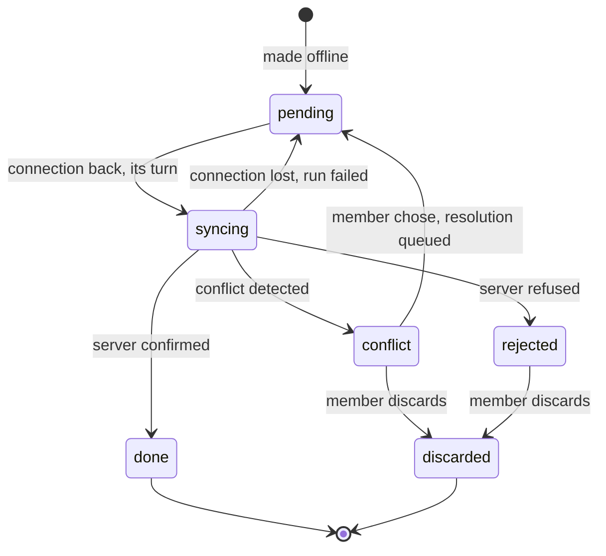

# Offline mode: installable web app with sync and conflict handling Concept

The specification of roadmap feature R12: how a member installs the web app, keeps selected files and folders available without a network, and gets the changes made offline synchronized without losing data. It is written for the feature's owner (trutscf1), its reviewers, the owners of the units it touches, and the agents that implement it. Part H is the plain-language view; Part S is binding.

# Part H — For Human Readers

This part adds no rule. It summarizes Part S and cites its IDs; where the two disagree, Part S wins (P-HUM-3).

## H1. In one sentence

Members install the web app, mark files and folders as available offline, work with them without a network, and see their offline changes synchronized afterwards without losing data. This serves the project goal `G-1` ("store, organize, search, share, and use their files offline on their own server") through the member role `R-1`, and it keeps `G-1.N1`: offline use is offered only through the installable web app, never through a native client.

## H2. Who benefits and how

- **Member (`R-1`)**: installs the app ([OFF-AC-1.3] installation), starts it without a network ([OFF-AC-1.2] start without network), marks files and folders as available offline ([OFF-AC-2.1] mark for offline), opens them on the plane or in the cellar ([OFF-AC-2.3] open offline), renames, moves, deletes, and uploads while offline ([OFF-AC-3.1] queue), and decides what happens when someone else changed the same file ([OFF-AC-3.3] conflicts).
- **Operator (`R-2`)**: sets how much offline storage one device may use ([OFF-AC-2.5] storage limit); the app needs nothing from the internet to be installed or to run ([OFF-NF-5] no outside services).
- **Developers of the team** (not a role of `GOAL.md`): get one package with the offline logic and a list of what the file storage must provide for it (revision per file, §15).

## H3. How it works, step by step

1. A member opens the web client in Chrome or Edge and installs it ([OFF-AC-1.3] installation). On iOS the member adds it to the Home Screen; this is prepared but only checked by hand ([OFF-AC-1.5] installation on iOS).
2. The app keeps its own shell on the device, so it starts without a network ([OFF-AC-1.2] start without network) and shows "Offline" in words, not only in colour, while there is no connection ([OFF-AC-1.4] offline status).
3. The member chooses "available offline" on a file or folder. The app checks the storage limit first; if the marking does not fit, nothing is stored and the message names the limit ([OFF-AC-2.5] storage limit). Everything inside a marked folder is included, also files that are added later ([OFF-AC-2.7] folder marks follow the folder).
4. The content of each marked file is copied to the device and its metadata is replicated to it ([OFF-AC-2.2] local storage). The member opens it without a network ([OFF-AC-2.3] open offline) and sees the used storage and every mark in the offline overview, where each mark can be removed ([OFF-AC-2.4] usage and removal).
5. While offline, renaming, moving, deleting, and uploading are put into a queue that survives closing the app ([OFF-AC-3.1] queue).
6. When the connection returns, the queue is sent in order and the progress is visible ([OFF-AC-3.2] automatic sync). A queued action leaves the queue only when the server confirmed it or the member discarded it ([OFF-AC-3.4] no data loss).
7. If the file changed on the server in the meantime, or the name is taken, the member chooses their version, the server version, or keeps both; "keep both" is preselected ([OFF-AC-3.3] conflicts). A file another member deleted disappears from the device with a notice ([OFF-AC-3.5] file removed on the server). An action the server refuses stays visible with its reason ([OFF-AC-3.6] rejected actions stay visible).
8. When the member signs out, the app warns how many changes are not synchronized and then removes the offline content and metadata of the account from the device ([OFF-AC-2.6] sign-out clears the device).

## H4. What it deliberately does not do

- It does not merge the contents of two versions of a file; the member decides, or both are kept (§12).
- It does not synchronize while the app is closed; the queue is sent the next time the app is open and online (§12, A9).
- It does not offer native clients (`G-1.N1`) or co-editing (`G-1.N2`).
- It does not decide whether copies of files on a member's own device are lawful; that question goes to the school management (§13, OQ-1).

## H5. How it is built, in plain words

A shared package `offline` holds the logic: a device store for the copies, a replicated metadata store, a persistent queue of actions, and a synchronization engine that compares revisions. The web unit wires it to the file browser and shows the status, the overview, and the conflict dialog. The file storage hands out a revision for every file and folder and refuses a change that is based on an outdated revision (§15). Technology is chosen in `STACK.md` (capabilities [OFF-C-1] to [OFF-C-5]).

## H6. How we know it works

Every acceptance criterion has an acceptance test ([OFF-T-1] to [OFF-T-18]). The risky part is the loss of data: the scenarios of §10 are run as the test of [OFF-AC-3.4] and cover a closed app during synchronization, a lost connection in the middle of an action, an expired session, and every conflict kind.

## H7. Key decisions

| Question | Decision | Reason |
| --- | --- | --- |
| Q335 Conflict rule | A queued change conflicts when the file's content, name, location, or existence changed on the server, or the name is taken; "keep both" is preselected | It never loses data, which is the highest risk of the feature |
| Q336 Shared devices | Signing out removes the offline data of the account after a warning about unsynchronized changes | Devices in schools are shared; data must not stay behind |
| Q337 Storage limit | One limit per device, set by the operator, default 500 MB | A full browser store breaks the app; the operator knows the devices |
| Q338 iOS | Prepared and checked by hand once a device exists; Chrome and Edge are binding | The team may have no iOS device; the criterion stays honest |
| A1 Technology | Not named in requirements; mapped in `STACK.md` | P-DES-4 |

# Part S — Specification (normative)

## 0. Synthesis Context

### Development Path

Path A (frontloaded). The draft of 2026-10-06 was grilled on 2026-11-17 (Phases 1 to 6 in one session; Q335 to Q339, assumptions A1 to A12). Q335 to Q338 were decided by `trutscf1`; the owner confirmed A1 to A7 in Q339 and A8 to A12 on 2026-11-24 (Q372); only the reviewers confirm the assumptions in the merge request. Nothing in this document is approved until the Phase 4 gate is passed.

### Synthesis Dependencies

- [scaffolding.md](scaffolding.md) — the five units, the reverse proxy, the configuration helper and [SCF-E-1] (invalid configuration), the contracts package, the relational data model.
- [web-client.md](web-client.md) — the file browser that offers "available offline" and the preview that opens a file ([OFF-F-6], [OFF-F-9]).
- [storage-core.md](storage-core.md) — the revision of a file and a folder and the conditional change that conflict detection needs (§15).
- [identity.md](identity.md) — the sign-out that clears the device ([OFF-F-12]) and the session check on synchronization ([OFF-E-3]).
- [teams-permissions.md](teams-permissions.md) — the permissions a synchronization checks again ([OFF-E-4], [OFF-F-18]).
- [design-system.md](design-system.md) — themes and accessibility rules for the offline status, overview, and conflict dialog.

### Synthesis Scope

From this document and `STACK.md` §1: the web app manifest and the offline app shell, the device store and its limit, the marks, the replicated metadata, the action queue, the synchronization engine with conflict detection and resolution, the sign-out wipe, and the three screens (status, overview, conflict dialog). Not included: the file storage itself (R5), the file browser and preview (R6), sign-out and session (R3), permissions (R7).

### Owner

trutscf1, per [ROADMAP.md](../ROADMAP.md). `trutscf1` builds the package `offline` and the wiring in `web`; `schwaigc`, owner of the track Web, reviews the changes in `apps/web`.

## 1. Purpose & Goal Trace

**Feature goal:** Members install the web app, keep selected files offline, and get their offline changes synchronized without losing data.

**Serves:** `G-1` in [GOAL.md](../GOAL.md), as stated in the *Serves* column of [ROADMAP.md](../ROADMAP.md) ("use their files offline"): the member `R-1` uploads, organizes, and uses files offline. The feature keeps `G-1.S1`: installing and running offline needs no service on the internet ([OFF-NF-5]), and `G-1.S2`: its three screens pass the accessibility checks ([OFF-NF-6]). It touches no non-goal: `G-1.N1` is respected because offline use is only the installable web app, and the conflict rule decides which version stays and never merges contents, so it is no co-editing (`G-1.N2`).

## 2. Ubiquitous Language & Context

Defined in [CONTEXT.md](../CONTEXT.md) and used here exactly: **member**, **account**, **session**, **unit**, **offline mark**, **offline copy**, **offline overview**, **queued action**, **conflict**, **offline storage limit**.

Used only in this document:

- **Device**: one browser profile on one machine. Offline data belongs to a device and to an account on it.
- **Revision**: the text the file storage assigns to a file or folder and changes whenever its content, name, or parent folder changes.
- **Base revision**: the revision of a file or folder that a queued action was made against.
- **Synchronization**: the run that sends the queue to the server in order and brings marked files and metadata up to date.
- **Conflict kind**: `changed` (the revision on the server differs from the base revision), `deleted` (the target no longer exists on the server), or `name-taken` (a rename, move, or upload would give an entry a name that exists in its folder).
- **Offline copy name**: the name of the extra copy that "keep both" creates, `<name> (offline copy <date>)`, with a counter on a clash (§10, example 2).
- **App shell**: the pages, scripts, styles, and icons of the web client that the app keeps on the device to start without a network.

## 3. User Stories & Acceptance Criteria

The user stories and their acceptance criteria are the work items in [work-items/E12-offline-mode/](../work-items/E12-offline-mode/epic.md); they are not repeated here (P-DOC-6).

## 4. Functional Requirements

| ID | Title | Requirement | Derives from |
| --- | --- | --- | --- |
| OFF-F-1 | Manifest | The web client MUST publish a web app manifest with the name `stash`, icons in the sizes 192 and 512 pixels (and one maskable icon), the start address of the web client, the display mode `standalone`, and a theme colour of the light theme of [design-system.md](design-system.md). | OFF-AC-1.1 (Manifest) |
| OFF-F-2 | App shell offline | After the first visit with a network, the app MUST keep its app shell on the device and MUST start from it without a network. A new version of the shell MUST replace the old one at the next start with a network, and MUST NOT interrupt a running session. | OFF-AC-1.2 (Start without network) |
| OFF-F-3 | Installation | In Chrome and Edge the web client MUST meet the conditions for installing it as an app (manifest, shell, a secure origin or the local address), so that the browser offers the installation. | OFF-AC-1.3 (Installation) |
| OFF-F-4 | Home Screen on iOS | The web client MUST provide what iOS needs to add it to the Home Screen with name and icon (a touch icon, the standalone display mode). Its correct behaviour on iOS is checked by hand once a device is available; no automated test claims it (Q338). | OFF-AC-1.5 (Installation on iOS) |
| OFF-F-5 | Offline status | While the device has no connection to the server, every page of the app MUST show the status "Offline" in text. It MUST show the status within 3 seconds after the connection is lost and remove it within 3 seconds after the connection is back and the server answered. | OFF-AC-1.4 (Offline status) |
| OFF-F-6 | Mark for offline | A member MUST be able to mark a file or a folder as available offline and to remove the mark, in the file browser. A marking applies to the signed-in account on this device; a folder mark includes every file and folder inside it. A member can mark only what they may read. | OFF-AC-2.1 (Mark for offline) |
| OFF-F-7 | Folder marks follow the folder | At every synchronization the app MUST add the files and folders that were added to a marked folder on the server to the offline marks, and MUST remove the ones that were removed or moved out. | OFF-AC-2.7 (Folder marks follow the folder) |
| OFF-F-8 | Copy and metadata | For every marked file the app MUST keep an offline copy of the content of its current revision on the device, and the metadata (identifier, name, size, type, parent folder, revision, change time) of the file and of every folder on its path MUST be replicated to the device. A copy MUST be written completely or not at all. | OFF-AC-2.2 (Local storage) |
| OFF-F-9 | Open offline | A member MUST be able to open an offline copy without a network in the preview of the web client; for a type the preview cannot show, the app MUST offer to save the copy from the device. | OFF-AC-2.3 (Open offline) |
| OFF-F-10 | Overview and removal | The offline overview MUST list every offline mark with name, size, and the time of the last synchronization, MUST show the used offline storage and the offline storage limit in megabytes, and MUST let the member remove each mark. Removing a mark MUST delete the offline copies that no other mark keeps and update the used storage at once. | OFF-AC-2.4 (Usage and removal) |
| OFF-F-11 | Storage limit | Before a marking is accepted the app MUST add the size of the files it would copy to the offline storage already used on the device and compare the sum with `OFFLINE_STORAGE_LIMIT_MB`. If the sum is larger, the app MUST refuse the whole marking and store nothing of it; if it is equal or smaller, the app MUST accept it. | OFF-AC-2.5 (Storage limit) |
| OFF-F-12 | Sign-out clears the device | When a member signs out, the app MUST first show the number of queued actions that are not synchronized and let the member cancel or confirm; after the confirmation, or at once without such actions, it MUST delete the offline copies, the replicated metadata, the marks, and the queue of that account from the device within 5 seconds. | OFF-AC-2.6 (Sign-out clears the device) |
| OFF-F-13 | Action queue | While the device has no connection, renaming, moving, deleting, and uploading a file or folder MUST be put into a queue, in the order they were made, with the base revision of the target. The queue MUST survive closing the app and restarting the device. | OFF-AC-3.1 (Queue) |
| OFF-F-14 | Automatic synchronization | Within 10 seconds after the connection is back and the session is valid, the app MUST start the synchronization without a member action. It MUST show how many queued actions are done of how many, and it MUST retry a failed run with a pause that doubles up to `OFFLINE_SYNC_RETRY_MAX_SECONDS`. | OFF-AC-3.2 (Automatic sync) |
| OFF-F-15 | Conflict detection | For every queued action the synchronization MUST compare the base revision with the revision on the server and detect a conflict of one of the kinds of §2: `changed`, `deleted`, or `name-taken`. An action without a conflict MUST be applied; the server MUST NOT apply a change whose base revision is outdated (§15). | OFF-AC-3.3 (Conflicts) |
| OFF-F-16 | Conflict resolution | For a conflict the member MUST choose between their version, the server version, and keep both; "keep both" MUST be preselected. For the kind `deleted` only "restore my version" (preselected) and "accept the deletion" are offered. The action stays queued, in state `conflict`, until the member has chosen; the other actions go on. | OFF-AC-3.3 (Conflicts) |
| OFF-F-17 | Keep both | "Keep both" MUST leave the server version unchanged and MUST store the member's version as an additional file or folder named by the offline copy name of §2, in the same folder. No name of a person MUST be part of it. | OFF-AC-3.3 (Conflicts) |
| OFF-F-18 | Removed or no longer readable | When a marked file was deleted on the server, or the member may no longer read it, the next synchronization MUST delete its offline copy and its mark and show a notice naming it. A queued action on it is a conflict of the kind `deleted`. | OFF-AC-3.5 (File removed on the server) |
| OFF-F-19 | Rejected actions | If the server refuses a queued action (permission, validation), the action MUST get the state `rejected` with the reason of the error response and stay in the queue until the member discards it. Later actions that do not depend on it MUST go on. | OFF-AC-3.6 (Rejected actions stay visible) |
| OFF-F-20 | Nothing leaves unconfirmed | A queued action MUST leave the queue only when the server confirmed it, the member chose a resolution that was applied, or the member discarded it. Closing the app, a lost connection, a failed run, and an expired session MUST NOT remove or change it. | OFF-AC-3.4 (No data loss) |

## 5. User Interaction Requirements

The users of these requirements are members of every kind of input (mouse, touch, keyboard, screen reader).

| ID | Title | Requirement | Derives from |
| --- | --- | --- | --- |
| OFF-U-1 | Status in words | The offline status MUST be given in text and an icon and MUST NOT rely on colour alone; it MUST be announced to screen readers when it changes. | OFF-AC-1.4 (Offline status) |
| OFF-U-2 | Conflict dialog | The conflict dialog MUST show for both versions the name, size, and change time, MUST be operable by keyboard alone, MUST move the focus into itself when it opens and back when it closes, and MUST name the preselected choice. | OFF-AC-3.3 (Conflicts) |
| OFF-U-3 | Progress announced | The synchronization progress MUST be shown as text ("3 of 7 changes synchronized") and announced to screen readers at most once every 5 seconds and at the end. | OFF-AC-3.2 (Automatic sync) |
| OFF-U-4 | Sign-out warning | The sign-out warning MUST name the number of unsynchronized changes, offer "Cancel" and "Sign out and discard", and, if the device is online, offer to synchronize first. | OFF-AC-2.6 (Sign-out clears the device) |
| OFF-U-5 | Limit message | The message of a refused marking MUST name the limit and the used storage in megabytes and say how much of the marking did not fit. | OFF-AC-2.5 (Storage limit) |

## 6. Non-Functional Requirements

| ID | Title | Requirement | Derives from |
| --- | --- | --- | --- |
| OFF-NF-1 | Start from the shell in 3 seconds | An installed app without a network MUST show its first screen within 3 seconds after the start, on a reference device of the team. | OFF-AC-1.2 (Start without network) |
| OFF-NF-2 | No data loss | In every scenario of §10 and of the tests [OFF-T-18] and [OFF-T-35] to [OFF-T-40], the content of a member's file and every queued action MUST still exist after the run: on the server, on the device, or as a discarded action the member chose to discard. | OFF-AC-3.4 (No data loss) |
| OFF-NF-3 | Data on the device | The device MUST hold only the content of marked files, the metadata named in [OFF-F-8], the marks, the queue, and the setting of the member. It MUST NOT hold a password, a password hash, or the content of an unmarked file, and it MUST NOT write the name of a file or the name of a person into any telemetry. | OFF-AC-2.2 (Local storage) |
| OFF-NF-4 | One account per store | The offline data of one account MUST be unreadable for every other account on the same device; a second account that signs in finds no offline data of the first. | OFF-AC-2.6 (Sign-out clears the device) |
| OFF-NF-5 | No outside services | Installing, starting offline, and synchronizing MUST NOT load a script, font, image, or any other resource from a host outside the installation, and MUST NOT report usage to one. | G-1.S1 |
| OFF-NF-6 | Accessible screens | The offline status, the offline overview, and the conflict dialog MUST pass the accessibility checker of the pipeline in every theme with 0 violations. | G-1.S2 |
| OFF-NF-7 | Resolution within two actions | Choosing the preselected resolution of a conflict MUST take at most two actions on the keyboard (focus is already inside the dialog; confirm). | OFF-AC-3.3 (Conflicts) |

## 7. Capability Requirements

Mapped to technology in `STACK.md` §1 (track Platform & cms, owner `trutscf1`) and listed in its capability index. The project proposal names CouchDB and PouchDB for the metadata; the owner decides before the first slice.

| ID | Title | Requirement | Derives from |
| --- | --- | --- | --- |
| OFF-C-1 | Installable web app | A browser mechanism to describe the app (name, icons, display mode) and a script that runs in the browser beside the page, intercepts its requests, keeps the app shell in a versioned store, and answers from it without a network. | OFF-AC-1.1 (Manifest), OFF-AC-1.2 (Start without network), OFF-AC-1.3 (Installation) |
| OFF-C-2 | Device content store | A store in the browser for the content of files with writes that are complete or absent, a query for the bytes used, separation per account, and deletion of everything of one account. | OFF-AC-2.2 (Local storage), OFF-AC-2.5 (Storage limit), OFF-AC-2.6 (Sign-out clears the device) |
| OFF-C-3 | Metadata replication | A store of metadata documents on the device that replicates in both directions with a store on the server, keeps a revision per document, and reports a conflicting revision instead of overwriting. | OFF-AC-2.2 (Local storage), OFF-AC-3.3 (Conflicts) |
| OFF-C-4 | Persistent action queue | A store on the device that keeps queued actions in order across restarts, with a change of state per action in one step. | OFF-AC-3.1 (Queue), OFF-AC-3.4 (No data loss) |
| OFF-C-5 | Connectivity signal | A signal from the browser that the connection changed, and a probe of the server's health endpoint to confirm that the server is reachable. | OFF-AC-1.4 (Offline status), OFF-AC-3.2 (Automatic sync) |

## 8. Data Model

On the device; the relational model of [scaffolding.md](scaffolding.md) §8 is unchanged (§15). Types are given without technology. Every record belongs to one account (`accountKey`, an opaque key derived from the account, never the e-mail address).

**OfflineMark** — one marking by a member.

| Field | Type | Rule |
| --- | --- | --- |
| `accountKey` | text | The signed-in account |
| `targetId` | text | Identifier of a file or folder |
| `targetKind` | `file` or `folder` | |
| `markedAt` | time | |

**OfflineCopy** — the content of one file on the device.

| Field | Type | Rule |
| --- | --- | --- |
| `accountKey`, `fileId` | text, text | Together unique |
| `revision` | text | The revision whose content is stored |
| `sizeBytes` | integer | At least 0 |
| `checksum` | text | Of the stored bytes; checked when the copy is opened ([OFF-E-5]) |
| `syncedAt` | time | |

**QueuedAction** — one action made offline.

| Field | Type | Rule |
| --- | --- | --- |
| `id` | text | Generated on the device |
| `accountKey` | text | |
| `seq` | integer | Order of creation, unique per account |
| `kind` | `rename`, `move`, `delete`, `upload` | |
| `targetId` | text | For an upload the temporary identifier of the new file |
| `baseRevision` | text, optional | Absent for an upload |
| `payload` | record | New name, new parent, or the content of the upload |
| `createdAt` | time | |
| `state` | see below | |
| `reason` | text, optional | Error code of the refusal, or the conflict kind |

**Settings** (the operator's configuration, read by the app from the server):

| Variable | Type | Default | Valid values | Meaning |
| --- | --- | --- | --- | --- |
| `OFFLINE_STORAGE_LIMIT_MB` | integer | 500 | 50 to 10240 | Offline storage per device |
| `OFFLINE_SYNC_RETRY_MAX_SECONDS` | integer | 300 | 10 to 3600 | Longest pause between two failed synchronization runs |

The state of a queued action ([OFF-F-13], [OFF-F-15] to [OFF-F-20]):



An action in `done` or `discarded` is removed from the queue; no other state removes it ([OFF-F-20]).

## 9. Error Conditions

| ID | Title | Trigger | Required behavior | Fallback | Derives from |
| --- | --- | --- | --- | --- | --- |
| OFF-E-1 | Browser store full | The browser refuses a write although the offline storage limit is not reached. | The copy is not stored, no mark remains for it, and the member sees a message that the browser store is full; copies already stored stay. | The member removes marks in the overview. | OFF-AC-2.5 (Storage limit) |
| OFF-E-2 | Server unreachable | The server does not answer a synchronization request within 10 seconds, or answers with a status from 500 to 599. | The run stops, the actions stay as they were, and the app retries after the pause of [OFF-F-14]. | None. | OFF-AC-3.2 (Automatic sync) |
| OFF-E-3 | Session expired while offline | The connection is back but the session is no longer valid. | The queue and the offline data stay unchanged. The app asks the member to sign in again, as the same account, and then starts the synchronization. This is not a sign-out and clears nothing (A8). | None. | OFF-AC-3.4 (No data loss) |
| OFF-E-4 | Permission lost | The server refuses a queued action with the error code of a missing permission. | The action gets the state `rejected` with that code ([OFF-F-19]); the offline copies the member may no longer read are removed ([OFF-F-18]). | The member discards the action. | OFF-AC-3.6 (Rejected actions stay visible) |
| OFF-E-5 | Offline copy damaged | The checksum of a copy does not match its bytes when it is opened. | The app does not show the damaged bytes. If online it fetches the copy again; if offline it says that the copy is damaged and keeps the mark. | Fetch again at the next synchronization. | OFF-AC-2.3 (Open offline) |
| OFF-E-6 | No offline support in the browser | The browser lacks the mechanisms of [OFF-C-1] to [OFF-C-4]. | The app works online as before, the marking and the overview are not offered, and one notice says why. | None. | OFF-AC-1.2 (Start without network) |
| OFF-E-7 | Invalid configuration | `OFFLINE_STORAGE_LIMIT_MB` or `OFFLINE_SYNC_RETRY_MAX_SECONDS` is missing or outside its valid values. | `web` behaves as [SCF-E-1] (invalid configuration) of [scaffolding.md](scaffolding.md). | None. | OFF-AC-2.5 (Storage limit) |
| OFF-E-8 | Parent folder missing | A queued move or upload names a parent folder that no longer exists on the server. | Conflict of the kind `deleted`; with "restore my version" the item goes to the root folder of its team, with the offline copy name. | The member discards the action. | OFF-AC-3.3 (Conflicts) |

## 10. Worked Examples

**Example 1 — storage limit ([OFF-F-11]).** `OFFLINE_STORAGE_LIMIT_MB` is 500; 480 MB are used. The member marks a folder with three files of 15 MB, 10 MB, and 8 MB: the sum 513 MB is larger than 500 MB, so the whole marking is refused with "The limit of 500 MB would be exceeded: 480 MB used, 33 MB needed, 13 MB too many" and nothing is stored. The member then marks one file of 20 MB: 500 MB equals the limit, so it is accepted and the used storage reads 500 MB.

**Example 2 — keep both ([OFF-F-17]).** The member uploaded a changed `Plan.pdf` offline on 2026-11-17; on the server `Plan.pdf` changed meanwhile (conflict `changed`). With "keep both" the server file stays, and the member's version is stored as `Plan (offline copy 2026-11-17).pdf`. If that name exists, the next free counter is added: `Plan (offline copy 2026-11-17 2).pdf`. A folder `Reports` becomes `Reports (offline copy 2026-11-17)`; a name without extension gets the text at the end.

**Example 3 — queue in order ([OFF-F-13], [OFF-F-14], [OFF-F-16]).** Offline, a member (1) renames `A.txt` to `B.txt`, (2) moves `B.txt` to `Archive`, (3) uploads `c.txt`, and (4) deletes `d.txt`. When the connection is back, the app sends 1 and 2 (confirmed), finds that `c.txt` exists in the folder (conflict `name-taken`) and shows the dialog, and sends 4 (confirmed). The progress reads "3 of 4 changes synchronized" while action 3 waits. The member keeps both; the upload goes up as `c (offline copy 2026-11-17).txt` and the queue is empty.

**Example 4 — sign-out ([OFF-F-12], [OFF-U-4]).** Two actions are not synchronized and the device is online. The warning reads "2 changes are not synchronized" with "Synchronize first", "Cancel", and "Sign out and discard". After "Sign out and discard" the offline copies, metadata, marks, and queue of the account are deleted within 5 seconds; a second account that signs in on the device finds nothing ([OFF-NF-4]).

**Example 5 — deleted on the server ([OFF-F-18], [OFF-F-16]).** Another member deletes `Notes.txt`, which the member marked offline and renamed offline to `Ideas.txt`. At the synchronization the offline copy is removed and the notice "Notes.txt was deleted on the server" appears. The queued rename is a conflict of the kind `deleted`: "Restore my version" (preselected) uploads the offline content as `Ideas.txt`; "Accept the deletion" discards the action.

**Example 6 — rejected action ([OFF-F-19], [OFF-E-4]).** The member lost write permission on `Team/Docs` while offline and had renamed `Docs/x.txt`. The server answers 403 with the error code `forbidden`. The action shows as rejected with "no permission" and stays until the member discards it; the other queued actions are synchronized.

**Example 7 — closed during synchronization ([OFF-F-20], [OFF-NF-2]).** Action 2 of 4 is `syncing` when the member closes the app. At the next start with a network, action 1 is `done`, action 2 is `pending` again (the server decides by the base revision whether it was applied: if the revision already changed by this very action, it is `done`), and 3 and 4 follow.

## 11. Integration Points

| Point | Between | What crosses it | Specified in |
| --- | --- | --- | --- |
| Marking | file browser (R6) → package `offline` | The mark and remove commands for a file or folder | [OFF-F-6], [OFF-F-7] |
| Preview | package `offline` → preview of R6 | The bytes of an offline copy | [OFF-F-9] |
| Metadata replication | device → storage unit | Metadata documents with revisions | [OFF-F-8], [OFF-C-3] |
| Content transfer | device ↔ storage unit | Download of the current revision; conditional change and upload | [OFF-F-8], [OFF-F-15], §15 |
| Sign-out | identity unit → package `offline` | The event "signing out", the choice of the member | [OFF-F-12] |
| Session check | package `offline` → identity unit | Whether the session is valid before a synchronization | [OFF-E-3] |
| Configuration | operator → `web` → app | The two variables of §8 | [OFF-E-7]; [SCF-F-11] |

## 12. Out of Scope

- Merging the content of two versions of a file; the member chooses, or keeps both.
- Synchronization while the app is closed or in the background (A9); it runs while the app is open.
- Native desktop or mobile clients (`G-1.N1`) and real-time co-editing (`G-1.N2`).
- Offline use of the share-link page for recipients without an account and of the public pages.
- Offline search; the search of R10 needs the server.
- Offline creation of folders and permission changes; only rename, move, delete, and upload are queued.
- End-to-end encryption of offline copies (optional extension O1 of the roadmap).
- Automatic checks on iOS ([OFF-F-4], Q338).
- A server-wide remote wipe of devices.

## 13. Resolved Questions & ADRs

Verbatim rounds: the AI chat export in `docs/prompts/` (P-GRILL-2). No ADR was needed: no decision changes `GOAL.md` or deviates from a `P-…` ID; the technology decision for the metadata replication is made in `STACK.md` when the first slice starts.

| Q | Title | Decision | Rationale |
| --- | --- | --- | --- |
| Q335 | Conflict rule | Conflict when content, name, location, or existence changed on the server, or the name is taken; "keep both" preselected | Never loses data |
| Q336 | Shared devices | Sign-out deletes the offline data of the account after a warning | Data must not stay on shared devices |
| Q337 | Storage limit | One limit per device, set by the operator (`OFFLINE_STORAGE_LIMIT_MB`, default 500) | A full browser store breaks the app |
| Q338 | iOS | Prepared and checked by hand; Chrome and Edge binding | Honest scope without a test device |
| Q339 | Shared understanding | Q335 to Q338 and A1 to A7 confirmed; the concept is written | — |
| Q372 | Assumptions A8 to A12 | Confirmed by trutscf1 on 2026-11-24 | — |

Assumptions A1 to A12 are confirmed by the owner (A1 to A7 in Q339, A8 to A12 on 2026-11-24 in Q372); the reviewers confirm them at the Phase 4 gate (P-GRILL-4). A1 to A7 were stated in the grilling round, A8 to A12 were added while writing:

| A | Assumption | Where it holds |
| --- | --- | --- |
| A1 | Technology names live in `STACK.md`, not in requirements | §7, `STACK.md` |
| A2 | OFF-US-2 and OFF-US-3 (weight 8 each) are cut into slices of at most 4 hours | story files |
| A3 | A folder mark includes files added to the folder later | [OFF-F-7] |
| A4 | A file deleted on the server by someone else is removed locally at the next synchronization, with a notice | [OFF-F-18] |
| A5 | An offline upload whose name now exists is a conflict, preselected "keep both" | [OFF-F-15], [OFF-F-17] |
| A6 | The server checks the permission again; a refused action stays visible and is never dropped silently | [OFF-F-19] |
| A7 | Only what the member may read is stored; a device stores nothing for other accounts | [OFF-NF-3], [OFF-NF-4] |
| A8 | An expired session is not a sign-out: nothing is deleted, the member signs in again as the same account | [OFF-E-3] |
| A9 | No synchronization while the app is closed | §12 |
| A10 | The copy name has the form `<name> (offline copy <date>)` with a counter and no person's name | [OFF-F-17] |
| A11 | The default limit is 500 MB and the default longest retry pause 300 seconds | §8 |
| A12 | The sign-out warning lets the member synchronize first, cancel, or discard | [OFF-U-4] |

Open questions:

| ID | Question | For |
| --- | --- | --- |
| OQ-1 | What is the lawful basis for keeping copies of the organisation's files on a member's own device, and may an operator forbid offline marks for some teams? The agent does not decide this. | School management, asked by `trutscf1` |

## 14. Artifact Interactions & Interferences

The existing parts of the system this feature touches, checked on 2026-11-17. Each interference is closed by the requirement or the change named in its row.

| Artifact | Interaction | Interference | Resolved by |
| --- | --- | --- | --- |
| File browser and preview ([web-client.md](web-client.md)) | Offers "available offline", opens an offline copy | A browser built for online use has no offline state | [OFF-F-6], [OFF-F-9]; request in the inbox of `schwaigc` |
| File storage ([storage-core.md](storage-core.md)) | Delivers content and revisions, accepts changes | Without a revision per entry and a conditional change a conflict cannot be detected | §15; request in the inbox of `schauby1` |
| Sign-out and session ([identity.md](identity.md)) | Triggers the wipe; validates the session on synchronization | An expired session could be mistaken for a sign-out | [OFF-E-3], [OFF-F-12] |
| Permissions ([teams-permissions.md](teams-permissions.md)) | Decide what may be marked and synchronized | A member can lose access while offline | [OFF-F-18], [OFF-E-4] |
| Reverse proxy ([scaffolding.md](scaffolding.md) §8) | Serves the manifest, the shell, and the script under the root path | The script must be served from the root to cover the whole app, and must not be cached by the proxy | [OFF-F-2]; header rules in the module M9 |
| Design system ([design-system.md](design-system.md)) | Themes for status, overview, dialog | Status by colour alone would fail `G-1.S2` | [OFF-U-1], [OFF-NF-6] |
| Observability ([observability.md](observability.md)) | The app must not send person identifiers | File names in telemetry | [OFF-NF-3] |
| End-to-end encryption (O1) | Would need decrypting copies on the device | Not specified yet | §12 |

## 15. Schema Extensions

**Contracts and the file storage** (requests to R5, backward compatible):

- Every file and folder gets a `revision` (text) that changes with its content, name, or parent folder.
- A rename, move, delete, or content change accepts the base revision and answers with the error code `conflict` and the current revision when it is outdated. The error codes `conflict` and `forbidden` are added to `ErrorResponse` of [scaffolding.md](scaffolding.md) §8 by the MR of the first slice of `OFF-US-3`.
- A list of the changes in a folder tree since a revision, for [OFF-F-7].

**Configuration:** the two variables of §8 join the configuration of `web` ([SCF-F-11]) and `.env.example`.

**Relational data model:** unchanged; the offline data lives only on the device.

## 16. Architecture & Vertical Slices

### Module Overview & Tree

```text
packages/offline            shared package, built by trutscf1
├── M1 OfflineSettings       reads and checks the two variables of §8
├── M2 DeviceStore           copies per account, bytes used, limit check, complete-or-nothing writes
├── M3 MetadataReplica       replicated metadata documents, revisions
├── M4 MarkManager           marks, folder expansion, follow-up of added and removed files
├── M5 ActionQueue           persistent queue, state changes of §8
├── M6 SyncEngine            order, base-revision comparison, retry, progress
├── M7 ConflictResolver      the three kinds, the three choices, offline copy name
└── M8 SignOutWipe           warning data, complete deletion of one account
apps/web                    wiring, reviewed by schwaigc
├── M9 AppShell              manifest, script for the shell, update of the shell, connectivity signal
└── M10 OfflineScreens       status, offline overview, conflict dialog, sign-out warning, "available offline" action
```

### Vertical Slices Breakdown

The slices and their issues stand in the story files (P-DOC-6); this table only says which modules each slice builds.

| Story | Slice | Modules |
| --- | --- | --- |
| OFF-US-1 | 1 — whole story | M9, M10 (status), the manifest and icons |
| OFF-US-2 | 1 — mark, store, and open files and folders | M1, M2, M3, M4, M10 (marking) |
| OFF-US-2 | 2 — offline overview and storage limit | M2 (limit), M10 (overview, limit message) |
| OFF-US-2 | 3 — sign-out clears the device | M8, M10 (sign-out warning) |
| OFF-US-3 | 1 — queue and automatic synchronization | M5, M6, M10 (progress, rejected) |
| OFF-US-3 | 2 — conflicts and removed files | M6, M7, M10 (conflict dialog) |
| OFF-US-3 | 3 — no-data-loss scenarios | tests of §17 only |

OFF-US-2 slice 1 and OFF-US-3 need the revisions of §15 from R5; OFF-US-1 depends only on the file browser. R12 follows R6 and R7 on the roadmap.

### Module Specifications

```text
M1 OfflineSettings      read(variables) -> { storageLimitBytes, retryMaxSeconds } | invalid(names)
M2 DeviceStore          bytesUsed(account) -> integer
                        wouldFit(account, sizes) -> boolean          used + sum(sizes) <= limit
                        put(account, fileId, revision, bytes)        complete or nothing
                        get(account, fileId) -> bytes | damaged      checksum compared
                        removeAll(account)
M3 MetadataReplica      replicate(server) ; get(account, id) -> metadata | conflicting revision
M4 MarkManager          mark(account, target) -> accepted | refused(limit, used, needed)
                        unmark(account, target) ; update(account, changesSince)
M5 ActionQueue          enqueue(kind, target, baseRevision, payload) -> id
                        next(account) -> action ; setState(id, state, reason)
M6 SyncEngine           run(account) ; for each pending action in seq order:
                          send with baseRevision -> done | conflict(kind) | rejected(code) | failed
M7 ConflictResolver     resolve(action, choice) ; offlineCopyName(name, date, existingNames)
M8 SignOutWipe          unsynchronizedCount(account) ; wipe(account)
```

### Design for Testability

The seams at which the tests of §17 run (P-DES-2):

- **Package `offline`**: M2 to M8 take the clock, the stores, and the server client as parameters; tests pass in-memory stores, a fixed clock, and a stub server that confirms, refuses, conflicts, or stays silent.
- **Naming and limit rules**: pure functions (M2 `wouldFit`, M7 `offlineCopyName`) tested with the values of §10.
- **Repository content**: the manifest, the icon files, and the example configuration are read as data.
- **Started web client**: a browser test with the network switched off and on, used where no smaller seam proves the criterion; the check on iOS is manual.

### Requirement Traceability Matrix

`G-1` → story → requirements → modules → tests. The acceptance criteria of each story stand in its story file.

| Story | Requirements | Modules | Tests |
| --- | --- | --- | --- |
| OFF-US-1 | OFF-F-1 to F-5; OFF-U-1; OFF-NF-1, NF-5; OFF-E-6; OFF-C-1, C-5 | M9, M10 | OFF-T-1 to T-5, T-19, T-24 |
| OFF-US-2 | OFF-F-6 to F-12; OFF-U-4, U-5; OFF-NF-3, NF-4, NF-6; OFF-E-1, E-5, E-7; OFF-C-2, C-3 | M1 to M4, M8, M10 | OFF-T-6 to T-12, T-20, T-22, T-23, T-25 to T-33 |
| OFF-US-3 | OFF-F-13 to F-20; OFF-U-2, U-3; OFF-NF-2, NF-7; OFF-E-2, E-3, E-4, E-8; OFF-C-4 | M5 to M7, M10 | OFF-T-13 to T-18, T-21, T-34 to T-40 |

## 17. Test Concept & TDD Contract

### Unit Tests & Test Case Tables

Values from §10. Each test name in code carries its ID and the requirement IDs it covers.

| ID | Module | Input | Expected | Covers |
| --- | --- | --- | --- | --- |
| OFF-T-24 | M9 | The manifest of the web client | Name `stash`, icons 192 and 512 pixels and one maskable icon, display `standalone`, start address, theme colour; touch icon present | OFF-F-1, OFF-F-4 |
| OFF-T-25 | M2 | limit 500 MB, used 480 MB, files of 15, 10, and 8 MB | `wouldFit` is false; nothing stored | OFF-F-11, OFF-U-5 |
| OFF-T-26 | M2 | limit 500 MB, used 480 MB, one file of 20 MB | `wouldFit` is true; used reads 500 MB | OFF-F-11 |
| OFF-T-27 | M2 | `put` interrupted after half of the bytes | No copy exists, the used bytes are unchanged | OFF-F-8 |
| OFF-T-28 | M2 | A copy whose bytes were changed after the checksum | `get` answers `damaged`; if the stub server is online the copy is fetched again | OFF-E-5 |
| OFF-T-29 | M2 | The browser store refuses a write (stub) | No copy, no mark, the message of [OFF-E-1]; earlier copies remain | OFF-E-1 |
| OFF-T-30 | M1 | `OFFLINE_STORAGE_LIMIT_MB=10`, `OFFLINE_SYNC_RETRY_MAX_SECONDS=5` | `invalid` with both variable names and no values | OFF-E-7 |
| OFF-T-31 | M4 | A marked folder; the server list adds one file and removes one | The added file is marked and copied, the removed one loses mark and copy | OFF-F-7, OFF-F-18 |
| OFF-T-32 | M8 | Two accounts with data; `wipe` of the first | Nothing of the first remains; the second is unchanged; the data of the first cannot be read through the second | OFF-NF-3, OFF-NF-4 |
| OFF-T-33 | M8 | Two unsynchronized actions | `unsynchronizedCount` is 2; the warning text of [OFF-U-4] names it and its three choices | OFF-F-12, OFF-U-4 |
| OFF-T-34 | M5 | Four actions made offline, app restarted | The queue holds them in the order 1 to 4 with their base revisions | OFF-F-13 |
| OFF-T-35 | M6 | Action 2 `syncing`, the app closed (stub) | At restart action 2 is `pending` or `done` as the revision of the server says; none is lost | OFF-F-20, OFF-NF-2 |
| OFF-T-36 | M6 | Stub server answers `conflict` `changed`, `deleted`, `name-taken`, and `forbidden` | The states `conflict` (three kinds) and `rejected` with the code; other actions go on | OFF-F-15, OFF-F-19, OFF-E-4 |
| OFF-T-37 | M7 | Choices "mine", "server", "both" for each kind | The effects of [OFF-F-16] and [OFF-F-17]; for `deleted` only two choices, the preselected one restores | OFF-F-16, OFF-E-8 |
| OFF-T-38 | M7 | `Plan.pdf`, `Reports`, a name without extension, existing names | The names of §10, example 2, with counters; no name of a person | OFF-F-17 |
| OFF-T-39 | M6 | The stub server unreachable for three runs, then back | Pauses double up to the maximum; the state is unchanged; the run then succeeds | OFF-F-14, OFF-E-2 |
| OFF-T-40 | M6 | Session invalid when the connection returns | No synchronization, no deletion, the sign-in request of [OFF-E-3]; after the sign-in the run starts | OFF-E-3, OFF-F-20 |

### Acceptance Tests

One test per acceptance criterion; test names in code carry the `AC` ID.

| ID | Title | Covers | Given | When | Then |
| --- | --- | --- | --- | --- | --- |
| OFF-T-1 | Manifest | OFF-AC-1.1, OFF-F-1 | the started web client | the manifest is requested | it holds name, icons in the sizes of [OFF-F-1], and a theme colour |
| OFF-T-2 | Start without network | OFF-AC-1.2, OFF-F-2, OFF-NF-1 | a browser that visited the web client once | the network is switched off and the app is started | the first screen shows within 3 seconds |
| OFF-T-3 | Installation | OFF-AC-1.3, OFF-F-3 | Chrome or Edge on the started web client | the installability of the page is checked | the browser reports that the page can be installed |
| OFF-T-4 | Offline status | OFF-AC-1.4, OFF-F-5, OFF-U-1 | the app open | the network is switched off, then on | "Offline" appears in text within 3 seconds and is announced, then disappears within 3 seconds |
| OFF-T-5 | Installation on iOS | OFF-AC-1.5, OFF-F-4 | an iPhone or iPad (manual) | the app is added to the Home Screen | it opens in its own window with name and icon; recorded in the MR; not run in CI |
| OFF-T-6 | Mark for offline | OFF-AC-2.1, OFF-F-6 | a signed-in member with a file and a folder | they mark both | both show as available offline, and the folder mark includes its content |
| OFF-T-7 | Local storage | OFF-AC-2.2, OFF-F-8, OFF-NF-3 | a marked file | the synchronization ran | its bytes are in the device store, its metadata and that of its folders are on the device, and nothing else |
| OFF-T-8 | Open offline | OFF-AC-2.3, OFF-F-9 | a marked file and no network | the member opens it | it is shown in the preview, or offered for saving if the preview cannot show its type |
| OFF-T-9 | Usage and removal | OFF-AC-2.4, OFF-F-10 | two marks | the member opens the offline overview and removes one | it lists both with name, size, and time, shows used storage and limit, and after the removal shows the new used storage |
| OFF-T-10 | Storage limit | OFF-AC-2.5, OFF-F-11, OFF-U-5 | limit 500 MB, 480 MB used | the member marks a folder of 33 MB | the marking is refused with the message of §10, example 1, and nothing is stored |
| OFF-T-11 | Sign-out clears the device | OFF-AC-2.6, OFF-F-12, OFF-U-4 | a member with marks and two unsynchronized actions | they sign out | the warning names 2; after "Sign out and discard" no data of the account remains within 5 seconds |
| OFF-T-12 | Folder marks follow the folder | OFF-AC-2.7, OFF-F-7 | a marked folder | a file is added on the server and the app synchronizes | the file is marked and available offline |
| OFF-T-13 | Queue | OFF-AC-3.1, OFF-F-13 | a member without a network | they rename, move, delete, and upload | four queued actions in this order, still there after a restart |
| OFF-T-14 | Automatic sync | OFF-AC-3.2, OFF-F-14, OFF-U-3 | queued actions | the connection returns | within 10 seconds the synchronization starts without action and shows "n of m", announced at most every 5 seconds |
| OFF-T-15 | Conflicts | OFF-AC-3.3, OFF-F-15, OFF-F-16, OFF-F-17, OFF-U-2, OFF-NF-7 | a file changed on the server and a queued change to it; one upload whose name exists | the app synchronizes | the dialog shows both versions, has "keep both" preselected, is keyboard-operable, and each choice has the effect of [OFF-F-16] |
| OFF-T-16 | File removed on the server | OFF-AC-3.5, OFF-F-18 | a marked file another member deleted | the app synchronizes | the copy and mark are gone, the notice names the file |
| OFF-T-17 | Rejected actions stay visible | OFF-AC-3.6, OFF-F-19, OFF-E-4 | a queued action the server refuses with `forbidden` | the app synchronizes | it shows as rejected with its reason and stays until discarded; the next actions are synchronized |
| OFF-T-18 | No data loss | OFF-AC-3.4, OFF-F-20, OFF-NF-2 | the scenarios of §10, examples 3, 5, 6, and 7, and an expired session | each is run | every file and every action still exists in one of the allowed places of [OFF-NF-2] |

### Integration Tests

| ID | Title | Covers | Given | When | Then |
| --- | --- | --- | --- | --- | --- |
| OFF-T-19 | Offline start without internet | OFF-NF-5, OFF-C-1, OFF-C-5, OFF-E-6 | the local stack without a connection to the internet; a browser with and one without offline support | the app is installed, started, and used with a marking | no request leaves the installation; the second browser works online and shows the notice of [OFF-E-6] |
| OFF-T-20 | Two accounts on one device | OFF-NF-4 | two accounts that signed in one after the other | the second signs in | it finds no marks, copies, or queue of the first |
| OFF-T-21 | Restart during synchronization | OFF-F-20, OFF-C-4 | four queued actions and a device restart in the middle | the app starts again | no action is lost or applied twice |
| OFF-T-22 | Accessibility of the screens | OFF-NF-6 | the status, the overview, and the conflict dialog in each theme | the accessibility checker runs | 0 violations |
| OFF-T-23 | Replication round trip | OFF-F-8, OFF-C-2, OFF-C-3 | a started storage unit and the device store | a file is marked, changed on the server, and synchronized | the device holds the new revision and the metadata of its folders |

### Synthetic Test Data Strategy

The values of §10 are the test data: the limit table, the offline copy names, the queue of four actions, and the conflict kinds. Tests keep them as data files next to the test, not inside the test code. No real file names or person data are used.

### CI Test Constraints

The unit tests ([OFF-T-24] to [OFF-T-40]) and the file tests ([OFF-T-1], [OFF-T-24]) run in the `test` job without network. The browser tests ([OFF-T-2], [OFF-T-4], [OFF-T-8], [OFF-T-14], [OFF-T-15], [OFF-T-19], [OFF-T-22]) need a browser and the started web client and run in the job of the accessibility check or its successor. [OFF-T-5] is checked by hand on a device and recorded in the merge request.

### Test Coverage Matrix & Untested Justifications

Every acceptance criterion and every requirement of §4 to §6 and §9 is named in a *Covers* column above. The capabilities of §7 are covered through the requirements that use them.

| ID | Reason |
| --- | --- |
| OFF-AC-1.5 | The behaviour on iOS cannot be run in CI; the criterion is checked by hand once a device is available (Q338). |
