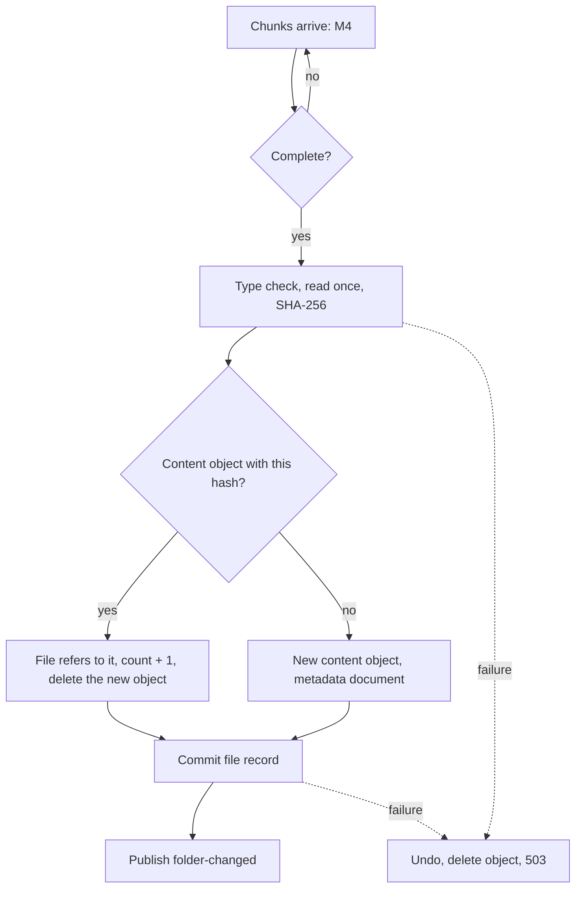
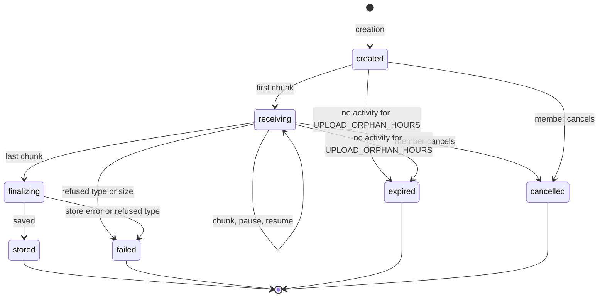
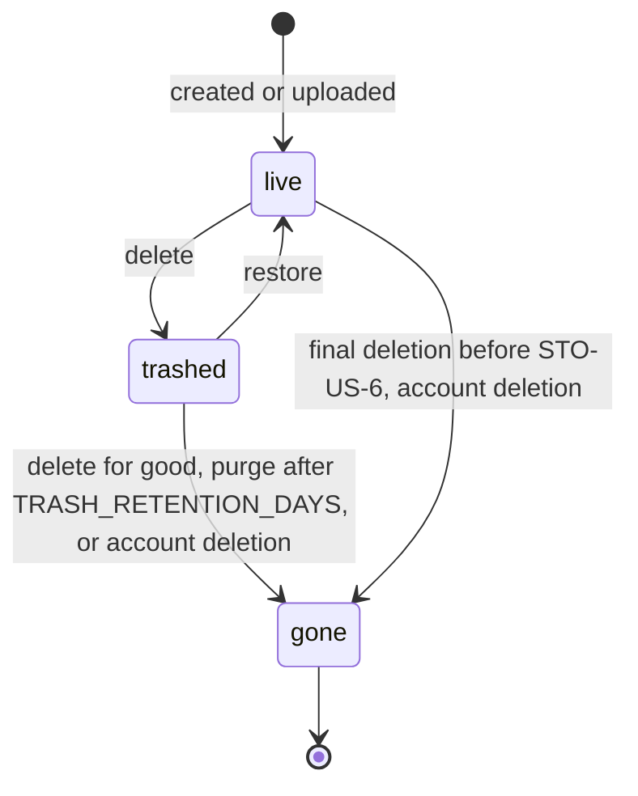

# Storage core: folders, resumable upload, deduplication Concept

The specification of roadmap feature R5: how a member uploads, organizes, deletes, restores, and downloads files, and how those files are kept apart from everything else about them on the operator's own server. It is written for the feature's owner (schauby1), its reviewers, the owner of `web` who builds the pages of the feature, and the agents that implement it. Part H is the plain-language view; Part S is binding. Question log: [storage-core.qa-log.md](storage-core.qa-log.md).

**Status of this version.** Grilled on 2026-11-24 (rounds 1 to 13, Q414 to Q456, A1 to A32); ready for review, not approved. The Phase 4 gate is the review of the merge request that carries this document.

# Part H — For Human Readers

This part adds no rule. It summarizes Part S and cites its IDs; where the two disagree, Part S wins (P-HUM-3).

## H1. In one sentence

Members upload, organize, restore, and download files up to the size the operator allows, so that their data stays on their own server under their control. This serves `G-1` ("store, organize … on their own server"): the server is the organisation's own, run by the operator. Until R7, only the owner reaches an item through stash ([STO-F-24] (owner only)), but stash stores files unencrypted ([STO-NF-7] (encryption at rest)), so whoever runs or has access to the server can read them. The feature promises no backups (stash makes none; that is the operator's job, Q442) and no availability (`G-1.N4`). `G-1.S1` (start on one own server without internet) is a goal of the whole system; this feature needs no service on the internet and so does not endanger it ([STO-NF-8] (start without internet)).

## H2. Who benefits and how

- **Member (`R-1`)**: uploads several files at once by file picker or drag and drop and sees the progress of each ([STO-US-2] (upload files)); continues an interrupted upload where it stopped ([STO-US-3] (chunked upload with resume)); creates nested folders and renames, moves, and copies files and folders ([STO-US-5] (manage folders and files)); restores a deleted item ([STO-US-6] (trash)); and downloads a file or a whole folder as one ZIP archive ([STO-US-7] (download files and folders)). Until the story STO-US-6 ships, deleting is final: there is no trash yet ([STO-F-26] (delete to trash), A7).
- **Operator (`R-2`)**: sets in the configuration the largest file (5 GiB by default), the allowed file types, the chunk size (8 MiB by default), how long an unfinished upload is kept (24 hours by default), and how long the trash keeps items (30 days by default) ([STO-F-8] (size and type limits), [STO-F-11] (resumable protocol), [STO-F-15] (clean-up of uploads), [STO-F-29] (automatic purge)). Identical content is stored once, which saves space ([STO-US-4] (deduplication by file hash)). The operator is responsible for encrypting the disks and for backups ([STO-NF-7]).
- **Link recipient (`R-3`), visitor (`R-4`), and content editor (`R-5`)**: nothing changes for them in this feature; it has no sharing and no public files.

## H3. How it works, step by step

1. A member opens their files. The first time, stash creates their root folder ([STO-F-34] (root folder)). Every request first asks `identity` whether the session is valid; without a valid session nothing is shown ([STO-F-4] (protected endpoints), A2). Only the health endpoint and the internal deletion call of step 11 skip that question; the internal call is reachable only on the internal network and needs a shared secret (A28).
2. The member picks files or drops them on the folder. Each file is sent in chunks over one resumable upload path, and each file shows its own progress ([STO-AC-2.1] (several files), [STO-F-42] (one upload path), [STO-U-1] (progress per file)).
3. If the folder already holds a file of that name, the member chooses to replace it, keep both (the new file becomes `Name (2).ext`), or cancel ([STO-F-9] (name conflict), [STO-F-38] (keep-both name)). Replace removes only the file that held the name when the upload was created, through the normal deletion: into the trash, or final deletion before STO-US-6 ships, which the dialog then says. Replace is not offered when the existing item is a folder. If at the end a different item holds the name, or the name only became taken after the upload was created, keep-both is applied without asking (A29).
4. When the last chunk has arrived, `storage` reads the content once to compute its SHA-256 fingerprint ([STO-F-16] (hash on completion)). If a content object with the same fingerprint exists, the new file refers to it and the new copy of the bytes is removed after the commit; until the clean-up job runs it may still linger if that removal fails ([STO-F-17] (reference instead of copy), [STO-E-11] (removal failed after commit)). Otherwise the bytes become a new content object. The member never sees a half-saved file: if a step fails, what the request wrote is undone, and the clean-up net removes any leftovers ([STO-F-35] (all or nothing), [STO-F-36] (clean-up net)).
5. Every open folder view of the member, also on a second device, learns about the change through a live event and updates without a reload ([STO-F-10] (live list)).
6. If the connection drops or the page is reloaded, the upload continues where it stopped; after a reload it continues when the member selects the same file again. The member can also pause and resume ([STO-F-12] (resume), [STO-F-13] (pause), [STO-U-5] (pause and resume)). An upload that nobody continues is removed after 24 hours by default (configurable), normally within one clean-up interval (60 minutes by default) after that; a failed run is repeated at the next interval ([STO-NF-10] (retention periods), [STO-E-13] (clean-up job failed)).
7. The member creates folders (at least 1,000 levels deep) and renames, moves, and copies files and folders. Names follow portable rules so a ZIP archive opens on every system ([STO-F-21] (nested folders), [STO-F-22] (rename, move, copy), [STO-F-23] (name validation)). A copy into a folder where the name is taken is proposed to get a keep-both name instead of being refused; this is a writing decision (W11) that is still open for the review.
8. Once the story STO-US-6 (trash) ships, deleting an item moves it to the trash; a deleted folder is one trash entry with everything in it ([STO-F-41] (folder in the trash)). A member restores a trash entry to its original place, or to the root folder if that place no longer exists or it or one of its ancestors is in the trash ([STO-F-27] (restore), [STO-F-50] (restore conflict)), or deletes it for good after confirming ([STO-F-51] (delete for good), [STO-U-7] (confirm final deletion)). After 30 days by default (configurable), normally within one clean-up interval after that, the trash removes it by itself.
9. A file is downloaded with its name and type; a browser can also ask for a part of it ([STO-F-30] (single file), [STO-F-32] (range requests)). A folder or a selection is streamed as a ZIP archive that is never held in memory as a whole ([STO-F-31] (folder as ZIP)). The ZIP of the root folder contains every live file and folder of the member, below their names; it holds no trash entries and no file metadata ([STO-F-49] (download everything)).
10. A content object is removed from the stores as soon as the last file that refers to it is deleted for good; while a file sits in the trash, it still holds its reference, up to the retention period ([STO-F-18] (reference counting), [STO-F-5] (final deletion)). A failed removal is caught by the clean-up net. Deleting is logical in the stores: they reclaim space and remnants such as database logs later, and the operator's backups and replicas are untouched; this feature promises no physical erasure.
11. This is the planned flow for account deletion, awaiting the draft story IDN-US-8 and the owner of `identity`; [IDN-F-42] (files of a deleted account) there still names the opposite order. `identity` calls `storage` first. `storage` blocks every further write of that member, then deletes at once everything of that member alone: files, folders, trash entries, and unfinished uploads ([STO-F-44] (account deletion), [STO-NF-6] (no remainder of a deleted account)). The call is safe to repeat, and `identity` repeats it until it gets the answer 204, so a failure part-way is finished by the next call. Content that another member's file also uses stays for that member, with nothing that points to the deleting member ([STO-NF-5] (shared content leaves no trace)). What stays: that shared content, bytes whose removal failed until the clean-up net runs, remnants the stores reclaim later, the operator's backups, and a marker with only the member's ID until the clean-up net removes it. Telemetry carries no member IDs ([STO-NF-4] (no names or content in telemetry), A31). Whether this meets legal duties is an open question (L1, A22).

## H4. What it deliberately does not do

- No sharing, teams, roles, or inherited permissions: only the owner reaches an item until R7 ([teams-permissions.md](teams-permissions.md); Q420). No quotas.
- No thumbnails, virus scan, or text recognition; the file metadata of this feature holds only the detected type (R9, [background-processing.md](background-processing.md)).
- No end-to-end encryption and no encryption by stash; encrypting the disks is the operator's job ([STO-NF-7], Q442). No backups either: stash makes none (Q442).
- No availability guarantee for external users (`G-1.N4`); no native sync clients (`G-1.N1`), because files are reached only through the web client, which can be installed for offline use; no co-editing (`G-1.N2`); no payment or plans (`G-1.N3`); no cryptography of its own (`G-1.N5`).
- Limits a member sees (§12): a single file cannot be restored from a deleted folder, only the whole trash entry (Q439); the member cannot sort a folder; long folders are not paginated; files have no preview or version history; there is a single instance of `storage`, so the live events work only through that one.
- No legal decision: whether and on which basis an installation may keep members' files is an open question for the school management (L1 in §13).

## H5. How it is built, in plain words

`storage` is a small HTTP server in its own container, reached under `/api/storage`. It keeps the data of a file in three places (§8, [STO-F-2] (separated data)): the object store holds the bytes; the record store holds names, folders, owners, sizes, trash markers, and the record of each content object (fingerprint, size, reference count); the metadata store holds the facts derived from the content, one document per content object. The rules for files, folders, the trash, and counting how many files share a content object live in one deep module, the storage core, which reaches the three stores through three ports so it can be tested without them (§16, M3). Unfinished uploads keep their folder, file name, owner, replace target, and last activity next to the bytes in the object store (§8). The shapes of requests and answers are shared contracts that `web` and `storage` both use.

Two state machines (§16) summarize the life of the data. An upload is created, receives chunks (it can be paused and resumed), is finalized when the last chunk has arrived, and ends stored; it ends failed when the type or size is refused or a store fails, cancelled when the member cancels, or expired after 24 hours without activity by default. An item is live; deleting makes it trashed (before STO-US-6, deleting makes it gone at once); restoring makes it live again; deleting for good, the purge after 30 days by default, or an account deletion makes it gone, whether it was live or in the trash.

Other units: `web` builds the file browser, the upload dialog, and the trash page as slices of its own (Q432); `worker` runs the clean-up jobs on a schedule and uses the same storage core ([STO-US-3] slice 3 brings the clean-up of uploads and orphans, [STO-US-6] slice 3 the purge of the trash); `identity` tells `storage` to delete the data of a deleted account, a call that is still a planned change awaiting its owner, like the note on encryption for `deployment.md` (§15, W10).

## H6. How we know it works

The scenarios of §17 are of five kinds. The acceptance tests (at least one per acceptance criterion) run against `storage` over HTTP with the real record, object, and metadata stores of the test stack and a stub that plays the session check, unless a row says otherwise. Four criteria are proven only in a browser with the real `identity`, through [STO-T-30] (the member's day): [STO-AC-2.1] (several files), [STO-AC-2.2] (drag and drop or button), [STO-AC-5.5] (breadcrumb), and [STO-AC-6.3] (confirm final deletion). The former test-only criterion became [STO-T-5] (store, read, delete leaves nothing behind), which §17 lists among the acceptance tests and describes as an integration test with real stores, for the reworded criterion [STO-AC-1.5] (delete removes everything). The integration tests cover what spans several parts: [STO-T-31] (account deletion), [STO-T-55] (account deletion is safe to repeat), [STO-T-56] (writes blocked during deletion), [STO-T-32] (all or nothing), [STO-T-33] (clean-up net), [STO-T-34] (no names in telemetry), and [STO-T-35] (start without internet). The runs of 5 GiB ([STO-T-12] (large files), [STO-T-27] (folder as ZIP)) are done by a person and recorded in a test protocol; they are never run in continuous integration (CI). The unit tests use the values of §10 (names, keep-both names, type check, reference counting, ranges, archives, moves, restore) and, for the clean-up, the ages in [STO-T-51] (clean-up selection).

| Story | Scenarios |
| --- | --- |
| STO-US-1 (connect the storage backend to the object storage) | [STO-T-1] (bytes in the object store), [STO-T-2] (three stores, one fact each), [STO-T-3] (documented endpoints), [STO-T-4] (protected endpoints), [STO-T-5] |
| STO-US-2 (upload files) | [STO-T-6] (size and type limits), [STO-T-7] (name conflict), [STO-T-8] (live list), [STO-T-9] (chunked protocol), [STO-T-14] (hash on completion), [STO-T-30] |
| STO-US-3 (chunked upload with resume) | [STO-T-10] (resume), [STO-T-11] (pause on the server side), [STO-T-12], [STO-T-13] (clean-up of uploads), [STO-T-30] |
| STO-US-4 (deduplication by file hash) | [STO-T-15] (reference instead of copy), [STO-T-16] (reference counting), [STO-T-17] (invisible to members), [STO-T-18] (counting is tested) |
| STO-US-5 (manage folders and files) | [STO-T-19] (nested folders), [STO-T-20] (rename, move, copy), [STO-T-21] (name validation), [STO-T-22] (owner only), [STO-T-30] |
| STO-US-6 (trash) | [STO-T-23] (delete to trash), [STO-T-24] (restore), [STO-T-25] (automatic purge), [STO-T-30] |
| STO-US-7 (download files and folders) | [STO-T-26] (single file), [STO-T-27], [STO-T-28] (range requests), [STO-T-29] (permission check per download) |

## H7. Key decisions

One line per decision of §13 (Q numbers are those of the question log; Q446 and Q447 were used by other sessions). The writing decisions W1 to W12 are in §13; W11 (a copy into a taken name gets a keep-both name) is still open for the review.

| Question | Decision | Reason |
| --- | --- | --- |
| Q414 Deviations | None from the standing decisions | They apply unchanged |
| Q415 Ownership of R5 | schwaigc took over only #56 and #117; schauby1 stays owner | Narrowest change |
| Q416 Scope of the grill | The whole of R5, foundation first | One consistent concept |
| Q417 Feature goal | "Up to the size the operator allows" instead of "of any size" | The limit is configurable and tested at 5 GiB |
| Q418 Terms | File, content object, file metadata | Deduplication needs bytes apart from names |
| Q419 STO-AC-1.5 | Reworded as behaviour; the test moved to §17 | A criterion describes what a person can observe |
| Q420 Rights | Only the owner until R7 | Teams and roles are R7 |
| Q421 Test member | Session check as a seam with a stub, plus one end-to-end test | Fast tests, one real proof |
| Q422 HTTP framework | The same as `identity` | One framework in both server units |
| Q423 Object store client | An established client library | No own client code |
| Q424 Metadata store access | The database's official driver | No second contract layer |
| Q425 Object key | A random ID; the fingerprint in the record store | A key reveals nothing about content |
| Q426 Failure | All or nothing across the three stores | No half-saved file is visible |
| Q427 Read path | Bytes stream through `storage` | The object store is not public; every download is checked |
| Q428 Removing a content object | It is removed at once when its reference count reaches 0, with a clean-up net | Deletion takes effect at once; crashes are cleaned up |
| Q429 Upload path | One resumable path for every upload | One path to build and test |
| Q430 Type check | Content and extension together | A renamed file does not slip through |
| Q431 Live list | Server-sent events | One-way, simple, works through the proxy |
| Q432 Interface | Built in R5 as web slices | A story is done when a member can use it |
| Q433 Upload server | A library for the resumable protocol | No own protocol code |
| Q434 Fingerprint | Computed after completion by reading once | A resumed upload cannot be hashed on the fly |
| Q435 Clean-up jobs | `worker` runs them now | R9 reuses the runtime |
| Q436 Deduplication hit | The new object is deleted, the file refers to the old one | One copy of the bytes |
| Q437 Name rules | Portable rules | Archives open on every system |
| Q438 Restore with a conflict | Asks like an upload | One behaviour for both |
| Q439 Trash entry of a folder | Only the whole trash entry | No partial trees |
| Q440 ZIP | A streaming library, stored without compression, for archives over 4 GiB | Archives are never held in memory |
| Q441 Account deletion | Everything of that member alone is deleted at once; shared content stays for the other member. The planned flow: `storage` blocks the member's writes, deletes, is safe to repeat, and `identity` repeats until 204. Whether this meets legal duties is open (L1) | Members' data leaves the stores when the account goes |
| Q442 Encryption at rest | The operator's matter, documented; stash makes no backups | stash adds no cryptography of its own |
| Q443 Speed | Three measurable targets | Falsifiable; measured under load in R13 |
| Q444 Adversarial check | An independent check of §1 and Part H before the review | Personal data and irreversible deletion |
| Q445 Shared understanding | Confirmed | — |
| Q448 Table `folders` | `owner_id` added, `team_id` optional until R7, new tables `files` and `content_objects` | Smallest change |
| Q449 Account deletion call | An internal call with a shared secret, storage first | `identity` owns the account |
| Q450 Shared package | `packages/storage-core` for `storage` and `worker`, without an ADR | Counting exists once |
| Q451 Writing decisions | The details of W1 to W5, W8, W9, W12 stay | Accepted |
| Q452 Fingerprint criterion | Moved into STO-US-2 | The first stored file needs it |
| Q453 Protocol criterion | Moved into STO-US-2 | Q429 puts the path there |
| Q454 Capacity | Read from the object store's status interface | The standard interface has no such call |
| Q455 Cross-model check | Skipped | One independent check was enough |
| Q456 Feature goal | "… stays on their own server under their control" replaces "lives reliably" | "Reliably" read as a durability or availability promise that R5 does not give |

# Part S — Specification (normative)

## 0. Synthesis Context

### Development Path

Path A (frontloaded). The first draft of 2026-10-06 was grilled on 2026-11-24 by schwaigc (rounds 1 to 13, Q414 to Q456, A1 to A32). The concept was taken over from schauby1 on 2026-11-24 for the story issues #56 and #117; schauby1 stays owner of R5 (Q415). Phases 5 and 6 are in the same merge request; its approval by another team member is the Phase 4 gate.

### Synthesis Dependencies

- [scaffolding.md](scaffolding.md) — the unit `storage` and the unit `worker`, their route prefix and ports in the routing table (§8), the health report and its rule that the feature defines the unit's dependency checks ([SCF-F-6], [SCF-F-7]), the configuration helper and [SCF-E-1], the error response ([SCF-F-21]), and the relational data model with `users` and `folders` (§8, [SCF-F-24]).
- [identity.md](identity.md) — the session check ([IDN-F-37], [ADR-0007](../adr/0007-session-check-through-identity.md)), the shape `SessionInfo`, the seeded member of the tests, and the account deletion of the draft story IDN-US-8 ([IDN-F-42], [IDN-AC-8.2]).
- [observability.md](observability.md) — the metrics `upload.received` and `storage.capacity.*` ([OBS-F-21], [OBS-F-23]) and the redaction of secrets ([OBS-F-14]).
- [ADR-0001](../adr/0001-five-units-behind-one-origin.md) and [ADR-0007](../adr/0007-session-check-through-identity.md).

### Synthesis Scope

From this document and `STACK.md` §2: in `apps/storage` the HTTP server, the routes of §8, the upload path, the downloads, and the live events; in `packages/storage-core` the storage core and the three store adapters (shared by `storage` and `worker`); in `apps/worker` the clean-up jobs; in `packages/contracts` the module `storage` with the shapes of §8; in `apps/web` the file browser, the upload dialog, and the trash page (slices of the Web track, Q432).

### Owner

schauby1, per [ROADMAP.md](../ROADMAP.md) (Q415). The story issues #56 and #117 are assigned to schwaigc since 2026-11-24, and the pages in `web` are built by schwaigc (Q432).

## 1. Purpose & Goal Trace

**Feature goal:** Members upload, organize, restore, and download files up to the size the operator allows, so that their data stays on their own server under their control.

**Serves:** `G-1` in [GOAL.md](../GOAL.md), as stated in the *Serves* column of [ROADMAP.md](../ROADMAP.md) ("store and organize files"): files stay on the organisation's own server, which its operator runs, under the control of that organisation. Until R7, access through stash is owner-only ([STO-F-24]), but stash stores files unencrypted ([STO-NF-7]), so whoever runs or has access to the server can read them. The feature promises neither backups (stash makes none; that is the operator's job, Q442) nor availability (`G-1.N4`); its all-or-nothing save ([STO-F-35], Q426) only means that no half-saved file is visible. `G-1.S1` is a goal of the whole system; this feature needs no service on the internet and so does not endanger it ([STO-NF-8]).

Non-goals of `GOAL.md`, checked one by one:

| Non-goal | Check |
| --- | --- |
| `G-1.N1` native sync clients | Not touched: files are reached only through the web client. |
| `G-1.N2` real-time co-editing | Not touched: a file is stored and replaced as a whole. |
| `G-1.N3` payment, billing, plans | Not touched: this feature has no quotas and nothing that is sold. |
| `G-1.N4` production operation with an availability guarantee for external users | Respected: the feature promises no availability; backups are not made by stash (Q442, [STO-NF-7]). |
| `G-1.N5` own cryptography | Respected: the fingerprint is SHA-256 from the platform ([STO-C-8]), and stash adds no encryption of its own ([STO-NF-7]). |

## 2. Ubiquitous Language & Context

Defined in [CONTEXT.md](../CONTEXT.md) and used here exactly: **stash**, **unit**, **contract**, **health report**, **member**, **account**, **session**, **operator role**, **file**, **content object**, **file metadata**, **owner**, **item**, **folder**, **root folder**, **trash**, **trash entry**, **upload**.

Used only in this document:

- **Object store**: the self-hosted store that holds the bytes of content objects under a key ([STO-C-1]). It is not reachable from outside the local stack ([STO-F-37]).
- **Record store**: the relational database that holds folders, files, and content objects ([STO-C-3]).
- **Metadata store**: the document database that holds file metadata, one document per content object ([STO-C-2]).
- **Storage core**: the module that applies every rule of this feature to the three stores through ports (§16, M3).
- **Session gate**: the seam through which `storage` asks whether a session is valid and who the member is ([STO-F-4]).
- **Name key**: the Unicode-normalized, case-folded form of an item name; two names are the same when their name keys are equal ([STO-F-23]).
- **Reference count**: the number of files that refer to one content object ([STO-F-18]).
- **Final deletion**: the removal of a file or folder from the record store, with the removal of every content object that no file refers to any more ([STO-F-5]).
- **Clean-up net**: the scheduled jobs that remove what a crash or failed removal left behind ([STO-F-36]).

## 3. User Stories & Acceptance Criteria

The user stories and their acceptance criteria are the work items in [work-items/E05-storage-core/](../work-items/E05-storage-core/epic.md); they are not repeated here (P-DOC-6).

## 4. Functional Requirements

The IDs STO-F-1 to STO-F-33 of the first draft keep their meaning, with three exceptions: the three requirements that only describe the page moved to §5, because they are user interaction (STO-F-6 is now [STO-U-1], STO-F-7 is [STO-U-2], STO-F-28 is [STO-U-7]); their F numbers are not used again. STO-F-34 and higher are new.

| ID | Title | Requirement | Derives from |
| --- | --- | --- | --- |
| STO-F-1 | Object store | `storage` MUST write the bytes of every file to the object store, under a key that is a random uuid (Q425), and MUST read them from there; no file content MUST be written to the disk of the `storage` container beyond the object store's own transfer buffers. | STO-AC-1.1 (Object storage) |
| STO-F-2 | Separated data | When a file is saved, its bytes MUST go to the object store, the facts derived from the content to the metadata store (one document per content object), and names, folders, owners, sizes, content objects, and the trash marker to the record store. Each fact MUST live in exactly one of the three. | STO-AC-1.2 (Separated data) |
| STO-F-3 | Documented endpoints | The machine-readable interface description generated from the contracts MUST list every endpoint of §8, each with its request shape, its response shape, and its error codes. A test MUST compare the list of the description with the list of the routes of the server. | STO-AC-1.3 (Documented endpoints) |
| STO-F-4 | Protected endpoints | Every endpoint of §8 except the health endpoint and the internal member-deletion call MUST first ask the session gate for the session cookie and answer [STO-E-2] without a valid session. It MUST then check that the file, folder, trash entry, or upload belongs to the member of the session and MUST answer [STO-E-3] otherwise. In production the session gate MUST ask `identity` ([IDN-F-37], A2). The internal call is not left unprotected: it is served only on the internal port, which the reverse proxy does not route, and it requires the shared secret ([STO-F-44], A28). | STO-AC-1.4 (Protected endpoints) |
| STO-F-5 | Final deletion | After the final deletion of a file by its owner, the file record MUST be gone, and when no other file refers to its content object, that content object's record, its bytes in the object store, and its document in the metadata store MUST be gone as well. Once the story STO-US-6 is delivered, only the deletion for good of [STO-F-51] satisfies this; a deletion into the trash does not (A25). | STO-AC-1.5 (Final deletion) |
| STO-F-8 | Size and type limits | `storage` MUST refuse an upload whose declared size exceeds `MAX_FILE_BYTES` with [STO-E-5], at creation and again when more bytes arrive than were declared. It MUST decide the file type from the content and the extension together (Q430): the type detected from the first received 4,096 bytes (or the whole file, if smaller) MUST be in `ALLOWED_FILE_TYPES`, and the extension MUST be one of the extensions of that type; otherwise the upload MUST be refused with [STO-E-6] and removed. With `ALLOWED_FILE_TYPES=*` every type is allowed (W2). | STO-AC-2.3 (Size and type limits) |
| STO-F-9 | Name conflict | When an upload is created for a folder that already holds a live item with the same name key, `storage` MUST refuse the creation with [STO-E-4] unless it names `onConflict` as `replace` or `keep-both`. `replace` MUST NOT be accepted when that item is a folder. With `replace`, `storage` MUST record the ID of the file that held the name in the upload (the replace target, A29). When the upload completes: if the replace target is still live in the folder and still holds the name key, it MUST be removed through [STO-F-26] and the new file gets the name; if the name key is held by another item (a file or a folder), the new file MUST get the keep-both name of [STO-F-38] without asking; if the name is free, the new file gets the name and nothing is removed. This rule also covers a name that became taken after the creation without a choice (W3, W4). | STO-AC-2.4 (Name conflict) |
| STO-F-10 | Live list | `storage` MUST send, for every change of the direct children of a folder of the member (create, upload finished, rename, move, copy, delete, restore), one event `folder-changed` with the folder's ID to every open event stream of that member for that folder. An event stream MUST send a comment line every 25 seconds and MUST check the session every 60 seconds and end when it is no longer valid. A member MUST NOT receive an event of another member's folder. | STO-AC-2.5 (Live list) |
| STO-F-11 | Resumable protocol | Every upload MUST use the resumable upload protocol of [STO-C-4]: creation, then chunks of exactly `UPLOAD_CHUNK_BYTES` bytes (the last may be shorter), then completion. `storage` MUST accept a chunk of up to `UPLOAD_CHUNK_BYTES` bytes and MUST refuse a larger one. | STO-AC-2.7 (Chunked protocol) |
| STO-F-12 | Resume | `storage` MUST report the number of bytes it holds for an upload on request, so that a client continues from there after a dropped connection or a reloaded page, without sending bytes the server already holds. An upload MUST stay resumable until its last activity is `UPLOAD_ORPHAN_HOURS` hours old. | STO-AC-3.2 (Resume) |
| STO-F-13 | Pause | A paused upload MUST continue from the number of bytes the server holds when the member resumes it, also after a pause of up to `UPLOAD_ORPHAN_HOURS` hours. | STO-AC-3.3 (Pause) |
| STO-F-14 | Large files | An upload of a file of `MAX_FILE_BYTES` bytes (5 GiB by default) MUST complete with identical stored bytes, also when the connection is interrupted once in the middle. The run of this test with the default limits MUST be documented in a test protocol with its result table. | STO-AC-3.4 (Large files) |
| STO-F-15 | Clean-up of uploads | The job `cleanup-uploads` MUST remove, every `CLEANUP_INTERVAL_MINUTES` minutes, every upload whose last activity is older than `UPLOAD_ORPHAN_HOURS` hours, with its bytes in the object store and its upload resource. | STO-AC-3.5 (Cleanup) |
| STO-F-16 | Hash on completion | When an upload is complete, `storage` MUST read its content once from the object store and compute its SHA-256 fingerprint as 64 lower-case hexadecimal characters; it MUST NOT compute or announce a fingerprint before the upload is complete (Q434, A10). | STO-AC-2.6 (Hash on upload) |
| STO-F-17 | Reference instead of copy | When the fingerprint of a completed upload equals that of an existing content object, `storage` MUST create the file with a reference to the existing content object, MUST raise its reference count by 1, and MUST remove the just uploaded object from the object store (Q436); otherwise the uploaded object MUST become a new content object whose ID is the upload's ID and whose reference count is 1. | STO-AC-4.2 (Reference instead of copy) |
| STO-F-18 | Reference counting | Every creation of a file (upload, copy) MUST raise the reference count of its content object by 1 and every final deletion of a file MUST lower it by 1, in the same transaction as the file record. A content object MUST be removed exactly when its reference count reaches 0 (F-5), also when a creation and a final deletion run at the same time. | STO-AC-4.3 (Reference counting) |
| STO-F-19 | Invisible to members | No response, event, or message to a member MUST contain a content object ID, a fingerprint, a reference count, or any hint that another file has the same content. Every file MUST keep its own owner, name, folder, and trash state; an action on one file MUST NOT change another file (A10, A21). | STO-AC-4.4 (Invisible to members) |
| STO-F-20 | Tested counting | The unit tests of §17 MUST cover the reference counting with these cases: reuse raises the count, a copy raises the count, a deletion with other references keeps the object, the deletion of the last reference removes it, and a creation concurrent with the last deletion never leaves a file without bytes. | STO-AC-4.5 (Tested counting) |
| STO-F-21 | Nested folders | A member MUST be able to create a folder in any of their folders, nested to a depth of at least 1,000 levels. | STO-AC-5.1 (Nested folders) |
| STO-F-22 | Rename, move, copy | A member MUST be able to rename a file or folder, move it into another folder of theirs, and copy it into a folder of theirs. A rename or move onto a name key already used by a live item in the target MUST be refused with [STO-E-4]; a copy MUST take the name of [STO-F-38] when the name is taken. A rename, move, copy, or deletion of the root folder MUST be refused with [STO-E-1]. | STO-AC-5.2 (Rename, move, copy) |
| STO-F-23 | Name validation | The shared contract `ItemName` of §8 MUST reject, in `web` before sending and in `storage`, a name that is empty after trimming, longer than 255 characters, contains a slash, backslash, colon, asterisk, question mark, double quote, less-than sign, greater-than sign, vertical bar, or a control character, ends with a dot, is `.` or `..`, or equals a reserved device name (W1). `storage` MUST answer a rejection with [STO-E-1]. Names are stored in Unicode normalization form C and compared by name key. | STO-AC-5.3 (Name validation) |
| STO-F-24 | Owner only | Until R7, only the owner of a file, folder, or trash entry MUST be able to see or change it. Any request of another member for it MUST be answered as if it did not exist ([STO-E-3]); a folder of one member MUST NOT accept a new item from another (Q420, A6). | STO-AC-5.4 (Permissions respected) |
| STO-F-25 | Path of a folder | The answer for a folder MUST contain its path as the list of its ancestors from the root folder to the folder itself, each with ID and name. | STO-AC-5.5 (Breadcrumb) |
| STO-F-26 | Delete to trash | Deleting a file or folder MUST mark it as trashed with the current time and take it out of its folder's listing; it MUST NOT remove content. Until the story STO-US-6 is delivered, the same request is the final deletion of [STO-F-5] (A7). | STO-AC-6.1 (Delete to trash) |
| STO-F-27 | Restore | Restoring a trash entry MUST return it to its original folder when that folder exists and neither it nor an ancestor is in the trash; otherwise it MUST return it to the root folder. A restored folder MUST bring back everything in it. | STO-AC-6.2 (Restore) |
| STO-F-29 | Automatic purge | The job `purge-trash` MUST finally delete, every `CLEANUP_INTERVAL_MINUTES` minutes, every trash entry that is older than `TRASH_RETENTION_DAYS` days (30 by default) with everything in it. | STO-AC-6.4 (Automatic purge) |
| STO-F-30 | Single file | A download of a file MUST deliver its bytes with the stored detected type as content type (`application/octet-stream` when none is stored) and the file name in the header of §8, encoded for UTF-8 (A16). | STO-AC-7.1 (Single file) |
| STO-F-31 | Folder as ZIP | A download of a folder or of a selection of 1 to 100 items MUST stream one ZIP archive, without compression and in the format that allows archives and entries over 4 GiB, and MUST NOT hold more of the archive in memory than one chunk of the stream. Trashed items MUST NOT be included. | STO-AC-7.2 (Folder as ZIP) |
| STO-F-32 | Range requests | A download of a file MUST answer a request with one byte range with 206 and exactly that range, MUST answer an unsatisfiable range with [STO-E-10], and MUST ignore a request with several ranges and answer 200 with the whole file. | STO-AC-7.3 (Range requests) |
| STO-F-33 | Permission check | Every download MUST pass the checks of [STO-F-4] for the file, the folder, and each item of a selection, before the first byte is sent; one item the member may not see MUST fail the whole download with [STO-E-3]. | STO-AC-7.4 (Permission check) |
| STO-F-34 | Root folder | Every member MUST have exactly one root folder, which `storage` creates on the member's first request for it or first upload; it has no parent and the empty name. | STO-AC-2.2 (Drag and drop or button), STO-AC-6.2 (Restore) |
| STO-F-35 | All or nothing | Saving a file touches the object store, the metadata store, and the record store. If any step fails, `storage` MUST undo what the same request already wrote (the metadata document and the uploaded object, in reverse order), answer [STO-E-8], and leave no file, content object, or metadata document that the member could see (Q426). | STO-AC-1.2 (Separated data) |
| STO-F-36 | Clean-up net | The job `cleanup-orphans` MUST remove, every `CLEANUP_INTERVAL_MINUTES` minutes, every object in the object store without a content object record, every metadata document without a content object record, and every content object record with reference count 0, and every deletion marker of [STO-F-44] whose account no longer exists, each only when older than `CLEANUP_GRACE_MINUTES` minutes and not part of a running upload. After a final deletion, `storage` MUST remove the object and the document immediately and MUST NOT wait for the job (Q428). | STO-AC-1.5 (Final deletion), STO-AC-3.5 (Cleanup) |
| STO-F-37 | Streamed through storage | The object store MUST NOT be reachable from outside the local stack. Every download MUST pass through `storage`, which streams the bytes after the checks of [STO-F-33] (Q427). | STO-AC-7.4 (Permission check) |
| STO-F-38 | Keep-both name | The new name MUST be the name with a space and the number in parentheses, for example (2), inserted before the last extension, for the smallest `n` of 2 or more whose name key is free in the folder; an extension is the part after the last dot unless that dot is the first character or the last (A9, §10 example 2). | STO-AC-2.4 (Name conflict) |
| STO-F-39 | Copy shares content | A copy of a file MUST be a new file that refers to the same content object; a copy of a folder MUST copy its live subtree the same way and MUST NOT copy the content (A13). | STO-AC-5.2 (Rename, move, copy) |
| STO-F-40 | No move into itself | `storage` MUST refuse to move a folder into itself or into one of its subfolders with [STO-E-7] (A14). | STO-AC-5.2 (Rename, move, copy) |
| STO-F-41 | Folder in the trash | Deleting a folder MUST create one trash entry for it; everything in it MUST stay unchanged and be unreachable until the entry is restored or deleted for good. A trash entry of a folder MUST be restored or deleted only as a whole (A17, Q439). | STO-AC-6.1 (Delete to trash), STO-AC-6.2 (Restore) |
| STO-F-42 | One upload path | Every upload, also of a file smaller than one chunk, MUST use the resumable protocol (Q429); `storage` MUST offer no other way to put a file into a folder. | STO-AC-2.7 (Chunked protocol) |
| STO-F-43 | Detected type stored | When a content object is created, `storage` MUST store the type detected from the content in its metadata document; with no signature, the type of the extension table of [STO-C-7] for a content without a zero byte; otherwise `application/octet-stream`. | STO-AC-2.3 (Size and type limits), STO-AC-7.1 (Single file) |
| STO-F-44 | Account deletion | `storage` MUST offer `identity` the internal call of §8, served only on the internal port that the reverse proxy does not route (A28), that finally deletes, at once, every file, folder, trash entry, and unfinished upload of one member. The call MUST first set a deletion marker for the member, from which on every write of that member is refused with [STO-E-14], and then delete. It MUST answer 204 only when everything is deleted and [STO-E-8] when a store fails, leaving the marker and the rest for the next call. It MUST be safe to repeat: a repeat finishes what is left and answers 204, also when nothing is left (A30). It MUST require the secret `INTERNAL_API_SECRET` and MUST answer [STO-E-3] without it. `identity` is to repeat the call until it receives 204 (Q441, W10). | IDN-AC-8.2 (Files deleted) |
| STO-F-45 | Upload throughput metric | `storage` MUST add the size in bytes of every completely received chunk to the metric `upload.received` ([OBS-F-21], A18). | STO-AC-2.7 (Chunked protocol) |
| STO-F-46 | Capacity metrics | `storage` MUST set `storage.capacity.used` and `storage.capacity.total` every 60 seconds to the used and total bytes of the object store, read from its status interface on the internal network ([OBS-F-23], A18, Q454). | STO-AC-1.1 (Object storage) |
| STO-F-47 | Dependency checks | The health report of `storage` MUST contain the essential dependency checks `relational-database`, `object-storage`, and `document-database` ([SCF-F-7]). | STO-AC-1.2 (Separated data) |
| STO-F-48 | Limits endpoint | `storage` MUST tell a logged-in client the effective `maxFileBytes`, `chunkBytes`, and `allowedFileTypes` of the configuration, so that `web` can check a file before sending it. | STO-AC-2.3 (Size and type limits), STO-AC-2.7 (Chunked protocol) |
| STO-F-49 | Download everything | The ZIP download of the root folder MUST contain every live file and folder of the member, below their names, and nothing else; it is the member's copy of their data (A20). | STO-AC-7.2 (Folder as ZIP) |
| STO-F-50 | Restore conflict | When the place a trash entry returns to already holds a live item with the same name key, `storage` MUST refuse the restore with [STO-E-4] unless the request names `onConflict` as `replace` or `keep-both`, which act as in [STO-F-9] (for `replace`, the file that holds the name at that moment is removed); for a folder only `keep-both` is accepted (Q438, W5). | STO-AC-6.2 (Restore) |
| STO-F-51 | Delete for good | Deleting a trash entry for good MUST be the final deletion of [STO-F-5] for the item, and for a folder for everything in it; `storage` MUST NOT ask for a confirmation, because the page asks ([STO-U-7]). | STO-AC-6.3 (Confirm final deletion) |

## 5. User Interaction Requirements

The pages are built in `web` (Q432, A15). Texts are given in English; the German texts are in §8 ("Message texts"). `{name}` stands for the name of the item. The pages use the design system ([design-system.md](design-system.md)): themes, colour modes, font sizes, and reduced motion apply to them.

| ID | Title | Requirement | Derives from |
| --- | --- | --- | --- |
| STO-U-1 | Progress per file | The upload dialog MUST list every file with its name, its status (`waiting`, `uploading`, `paused`, `done`, `failed`), and, while uploading, its percentage as text and as a progress bar with its value readable by screen readers. | STO-AC-2.1 (Several files) |
| STO-U-2 | Drag and drop or button | A member MUST be able to start an upload by dropping files onto the folder view or by the button "Upload files", which opens the file picker and works with the keyboard alone; the dialog MUST announce the start and the end of each upload as a status message. | STO-AC-2.2 (Drag and drop or button) |
| STO-U-3 | Conflict choice | When [STO-E-4] answers an upload, the page MUST show the dialog "A file named "{name}" already exists in this folder." with the buttons `Replace`, `Keep both`, and `Cancel`; focus MUST start on `Keep both`, and `Cancel` MUST leave everything unchanged. Until the story STO-US-6 ships, the dialog MUST add "Replacing deletes the old file for good." | STO-AC-2.4 (Name conflict) |
| STO-U-4 | List updates | On [STO-F-10] the page MUST reload the listing and keep keyboard focus and scroll position; the addition of an item MUST be announced as a status message. | STO-AC-2.5 (Live list) |
| STO-U-5 | Pause and resume | Each running upload MUST have a button `Pause`, and each paused upload a button `Resume`; a reload MUST offer to continue an unfinished upload when the member selects the same file again. | STO-AC-3.3 (Pause), STO-AC-3.2 (Resume) |
| STO-U-6 | Breadcrumb | The folder view MUST show the path of [STO-F-25] as a navigation landmark labelled "Folder path"; every ancestor is a link, the current folder is plain text marked as the current page, and the root folder is named "My files". | STO-AC-5.5 (Breadcrumb) |
| STO-U-7 | Confirm final deletion | Before it calls the final deletion, the trash page MUST show the dialog "Delete "{name}" for good? This cannot be undone." with the buttons `Delete for good` and `Cancel`; focus MUST start on `Cancel`, and `Escape` MUST cancel. | STO-AC-6.3 (Confirm final deletion) |
| STO-U-8 | Move without dragging | Every move possible by drag and drop MUST also be possible by the action "Move to…" that lists the member's folders, operable by keyboard. | STO-AC-5.2 (Rename, move, copy) |
| STO-U-9 | Name errors | Rename and create-folder forms MUST show each violation of [STO-F-23] next to the field before sending, as text linked to the field for screen readers, and MUST keep the entered name. | STO-AC-5.3 (Name validation) |
| STO-U-10 | Upload messages | A file refused by [STO-E-5], [STO-E-6], or [STO-E-8] MUST show its status `failed` with the matching message of §8; the page MUST check size and type with the limits of [STO-F-48] before sending and show the same message. | STO-AC-2.3 (Size and type limits) |
| STO-U-11 | Restore conflict | When [STO-E-4] answers a restore, the page MUST show the dialog of [STO-U-3] with the text "An item named "{name}" already exists in the place it returns to." and, for a folder, without `Replace`. | STO-AC-6.2 (Restore) |
| STO-U-12 | Download actions | A file MUST have the action "Download", and a folder or a selection the action "Download as ZIP"; both start a download by a link to the endpoints of §8, so the browser streams it. | STO-AC-7.1 (Single file), STO-AC-7.2 (Folder as ZIP) |
| STO-U-13 | Trash page | The trash page MUST list every trash entry with its name, the date it was deleted, and the days left until the purge, and offer `Restore` and `Delete for good` per entry. | STO-AC-6.1 (Delete to trash), STO-AC-6.4 (Automatic purge) |

## 6. Non-Functional Requirements

| ID | Title | Requirement | Derives from |
| --- | --- | --- | --- |
| STO-NF-1 | Listing time | Listing a folder of 1,000 items MUST take at most 300 ms at the 95th percentile on the local stack (Q443). | STO-US-5 (Manage folders and files), STO-AC-2.5 (Live list) |
| STO-NF-2 | First byte | The first byte of a download MUST arrive within 500 ms at the 95th percentile on the local stack (Q443). | STO-AC-7.1 (Single file) |
| STO-NF-3 | Memory | An upload or a download of 5 GiB MUST NOT make the process of `storage` use more than 256 MB of memory (Q443). | STO-AC-3.4 (Large files), STO-AC-7.2 (Folder as ZIP) |
| STO-NF-4 | No names or content in telemetry | Log entries, traces, and metrics of `storage` and `worker` MUST NOT contain a file name, folder name, file content, fingerprint, e-mail address, or the ID of a member or owner (A19, A31, [OBS-NF-2]); they MAY contain IDs of files, folders, content objects, and uploads, sizes, counts, and route patterns. | STO-US-2 (Upload files) |
| STO-NF-5 | Shared content leaves no trace | A content object and its metadata document MUST NOT hold any reference to a member. After a member's final deletion of a shared file, nothing that points to that member MUST remain in the content object, its metadata, or the object key (A21). | STO-AC-4.4 (Invisible to members), STO-AC-4.3 (Reference counting) |
| STO-NF-6 | No remainder of a deleted account | After [STO-F-44] has answered 204, no file record, folder record, trash marker, unfinished upload, or content object of that member alone MUST remain in any of the three stores (Q441), except the deletion marker, which holds only the member's ID until the clean-up net removes it after the account is gone ([STO-F-36]). The deletion is logical in the stores: they reclaim space and remnants such as database logs later, and stash promises no physical erasure and does not touch the operator's backups. | IDN-AC-8.2 (Files deleted) |
| STO-NF-7 | Encryption at rest | `storage` MUST NOT encrypt content, records, or metadata itself; the documentation of the installation MUST state that they are stored unencrypted, that disk or volume encryption is the operator's responsibility, and that end-to-end encryption is the optional extension O1 (Q442). | STO-US-1 (Connect the storage backend to the object storage) |
| STO-NF-8 | Start without internet | With the stores of the local stack, upload, organize, trash, and download MUST work without any service on the internet. | G-1.S1 |
| STO-NF-9 | Minimal stored data | A file record MUST hold only owner, folder, name, name key, size, content object, time stamps, and trash marker; a content object only its fingerprint, size, reference count, and creation time; a metadata document only facts derived from the content. No IP address, browser string, or e-mail address MUST be stored. | STO-US-2 (Upload files) |
| STO-NF-10 | Retention periods | An unfinished upload MUST be removed, normally within one clean-up interval after it passes `UPLOAD_ORPHAN_HOURS` hours (24 by default) without activity, and a trash entry normally within one clean-up interval after it passes `TRASH_RETENTION_DAYS` days (30 by default); a failed run is repeated at the next interval ([STO-E-13]). The privacy template names both ([PUB-F-22]). | STO-AC-3.5 (Cleanup), STO-AC-6.4 (Automatic purge) |
| STO-NF-11 | Accessible pages | Every page of the slices of `web` MUST pass the automated accessibility check with 0 violations, in all themes and colour modes the check covers ([design-system.md](design-system.md)). | G-1.S2 |

## 7. Capability Requirements

Mapped to technology in `STACK.md` §2 (track Contracts, storage & worker).

| ID | Title | Requirement | Derives from |
| --- | --- | --- | --- |
| STO-C-1 | Object store client | A client for the self-hosted object store of [SCF-C-17] over its network interface: write an object from a stream, read a whole object or a byte range as a stream, delete an object, list objects with their age, copy server-side, and report used and total bytes, if need be from the object store service's own status interface on the internal network (Q454). | STO-AC-1.1 (Object storage) |
| STO-C-2 | Document database access | The driver of [SCF-C-15] to store, read, and delete one document per content object, with its shape checked by the contracts of [SCF-C-2]. | STO-AC-1.2 (Separated data) |
| STO-C-3 | Record store access | Access to the relational database of [SCF-C-8] through the access layer of [SCF-C-19], with transactions and row locks. | STO-AC-1.2 (Separated data) |
| STO-C-4 | Resumable upload server | A server component for an open resumable upload protocol with creation, chunks, offset query, termination, and metadata, that writes straight into the object store and runs inside the HTTP server. | STO-AC-2.7 (Chunked protocol) |
| STO-C-5 | ZIP streaming | A library that writes a ZIP archive as a stream, with entries stored without compression, in the format for archives over 4 GiB. | STO-AC-7.2 (Folder as ZIP) |
| STO-C-6 | Scheduled job runtime | A job queue with repeatable scheduled jobs and retries, on the key-value store of [SCF-C-14], running in `worker`. | STO-AC-3.5 (Cleanup), STO-AC-6.4 (Automatic purge) |
| STO-C-7 | Content type detection | Detection of a media type from the leading bytes of a content, and a fixed table that maps each detected type to its extensions and each text extension to a text type. | STO-AC-2.3 (Size and type limits) |
| STO-C-8 | Content hash | SHA-256 of a stream, from the platform's standard cryptography library. | STO-AC-2.6 (Hash on upload) |
| STO-C-9 | Server push | One-way events from the server to the browser over HTTP, with heartbeats. | STO-AC-2.5 (Live list) |
| STO-C-10 | HTTP server framework | The HTTP server framework of [SCF-C-4] for `storage`, with request validation by the contracts of [SCF-C-2], streaming bodies, and the generated interface description. | STO-AC-1.3 (Documented endpoints) |

## 8. Data Model

**Stored data.** Three stores hold the data of a file (Q418, [STO-F-2]):

| Store | Holds | Key |
| --- | --- | --- |
| Record store | `folders` (extended, §15), `files`, `content_objects`, `member_deletions` | uuid per row |
| Object store | the bytes of every content object | the content object's ID; an unfinished upload under its upload ID |
| Metadata store | collection `file_metadata`, one document per content object | the content object's ID |

An item is *live* when it has no trash marker and neither does any ancestor; it is *in the trash* otherwise; a trash entry is an item with its own trash marker. The upload resources (offset, folder, file name, choice, replace target, owner, last activity) are kept by the resumable upload server next to the bytes in the object store, not in the record store.

### Persisted layout

`folders` is defined by [scaffolding.md](scaffolding.md) §8; only the fields this feature adds or changes are listed.

| Record | Stored as | Field | Stored field | Type | Encoding | Nullable | Unique | Key | References | Default | On delete |
| --- | --- | --- | --- | --- | --- | --- | --- | --- | --- | --- | --- |
| Folder | `folders` | ownerId | `owner_id` | uuid | — | yes (empty for team folders of R7) | no | foreign | `users.id` | — | restrict |
| Folder | `folders` | teamId | `team_id` | uuid | — | yes (changed: was no) | no | foreign | `teams.id` | — | cascade |
| Folder | `folders` | nameKey | `name_key` | string | name in normalization form C, case-folded | no | with parent, among live items | none | — | — | — |
| Folder | `folders` | trashedAt | `trashed_at` | timestamp | UTC, with time zone | yes | no | none | — | empty | — |
| File | `files` | id | `id` | uuid | database-generated | no | yes | primary | — | generated | — |
| File | `files` | ownerId | `owner_id` | uuid | — | no | no | foreign | `users.id` | — | restrict |
| File | `files` | folderId | `folder_id` | uuid | — | no | no | foreign | `folders.id` | — | restrict |
| File | `files` | name | `name` | string | normalization form C | no | no | none | — | — | — |
| File | `files` | nameKey | `name_key` | string | name in normalization form C, case-folded | no | with folder, among live items | none | — | — | — |
| File | `files` | sizeBytes | `size_bytes` | integer | 64 bit | no | no | none | — | — | — |
| File | `files` | contentObjectId | `content_object_id` | uuid | — | no | no | foreign | `content_objects.id` | — | restrict |
| File | `files` | createdAt | `created_at` | timestamp | UTC, with time zone | no | no | none | — | time of insert | — |
| File | `files` | updatedAt | `updated_at` | timestamp | UTC, with time zone | no | no | none | — | time of insert | — |
| File | `files` | trashedAt | `trashed_at` | timestamp | UTC, with time zone | yes | no | none | — | empty | — |
| ContentObject | `content_objects` | id | `id` | uuid | the upload ID of the upload that wrote the bytes; also the object key | no | yes | primary | — | — | — |
| ContentObject | `content_objects` | sha256 | `sha256` | string | 64 lower-case hexadecimal characters | no | yes | none | — | — | — |
| ContentObject | `content_objects` | sizeBytes | `size_bytes` | integer | 64 bit | no | no | none | — | — | — |
| ContentObject | `content_objects` | referenceCount | `reference_count` | integer | at least 0 | no | no | none | — | 0 | — |
| ContentObject | `content_objects` | createdAt | `created_at` | timestamp | UTC, with time zone | no | no | none | — | time of insert | — |
| MemberDeletion | `member_deletions` | ownerId | `owner_id` | uuid | no foreign key, so that it survives the account | no | yes | primary | — | — | — |
| MemberDeletion | `member_deletions` | startedAt | `started_at` | timestamp | UTC, with time zone | no | no | none | — | time of insert | — |
| FileMetadata | `file_metadata` (document) | contentObjectId | `_id` | uuid | text | no | yes | primary | `content_objects.id` (no constraint across stores) | — | — |
| FileMetadata | `file_metadata` (document) | detectedType | `detectedType` | string | media type in lower case | no | no | none | — | — | — |
| FileMetadata | `file_metadata` (document) | createdAt | `createdAt` | timestamp | UTC | no | no | none | — | time of insert | — |

Constraints beyond these columns are requirements: the root folder (no parent, empty name, one per owner) is [STO-F-34]; the name key is unique among live children of a folder ([STO-F-22]); `files.folder_id` and `files.content_object_id` are `restrict`, so that only the application deletes files and can count references ([STO-F-18]); `files.owner_id` is `restrict`, so that an account is deleted only after [STO-F-44].

### Seed records

n/a — the system needs no record before its first use; a member's root folder is created on first use ([STO-F-34]), and the test member comes from the seed of `identity`.

**Contracts** (package `contracts`, module `storage`):

```text
ItemName     = string 1..255 after trimming and normalization form C; none of / \ : * ? " < > | or a control character
               (U+0000 to U+001F, U+007F); not ending with "."; not "." or ".."; not, ignoring case and extension,
               one of CON PRN AUX NUL COM1..COM9 LPT1..LPT9
ConflictChoice = enum(replace|keep-both)
FolderInfo   { id: uuid, parentId: optional<uuid>, name: string, createdAt: timestamp, updatedAt: timestamp }
FileInfo     { id: uuid, folderId: uuid, name: string, sizeBytes: integer, mediaType: string, createdAt: timestamp, updatedAt: timestamp }
ItemInfo     { kind: enum(file|folder), id: uuid, parentId: uuid, name: string, sizeBytes: optional<integer>,
               mediaType: optional<string>, updatedAt: timestamp }      // sizeBytes and mediaType only for kind file
PathSegment  { id: uuid, name: string }                               // root first; the root's name is ""
FolderListing { folder: FolderInfo, path: list<PathSegment>, items: list<ItemInfo> }   // live items, folders first, then files, each by name key
TrashEntryInfo { id: uuid, kind: enum(file|folder), name: string, sizeBytes: optional<integer>, deletedAt: timestamp, purgeAt: timestamp }
Limits       { maxFileBytes: integer, chunkBytes: integer, allowedFileTypes: list<string> }   // ["*"] when every type is allowed
CreateFolderInput { parentId: uuid, name: ItemName }
UpdateItemInput   { name: optional<ItemName>, parentId: optional<uuid> }   // at least one of the two
CopyInput         { parentId: uuid }
RestoreInput      { onConflict: optional<ConflictChoice> }
ArchiveQuery      { items: list<uuid> 1..100 }                         // in the query as items=<id>,<id>,…
FolderChanged     { folderId: uuid }                                  // data of the event folder-changed
```

**Endpoints of `storage`** (below the prefix `/api/storage` of the routing table; every endpoint except `/health` needs the session cookie, [STO-F-4]):

| Method and path | Body or query | Success | Errors |
| --- | --- | --- | --- |
| `GET /health` | — | 200 `HealthReport` ([STO-F-47]) | — |
| `GET /limits` | — | 200 `Limits` | E-2 |
| `GET /folders/root` | — | 200 `FolderListing` of the root folder, created on first use | E-2 |
| `GET /folders/{id}` | — | 200 `FolderListing` | E-2, E-3 |
| `POST /folders` | `CreateFolderInput` | 201 `FolderInfo` | E-1, E-2, E-3, E-4 |
| `PATCH /folders/{id}`, `PATCH /files/{id}` | `UpdateItemInput` | 200 `ItemInfo` | E-1, E-2, E-3, E-4, E-7 |
| `POST /folders/{id}/copy`, `POST /files/{id}/copy` | `CopyInput` | 201 `ItemInfo` | E-1, E-2, E-3, E-7, E-8 |
| `DELETE /folders/{id}`, `DELETE /files/{id}` | — | 204 (trash; final deletion until STO-US-6) | E-2, E-3, E-8 |
| `GET /trash` | — | 200 `list<TrashEntryInfo>`, newest first | E-2 |
| `POST /trash/{id}/restore` | `RestoreInput` | 200 `ItemInfo` | E-1, E-2, E-3, E-4, E-8 |
| `DELETE /trash/{id}` | — | 204 (final deletion) | E-2, E-3, E-8 |
| `POST /uploads` | resumable protocol creation; metadata `folderId`, `filename`, optional `onConflict` | 201 with the upload's URL `/uploads/{id}` | E-1, E-2, E-3, E-4, E-5, E-6 |
| `HEAD /uploads/{id}`, `PATCH /uploads/{id}`, `DELETE /uploads/{id}`, `OPTIONS /uploads` | per the protocol; the last `PATCH` finishes the file | 204; the last `PATCH` adds the header `Stash-File-Id` | E-2, E-3, E-5, E-6, E-8 |
| `GET /files/{id}/content` | optional `Range` | 200 or 206 bytes with the headers below | E-2, E-3, E-10, E-12 |
| `GET /archive?items=<id>,<id>…` | `ArchiveQuery` | 200 ZIP stream | E-1, E-2, E-3, E-12 |
| `GET /events?folderId=<uuid>` | — | 200 event stream with `folder-changed` | E-2, E-3 |
| `DELETE /internal/members/{userId}` (internal port only) | header `Authorization: Bearer <INTERNAL_API_SECRET>` | 204, also when repeated | E-3, E-8 |

Download headers: `Content-Type` is the stored detected type; `Content-Length` is the size (for a range, the length of the range); `Accept-Ranges: bytes`; `Content-Range: bytes <first>-<last>/<size>` for 206; `Content-Disposition: attachment; filename="<ASCII fallback>"; filename*=UTF-8''<percent-encoded name>`. The ASCII fallback replaces every character outside printable ASCII, the quote, and the backslash by `_`. The archive is named `<folder name>.zip` for one folder, else `stash-download.zip`; its entries use `/` as separator, folders have an entry ending in `/`, and a name used twice in one folder of the archive is changed by [STO-F-38].

Event stream: `event: folder-changed` and `data: {"folderId":"<uuid>"}`, then an empty line; heartbeat `: keep-alive`.

The call `DELETE /internal/members/{userId}` is not for browsers: `storage` serves it only on a second listener, `INTERNAL_PORT`, which the reverse proxy neither routes nor publishes, so it is reachable only on the internal network of the local stack; the secret protects it as well ([STO-F-44], A28). Every write endpoint above answers [STO-E-14] for a member whose deletion has begun.

**Error codes** added to the `ErrorResponse` table of `scaffolding.md` §8 (§15); `no-session`, `validation-failed`, and `not-found` exist already:

| Code | HTTP status | Message |
| --- | --- | --- |
| `name-taken` | 409 | An item with this name already exists here. |
| `invalid-move` | 409 | An item cannot be moved into itself or one of its subfolders. |
| `file-too-large` | 413 | The file is larger than the allowed size. |
| `file-type-not-allowed` | 415 | This file type is not allowed. |
| `range-not-satisfiable` | 416 | The requested range cannot be delivered. |
| `storage-unavailable` | 503 | The storage is not available. Nothing was saved. |

**Configuration of `storage` and `worker`** (example values in `.env.example`; every value is checked at start, [SCF-E-1]):

| Variable | Valid values | Default |
| --- | --- | --- |
| `OBJECT_STORE_ENDPOINT` | absolute URL | — (required) |
| `OBJECT_STORE_BUCKET` | 3..63 characters | `stash` |
| `OBJECT_STORE_ACCESS_KEY`, `OBJECT_STORE_SECRET_KEY` | non-empty | — (required) |
| `INTERNAL_PORT` | 1024..65535, not the port of the public listener | `3012` |
| `OBJECT_STORE_STATUS_URL` | absolute URL of the object store's status interface inside the local stack, used for [STO-F-46] (Q454) | — (required) |
| `METADATA_STORE_URL` | absolute URL | — (required) |
| `IDENTITY_URL` | absolute URL of `identity` inside the local stack | `http://identity:3001` |
| `SESSION_CHECK_TIMEOUT_MS` | 100..5000 (read also by `web` and `identity`'s callers) | `1000` |
| `INTERNAL_API_SECRET` | at least 32 characters (also read by `identity`) | — (required) |
| `MAX_FILE_BYTES` | 1..1099511627776 | `5368709120` (5 GiB) |
| `UPLOAD_CHUNK_BYTES` | 5242880..268435456 | `8388608` (8 MiB) |
| `ALLOWED_FILE_TYPES` | `*` or a comma-separated list of media types | `*` |
| `UPLOAD_ORPHAN_HOURS` | 1..168 | `24` |
| `TRASH_RETENTION_DAYS` | 1..365 | `30` |
| `CLEANUP_INTERVAL_MINUTES` | 5..1440 | `60` |
| `CLEANUP_GRACE_MINUTES` | 10..1440 | `60` |
| `REDIS_URL` (`worker` only) | `redis://` URL | — (required) |

**Message texts (German).** STO-U-3: „In diesem Ordner gibt es schon eine Datei namens „{Name}“.“ mit `Ersetzen`, `Beide behalten`, `Abbrechen`; bis STO-US-6 ausgeliefert ist, zusätzlich „Ersetzen löscht die alte Datei endgültig.“ STO-U-7: „„{Name}“ endgültig löschen? Das kann nicht rückgängig gemacht werden.“ mit `Endgültig löschen`, `Abbrechen`. STO-U-11: „Am Zielort gibt es schon ein Element namens „{Name}“.“ STO-U-6: Pfad „Ordnerpfad“, Wurzel „Meine Dateien“. STO-U-1 status: `wartet`, `lädt hoch`, `pausiert`, `fertig`, `fehlgeschlagen`. STO-U-10: „Die Datei ist größer als erlaubt.“, „Dieser Dateityp ist nicht erlaubt.“, „Der Speicher ist nicht erreichbar. Es wurde nichts gespeichert.“ STO-U-5: `Pausieren`, `Fortsetzen`. STO-U-12: „Herunterladen“, „Als ZIP herunterladen“. STO-U-13: `Wiederherstellen`, `Endgültig löschen`.

## 9. Error Conditions

| ID | Title | Trigger | Required behavior | Fallback | Derives from |
| --- | --- | --- | --- | --- | --- |
| STO-E-1 | Invalid input | A body, query, or upload metadata does not match its contract of §8, a name breaks [STO-F-23], or a change names the root folder. | 400 `validation-failed` ([SCF-F-21]); nothing is stored. | None. | STO-AC-5.3 (Name validation) |
| STO-E-2 | No session | No cookie, an invalid or expired session, or no answer of `identity` within `SESSION_CHECK_TIMEOUT_MS` ([ADR-0007](../adr/0007-session-check-through-identity.md)). | 401 `no-session`; nothing else is checked or changed. | None: never treat a missing answer as a valid session. | STO-AC-1.4 (Protected endpoints) |
| STO-E-3 | Not found | The ID names no file, folder, trash entry, or upload, or one of another member, or the internal call carries no or a wrong secret. | 404 `not-found`; the answer MUST NOT tell the two cases apart. | None. | STO-AC-5.4 (Permissions respected), STO-AC-7.4 (Permission check) |
| STO-E-4 | Name taken | A creation, rename, move, upload, or restore meets a live item with the same name key, and no choice of [STO-F-9] or [STO-F-50] was given. | 409 `name-taken`; nothing is changed. | The page shows [STO-U-3] or [STO-U-11]. | STO-AC-2.4 (Name conflict), STO-AC-5.2 (Rename, move, copy) |
| STO-E-5 | File too large | The declared size or the received bytes exceed `MAX_FILE_BYTES`. | 413 `file-too-large`; the upload is terminated and its bytes removed. | None. | STO-AC-2.3 (Size and type limits) |
| STO-E-6 | Type not allowed | The detected type is not in `ALLOWED_FILE_TYPES`, or the extension does not belong to it. | 415 `file-type-not-allowed`; the upload is terminated and its bytes removed. | None. | STO-AC-2.3 (Size and type limits) |
| STO-E-7 | Invalid move | A folder is moved into itself or one of its subfolders. | 409 `invalid-move`; nothing is changed. | None. | STO-AC-5.2 (Rename, move, copy) |
| STO-E-8 | Store unavailable | The object store, the metadata store, or the record store fails or does not answer within 10 seconds during a request that writes. | 503 `storage-unavailable`; [STO-F-35] undoes what the request wrote. | The clean-up net removes what the undoing could not ([STO-F-36]). | STO-AC-1.2 (Separated data) |
| STO-E-9 | Session check unavailable | `identity` does not answer within `SESSION_CHECK_TIMEOUT_MS`. | Same as [STO-E-2]; the health report of `storage` is not changed by it. | None. | STO-AC-1.4 (Protected endpoints) |
| STO-E-10 | Range not satisfiable | The first byte of a requested range is at or after the size of the file, or the range is malformed. | 416 `range-not-satisfiable` with `Content-Range: bytes */<size>`. | The client asks again without `Range`. | STO-AC-7.3 (Range requests) |
| STO-E-11 | Removal failed after commit | The object or document of a removed content object cannot be removed after the record store committed. | The request still succeeds; the failure is logged at level `error` with the content object's ID only. | `cleanup-orphans` removes it ([STO-F-36]). | STO-AC-1.5 (Final deletion) |
| STO-E-12 | Content missing | The record store names a content object whose object is missing, or the object store fails while a download streams. | Before the first byte: 500 `internal-error`; after it: the connection is closed without finishing the body, so the client sees an incomplete download; both are logged at level `error` with IDs only. | None; the operator restores the object store. | STO-AC-7.1 (Single file), STO-AC-7.2 (Folder as ZIP) |
| STO-E-13 | Clean-up job failed | A job of `worker` throws or the stores do not answer. | The failure is logged at level `error`; the job runs again at its next interval; items it did not reach stay as they are. | The next run. | STO-AC-3.5 (Cleanup), STO-AC-6.4 (Automatic purge) |
| STO-E-14 | Account being deleted | A write request (upload creation or chunk, creating a folder or the root folder, rename, move, copy, delete, restore) of a member for whom the deletion marker of [STO-F-44] is set. | 401 `no-session`; nothing is written. Reads are answered as usual. | None. | IDN-AC-8.2 (Files deleted) |

## 10. Worked Examples

**Example 1 — names ([STO-F-23]).**

| Input | Result |
| --- | --- |
| `Report 2026.pdf` | valid |
| `Report.pdf` with spaces before and after | valid, stored as `Report.pdf` |
| `A` + U+0308 + `rger.txt` | valid, stored as `Ärger.txt` (form C) |
| `   ` | invalid — empty after trimming |
| `a/b.txt` | invalid — contains `/` |
| `notes.` | invalid — ends with a dot |
| `..` | invalid |
| `CON.txt` and `con` | invalid — reserved device name |
| 256 × `a` | invalid — more than 255 characters |

`Report.PDF` and `report.pdf` have the same name key; they cannot live in one folder.

**Example 2 — keep-both names ([STO-F-38]).**

| Folder holds | Upload or copy of | New name |
| --- | --- | --- |
| `Bericht.pdf` | `Bericht.pdf` | `Bericht (2).pdf` |
| `Bericht.pdf`, `Bericht (2).pdf` | `Bericht.pdf` | `Bericht (3).pdf` |
| `README` | `README` | `README (2)` |
| `.env` | `.env` | `.env (2)` |
| `archive.tar.gz` | `archive.tar.gz` | `archive.tar (2).gz` |

**Example 3 — type check ([STO-F-8], [STO-F-43]).** With `ALLOWED_FILE_TYPES=image/png,application/pdf`:

| File name | Content | Detected type | Result |
| --- | --- | --- | --- |
| `a.png` | PNG signature | `image/png` | accepted |
| `a.pdf` | PDF signature | `application/pdf` | accepted |
| `a.pdf` | PNG signature | `image/png` | refused [STO-E-6] — the extension does not belong to the type |
| `a.png` | PDF signature | `application/pdf` | refused [STO-E-6] |
| `a.txt` | plain text | `text/plain` | refused [STO-E-6] — not in the list |

With `ALLOWED_FILE_TYPES=*`: `a.txt` with plain text is accepted and stored as `text/plain`; `data.bin` with random bytes containing a zero byte is accepted and stored as `application/octet-stream`.

**Example 4 — upload with a name conflict ([STO-F-9], [STO-F-38], A29).** The folder holds the file `report.pdf` (ID R1).

| Step | Request | Answer |
| --- | --- | --- |
| 1 | create upload, `filename=report.pdf`, no `onConflict` | 409 `name-taken` |
| 2 | create upload again with `onConflict=keep-both`, send all chunks | the new file is `report (2).pdf`; `report.pdf` is unchanged |
| 3 | create upload with `onConflict=replace` (the upload records R1), send all chunks | R1 still holds the name: the new file is `report.pdf`, and R1 is removed through [STO-F-26] (trash; final before STO-US-6) |
| 4 | as step 3, but before the last chunk the member renames R1 to `old.pdf` | the name is free: the new file is `report.pdf`, and `old.pdf` stays |
| 5 | as step 3, but before the last chunk R1 is deleted and a folder `report.pdf` is created | the name is held by another item: the new file is `report (2).pdf`, and nothing is removed |
| 6 | create upload without `onConflict` for `scan.pdf`; meanwhile another tab uploads `scan.pdf` | at the last chunk the new file becomes `scan (2).pdf` |
| 7 | create upload with `onConflict=replace` for the name of a folder | 409 `name-taken` — replace is not accepted for a folder |

**Example 5 — reference counting ([STO-F-17], [STO-F-18], [STO-F-5]).** Ada and Ben are members; content X has fingerprint `9f86d0…0a08` (invented).

| Step | Action | Reference count of X | Object X |
| --- | --- | --- | --- |
| 1 | Ada uploads `a.txt` (new content) | 1 | stored |
| 2 | Ben uploads `b.txt` with identical bytes; his uploaded object is removed | 2 | stored |
| 3 | Ada copies `a.txt` into `Archiv` | 3 | stored |
| 4 | Ada deletes `a.txt` (trash) | 3 | stored |
| 5 | Ada deletes the trash entry `a.txt` for good | 2 | stored |
| 6 | Ben deletes `b.txt` and its trash entry for good | 1 | stored; nothing points to Ben |
| 7 | Ada deletes the copy and its trash entry for good | 0 | removed, with its metadata document |

**Example 6 — restore ([STO-F-27], [STO-F-41], [STO-F-50]).** Ada deleted the folder `Fotos` (with `a.jpg`) from `Projekte` on 2026-11-24 at 10:00; with the default of 30 days its `purgeAt` is 2026-12-24 at 10:00.

| Situation | Restore result |
| --- | --- |
| `Projekte` still exists | `Fotos` with `a.jpg` is back in `Projekte` |
| `Projekte` is in the trash as well | `Fotos` returns to the root folder |
| `Projekte` holds a new live folder `Fotos`, no choice | 409 `name-taken` |
| the same, `onConflict=keep-both` | the restored folder is `Fotos (2)` |
| the same, `onConflict=replace` | 409 `name-taken` — replace is not accepted for a folder |
| `a.jpg` alone is restored from the entry `Fotos` | 404 `not-found` — only the whole entry can be restored (Q439) |

**Example 7 — moves ([STO-F-40]).** Folders `A` contains `B` contains `C`. Moving `A` into `C`: 409 `invalid-move`. Moving `A` into `A`: 409 `invalid-move`. Moving `C` into the root folder: 200. Moving, renaming, or deleting the root folder: 400 `validation-failed`.

**Example 8 — range ([STO-F-32]).** A file of 1,000 bytes.

| `Range` header | Answer |
| --- | --- |
| `bytes=0-99` | 206, `Content-Range: bytes 0-99/1000`, 100 bytes |
| `bytes=900-` | 206, `Content-Range: bytes 900-999/1000`, 100 bytes |
| `bytes=-100` | 206, `Content-Range: bytes 900-999/1000`, 100 bytes |
| `bytes=0-4999` | 206, `Content-Range: bytes 0-999/1000`, 1,000 bytes |
| `bytes=1000-` | 416, `Content-Range: bytes */1000` |
| `bytes=0-9,20-29` | 200, the whole file |
| none | 200, the whole file, `Accept-Ranges: bytes` |

**Example 9 — download header ([STO-F-30]).** The file `Übersicht Q3.pdf` of detected type `application/pdf`: `Content-Type: application/pdf`; `Content-Disposition: attachment; filename="_bersicht Q3.pdf"; filename*=UTF-8''%C3%9Cbersicht%20Q3.pdf`.

**Example 10 — chunks ([STO-F-11]).** With the defaults, a file of 5 GiB is sent as 640 chunks of 8 MiB. A file of 10 MiB with `UPLOAD_CHUNK_BYTES=5242880` is sent as 2 chunks of 5 MiB; a file of 12 MiB as 2 chunks of 5 MiB and one of 2 MiB.

**Example 11 — failure while saving ([STO-F-35], [STO-E-8]).** The last chunk of a new file has arrived and the fingerprint is computed, but the metadata store does not answer. The request answers 503 `storage-unavailable`; no `files` or `content_objects` row exists; the object under the upload ID is removed; no document exists. The member sees `failed` and may upload again.

**Example 12 — archive ([STO-F-31], [STO-F-49]).** A member selects the folder `Fotos` (with `a.jpg` and an empty subfolder `Leer`) and the file `notiz.txt`: the archive is `stash-download.zip` with the entries `Fotos/`, `Fotos/a.jpg`, `Fotos/Leer/`, `notiz.txt`. Selecting only `Fotos` gives `Fotos.zip` with the first three entries. Selecting the root folder gives `stash-download.zip` with every live item at the top level, below its own name.

**Example 13 — account deletion ([STO-F-44], [STO-NF-6], A30).** Ada has two files, a trash entry, and an unfinished upload; one of her contents is shared with Ben.

| Step | Event | Result |
| --- | --- | --- |
| 1 | `identity` calls the deletion without the secret | 404 `not-found`; nothing changes |
| 2 | `identity` calls it with the secret; the marker is set; the metadata store fails after Ada's files are removed | 503 `storage-unavailable`; the marker and the rest stay |
| 3 | meanwhile Ada, still logged in, creates an upload | 401 `no-session` ([STO-E-14]) |
| 4 | `identity` repeats the call | the rest is deleted; 204; Ben's content stays with count 1 |
| 5 | `identity` repeats it once more | 204; nothing is left to do |
| 6 | the account is gone and `cleanup-orphans` runs | the marker of Ada is removed |

## 11. Integration Points

| Point | Between | What crosses it | Specified in |
| --- | --- | --- | --- |
| Pages and upload | browser → `web` → `storage` | The contracts and endpoints of §8, the resumable upload, the event stream | [STO-U-1] to [STO-U-13], §8; slice 2 of each story (Q432) |
| Session check | `storage` → `identity` | Session cookie → `SessionInfo` or 401 | [STO-F-4], [IDN-F-37], [ADR-0007](../adr/0007-session-check-through-identity.md) |
| Account deletion | `identity` → `storage` (internal port only) | `DELETE /internal/members/{userId}` with the shared secret, repeated until 204 | [STO-F-44], [IDN-F-42] |
| Object store | `storage`, `worker` → object store | Bytes by key, range reads, listing; used and total bytes from its status interface | [STO-C-1], §8 |
| Record store | `storage`, `worker` → relational database | `folders`, `files`, `content_objects` | [STO-C-3], §8 |
| Metadata store | `storage`, `worker` → document database | `file_metadata` documents | [STO-C-2], §8 |
| Job queue | `worker` → key-value store | The three clean-up jobs | [STO-C-6], [STO-F-15], [STO-F-29], [STO-F-36] |
| Telemetry | `storage` → collector | `upload.received`, `storage.capacity.*` | [STO-F-45], [STO-F-46], [OBS-F-21], [OBS-F-23] |
| Reverse proxy | browser → `/api/storage/*` → `storage` | All endpoints of §8 | routing table of [scaffolding.md](scaffolding.md) §8 |

## 12. Out of Scope

- Sharing, share links, teams, roles, inherited permissions, and quotas: R7 and its neighbours; until then only the owner sees an item (Q420).
- Thumbnails, virus scan, text recognition, and search: R9 and the search concept; the metadata store holds only the detected type here.
- Preview of a file in the browser and the full file browser with dashboard (R6); this feature builds the pages of the stories STO-US-2, -3, -5, -6, -7 only (Q432).
- Pagination of long folders and sorting by the member: a folder listing returns every live item, folders first, then files, each by name key.
- Version history of a file and recovery of single files from a deleted folder (Q439).
- Several instances of `storage` at once: the event streams of [STO-F-10] are kept in the memory of one instance.
- End-to-end encryption (optional extension O1) and encryption at rest by stash (Q442).
- Legal assessment of keeping members' files: L1 in §13.

## 13. Resolved Questions & ADRs

Verbatim rounds: [storage-core.qa-log.md](storage-core.qa-log.md). The questions are numbered by the project-wide counter; assumptions (A1 to A32) were stated before the questions of their round; A1 to A23 were accepted with Q445, A24 to A27 in round 11, A28 to A32 in round 13. No ADR is needed: the stack choices are rows of `STACK.md` §2, and the session check follows [ADR-0007](../adr/0007-session-check-through-identity.md).

| Q | Title | Decision | Rationale |
| --- | --- | --- | --- |
| Q414 | Deviations | None from P-GIT-6, P-GOAL-3, P-DOC-6, P-DES-4, P-HUM-1/2/3, P-GRILL-4 | Standing decisions apply |
| Q415 | Ownership of R5 | schwaigc took over only #56 and #117; schauby1 stays owner of R5 | Narrowest change of ownership |
| Q416 | Scope of the grill | The whole of R5, foundation first | One consistent concept |
| Q417 | Feature goal | "Up to the size the operator allows" replaces "of any size" ([STO-F-8]) | The limit is configurable and tested at 5 GiB |
| Q418 | Terms | File, content object, file metadata ([CONTEXT.md](../CONTEXT.md); [STO-F-2]) | Deduplication needs bytes apart from names |
| Q419 | STO-AC-1.5 | Reworded as behaviour; the integration test moved to §17 ([STO-T-5]) | An acceptance criterion describes what a person can observe |
| Q420 | Rights until R7 | Only the owner ([STO-F-24]) | Teams and roles are R7 |
| Q421 | Test user | Session gate as a seam with a stub, plus one end-to-end test with the real login ([STO-T-30]) | Fast tests and one real proof |
| Q422 | HTTP framework | Same as `identity` (`STACK.md` §2, [STO-C-10]) | One framework in both server units |
| Q423 | Object store client | The established client library for the object store's network interface (`STACK.md` §2, [STO-C-1]) | No own client code |
| Q424 | Document database access | The official driver (`STACK.md` §2, [STO-C-2]) | Shapes are checked by the contracts, no second schema layer |
| Q425 | Object key | A random ID, the fingerprint in the record store ([STO-F-1], [STO-F-17]) | The key reveals nothing about the content |
| Q426 | Failure in three stores | All or nothing ([STO-F-35], [STO-E-8]) | No half-saved files |
| Q427 | Read path | Streamed through `storage` ([STO-F-37]) | The object store is not public; each download is checked |
| Q428 | Removing content | Immediately, plus a clean-up net ([STO-F-5], [STO-F-36]) | Deletion takes effect at once; crashes are cleaned up |
| Q429 | Upload path | Every upload uses the resumable protocol ([STO-F-42]) | One path to build and test |
| Q430 | Type check | Content and extension together ([STO-F-8]) | A renamed file does not slip through |
| Q431 | Live list | Server-sent events ([STO-F-10], [STO-C-9]) | One-way, simple, works through the proxy |
| Q432 | Interface of the upload stories | Built in R5 as web slices ([STO-U-1] to [STO-U-13]) | A story is only done when a member can use it |
| Q433 | Upload server | An upload server library for the resumable protocol that writes into the object store (`STACK.md` §2, [STO-C-4]) | No own protocol implementation |
| Q434 | Computing the fingerprint | After completion, by reading once ([STO-F-16]) | A resumed upload cannot be hashed on the fly |
| Q435 | Clean-up jobs | `worker` runs them now with a job queue (`STACK.md` §2, [STO-C-6]) | R9 reuses the runtime |
| Q436 | Deduplication hit | The new object is deleted, the file refers to the old one ([STO-F-17]) | One copy of the bytes |
| Q437 | Name rules | Portable rules ([STO-F-23], W1) | Archives open on every system |
| Q438 | Restore with a conflict | Asks like an upload ([STO-F-50], [STO-U-11]) | One behaviour for both |
| Q439 | Trash entry of a folder | Only the whole entry ([STO-F-41]) | Simple, no partial trees |
| Q440 | ZIP streaming | A streaming ZIP library, entries stored without compression, for archives over 4 GiB (`STACK.md` §2, [STO-C-5]) | Archives are never held in memory |
| Q441 | Account deletion | Everything of that member alone is deleted at once; shared content stays for the other member; planned flow: `storage` blocks the member's writes, then deletes, safely repeatable, and `identity` repeats until 204 ([STO-F-44], [STO-NF-6], [STO-NF-5], A28, A30) | Members' data leaves the stores when the account goes; legal sufficiency is open (L1) |
| Q442 | Encryption at rest | The operator's matter, documented ([STO-NF-7]) | stash adds no cryptography of its own (`G-1.N5`) |
| Q443 | Performance | Three targets ([STO-NF-1] to [STO-NF-3]) | Measurable; tested in R13 |
| Q444 | Adversarial check | An independent check of §1 and Part H before the review. It ran on 2026-11-24 in two cycles: 22 findings in cycle 1 and 18 in cycle 2, all fixed. The cross-model check was skipped (Q455) | Personal data and irreversible deletion |
| Q445 | Shared understanding | Confirmed | — |
| Q448 | Table `folders` | `owner_id` is added to `folders`, `team_id` becomes optional until R7, and the tables `files` and `content_objects` are new (§15, W6); the change of `scaffolding.md` §8 goes to `trutscf1` | Smallest change that makes folders member-owned |
| Q449 | Account deletion through `identity` | An internal call with a shared secret, storage first, then the account ([STO-F-44], W10); an inbox item for `tschudea07` | `identity` owns the account; the order protects against orphaned content |
| Q450 | Shared package | `packages/storage-core` is used by `storage` and `worker`, without an ADR (W7) | Reference counting exists once; a package is not a new unit |
| Q451 | Writing decisions | W1 to W5, W8, W9, and W12 stay as written | The author's details are accepted |
| Q452 | Fingerprint from the first upload | STO-AC-4.1 moved to STO-US-2 as [STO-AC-2.6] (formerly STO-AC-4.1); STO-US-4 keeps STO-AC-4.2 to STO-AC-4.5 | The first stored file already needs its fingerprint |
| Q453 | Overlap of STO-US-2 and STO-US-3 | STO-AC-3.1 moved to STO-US-2 as [STO-AC-2.7] (formerly STO-AC-3.1); STO-US-3 covers resume, pause, large files, and clean-up | Q429 puts the resumable path into STO-US-2 |
| Q454 | Used and total storage | An adapter behind the object store port reads both from the status interface of the object store's master on the internal network (`STACK.md` §2, [STO-F-46]) | The S3 interface has no capacity call |
| Q455 | Cross-model check | Skipped ("Überspringen (Recommended)") | One independent check was enough |
| Q456 | "Reliably" in the feature goal | The goal reads "… so that their data stays on their own server under their control." (replaces "lives reliably", which read as a durability or availability promise; §1) | R5 makes no backups and no availability promise (Q442, `G-1.N4`) |

| A | Assumption (accepted with Q445, round 11, or round 13) | Where it applies |
| --- | --- | --- |
| A1 | The branch of the worktree is `concept/storage-core`; #56 gets its `feature/` branch after this concept is merged | process |
| A2 | `storage` checks every session by asking `identity` ([IDN-F-37]) | [STO-F-4] |
| A3 | `storage` is reached under `/api/storage` behind the one origin ([ADR-0001](../adr/0001-five-units-behind-one-origin.md)) | §8 |
| A4 | The role of STO-US-1 stays operator | story file |
| A5 | The record store is reached through the database access layer of `packages/db` (school requirement) | [STO-C-3] |
| A6 | Owner-only access: STO-AC-1.5 reads "its owner deletes it" | [STO-F-5], [STO-F-24] |
| A7 | Deleting in STO-US-1 is final; the trash comes in front of it later | [STO-F-26] |
| A8 | Every member has a root folder, created on first use | [STO-F-34] |
| A9 | "Keep both" names the file `Name (2).ext`, then `(3)` | [STO-F-38] |
| A10 | The fingerprint is computed only after the full upload, so no upload reveals whether another member has the same file | [STO-F-16], [STO-F-19] |
| A11 | Defaults: 5 GiB per file, 8 MiB per chunk, both configurable | §8 |
| A12 | An unfinished upload counts as orphaned after 24 hours, configurable | [STO-F-15] |
| A13 | A copy is a new file that refers to the same content object | [STO-F-39] |
| A14 | Moving a folder into itself or a subfolder is rejected | [STO-F-40] |
| A15 | The breadcrumb and the confirmation dialog belong to the web slice | [STO-U-6], [STO-U-7] |
| A16 | A download sends the stored detected type and the UTF-8 encoded name | [STO-F-30] |
| A17 | A deleted folder is one trash entry with its whole content | [STO-F-41] |
| A18 | R5 builds `storage.capacity.*` with STO-US-1 and `upload.received` with the upload | [STO-F-45], [STO-F-46] |
| A19 | File names and content never reach logs, traces, or metrics | [STO-NF-4] |
| A20 | The ZIP download of the root folder serves data portability | [STO-F-49] |
| A21 | Shared content stays for the other owner; nothing that points to the deleting member remains | [STO-NF-5] |
| A22 | Legal questions are not decided here | L1 below |
| A23 | Every story with an interface is cut into an API slice and a web slice; the clean-up jobs of STO-US-3 are a worker slice; the purge is STO-US-6 slice 3 (writing decision of the draft, not asked) | §16 |
| A24 | STO-US-1 also depends on IDN-US-2 (the session check) | story file STO-US-1 |
| A25 | After STO-US-6 only the deletion for good satisfies STO-AC-1.5; STO-T-5 stays | [STO-F-5], [STO-T-5] |
| A26 | The weights of the stories are re-estimated at `tickets` | §16 |
| A27 | STO-AC-4.5 stays a test criterion with named cases | [STO-F-20] |
| A28 | The internal deletion call is not routed by the proxy; it is served on an internal port reachable only on the internal network, exempt from the session check, and protected by the shared secret | [STO-F-4], [STO-F-44], [STO-E-3] |
| A29 | Replace replaces only the file that held the name when the upload was created; if another item holds the name at completion, keep-both applies; before STO-US-6 the dialog says replacing deletes the old file for good | [STO-F-9], [STO-U-3] |
| A30 | Account deletion first blocks the member's writes, then deletes; the call is safe to repeat and `identity` repeats it until 204 | [STO-F-44], [STO-NF-6], [STO-E-14] |
| A31 | Telemetry carries no member IDs | [STO-NF-4] |
| A32 | The glossary entry *File* no longer names the fingerprint; the state machines of §16 show account deletion and the refusal and cancel of an upload | CONTEXT.md, §16 |

**Decisions of the writing.** The first grill rounds fixed the choices above but not the details below; the author took them to make the document complete. Round 11 confirmed most of them (column *Confirmed*); the review confirms or changes the rest.

| W | Title | Decision | Confirmed |
| --- | --- | --- | --- |
| W1 | Portable name rules | Up to 255 characters, none of slash, backslash, colon, asterisk, question mark, double quote, less-than sign, greater-than sign, vertical bar, or a control character, no trailing dot, not `.` or `..`, no reserved device name, normalization form C, names equal when their case-folded forms equal ([STO-F-23]) | Q451 |
| W2 | File type configuration | `ALLOWED_FILE_TYPES` is a list of media types, default `*` (every type); content without a signature counts as the text type of its extension if it holds no zero byte ([STO-F-8], [STO-F-43]) | Q451 |
| W3 | Conflict at upload time | The choice is made at creation of the upload, which records the replace target; a name that became taken afterwards is resolved by keep-both ([STO-F-9], A29) | Q451 |
| W4 | Meaning of replace | Only the file that held the name at creation is removed, through the normal deletion (to the trash once it exists), and the new file takes the name; if another item holds the name at completion, keep-both applies ([STO-F-9], A29) | Q451 |
| W5 | Replace for folders | Not offered when the existing item is a folder, because it would delete a whole subtree ([STO-F-9], [STO-F-50]) | Q451 |
| W6 | Data model | `folders` gains `owner_id`, `name_key`, `trashed_at`; `team_id` becomes optional; new tables `files` and `content_objects` (§15) | Q448 |
| W7 | Clean-up code | The jobs call the storage core, shared by `storage` and `worker` in the package `storage-core`, so that reference counting exists once ([STO-F-36]) | Q450 |
| W8 | Events | One event kind for every change of a folder's children; the session is checked every 60 seconds ([STO-F-10]) | Q451 |
| W9 | Completion | The last chunk's response waits for the save (hash, deduplication, records) and carries the file ID or the error ([STO-F-16], [STO-F-35]) | Q451 |
| W10 | Account deletion call | An internal call on a separate internal port with a shared secret, safe to repeat; its form and the order are confirmed with the owner of `identity` when IDN-US-8 is grilled ([STO-F-44], A28, A30) | Q449 |
| W11 | Copy name | A copy in a folder where the name is taken is renamed by keep-both instead of refused ([STO-F-22]) | open, for the review |
| W12 | Listing and archive limits | A listing returns every live item; an archive takes 1 to 100 items ([STO-F-31], §12) | Q451 |

**Open questions for the school management** (legal; not decided by the team or an agent):

| Q | Title | Question |
| --- | --- | --- |
| L1 | Controller role and lawful basis | Which role does the installation's operator have, and on which lawful basis may stash process the files members store (content may contain personal data of third parties), and are the retention periods of [STO-NF-10] and the statement of [STO-NF-7] sufficient for the privacy template ([PUB-F-22])? |

## 14. Artifact Interactions & Interferences

| Artifact | Interaction | Interference | Resolved by |
| --- | --- | --- | --- |
| Data model ([SCF-F-23], `packages/db`) | `folders`, `users`. | `folders` is bound to a team (`team_id` required, one root per team, names unique among all children); R5 needs member-owned folders, a trash marker, and unique names only among live items. | §15; [STO-F-34], [STO-F-22] |
| Account deletion ([IDN-F-42], IDN-US-8) | `identity` deletes the account; the database would delete `users` and cascade. | `files.owner_id` and `folders.owner_id` are `restrict`: `identity` MUST call [STO-F-44] before it deletes the account, and repeat it until it gets 204, or the deletion fails; [IDN-F-42] still names the opposite order. | §15; [STO-NF-6] |
| Error response ([SCF-F-21]) | Six new codes; `no-session` is added by `identity`. | The code table says "a new code is added to this table first". | §15 |
| Routing ([SCF-F-4]) | `/api/storage` is proxied to `storage`; the proxy strips the prefix. | An internal endpoint on the same listener would be reachable through the proxy. | A28: the call of [STO-F-44] is served on a second internal port, which the proxy neither routes nor publishes; the secret protects it as well |
| Example configuration ([SCF-F-17], `.env.example`) | New variables of §8. | `tests/docker-compose.test.ts` requires every variable of `.env.example` to be used in `docker-compose.yml`. | The services `storage` and `worker` take them (slice 1 of STO-US-1) |
| Local stack (`docker-compose.yml`) | The object store, the document database, and the key-value store exist. | `storage` and `worker` are not services yet; the object store is published on the host only for development. | Slice 1 of STO-US-1 adds `storage`; slice 3 of STO-US-3 adds `worker`; [STO-F-37] forbids a public object store |
| Telemetry ([OBS-F-14], [OBS-F-21], [OBS-F-23]) | Two metrics; logs of the units. | The redactor catches secrets, e-mail addresses, and IP addresses, but not file names. | [STO-NF-4]: `storage` and `worker` never put names into attributes |
| Health ([SCF-F-7]) | Three dependency checks. | The status page shows `down` when the object store is unavailable. | [STO-F-47] |
| Identity ([IDN-F-37]) | Session check per request, `SessionInfo.userId` is the owner. | An event stream outlives a logout unless it re-checks. | [STO-F-10] |
| Design system ([design-system.md](design-system.md)) | The pages use tokens, the Appearance menu, and the accessibility check. | A new page without the check could hide violations. | [STO-NF-11] |
| Teams and permissions ([teams-permissions.md](teams-permissions.md), R7) | R7 adds roles and inherited permissions to folders. | Owner-only rules of R5 become permission checks; `files` has no permission rows. | R7 replaces [STO-F-24] by its checks and migrates `owner_id` |
| Background processing ([background-processing.md](background-processing.md), R9) | R9 adds thumbnails, scan, and text recognition as jobs. | R9 needs the job runtime and the metadata documents of R5. | [STO-C-6] and `file_metadata` are the shared base |
| Public pages ([PUB-F-22]) | The privacy template must name stored files and their retention. | It does not yet. | §15 |
| Web track (`apps/web`, schwaigc) | File browser, upload dialog, trash page. | Other track (WORKFLOW "Tracks"). | Slice 2 of each story (Q432) |

## 15. Schema Extensions

**Contracts:** the shapes of §8 in `packages/contracts` (new module `storage`), and the six error codes in `errors.ts`.

**Record store.** One migration through the package scripts of `packages/db` (`STACK.md` §3, row "Database access layer"): `folders` gets `owner_id`, `name_key`, and `trashed_at`, `team_id` becomes optional, the unique index on `(parent_id, name)` is replaced by a unique index on `(parent_id, name_key)` among live items, a second unique index allows one root folder per owner, and a check requires `owner_id` or `team_id`; the tables `files` and `content_objects` are created as in §8. The migration is written with slice 1 of STO-US-1.

**Required changes to other documents.** This concept does not edit documents of other owners (P-TEAM-4).

| Document | Change | Reason | Carried out by |
| --- | --- | --- | --- |
| [scaffolding.md](scaffolding.md) §8, `ErrorResponse` and relational model | Add the six codes of §8; change `folders` as above; add `files` and `content_objects`. | [SCF-F-21], [SCF-F-22] | `trutscf1`, inbox; before slice 1 of STO-US-1 is merged |
| [identity.md](identity.md) [IDN-F-42] | Name the call `DELETE /internal/members/{userId}` of [STO-F-44] on the internal port of `storage` (a variable for its address and the shared secret), the order (storage first, then the account), and the repeat until 204. A planned change awaiting its owner. | [STO-NF-6] | `tschudea07`, inbox; when IDN-US-8 is grilled |
| [observability.md](observability.md) | Nothing; the metrics of [OBS-F-21] and [OBS-F-23] are built here. | [STO-F-45], [STO-F-46] | — |
| [public-content.md](public-content.md) [PUB-F-22] | Name stored files, their retention periods ([STO-NF-10]), and that they are stored unencrypted ([STO-NF-7]). | Privacy, L1 | `trutscf1`, inbox |
| [deployment.md](deployment.md) | State that content, records, and metadata are stored unencrypted and that disk encryption is the operator's responsibility. | [STO-NF-7] | `tschudea07`, inbox |
| CI `test` job (`STACK.md` §3) | Add the object store and the document database as service containers; the key-value store for `worker` tests. | [STO-T-1] to [STO-T-35] | `tschudea07`, inbox; before slice 1 of STO-US-1 |
| `web` (schwaigc) | Slices 2 of STO-US-2, -3, -5, -6, -7: the pages. | Q432 | `schwaigc`, issues cut with `tickets` |

## 16. Architecture & Vertical Slices

### Module Overview & Tree

```text
packages/contracts/storage    shared, track Contracts, storage & worker
└── M10 StorageContracts      shapes of §8, ItemName rules, error replies
packages/storage-core         track Contracts, storage & worker (used by storage and worker)
├── M3 StorageCore            every rule on files, folders, trash, counting; talks only to the ports
├── P1 ObjectStore            port: write, read range, delete, list, copy, capacity
├── P2 RecordStore            port: transaction with row locks over folders, files, content_objects
├── P3 MetadataStore          port: put, get, delete, list of file_metadata documents
└── A1 A2 A3                  adapters of the ports for the stores of the local stack
apps/storage                  track Contracts, storage & worker
├── M1 Server                 routes of §8, error responses, health report, the internal listener for the deletion call
├── M2 SessionGate            seam: cookie -> SessionInfo or no session (asks identity)
├── M4 UploadService          resumable upload: creation checks, chunks, completion through M3
├── M5 Downloads              file content with ranges, archive stream
└── M6 FolderEvents           event hub and event stream
apps/worker                   track Contracts, storage & worker
└── M7 CleanupJobs            cleanup-uploads, cleanup-orphans, purge-trash
apps/web                      track Web (schwaigc)
├── M8 FileBrowser            folder view, breadcrumb, actions, trash page, download actions
└── M9 UploadClient           queue, progress, pause, resume, conflict dialog, live list
```

### Vertical Slices Breakdown

The weights of the stories are re-estimated at `tickets` (A26), because the slices and the moved criteria (Q452, Q453) change the effort.

| Story | Slice | Track | Modules |
| --- | --- | --- | --- |
| STO-US-1 | 1 — store, read, and delete through the three stores, `storage` in the local stack | Contracts, storage & worker | M1, M2 (stub), M3, P1 to P3, A1 to A3, M10 |
| STO-US-1 | 2 — documented and protected endpoints | Contracts, storage & worker | M1, M2 (identity), M10 |
| STO-US-2 | 1 — upload API: resumable path, fingerprint, limits, conflicts, events, listing | Contracts, storage & worker | M1, M3, M4, M6, M10 |
| STO-US-2 | 2 — upload dialog and live list | Web | M8, M9 |
| STO-US-3 | 1 — resume, offset, large files | Contracts, storage & worker | M4 |
| STO-US-3 | 2 — pause, resume, continue after reload | Web | M9 |
| STO-US-3 | 3 — clean-up jobs in `worker` | Contracts, storage & worker | M7, M3 |
| STO-US-4 | 1 — fingerprint, reuse, counting | Contracts, storage & worker | M3, M4 |
| STO-US-5 | 1 — folders, rename, move, copy, owner only | Contracts, storage & worker | M1, M3, M10 |
| STO-US-5 | 2 — folder actions, breadcrumb | Web | M8 |
| STO-US-6 | 1 — trash, restore, delete for good | Contracts, storage & worker | M1, M3 |
| STO-US-6 | 2 — trash page and confirmation | Web | M8 |
| STO-US-6 | 3 — scheduled purge | Contracts, storage & worker | M7 |
| STO-US-7 | 1 — file and archive download | Contracts, storage & worker | M1, M5 |
| STO-US-7 | 2 — download actions | Web | M8 |

### Module Specifications

**M3 StorageCore** — Traces to: STO-F-2, STO-F-5, STO-F-16 to STO-F-18, STO-F-22, STO-F-26, STO-F-27, STO-F-34 to STO-F-36, STO-F-38 to STO-F-41, STO-F-44, STO-F-50, STO-F-51. Requires: STO-C-1 to STO-C-3, STO-C-8. Every operation takes the member's ID `ownerId` from the session gate and a clock.

```text
function finalizeUpload(upload) -> FileInfo
  input: upload { id: uuid, ownerId: uuid, folderId: uuid, fileName: string, replaceTargetId: optional<uuid> };
         the bytes are complete in the object store under the key upload.id
  1. folder = live folder upload.folderId owned by ownerId, else remove the object and raise E-3;
     a member with a deletion marker raises E-14
  2. type check of STO-F-8 on the stored bytes; on failure remove the object and raise E-6
  3. hash = SHA-256 of the object, read once as a stream            // STO-F-16
  4. detectedType = type of the content (STO-F-43)
  5. in one record transaction:
       a. content = content object with sha256 = hash, row locked
       b. if content exists: reuse = true
          else: insert content object { id: upload.id, sha256: hash, sizeBytes, referenceCount: 0 }; reuse = false
       c. target = live file upload.replaceTargetId in the folder, if set and still holding the name key of fileName
          if target exists: trash it (finally delete it before STO-US-6); name = fileName
          else if the name key is free: name = fileName
          else: name = keepBothName(folder, fileName)                           // STO-F-9, STO-F-38, A29
       e. insert file { ownerId, folderId, name, nameKey, sizeBytes, contentObjectId: content.id }
       f. content.referenceCount = content.referenceCount + 1
       g. if not reuse: put the metadata document { contentObjectId: upload.id, detectedType }   // before the commit
       h. commit
  6. if reuse: delete the object upload.id                                      // STO-F-17; failure: E-11
  7. publish folder-changed(ownerId, folderId); return the file
  on any failure in 1 to 5: roll back, delete the metadata document of this call, delete the object upload.id,
       raise E-8 (or the specific error)                                         // STO-F-35

function releaseContent(contentObjectId, count) -> removeNeeded
  1. in the caller's record transaction: lock the content object row; referenceCount = referenceCount - count
  2. if referenceCount = 0: delete the content object row; removeNeeded = true
function afterCommitRemove(contentObjectId)
  1. delete the metadata document, then delete the object; a failure is E-11 and is only logged

function deleteForGood(ownerId, itemId)                                         // STO-F-5, STO-F-51
  1. collect the item, or the whole subtree of a folder, with every file and trashed file in it
  2. in one record transaction: delete the files, then the folders from the leaves up; per content object
     of the deleted files call releaseContent with the number of deleted files that refer to it
  3. after the commit: afterCommitRemove for every content object that reached 0
function moveItem(ownerId, itemId, targetFolderId)
  1. target and item are owned and live, else E-3; the root folder cannot be moved
  2. if the item is a folder and the target is the item or one of its descendants: raise E-7        // STO-F-40
  3. if a live item in the target has the same name key: raise E-4; else set the parent
function copyItem(ownerId, itemId, targetFolderId) -> ItemInfo                  // STO-F-39
  1. a file: insert a file with the same content object, name = keepBothName if taken; referenceCount + 1
  2. a folder: the same for its live subtree, in one transaction; no content is copied
function trashItem(ownerId, itemId)                                             // STO-F-26, STO-F-41
  1. set trashedAt = now on the item only; publish folder-changed
function restore(ownerId, itemId, onConflict) -> ItemInfo                       // STO-F-27, STO-F-50
  1. place = original folder if it exists and neither it nor an ancestor has a trash marker, else the root folder
  2. if a live item in place has the same name key: no choice -> E-4; replace for a folder -> E-4;
     keep-both -> keepBothName; replace -> trash that file
  3. set parent = place, trashedAt = empty
function deleteAllOfMember(ownerId)                       // STO-F-44, A30; safe to repeat
  1. set the deletion marker of ownerId if it is absent; from now on writes of the member raise E-14
  2. remove every upload of ownerId
  3. deleteForGood for every item of the member (the tree of the root folder, every trash entry), in batches
  4. delete the root folder; answer 204, also when nothing was left
  a failure in step 2 or 3 raises E-8 and leaves the marker and the rest; the next call continues
function keepBothName(folder, name) -> string                                   // STO-F-38
  1. split name at the last dot unless it is the first or the last character: base, ext
  2. for n = 2, 3, ...: candidate = base + " (" + n + ")" + ext; return the first whose name key is free,
     cut so that the candidate has at most 255 characters
```

**M4 UploadService** — Traces to: STO-F-8, STO-F-9, STO-F-11 to STO-F-14, STO-F-42, STO-F-45, STO-F-48. Requires: STO-C-4, STO-C-7.

```text
on create(request): session gate; metadata folderId, filename (validated as ItemName), onConflict;
   folder must be live and owned (E-3); declared size <= MAX_FILE_BYTES (E-5); extension allowed (E-6);
   a live item with the name key exists and no onConflict: raise E-4; onConflict=replace with a folder: raise E-4;
   with replace on a file: store its ID in the upload as the replace target; the upload ID is a random uuid
on chunk(request): session gate and ownership of the upload; at most UPLOAD_CHUNK_BYTES; after the first
   4,096 bytes run the type check (E-6); add the received bytes to upload.received; at the declared size
   call StorageCore.finalizeUpload and answer 204 with Stash-File-Id
on offset(request) and on terminate(request): session gate and ownership
```

**M7 CleanupJobs** — Traces to: STO-F-15, STO-F-29, STO-F-36. Requires: STO-C-6.

```text
every CLEANUP_INTERVAL_MINUTES minutes, three repeatable jobs:
  cleanup-uploads: for every upload whose last activity is older than UPLOAD_ORPHAN_HOURS: remove bytes and resource
  cleanup-orphans: remove objects, metadata documents, and content object records with reference count 0
                   that have no counterpart, each older than CLEANUP_GRACE_MINUTES and not in a running upload;
                   remove every deletion marker whose account no longer exists
  purge-trash:     for every trash entry with trashedAt older than TRASH_RETENTION_DAYS days: deleteForGood
a failing job is logged (E-13) and not retried before its next interval
```

**M2 SessionGate** — Traces to: STO-F-4, STO-E-2, STO-E-9. Requires: none.

```text
function check(cookie) -> SessionInfo | noSession
  1. no cookie: noSession
  2. ask identity with the cookie; no answer within SESSION_CHECK_TIMEOUT_MS or any non-200: noSession
```

**M5 Downloads** — Traces to: STO-F-30 to STO-F-33, STO-F-37, STO-F-49. Requires: STO-C-1, STO-C-5.

```text
file content: check ownership (E-3), parse Range (example 8), stream the object range
archive: check every item first (E-3); then stream entries in the order of the selection, folders depth-first,
         each file as a stream of its object, stored without compression
```

**M6 FolderEvents** — Traces to: STO-F-10. Requires: STO-C-9.

```text
publish(ownerId, folderId): send folder-changed to every open stream of ownerId for folderId
stream: heartbeat every 25 s; every 60 s check the session and end the stream if it is invalid
```

### Pipeline Flow



### Inter-Module Interfaces

| Interface | Provided by | Used by | Inputs and outputs | Error conditions |
| --- | --- | --- | --- | --- |
| Session check | M2 | M1, M4, M5, M6 | cookie → `SessionInfo` or no session | [STO-E-2], [STO-E-9] |
| Endpoints of §8 | M1 | M8, M9, `identity` | HTTP | [STO-E-1] to [STO-E-12] |
| Storage operations | M3 | M1, M4, M5, M7 | the operations of M3 | [STO-E-3] to [STO-E-8], [STO-E-11] |
| Object store port | P1 (A1) | M3, M5, M7 | key, stream or range → stream; delete; list with age; capacity | [STO-E-8], [STO-E-12] |
| Record store port | P2 (A2) | M3, M7 | transaction with row locks | [STO-E-8] |
| Metadata store port | P3 (A3) | M3, M7 | put, get, delete, list of documents | [STO-E-8] |
| Folder events | M6 | M3 | `publish(ownerId, folderId)` | — |
| Clean-up jobs | M7 | `worker` runtime | three scheduled jobs | [STO-E-13] |

### State Machine Diagram

Two state machines: an upload, and an item (file or folder).





### Design for Testability

- **Port seams P1 to P3**: M3 runs against in-memory fakes of the three ports in unit tests (reference counting, names, trash, restore, moves, failure at each step) — catches rule errors fast, misses behaviour of the real stores. One suite of contract tests runs against the fake and the real adapter, so a fake that lies is found.
- **Session gate M2**: tests use a stub that returns a given `SessionInfo` or no session — catches every owner rule without a login, misses real cookies; the one end-to-end test uses the real `identity` and the seeded member (Q421).
- **`storage` over HTTP**: tests start M1 with the real record store, object store, and metadata store of the test stack and the stub gate, and call the endpoints of §8 — catches wiring, headers, and the three-store behaviour, misses browser behaviour.
- **Clock and chunk size**: M3 and M7 take a clock and the limits as parameters; tests use a fixed clock and a chunk size of 5 MiB with files of 10 to 12 MiB — catches the large-file path without 5 GiB, misses memory at 5 GiB (measured in the documented run, [STO-F-14]).
- **`web` pages**: the end-to-end runner of `STACK.md` §4 against `web`, `storage`, and the real `identity` ([STO-T-30]).

### Requirement Traceability Matrix

| Story | Requirements | Modules | Tests |
| --- | --- | --- | --- |
| STO-US-1 | STO-F-1 to F-5, F-35, F-36, F-46, F-47; STO-NF-7; STO-E-2, E-3, E-8, E-9, E-11; STO-C-1 to C-3, C-10 | M1 to M3, M10, P1 to P3 | STO-T-1 to T-5, T-32 to T-35, T-53, T-54 |
| STO-US-2 | STO-F-8 to F-11, F-16, F-34, F-38, F-42, F-43, F-45, F-48; STO-U-1 to U-4, U-10; STO-NF-4, NF-9; STO-E-1, E-4 to E-6; STO-C-4, C-7 to C-9 | M1, M3, M4, M6, M8, M9 | STO-T-6 to T-9, T-14, T-30, T-36 to T-39, T-52 |
| STO-US-3 | STO-F-12 to F-15; STO-U-5; STO-NF-3, NF-10; STO-E-13; STO-C-6 | M4, M7, M9 | STO-T-10 to T-13, T-30 |
| STO-US-4 | STO-F-17 to F-20; STO-NF-5 | M3, M4 | STO-T-15 to T-18, T-40 to T-45 |
| STO-US-5 | STO-F-21 to F-25, F-39, F-40; STO-U-6, U-8, U-9; STO-NF-1; STO-E-1, E-4, E-7 | M1, M3, M8, M10 | STO-T-19 to T-22, T-30, T-36, T-49 |
| STO-US-6 | STO-F-26, F-27, F-29, F-41, F-50, F-51; STO-U-7, U-11, U-13; STO-E-4 | M1, M3, M7, M8 | STO-T-23 to T-25, T-30, T-50, T-51 |
| STO-US-7 | STO-F-30 to F-33, F-37, F-49; STO-U-12; STO-NF-2; STO-E-10, E-12; STO-C-5 | M1, M5, M8 | STO-T-26 to T-29, T-46 to T-48 |
| IDN-US-8 (account deletion of identity) | STO-F-44; STO-NF-6; STO-E-14 | M1, M3, M7 | STO-T-31, T-55, T-56 |

## 17. Test Concept & TDD Contract

Test documents that a person runs: the protocol of the 5 GiB run ([STO-F-14]), `gam-ai-knowledge/tests/large-upload-protocol.md` (`doc: test-strategy`), written with slice 1 of STO-US-3.

### Unit Tests & Test Case Tables

| ID | Module | Input | Expected | Covers |
| --- | --- | --- | --- | --- |
| STO-T-36 | M10 | the names of §10, example 1 | the "Result" column; `Report.PDF` and `report.pdf` have the same name key | STO-F-23, STO-F-22 |
| STO-T-37 | M3 | the folders and uploads of §10, example 2, with `keepBothName` | the "New name" column; a 255-character name is cut so that the result has 255 characters | STO-F-38 |
| STO-T-38 | M4 | the five rows of §10, example 3, and the list `*` | the "Result" column; `data.bin` is stored as `application/octet-stream` | STO-F-8, STO-F-43, STO-E-6 |
| STO-T-39 | M4 | the steps of §10, example 4 with the fake ports (replace target kept, renamed, replaced by a folder); an upload declared with `MAX_FILE_BYTES + 1` bytes; a chunk of `UPLOAD_CHUNK_BYTES + 1` bytes | 409 in step 1 and 7; the names of the table; 413; the oversize chunk refused | STO-F-9, STO-F-11, STO-E-4, STO-E-5 |
| STO-T-40 | M3 | uploads of identical bytes by Ada and Ben with the fake ports | one content object, count 2, Ben's object deleted | STO-F-17, STO-F-18 |
| STO-T-41 | M3 | a copy of a file | a new file with the same content object, count raised by 1 | STO-F-18, STO-F-39 |
| STO-T-42 | M3 | the deletion of one of two files of the same content | the count is 1, the object and the document stay | STO-F-18, STO-F-5 |
| STO-T-43 | M3 | the deletion of the last file of a content | the count reaches 0; the row, the object, and the document are removed | STO-F-5, STO-F-18, STO-NF-5 |
| STO-T-44 | M3 | a `finalizeUpload` that reuses a content object runs together with the final deletion of its last other file, with a barrier between the steps | the file has bytes afterwards; no content object has a count below 0 or a file without an object | STO-F-18, STO-F-20 |
| STO-T-45 | M3 | the steps of §10, example 5 | the counts of the table, 1, 2, 3, 3, 2, 1, 0 | STO-F-20, STO-F-18 |
| STO-T-46 | M5 | the seven rows of §10, example 8 | the answers of the table | STO-F-32, STO-E-10 |
| STO-T-47 | M5 | the file `Übersicht Q3.pdf` of §10, example 9; names with `"` and `\` | the header of the example; the fallback replaces the unsafe characters | STO-F-30 |
| STO-T-48 | M5 | the selections of §10, example 12 | the entries and archive names of the example; two items named alike get keep-both names | STO-F-31, STO-F-49 |
| STO-T-49 | M3 | the folders of §10, example 7 | 409 for `A` into `C` and `A` into `A`; `C` into the root works; the root folder refuses every change | STO-F-40, STO-E-7, STO-F-22 |
| STO-T-50 | M3 | the situations of §10, example 6 with a fixed clock; `purgeAt` of the example | the "Restore result" column; `purgeAt` is 2026-12-24 10:00 | STO-F-27, STO-F-41, STO-F-50, STO-E-4 |
| STO-T-51 | M7 | uploads aged 23 h and 25 h; objects, documents, and a count-0 content object aged 30 and 90 minutes, one inside a running upload; trash entries aged 29 and 31 days | only the 25 h upload, the 90-minute orphans outside a running upload, and the 31-day entry are removed | STO-F-15, STO-F-36, STO-F-29 |
| STO-T-52 | M6 | events for Ada's and Ben's streams; a stream whose session turns invalid after 60 s; the gate times out | each member receives only their own events; the invalid stream ends; the timeout is no session | STO-F-10, STO-E-9 |
| STO-T-53 | M3 | a failing P1, P2, or P3 at each step of `finalizeUpload` of §10, example 11 | in every case E-8, no row, no document, no object left by the request | STO-F-35, STO-E-8 |
| STO-T-54 | M3, A1 to A3 | the same cases of port behaviour against the fake and the real adapter | identical results | STO-F-2 |

### Acceptance Tests

One test per acceptance criterion; test names in code carry the `AC` ID. Tests run against `storage` over HTTP with the stub session gate unless the row says otherwise.

| ID | Title | Covers | Given | When | Then |
| --- | --- | --- | --- | --- | --- |
| STO-T-1 | Bytes in the object store | STO-AC-1.1, STO-F-1, STO-F-46 | the test stack with its object store and a file stored through M3 | the file is read back through `GET /files/{id}/content` and the object store is listed | the object exists under the content object's ID with the same size and bytes; the `storage` container's temporary directory holds no copy of it; the capacity metrics are set |
| STO-T-2 | Three stores, one fact each | STO-AC-1.2, STO-F-2, STO-F-47 | a stored file | the three stores are read | the bytes are only in the object store, `detectedType` only in the metadata document, name, folder, owner, and size only in the record store; the health report holds the three dependency checks |
| STO-T-3 | Documented endpoints | STO-AC-1.3, STO-F-3 | `storage` running | the generated interface description is compared with the routes of the server | every endpoint of §8 is listed with request, response, and error codes |
| STO-T-4 | Protected endpoints | STO-AC-1.4, STO-F-4, STO-E-2, STO-E-3, STO-E-9 | the stub gate answering "no session", then the member Ada, then the member Ben | every endpoint of §8 is called without a session; then Ben calls one with the ID of Ada's file | 401 `no-session` each time; 404 `not-found` for Ben, the same body as for an unknown ID |
| STO-T-5 | Store, read, delete leaves nothing behind | STO-AC-1.5, STO-F-5, STO-F-36 | a file stored through M3 for Ada (integration test, real stores) | Ada reads it, deletes it (after STO-US-6: deletes its trash entry), and the three stores are read | the read returned the same bytes; the file record, the content object, the object, and the metadata document are gone at once |
| STO-T-6 | Size and type limits | STO-AC-2.3, STO-F-8, STO-F-48, STO-E-5, STO-E-6 | `MAX_FILE_BYTES=10485760` and `ALLOWED_FILE_TYPES=image/png,application/pdf` | uploads of 10 MiB + 1 byte, of `a.pdf` with PNG content, and of a valid PNG are made; `GET /limits` is read | 413 `file-too-large`; 415 `file-type-not-allowed` and nothing kept; the PNG is stored; the limits are those of the configuration |
| STO-T-7 | Name conflict | STO-AC-2.4, STO-F-9, STO-F-38, STO-E-4 | a folder holding `report.pdf` | the seven steps of §10, example 4 | the answers and names of the table |
| STO-T-8 | Live list | STO-AC-2.5, STO-F-10 | Ada's event stream open for her folder and Ben's stream for his | Ada's upload finishes | Ada's stream receives `folder-changed` with the folder's ID; Ben's receives nothing |
| STO-T-9 | Chunked protocol | STO-AC-2.7, STO-F-11, STO-F-42, STO-F-45 | `UPLOAD_CHUNK_BYTES=5242880` | a file of 12 MiB is uploaded | 3 chunks (5, 5, 2 MiB) are accepted, a 6 MiB chunk is refused, the file is stored, `upload.received` rose by 12 MiB |
| STO-T-10 | Resume | STO-AC-3.2, STO-F-12 | an upload of 12 MiB whose connection is cut after the first chunk | the client asks for the offset and sends the rest | the offset is 5 MiB; no byte is sent twice; the stored bytes equal the source |
| STO-T-11 | Pause on the server side | STO-AC-3.3, STO-F-13 | an upload stopped after one chunk at a fixed clock | the clock moves 23 hours, the client asks for the offset, and sends the rest | the offset is unchanged, and the file is stored; after 25 hours the upload is gone (404) |
| STO-T-12 | Large files | STO-AC-3.4, STO-F-14, STO-NF-3 | the default limits and a file of 5 GiB (documented run); a file of 12 MiB with a connection cut in the middle (automated) | the file is uploaded and read back | identical bytes and hash; the peak memory of `storage` stayed at or under 256 MB in the documented run; the result is in the table of the test protocol |
| STO-T-13 | Clean-up of uploads | STO-AC-3.5, STO-F-15, STO-E-13 | an upload with its last activity 25 hours ago and one 23 hours ago | the job `cleanup-uploads` runs (once with a failing store, once normally) | the 25-hour upload and its bytes are gone, the other remains; the failing run logs an error and removes nothing |
| STO-T-14 | Hash on completion | STO-AC-2.6, STO-F-16 | an upload of the bytes `abc` | the last chunk arrives | the stored fingerprint is `ba7816bf8f01cfea414140de5dae2223b00361a396177a9cb410ff61f20015ad`; no fingerprint exists before the last chunk |
| STO-T-15 | Reference instead of copy | STO-AC-4.2, STO-F-17 | Ada's stored file | Ben uploads identical bytes | one object in the object store, count 2, Ben's uploaded object is gone |
| STO-T-16 | Reference counting | STO-AC-4.3, STO-F-18 | three files of one content | two are deleted, then the third | the object stays until the third; then it is removed |
| STO-T-17 | Invisible to members | STO-AC-4.4, STO-F-19, STO-NF-5 | Ada and Ben with identical files | Ben renames, moves, and deletes his file; Ada lists and downloads hers | Ada's file is unchanged and downloadable; no response of either contains a content object ID, fingerprint, or count |
| STO-T-18 | Counting is tested | STO-AC-4.5, STO-F-20 | the unit tests of M3 | the unit tests run | STO-T-40 to STO-T-45 exist, name the cases of STO-F-20, and pass |
| STO-T-19 | Nested folders | STO-AC-5.1, STO-F-21, STO-F-25, STO-F-34 | a member without a root folder | `GET /folders/root`, then 1,000 nested `POST /folders` | the root folder is created once with the empty name; the folder of level 1,000 exists, and its listing holds the path of 1,001 segments |
| STO-T-20 | Rename, move, copy | STO-AC-5.2, STO-F-22, STO-F-39, STO-F-40, STO-E-4, STO-E-7 | a file and two folders | rename, move, copy (also into a folder holding the name), move a folder into its subfolder | each change is applied; the copy has the keep-both name and the same content object; 409 for a taken name and for the invalid move |
| STO-T-21 | Name validation | STO-AC-5.3, STO-F-23, STO-E-1 | the shared contract and `storage` | the invalid names of §10, example 1, are checked by M10 and sent | both refuse each name; `storage` answers 400 `validation-failed` and changes nothing |
| STO-T-22 | Owner only | STO-AC-5.4, STO-F-24, STO-E-3 | Ada's folder and Ben as the caller | Ben creates, renames, moves, copies, and deletes in it | each is refused with 404 `not-found`; Ada's folder is unchanged |
| STO-T-23 | Delete to trash | STO-AC-6.1, STO-F-26, STO-F-41 | a file and a folder with a file, after STO-US-6 | both are deleted | neither is listed; each has one entry in `GET /trash`; the content is unchanged and `GET /files/{id}/content` of the inner file answers 404 |
| STO-T-24 | Restore | STO-AC-6.2, STO-F-27, STO-F-41, STO-F-50, STO-F-51 | the situations of §10, example 6, and a trash entry deleted for good | the entries are restored with each choice; one is deleted for good | the results of the table; the entry deleted for good leaves nothing behind |
| STO-T-25 | Automatic purge | STO-AC-6.4, STO-F-29 | entries deleted 29 and 31 days ago | the job `purge-trash` runs | the 31-day entry is finally deleted with its content; the other remains |
| STO-T-26 | Single file | STO-AC-7.1, STO-F-30, STO-F-43 | a stored `Übersicht Q3.pdf` | it is downloaded | the bytes are equal, the headers are those of §10, example 9; the first byte arrives within 500 ms on the local stack |
| STO-T-27 | Folder as ZIP | STO-AC-7.2, STO-F-31, STO-F-49, STO-NF-3 | the selections of §10, example 12, and a folder of 5 GiB (documented run) | they are downloaded | the entries of the example, stored without compression; the archive of 5 GiB is complete and the peak memory stayed at or under 256 MB |
| STO-T-28 | Range requests | STO-AC-7.3, STO-F-32, STO-E-10 | a stored file of 1,000 bytes | the requests of §10, example 8 are sent | the answers of the table |
| STO-T-29 | Permission check per download | STO-AC-7.4, STO-F-33, STO-F-37 | Ada's file and folder, a selection of her file and Ben's file | Ben downloads her file; Ada downloads the mixed selection; the object store is called from outside the local stack | 404 each time, with no byte sent; the object store does not answer from outside |
| STO-T-30 | The member's day (end to end) | STO-AC-2.1, STO-AC-2.2, STO-AC-2.4, STO-AC-2.5, STO-AC-3.2, STO-AC-3.3, STO-AC-5.5, STO-AC-6.3, STO-U-1, STO-U-2, STO-U-3, STO-U-4, STO-U-5, STO-U-6, STO-U-7, STO-U-8, STO-U-9, STO-U-10, STO-U-11, STO-U-12, STO-U-13, STO-NF-11 | the real `identity`, `storage`, and `web` with the seeded member `member@example.org` (password `Drei-blaue-Wolken-7`), chunk size 5 MiB | the member logs in, uploads two files by the button and one by drag and drop, gets the conflict dialog for a repeated name, pauses and resumes a file of 30 MiB, reloads and continues, sees the file appear in a second tab, creates a folder two levels deep and reads the breadcrumb, moves a file by "Move to…", deletes a file and restores it, deletes it again and confirms the dialog, downloads a file and the folder as ZIP | each step shows the texts and states of §5; per-file progress is readable as text; focus and the status messages are as specified; the new pages pass the accessibility check with 0 violations |

### Integration Tests

| ID | Title | Covers | Given | When | Then |
| --- | --- | --- | --- | --- | --- |
| STO-T-31 | Account deletion | STO-F-44, STO-NF-6, STO-E-3, IDN-AC-8.2 | Ada with files, folders, trash entries, a shared content object with Ben, and an unfinished upload | `DELETE /internal/members/{Ada}` with the secret on the internal port, then without it, then `/api/storage/internal/members/{Ada}` through the reverse proxy | 204 only when everything is gone: no row, no unfinished upload; the shared content object stays for Ben with count 1; the call without the secret gets 404, and so does the path through the proxy |
| STO-T-32 | All or nothing | STO-F-35, STO-E-8, STO-E-11 | the real stores with each one made unavailable in turn | an upload completes | 503 `storage-unavailable` each time and no file, content object, document, or object of the request; a failing removal after commit still answers success and the job `cleanup-orphans` removes the rest |
| STO-T-33 | Clean-up net | STO-F-36 | an object without a record, a document without a record, a count-0 content object, and a deletion marker whose account is gone, each older than the grace period | the job `cleanup-orphans` runs | all four are gone; a young one and one inside a running upload remain |
| STO-T-34 | No names in telemetry | STO-NF-4, STO-NF-9 | an upload of `Geheim Q3.pdf` by Ada and a failing download | the standard output and the exported telemetry are searched | the file name, the fingerprint, and Ada's member ID appear nowhere; the records hold only the fields of [STO-NF-9] |
| STO-T-35 | Start without internet | STO-NF-8, STO-NF-7 | the stack with no route to the internet | the member's day of STO-T-30 runs without the end-to-end steps of the pages | every step works; the operator documentation names the encryption responsibility |
| STO-T-55 | Account deletion is safe to repeat | STO-F-44, STO-NF-6, STO-E-8 | the data of Ada as in §10, example 13, with the metadata store failing after her files are removed | the call is made, repeated after the failure, and repeated once more | 503 first and the marker stays; the second call deletes the rest and answers 204; the third answers 204; Ben's shared content stays |
| STO-T-56 | Writes blocked during deletion | STO-E-14, STO-F-44 | Ada's deletion marker is set | Ada creates an upload, a folder, and a rename, and lists her root folder | 401 `no-session` for the writes and nothing is written; the listing is answered |

### Synthetic Test Data Strategy

Names, sizes, and fingerprints of §10 are the test data. Files are generated from a seeded random source with fixed sizes (the bytes `abc`, 1,000 bytes, 10 to 12 MiB, 30 MiB); a PNG and a PDF are built from their few signature bytes; the extension table is a data file of the module. The seeded member of `identity` (`member@example.org`) and a second invented member `ben@example.org` own the files. All values are invented. A golden dump of the three stores and contract examples for the endpoints of §8 are written under `test-data/storage-core/` with slice 1 of STO-US-1, as the `README.md` of `test-data/` requires.

### CI Test Constraints

All tests run in the `test` job with the service containers of §15 (relational database, object store, document database, key-value store); the session gate stub and the fakes of the ports run inside the test. No test calls a service on the internet, and no test uses a language model. The documented runs of 5 GiB ([STO-F-14], [STO-T-12], [STO-T-27]) are done by a person, never in CI. [STO-T-30] runs in the end-to-end job of the Web track against the whole local stack, with the real `identity`.

### Test Coverage Matrix & Untested Justifications

Every acceptance criterion and every binding requirement of §4 to §6 and §9 is named in a *Covers* column above or below.

| ID | Reason |
| --- | --- |
| STO-NF-1 | Measured with the load tests of R13 ([load-tests.md](load-tests.md)); not asserted in CI because timing on shared runners is unreliable. |
| STO-NF-2 | Checked once in STO-T-26 on the local stack and measured under load in R13. |
| STO-NF-10 | Follows from STO-F-12, STO-F-15, and STO-F-29, which STO-T-11, STO-T-13, and STO-T-25 test; the privacy template naming both is a document change (§15). |
| STO-E-12 | Unit test of M5 with a failing object store, written with slice 1 of STO-US-7. |
| STO-E-13 | Covered by the failing run of STO-T-13. |
